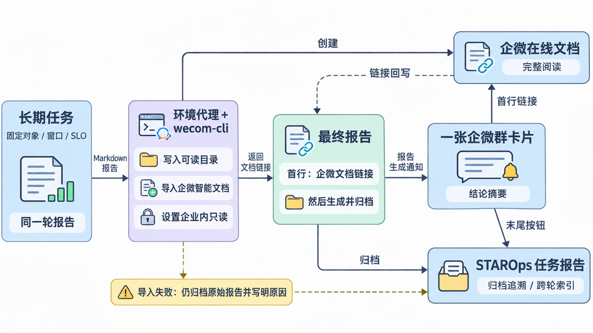
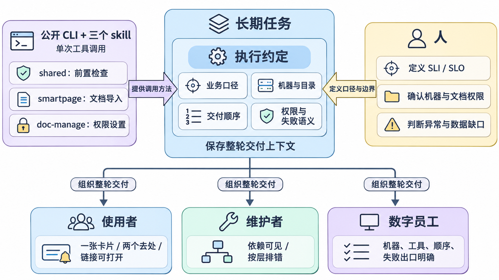
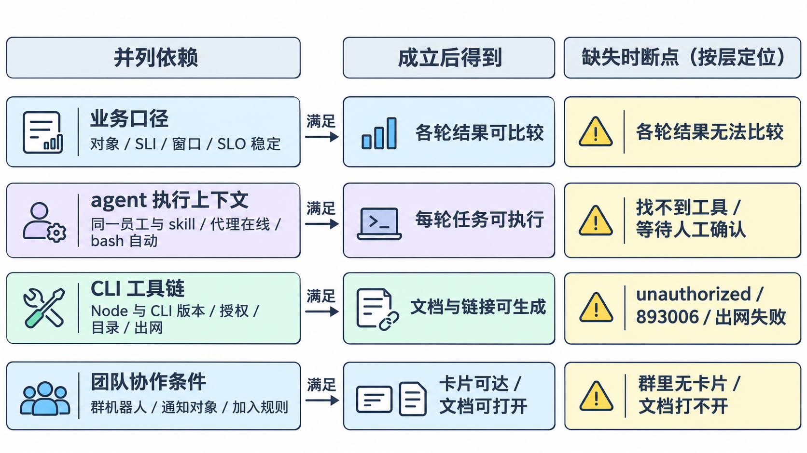
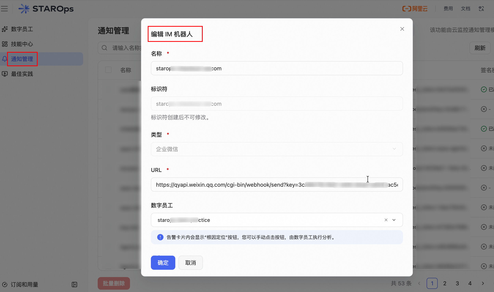
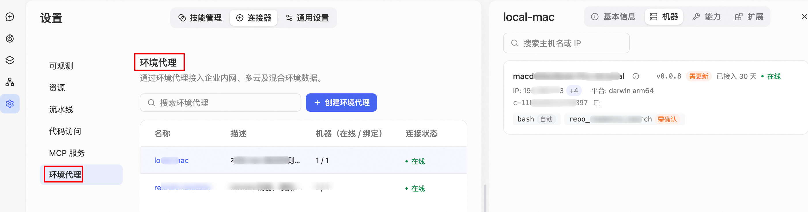
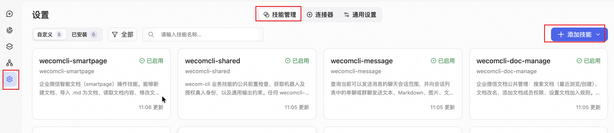
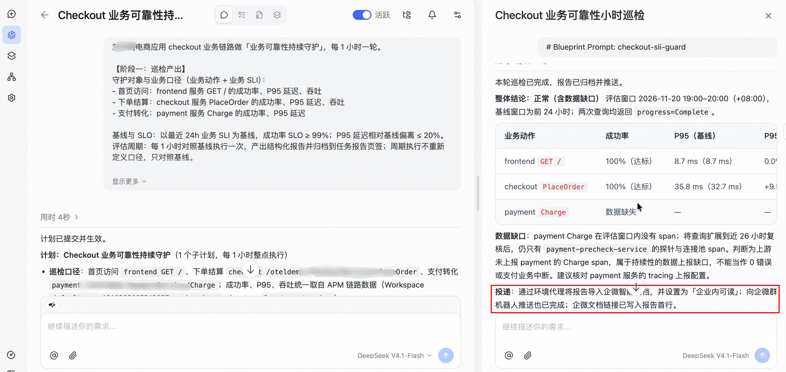
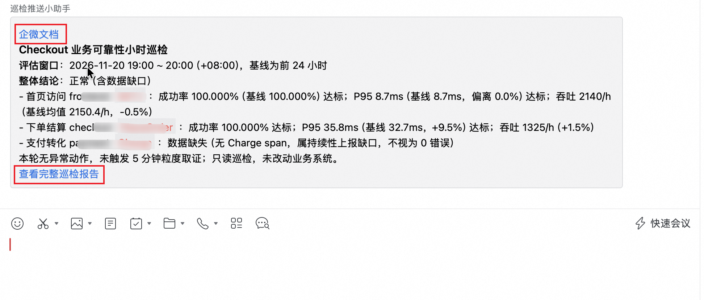
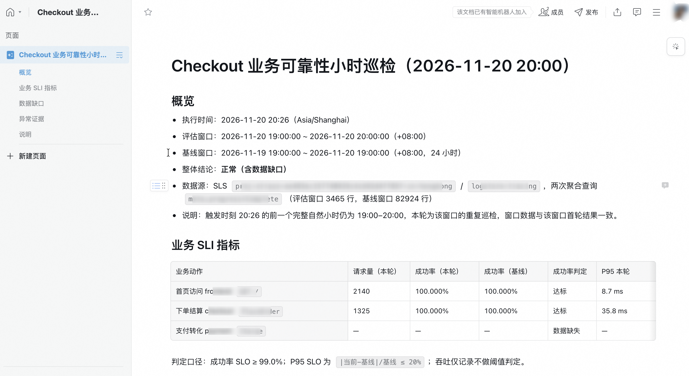

<div class="sls-starops-article-crumb">
  <a href="/doc/starops/starops.html">STAROps</a> <span class="sep">/</span> <span>集成扩展</span>
</div>

# 将巡检报告交付至企微文档

<div class="sls-starops-article-meta">
  <span>分类 · 集成扩展</span>
</div>

长期任务每小时完成一次巡检，报告也按时出现在 STAROps 中，自动化看似已经走完。团队如果习惯在企微文档里阅读运维信息，常见做法仍是下载报告、上传文档，再把链接发进群。这里要解决的问题来自这种分工：任务负责生成，人负责搬运。报告频率越高，中转次数越多；任务页、下载目录和群消息也可能各自留下副本。

问题不在于缺少一个导出按钮，而在于任务产物和人的协作过程没有接上。对数字员工来说，报告生成是一次执行的结果；对值班人员来说，它是判断的开始；对团队来说，它还要能被打开、阅读和追溯。三个需求如果靠人临时搬运来连接，长期任务只自动化了前半段。

**长期巡检需要一层任务级交付：同一轮结论由任务生成，链接回写后再归档，最后用一张群卡片把结果送到团队。** 卡片负责通知和摘要，并提供两个去处：企微文档用于完整阅读，STAROps 任务报告用于归档追溯。文档链接把任务产物与人的协作上下文连接起来。



下面的 checkout 小时巡检可以说明这层交付怎样工作。它的结论不是一句「正常」：首页和下单达标，支付转化却缺少数据。投递过程既要减少人的中转，也要原样保留这种区别，让接到报告的人知道下一步还需要判断什么。

## 报告生成以后，谁还要继续使用它

巡检关注系统状态，交付关注结果能否被人继续使用。前者需要稳定的检查对象、时间窗口和判定口径，后者需要明确的读者、入口和权限。把这两件事混在一起，容易出现一种情况：任务每轮都成功，团队却仍要花时间寻找、搬运和解释报告。

| 参与者 | 拿到结果后要做什么 | 需要怎样的产物 |
| --- | --- | --- |
| 值班人员 | 先判断本轮有没有需要处理的事，再决定是否深入 | 一张有结论和完整报告入口的群卡片 |
| 团队成员 | 阅读检查范围、指标表格、异常与数据缺口 | 权限合适、无需下载的企微在线文档 |
| 任务维护者 | 复查任务执行、投递状态和原始报告 | STAROps 任务记录与归档报告 |
| 数字员工 | 每轮按相同方式转换、回写和报告失败 | 明确的机器、工具、顺序、权限与失败约定 |

报告散落也不一定意味着没有集中存储。即使所有文件都在，缺少同一轮任务的标识和链接，读者仍然要在多份内容之间自行对应。**可以有多个阅读入口，但结论必须来自同一轮任务，入口之间必须能够互相辨认。**

这也是人机协作需要划清的地方。数字员工适合承担每轮重复的格式转换、文档创建、权限设置、链接回写和通知；人负责定义巡检口径、授予合适权限，并判断异常或数据缺口意味着什么。自动化去掉的是搬运，不应抹平报告里的不确定性。

## 交付设计要同时照顾三种体验

### 使用者：收到消息，还要能打开和继续读

群卡片回答「本轮是否需要关注」，在线文档提供完整指标与判断依据，任务归档保留原始执行记录。卡片提供摘要和两个去处，读者可以先判断是否需要继续，再选择完整阅读或执行追溯，不必让任何一个产物承担所有工作。

入口数量也需要克制。同一次巡检如果既触发「报告生成」通知，又调用消息 skill 单独发送，群里就会出现两条语义相近的消息。卡片首行使用清晰的「企微文档」链接，末尾保留平台生成的「查看完整巡检报告」，读者才能区分团队阅读入口和任务归档入口。

权限同样属于使用者体验。文档已经生成但其他企业成员打不开，投递并没有完成；链接写得再醒目，也不能弥补加入规则缺失。

### 维护者：复用现有执行面，把依赖留在明处

这套做法没有为企微文档另建一套转换服务。维护者复用长期任务、环境代理、公开 `wecom-cli` 和三个自定义 skill：长期任务保存业务口径与交付顺序，环境代理提供机器执行通道，CLI 完成文档接口调用，skill 告诉数字员工怎样使用 CLI。

对开发和维护人员来说，复用现有执行面可以避免把每种报告出口都做成新的产品连接。巡检口径与交付步骤在任务里分开描述，维护者可以分别复审；出现失败时，也能沿机器、授权、路径、文档权限和通知对象分别定位。

代价同样需要显性化：一台长期在线的机器、一个持续有效的 CLI 授权、自动执行 `bash` 的操作系统权限，以及企业内文档的可见范围。把这些依赖藏起来，配置看起来更简单，长期运行却更难维护。

### 数字员工：把执行上下文和失败出口写清楚

对数字员工而言，「把报告发到企微」还不足以成为可重复执行的任务。它至少需要知道：在哪台环境代理机器上执行，报告写到哪个目录，使用哪些 skill，先导入还是先设权限，链接写到哪里，以及导入失败后还要不要生成原始报告。

这里的三个 skill 分别负责前置检查、文档导入和权限设置；整轮交付还需要决定这些调用按什么顺序发生、链接何时回写、失败后是否归档。长期任务跨越巡检、转换、归档和通知，适合保存这份执行约定。业务口径和交付步骤都留在任务里，数字员工不必每轮重新决定投递方式，维护者也能直接检查它拿到的上下文。这份约定要说清输入是什么，经过哪些交接，怎样算完成，哪里允许失败。

案例选择把文档开放为企业内只读，同时由人确认企业外权限；把 `bash` 设为自动，同时限制机器和操作系统账号。便利性来自减少每轮中转，边界来自这些明确授权。数字员工也拿到确定的路径和失败出口，不需要在每轮执行中猜测。



## 把交付顺序写进长期任务

这条链将同一轮报告依次交给下一个环节，每一步的产物都是后一步的输入：

| 顺序 | 执行动作 | 为什么必须在这里完成 |
| --- | --- | --- |
| 1. 巡检 | 按固定对象、窗口和 SLO 整理报告内容 | 后续环节只投递本轮结论，不重新发明检查口径 |
| 2. 落盘 | 通过环境代理，将 Markdown 写到 CLI 可读目录 | `smartpage import` 需要读取本地文件 |
| 3. 文档化 | 检查 CLI 与授权，导入智能文档，设置加入规则 | 同时取得文档链接和读者可用的访问权限 |
| 4. 回写与归档 | 将文档链接写入报告首行，再生成并归档正式报告 | 让最终报告带上团队阅读入口 |
| 5. 通知 | 由「报告生成」事件触发一次企微群通知 | 让卡片展示已经包含链接的最终内容 |

**链接先回写，报告再归档，是这个顺序的关键。** 案例卡片展示了最终报告正文；如果文档虽然创建成功，链接却没有进入最终报告，群里的读者仍然拿不到入口。

链接也随着报告进入逐轮保留的任务归档。轮次累积以后，维护者可以从某一轮归档回到当轮企微文档，任务报告页签因此还能承担跨轮索引；只在群里寻找历史链接，则要依赖消息是否还容易翻到。

每轮通过 `smartpage import` 新建一份智能文档，不更新既有汇总文档。企微文档承载同轮正文的阅读，STAROps 报告保留任务归档；投递时不另写一套结论。通知也只使用「报告生成」，不再调用 `wecomcli-message` 发送第二条消息。

失败语义同样属于顺序的一部分。文档导入失败时，任务仍应归档原始报告，并在首行写明失败原因。这样可以区分「巡检没有完成」和「巡检完成但外部投递失败」，也不会为了补上链接而丢掉本轮结果。

## 四条依赖决定它能不能长期运行

四条依赖是并列条件，不是先后步骤。每条分别支撑一种能力，也对应一类断点：



| 依赖 | 需要具备什么 | 缺失时实际断在哪里 |
| --- | --- | --- |
| 业务口径 | 稳定的巡检对象、SLI、时间窗口和 SLO | 报告仍在生成，但不同轮次无法比较，读者无法判断结果 |
| agent 执行上下文 | 同一数字员工关联 skill 并创建任务，环境代理在线，`bash` 自动执行 | 数字员工找不到工具，或每轮停在等待人工确认 |
| CLI 工具链 | Node.js >= 18、`wecom-cli` >= 1.2.1、执行用户已授权、可读目录和企微出网 | 报告无法转换成在线文档，或无法取得链接 |
| 团队协作条件 | 企微群机器人、任务通知对象、文档加入规则 | 群里收不到卡片，或者成员收到链接却打不开 |

环境代理当前需高级版或旗舰版并提交工单，数字员工地域支持北京或新加坡；可用范围、机器架构和开通要求以[《环境代理》](https://help.aliyun.com/zh/starops/user-guide/environmental-agent)为准。案例使用一台 Apple silicon macOS 机器，CLI 来自公开的 [WecomTeam/wecom-cli](https://github.com/WecomTeam/wecom-cli) 仓库。

其中三项权限不能只在第一次配置时看一眼：

- **CLI 授权跟着机器和执行用户走。** 凭证保存在执行用户的 `~/.config/wecom`。环境代理使用专用账号运行时，必须在这个账号下扫码；另一个桌面账号授权成功，不代表任务读得到凭证。
- **自动 `bash` 是定时执行的必要条件，也是权限边界。** 数字员工可以直接以该操作系统用户的权限执行命令，因此应使用权限受控的机器和账号，只开放所需能力、目录与出网范围。
- **企业内可读会扩大文档可见范围。** 本方案关闭成员加入确认，并将企业内成员通过链接加入文档的权限设为只读。企业外成员权限和报告内容是否适合该范围，需要由人确认。

创建环境代理时复制的安装命令还包含明文 Bind Token，只应在可信机器上执行，并按官方文档处理命令记录。

## 配置一次，让每轮沿同一路径交付

### 配置企微群通知对象

在目标企微群添加群机器人并复制 Webhook。进入 STAROps「通知管理 → IM 机器人」，新建类型为「企业微信」的机器人，URL 填入该 Webhook。名称会显示为群里的发送方，例如「巡检推送小助手」。



弹窗里的「数字员工」用于告警卡片上的根因定位，与报告投递无关。保存后，通知对象列表里应出现这条机器人；后面还要把它添加到长期任务的通知对象中。通知机制的通用说明见[《消息中心与通知配置》](https://help.aliyun.com/zh/starops/user-guide/message-center-and-notification-configuration)。

### 准备代理机器与 CLI

按[《环境代理》](https://help.aliyun.com/zh/starops/user-guide/environmental-agent)安装并绑定代理，开启 `bash` 能力，将执行方式设为自动。机器在线、已经绑定且 `bash` 显示为「自动」后，再安装 CLI：



```bash
npm install -g @wecom/cli
wecom-cli --version
wecom-cli auth init
wecom-cli auth show --status
```

`auth init` 会给出扫码授权入口，用企业微信完成授权；最后一条命令应返回 `authorized`。这些命令要在环境代理实际使用的操作系统账号下执行。

本案例在 macOS 上将报告写入 `/private/tmp`，Linux 示例使用 `/tmp`，没有使用桌面或下载目录。若导入返回 `PermissionError 893006`，先检查文件是否位于当前 CLI 允许读取的目录；这个错误与授权状态是两件事。

### 关联三个必需的自定义 skill

从 `wecom-cli` 仓库的 `skills/` 目录取得下列 skill：

| skill | 在投递链中的职责 |
| --- | --- |
| `wecomcli-shared` | 检查 CLI 安装、版本和授权状态 |
| `wecomcli-smartpage` | 将 Markdown 导入企微智能文档并返回链接 |
| `wecomcli-doc-manage` | 设置文档加入规则与成员权限 |

在「设置 → 技能管理 → 自定义 → 添加技能」中完整上传各 skill 目录，包括 `SKILL.md` 和所需的 `references/`、`scripts/`。上传后进入「使用范围」，将它们关联到执行巡检的数字员工并启用；自定义 skill 不需要再安装。通用操作见[《技能中心》](https://help.aliyun.com/zh/starops/user-guide/skill-center)。



截图同时上传了 `wecomcli-message`，用于需要单独发消息的其他场景；本方案不调用它。

### 创建长期任务并写入交付约定

按[《创建与规划长期任务》](https://help.aliyun.com/zh/starops/user-guide/creating-and-planning-long-term-mission)，在关联这些 skill 的同一个数字员工下创建任务，并把企微机器人加入通知对象。调试时使用控制台的「立即执行」，不需要通过 IM 对话驱动。

下面是一份完整任务描述。已有巡检任务可保留阶段一，只追加阶段二、三；「代理机器」要替换成真实的环境代理名称，路径按操作系统选择上面的临时目录。巡检对象和阈值来自本案例，使用时应替换为自己的业务口径。

```text
对示例电商应用 checkout 业务链路做业务可靠性持续守护，每 1 小时一轮。

【阶段一：巡检产出】
- 守护对象：首页访问 frontend GET / 和下单结算 checkout PlaceOrder，分别检查成功率、P95 延迟和吞吐；支付转化 payment Charge 检查成功率和 P95 延迟。
- 基线与 SLO：以最近 24 小时业务 SLI 为基线，成功率不低于 99%，P95 相对基线偏离不超过 20%。
- 每小时对照同一口径整理结构化报告内容；吞吐只记录，不设阈值。

【阶段二：报告转换】
以下动作全部由本任务通过名为「代理机器」的环境代理执行，不需要人下载或中转：
1. 将本轮报告写入该机器上 wecom-cli 可导入的目录；macOS 写为 /private/tmp/report-<执行时间>.md，Linux 写为 /tmp/report-<执行时间>.md。
2. 按 skill wecomcli-shared 检查 CLI 与授权，再按 wecomcli-smartpage 将 Markdown 报告导入企微智能文档。
3. 按 wecomcli-doc-manage 关闭成员加入确认，并将企业内成员通过链接加入文档的权限设为只读，不逐个添加成员。
4. 获取文档链接后，在报告正文第一行只写一行 Markdown 链接：[企微文档](<文档链接>)。不要裸贴 URL，不要添加其他前缀；然后生成正式报告并归档到任务报告页签。
5. 如果导入失败，仍生成并归档报告，第一行写明「企微文档导入失败：<原因>」，不要虚构文档链接。

【阶段三：推送】
只使用本任务的「报告生成」通知，推送对象是通知管理中已配置的企微群机器人。不要调用 wecomcli-message 再发一条消息，也不需要 IM 里的数字员工交互。
```

成功率 99% 和 P95 偏离 20% 只用于这个 checkout 示例，不是其他业务的通用阈值。任务的规划方法可参考[《长期任务快速入门》](https://help.aliyun.com/zh/starops/getting-started/quick-start-for-long-term-tasks/)，报告归档入口见[《产物与报告管理》](https://help.aliyun.com/zh/starops/user-guide/product-and-report-management)。

## 一轮 checkout 巡检怎样抵达团队

2026 年 11 月 20 日的这轮任务评估了 19:00–20:00 的业务数据，并与前 24 小时基线比较：

| 业务动作 | 成功率 | P95 与基线 | 判定 |
| --- | --- | --- | --- |
| 首页访问 `frontend GET /` | 100% | 8.7 ms，基线 8.7 ms | 达标 |
| 下单结算 `checkout PlaceOrder` | 100% | 35.8 ms，基线 32.7 ms，偏离 +9.5% | 达标 |
| 支付转化 `payment Charge` | 数据缺失 | 数据缺失 | 需要核对 Trace 上报 |

整体结论是「正常（含数据缺口）」。`payment Charge` 在评估窗口内没有对应 span，报告因此保留数据缺口，没有把它写成零错误，也没有据此断言支付中断。这个细节也划出了数字员工与人的分工：投递可以自动完成，数据缺口意味着什么仍需要人继续判断。



任务结果末尾记录了后续动作：通过环境代理导入企微智能文档、设置企业内可读、写回文档链接并推送群机器人。原始报告仍归档在 STAROps 中，投递没有改写本轮检查结论。

企微群里收到一张报告卡片。首行「企微文档」是可点击链接，下面保留评估窗口、整体结论和各业务动作摘要；末尾「查看完整巡检报告」继续通向任务报告页签。值班人员可以先读摘要，再决定打开哪个入口，不需要从几条重复消息中辨认哪条才是最终报告。



打开首行链接后，团队可以看到同轮巡检的企微智能文档。标题、章节、判定口径和指标表格都保留下来，支付转化的数据缺口也仍然可见。



## 长期运行时，人仍然负责什么

交付链自动运行以后，人不再承担逐轮搬运，但仍有三项工作不能交出去：根据业务变化复审巡检对象和阈值；根据团队范围管理机器与文档权限；处理报告中的异常、数据缺口和投递失败。长期任务保存的是执行约定，不会替团队决定这些判断。

故障定位也可以沿四条依赖展开，不必笼统地重跑整个任务：

| 现象 | 先检查什么 |
| --- | --- |
| 群里没有卡片 | 通知对象是否已添加到任务，Webhook 是否有效且机器人仍在群里 |
| 卡片里没有「企微文档」链接 | 导入是否成功，链接是否写入最终报告首行，是否使用 Markdown 链接而不是裸 URL |
| CLI 返回 `unauthorized` | 是否在环境代理的执行用户和同一台机器下完成授权 |
| 返回 `PermissionError 893006` | 文件是否位于当前 CLI 允许读取的目录；案例中使用 `/private/tmp` |
| 导入出现解析错误 | 报告是否为纯 Markdown；内嵌 HTML 需移除，本地图片需先上传或改为可访问的外链 |
| 其他企业成员打不开文档 | 是否关闭成员加入确认并将企业内加入权限设为只读，企业外成员权限是否符合团队范围 |
| 任务停在等待执行 | `bash` 是否仍为人工确认，长期任务需要改为自动执行 |
| 数字员工提示没有执行能力 | 环境代理是否在线、是否绑定，以及机器是否声明了 `bash` |
| CLI 连接被重置或无法出网 | 代理机器到企微接口的网络与应用程序放行策略 |

企微群机器人消息有长度限制，长文应留在智能文档中，卡片保留结论和链接。如果使用 Pod 运行环境代理，还要处理凭证与报告目录的持久化；重建后本地授权和临时文件可能丢失，不能只恢复 CLI 安装。

## 从一轮跑通到长期使用

这轮 checkout 巡检最后留下了三种相互关联的产物：群里的一张卡片、可以完整阅读的企微文档，以及保留原始结果和文档链接的任务归档。三处都保留了支付转化的数据缺口。案例证明的是任务能够把交接做完，并没有证明数字员工可以替人判断业务。

将这套结构用于其他长期任务时，先选择一个报告口径已经稳定的任务追加交付约定。第一轮验收不能只看群里有没有消息，还要核对：最终报告是否带着文档链接，目标读者是否能打开文档，卡片是否只有一张且两个链接各到其处，导入失败时原始报告是否仍会归档并写明原因。

首轮跑通以后，维护工作分成两侧。业务变化时复审巡检对象、时间窗口和阈值；投递异常时沿业务口径、agent 执行上下文、CLI 工具链和团队协作条件定位，不必笼统地重跑整个任务。轮次累积后，还要抽查归档里的文档链接是否仍然可用，让跨轮索引不止停留在配置里。

**报告内容形成，意味着数字员工完成了检查；链接回写、权限设置、归档与通知完成，团队才拿到可以开始判断的结果。** 把重复交接交给任务，把口径、权限和异常判断留给人，长期巡检才会持续产生团队能使用的结果，而不只是持续增加报告数量。

## 相关入口

- [返回 STAROps 最佳实践首页](/starops/starops.html)
- [打开 STAROps Playground](/playground/staropsdemo.html)
- [进入 STAROps 控制台](https://starops.console.aliyun.com)

<style>
.sls-starops-article .vp-doc details {
  margin: 12px 0;
}

.sls-starops-article .vp-doc details > summary {
  font-size: 14px;
  line-height: 1.6;
}

.sls-starops-article .vp-doc img {
  display: block;
  width: 100%;
  max-width: 640px;
  aspect-ratio: 16 / 9;
  object-fit: contain;
  margin: 10px auto 2px;
  background: #f7f9fc;
  border: 1px solid var(--sls-starops-border, #e6ebf3);
  border-radius: 10px;
  box-shadow: none;
}

.sls-starops-article .vp-doc p {
  line-height: 1.85;
  margin: 14px 0;
}

.sls-starops-article .vp-doc h2 {
  margin-top: 36px;
}
</style>
