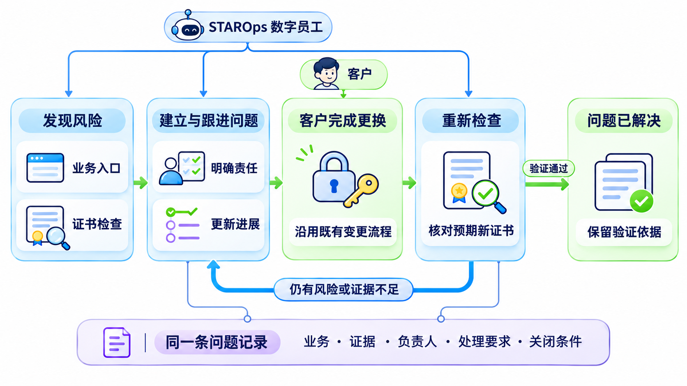
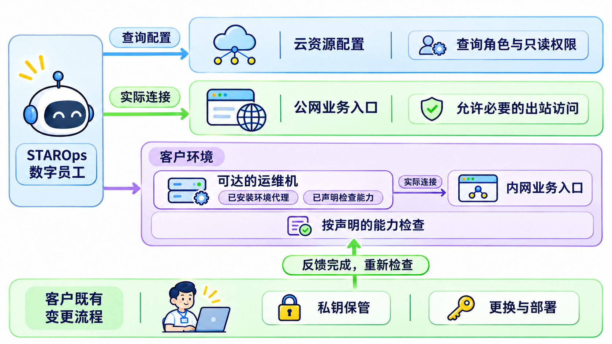
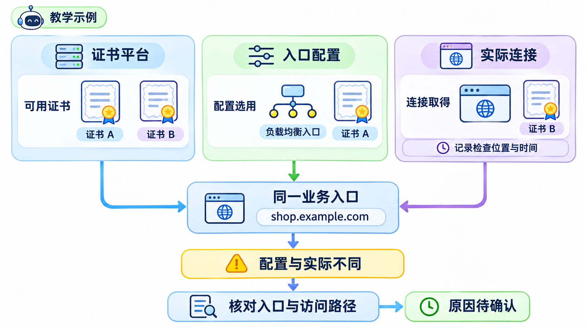
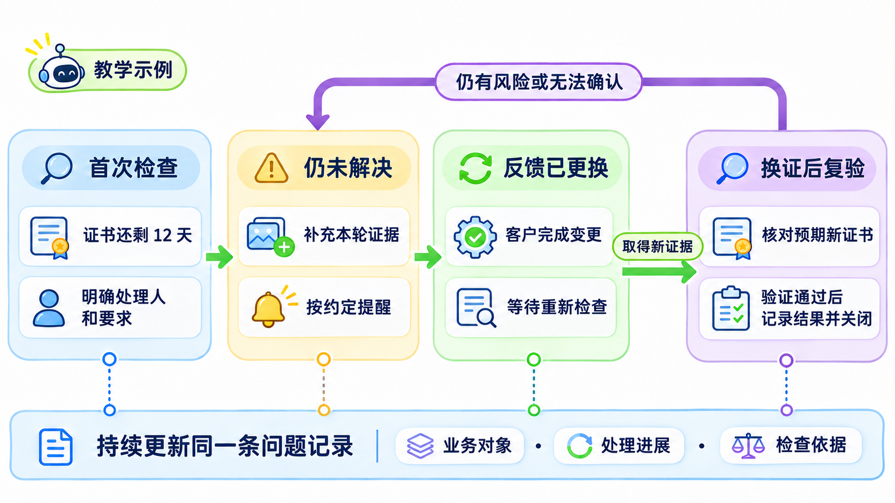

  <a href="/doc/starops/starops.html">STAROps</a> / 场景能力

# 使用 STAROps 推进业务证书问题闭环

  分类 · 场景能力

收到证书到期提醒后，运维人员还要完成一连串工作：查清哪些业务在用这张证书，找到负责人，安排续期和更换，再确认变更已经生效。证书分散在负载均衡、CDN 和自有服务器上时，证书平台里的记录、业务资源的配置和实际访问结果还可能不一致。新证书已经签发，业务仍在使用旧证书，这件事就还没有结束。

要把证书风险处理完，需要让这些工作持续接得上。谁在处理、还缺什么条件、是否到了需要再次提醒的时间，以及更换后取得了什么检查结果，都应留在同一项问题里。接手的人据此继续推进，直到有证据确认原来的风险已经消除。

本实践介绍一种分工：**STAROps 的数字员工负责检查、整理问题、持续跟进和复验，客户通过既有的人工或自动化流程完成证书更换。** 问题从发现到关闭始终有记录，换证所需的私钥和生产变更权限保留在客户既有流程中。

本文以团队**自行配置的检查能力**为前提：用 Skill 或脚本声明只读检查，经环境代理或已放行的公网路径读取公开证书文件与业务入口返回的证书，向会话只返回域名、有效期、指纹和验证结果。Skill 的编写与管理见[技能管理](https://help.aliyun.com/zh/starops/user-guide/skills-management)。使用前，需要确认目标数字员工已配置相应能力、该能力的获取方式和可检查来源；云资源授权与网络连通是后续检查条件，不能替代专项能力的接入。下文介绍已配置环境中的推荐做法，提问和报告片段为教学示例。

## 先选一组能够查清的业务

第一次使用时，可以从一个账号、一个地域中的一组关键业务开始。范围小一些，便于先核对发现的入口是否正确、检查结果能否解释，以及还需要补齐哪些条件。例如，在目标数字员工会话中提出：

> 帮我检查生产账号杭州地域的负载均衡证书，先查一次。告诉我哪些需要处理，哪些还没查清。

如果只关心一个网站，也可以直接提供业务地址，不必先整理它使用的全部云资源。数字员工从该入口取得证书；需要核对配置或查找归属时，再补查相关资源。对于内网系统或主机证书，则需要明确允许检查的业务、主机或公开证书文件范围。

检查前，要分别准备**读取配置的权限**和**访问业务入口的路径**。云产品的角色权限让数字员工查看资源与证书配置，具体接入方式见[接入阿里云资源](https://help.aliyun.com/zh/starops/user-guide/access-alibaba-cloud-resources)。证书平台的查询也有两个容易踩的坑：库存接口是全局接口，带地域参数会被拒绝；默认查询只返回有效与临近过期的证书，已过期证书要按过期状态单独查询，否则清单里永远看不到它们。公网入口需要在数字员工的[网络配置](https://help.aliyun.com/zh/starops/user-guide/sandbox-network-policy-configuration)中放行必要的目标域名或 IP。内网入口可以通过[环境代理](https://help.aliyun.com/zh/starops/user-guide/environmental-agent)，从能够访问目标业务的运维机检查；其开通、订阅版本和地域条件以该文档为准。

这些条件需要用实际结果核对：先读到一项所选资源的配置，再从准备好的位置检查一个业务入口。环境代理在线，只说明机器已经接入；是否能访问目标网段，仍要从该机器验证。暂时访问不到的业务保留在未完成清单里，能独立检查的部分先继续。

接入时还要把取证范围限定好。公开证书会在 TLS 连接中出示给客户端，私钥则必须严格保密，二者的用途见[公钥、私钥与证书说明](https://help.aliyun.com/zh/ssl-certificate/what-are-a-public-key-and-a-private-key)。**证书检查不需要客户提供私钥。** 应选择不返回私钥的查询方式，只开放指定的公开证书文件；采集时优先在客户环境解析，向会话返回域名、有效期、指纹和验证结果等必要信息。不要为取得证书而读取包含密钥的完整凭据对象或证书包。

## 查清业务实际使用的是哪张证书

接通数据以后，首先要弄清一个问题：读到的证书，是否就是这项业务正在使用的证书。

证书平台说明有哪些证书、何时到期，但一张证书可能尚未部署，也可能被多个入口共用。负载均衡监听、CDN 域名或服务器配置进一步说明某个位置选用了哪张证书；真正连接业务入口时，取得的则是该次访问实际收到的证书。这三处信息回答的问题不同，需要对应到同一项业务后才能比较。

数字员工可以从业务域名和端口开始，核对关联的资源配置，再以可比较的证书标识确认是否为同一张证书。**证书指纹**是识别证书的摘要，可用于比较配置与连接取得的证书；名称相同本身不足以证明是同一张。不同来源的指纹算法与写法可能不同（SHA-1 与 SHA-256、裸十六进制与带冒号大写），比较前先统一，否则会把同一张证书误判为不同。例如，配置层记录的是裸十六进制，实际连接取得的是带冒号大写，归一化之前会被当成两张证书，其实只是同一个 SHA-256 的两种写法。检查记录还应保留访问名称、检查位置和采集时间，使后续复验知道应当回到哪里检查。

例如，配置选用证书 A，连接时却取得证书 B，接下来要核对访问的域名、流量经过的代理和实际到达的资源。前置网关、不同的访问路径或另一组服务器，都可能影响这次取得的证书。确认观测位置之前，不能直接把差异归因为证书部署失败，更不能把网关的证书当成目标业务的证书。

证书对应关系明确以后，再检查有效期、是否匹配访问名称，以及能否按该业务认可的信任规则通过验证。使用私有 CA 的内部系统，需要采用团队认可的信任依据。若只有配置证据，就说明配置中存在什么风险、入口验证还缺什么；实际连接未完成，不能据此确认业务已经故障，也不能认定业务正常。

## 把检查结果变成可以推进的问题

检查报告应帮助运维人员安排工作。一项结果需要说清业务对象、观测依据、风险或未确定之处，以及下一步由谁处理。下面两条是教学示例，用于说明已有证据怎样影响行动；实际报告还应附上采集时间和可复核的证据入口。

| 业务对象 | 本轮取得的依据 | 可以作出的判断 | 下一步 |
| --- | --- | --- | --- |
| 网站 A 的 HTTPS 入口 | 从确认过的公网检查位置取得在用证书，距离到期还有 12 天 | 已确认在用证书临近到期，需要安排处理 | 业务负责人确认续期与部署安排，在到期前预留变更和复验时间 |
| 内网业务 B 的入口 | 配置中的证书已过期 3 天，尚未取得实际连接证据 | 存在需要优先核实的过期配置，业务实际使用状态尚不确定 | 环境维护人补齐内网检查路径，再由业务负责人根据结果安排更换或其他处理 |

这两项都值得关注，但推进的起点不同。第一项已经有在用证据，可以进入续期和更换安排；第二项应先补齐观测条件。把尚未查清的部分写出来，负责人才能知道现在需要换证，还是需要先找能检查这项业务的人。

对于需要持续处理的事项，可以使用数字员工的**问题发现（Finding）**保存业务对象、证据和处理要求，并为处理项明确负责人及验证条件，具体用法见[问题发现](https://help.aliyun.com/zh/starops/user-guide/findings)。产出问题发现有三个前置：任务目标或会话指令里显式写明问题发现要求，运行时角色含问题发现写权限，数字员工设置里的开启问题发现开关已启用并点确定保存。报告概览本轮情况，问题记录则保留一项问题从发现到结束的经过。

建立问题时，就应说明怎样才算解决。例如，在用证书临近到期的问题，需要完成更换，并在原业务入口确认预期的新证书、有效期、访问名称和信任检查符合要求。对于尚未取得入口证据的事项，首先要补齐该项检查，才能进一步判断是否存在证书风险。**更换要求和关闭条件一开始就写清，处理人才能交付可核验的结果。**

负责人和处理期限沿用团队已有分工。某类域名由业务维护，另一类由运维负责，这些约定可以交给数字员工整理；没有明确责任人的，先列为需要协调的事项。建议完成时间应考虑申请证书、审批、变更窗口和复验所需的时间，由团队确认，不能简单把证书到期日当成处理截止时间。

### 一组业务的首轮检查

一次巡检的范围是一个账号、一个地域，来源覆盖证书平台库存、传统型与应用型负载均衡、CDN、DNS、主机证书文件和公网入口。首轮得到的不是一份"正常/异常"清单，而是几类起点不同的事项：

| 业务对象 | 本轮取得的依据 | 可以作出的判断 | 下一步 |
| --- | --- | --- | --- |
| 库存中的一张证书 | 已过期，且仍挂在负载均衡监听上 | 过期证书仍在生效位置，需要优先处理 | 业务负责人安排更换并从监听摘除，处理后回到同一入口复验 |
| 内网负载均衡入口 | 没有可用探测路径，绑定层配置已读到 | 配置结论保留，实际使用状态待补查 | 环境维护人补齐探测路径，再判断是否需要换证 |
| 全站加速 | 服务未开通 | 记为未开通，不写成没有域名 | 需要覆盖该来源时再开通 |
| 公网入口证书 | 配置层是裸十六进制，实际连接取得带冒号大写 | 归一化后为同一个 SHA-256，不是两张证书 | 比较前统一算法与写法 |
| 远程主机证书文件 | 经环境代理读到自签证书 | 内部系统按团队认可的信任依据判定 | 明确信任规则后纳入周期检查 |

已过期仍挂监听和需要补查的入口，在同一轮里并存；未开通与没有域名分开记，读者才知道是覆盖问题还是资产问题。这些行同时保留查到了什么和还缺什么，负责人按起点分派即可。

问题记录按同一套字段承接这些事项。以下按实际记录的结构给出示例：业务对象与入口、证据（证书标识、有效期、采集时间、读取通道）、负责人、处理要求、验证条件（回到原范围重新取证，核对新证书有效期、访问名称与信任结果）、状态变化（首次建立为待处理，复验通过后按已解决关闭，记录版本随之递增）。后续每轮检查更新同一份记录的证据与进展，而不是另起一条。

## 让未解决的问题在下一轮继续推进

第一轮核对好范围和结果后，可以在目标数字员工的**长期任务**中安排持续检查。例如：

> 每天北京时间上午九点检查这批业务。30 天内到期的汇总给运维值班，7 天内仍未处理的单独提醒。已经发现的问题继续跟进，换证后再检查结果。

这里的 30 天和 7 天是教学策略。提前多少天进入处理，应当留足团队实际需要的时间；什么时候汇总、什么时候单独提醒，再结合业务重要性和值班安排确定。团队已有自动续期时，也要明确谁负责核实续期及部署结果，数字员工继续检查业务实际使用的证书。

在控制台进入目标数字员工的长期任务，描述目标并确认计划，操作入口见[创建与规划长期任务](https://help.aliyun.com/zh/starops/user-guide/creating-and-planning-long-term-mission)。保存时核对检查范围、执行时间和时区、真实接收人及通知渠道；保存后核对计划是否启用，按需要查看首轮执行结果。内网采集如果仍需逐次人工确认，也要把人工参与安排在执行计划中。

**持续推进体现在同一项问题如何变化。** 沿用前面的教学示例，网站 A 尚未完成更换时，后续检查应更新剩余时间和最新证据，处理进展继续留在原记录里；到达团队约定的提醒条件时，再根据通知安排推进。重复检查帮助确认风险仍然存在，无需让负责人重新理解一份互不关联的待办。

同样，某一轮因为权限或网络变化无法检查，应记录受影响的业务、原因和补查要求，保留此前问题的处理状态。失去观测能力不能作为风险消失的依据。负责人补齐条件后，再从原范围继续检查。

执行与通知也要分别核对。一份报告已经生成，不代表提醒已经送达；通知失败或发送结果未知时，需要把接收对象和受阻原因留给维护人处理。投入日常使用前，先核对首轮检查、问题更新和通知结果，再观察后续轮次能否按约定继续。检查频率决定何时发现新情况，每日检查的安排本身不提供两次执行之间的实时发现。

## 客户完成更换后，以新证据确认关闭

证书申请、签发和部署由客户既有流程完成。这使私钥管理和生产变更继续受团队原有权限与审批约束，数字员工则在变更前后保留检查依据。完成更换后，可以回到原问题或会话中提出：

> 这张证书已经换好了，帮我确认原来这些业务入口是否用上了预期的新证书。

复验应回到**原来受影响的业务范围**，重新取得证据，核对预期新证书是否已生效、是否处于有效期内、是否匹配访问名称，以及是否满足该业务的信任要求。检查位置也要能够说明目标业务的状态；不能用证书平台新增一张证书或服务器文件已更新，代替业务入口的验证。

一张证书关联多个入口时，需要覆盖原问题涉及的入口，才能将该问题按已解决关闭。仍有入口返回旧证书，就保留对应证据并继续核对部署、访问路径或服务加载情况；暂时无法检查的部分继续跟进。**客户反馈完成提供了复验的起点，新一轮检查结果提供了按已解决关闭的依据。**

关闭也不等于检查结束。新换的证书本身仍要过同样的检查：有效期是否超过规范上限、是否匹配访问名称、是否满足信任要求。新发现的问题进入同一跟进流程，而不是重新打开已经关闭的那一项。

这样，每一次交接都留下具体内容：运维人员接到的是需要处理的业务与要求，完成变更后，数字员工回到同一范围验证，关闭记录中保留检查结果。后续再查这项问题时，可以看清它为什么被发现、怎样处理，以及为什么能够结束跟踪。

## 把证书风险跟到关闭，才算处理完

证书到期提醒只说明时间到了，不说明风险已经处理完。决定这项工作是否结束的，是三个时刻都有证据：发现时知道业务实际在用哪张证书，处理时同一项问题留着责任与要求，换证后回到原入口确认新证书已经生效。任何一环缺证据，风险就只是被提醒过，不是被处理掉。

这套做法里，数字员工承担检查、整理问题、持续跟进和复验，证书申请、签发与部署仍由客户既有流程完成。私钥管理和生产变更权限留在团队原有边界内，换证动作也不需要交给平台。

起步可以从一个账号、一个地域的一组关键业务开始：先备好读取权限与入口路径，用一次检查核对证书记录、资源配置和实际连接是否对得上；把结果写成有负责人和关闭条件的问题；再用长期任务让同一项问题逐轮更新。范围小一些，先确认查到的是正确业务、报告能够解释、关闭有依据，再逐步扩大入口与来源。

