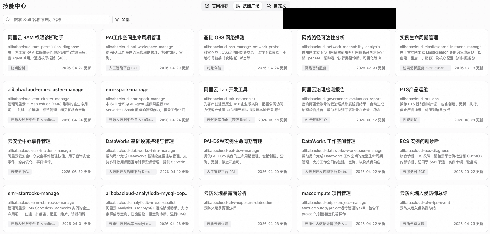
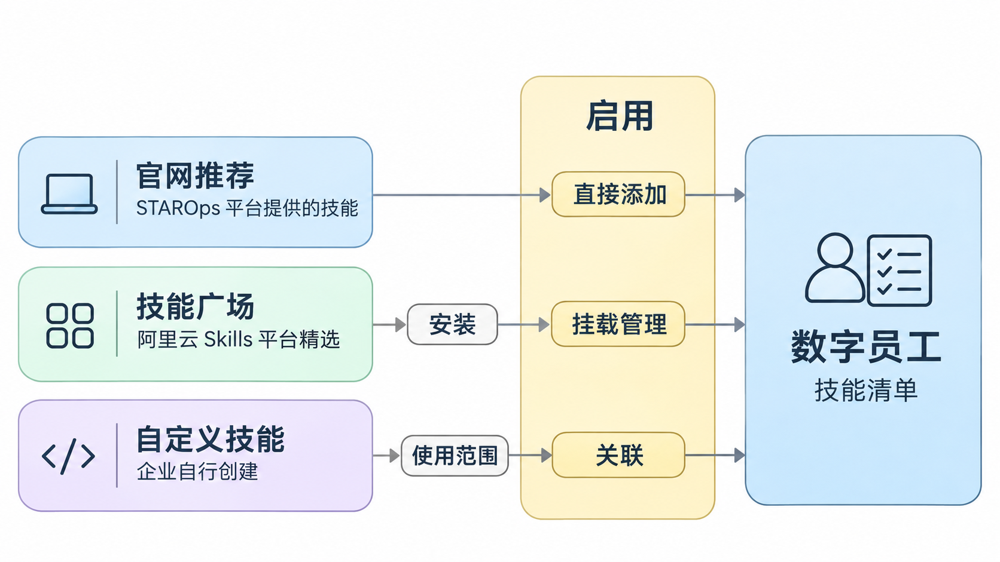
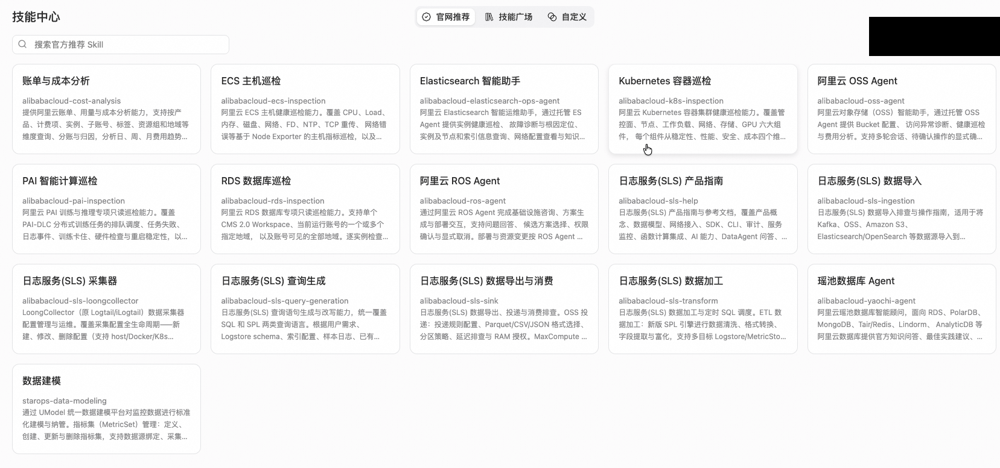
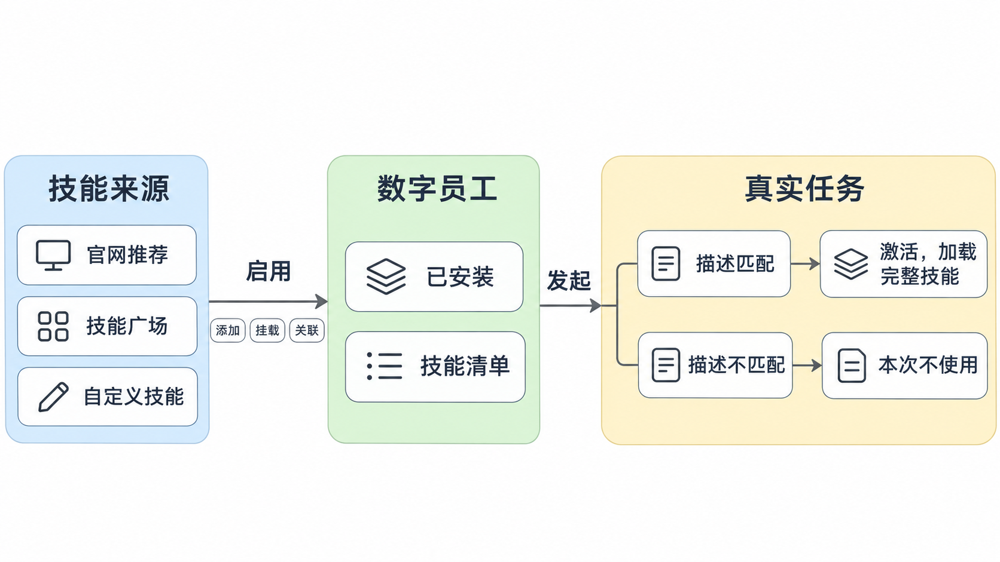

  <a href="/doc/starops/starops.html">STAROps</a> / 持续优化

# 技能中心选型与场景包启用

  分类 · 持续优化

**给数字员工装技能，先定它负责什么，再决定从哪里拿、怎么启用。** 数字员工从一个变成多个以后，能力授权就不再是随手装的事：每个员工能调用哪些技能，划定了它的职责边界，也决定每一次任务触发是否在授权范围之内。技能越装越多、职责重叠、授权边界模糊，是数字员工多了以后最常见的问题——同一个场景几个员工都能触发，该有的能力没装上，不该有的装上了。

## 三个来源，三种启用方式

技能中心把三种来源放在同一个入口，它们的定位和添加方式并不一样：

| 来源 | 是什么 | 怎么用到员工身上 |
| --- | --- | --- |
| 官网推荐 | STAROps 平台提供的技能 | 单击技能卡片，直接选择数字员工添加 |
| 技能广场 | 阿里云 Skills 平台的精选技能 | 先安装，再在「挂载管理」里挂到数字员工 |
| 自定义技能 | 企业自行创建，封装团队自己的运维经验 | 无需安装，创建后在「使用范围」里关联员工 |

三种来源最终都会进入数字员工的技能清单，但入口和状态不同，验收时看的位置也不同。技能中心是主账号级的入口：自定义技能创建后对主账号下所有用户可见，可被主账号下的数字员工挂载使用。各页签的完整操作见[《技能中心》](https://help.aliyun.com/zh/starops/user-guide/skill-center/)。

## 先定职责边界，再决定从哪拿

用一名值班数字员工走一遍。它负责 Kubernetes 集群的日常健康巡检与报告产出，动作限于只读取证和报告生成，不含变更。这个边界来自组织分工，不来自技能清单。边界不清就先看技能，后面每一笔授权都是技术债：同一个场景几个员工都能触发，出了问题不知道找谁。

边界定下来，来源选择才有依据：

- **平台已有的先看官网推荐和技能广场。** 官网推荐按单个技能组织，一个场景一张卡片；技能广场是阿里云 Skills 平台的精选技能。看得到合适的能力，直接加给这名员工，比自己写省事，也能跟着平台更新。
- **团队自己的口径和脚本，才进自定义技能。** 指标名称、判定阈值、报告格式这类只有团队才知道的内容，官方技能覆盖不了，值得自己写。

反向边界同样重要：用自定义技能复刻官方已有能力属于选型失误，维护成本由使用团队承担；把本该用官方技能的场景写成自定义技能，会失去官方技能的持续更新。

## 三种启用方式，操作和边界各不相同

### 官网推荐：直接添加

在官网推荐页签找到技能卡片，单击后选择数字员工，添加完成。没有安装步骤，也不需要在员工侧再做一次授权。值班员工的 K8s 巡检就走这条路：在卡片列表里找到 Kubernetes 容器巡检，添加给这名员工。添加后技能进入员工的技能清单，运行环境同步需要几分钟，刚添加完的会话可能还识别不到。

### 技能广场：先安装，再挂载

技能广场的技能要先安装，再到「挂载管理」里选择数字员工挂载。技能详情页可以查看技能内容、所需权限和版本对比；挂载完成后，到员工侧技能管理确认它已出现。挂载只是建立关联，随时可以在挂载管理里取消。

### 自定义技能：用「使用范围」关联

自定义技能不需要安装。在「自定义」页签新建技能，填技能名称、显示名称、描述和技能设计。技能设计用 Markdown 编写，可以带 `references/` 与 `scripts/` 目录，也可以上传本地文件。保存后进入详情页的「使用范围」，选择数字员工添加；之后可以按员工启用、禁用或移除，移除只解除关联，不删除技能本身。

自定义技能有两个边界要提前知道：**创建后对主账号下所有用户可见、可被挂载使用**，创建前要确认内容经过安全审查；草稿版本只对打开了「使用草稿」的员工生效，测试通过后再发布为正式版本。

技能中心与员工侧的准入不同：技能中心需要技能中心管理权限（浏览、搜索、安装、创建技能）；员工侧的技能管理要求目标是自建数字员工（系统内置员工不支持）、账号具备 `cms:CreateDigitalEmployeeSkill` 权限、套餐在专业版及以上。版本门槛见[《订阅套餐说明》](https://help.aliyun.com/zh/starops/product-overview/subscription-plan-description/)，员工侧操作见[《技能管理》](https://help.aliyun.com/zh/starops/user-guide/skills-management/)。

## 验收：员工侧能看到，真实任务能用上

添加完成不等于验收完成。检查两件事：

1. **员工侧技能管理里能看到这条技能。** 三种来源最终都会落到员工的技能清单，这里能看到，说明关联已经建立。
2. **一次真实任务用到了它。** 提一个这项工作本来就要问的请求，看回答里有没有这条技能参与的过程和结果。技能是否被激活，取决于任务描述和技能描述是否匹配：数字员工启动时只加载每个技能的名称和描述，任务匹配后才加载完整内容，所以技能描述写得准不准，直接影响它会不会被选中。添加或挂载只是让技能进入员工的技能清单，不保证每次都被用上。

两处对不上时，先看运行环境是否已同步——刚添加的技能需要几分钟——再核对员工清单里是不是这条技能。验收以真实任务的结果为准，不以配置页面上的开关状态为准。

变更类技能的授权、审批和回滚不在本文范围，需要另行核对。

## 总结

选型先回答三个问题：这名员工负责什么，现有来源里谁能覆盖，启用之后怎么证明它真的被用上。边界先于数量，来源先于自建；页面上的状态只说明关联建立了，真实任务的结果才说明能力到了员工身上。换一个场景、换一个账号，判断顺序不变。

## 相关入口

- [返回 STAROps 最佳实践首页](/starops/starops.html)
- [打开 STAROps Playground](/playground/staropsdemo.html)
- [进入 STAROps 控制台](https://starops.console.aliyun.com)

