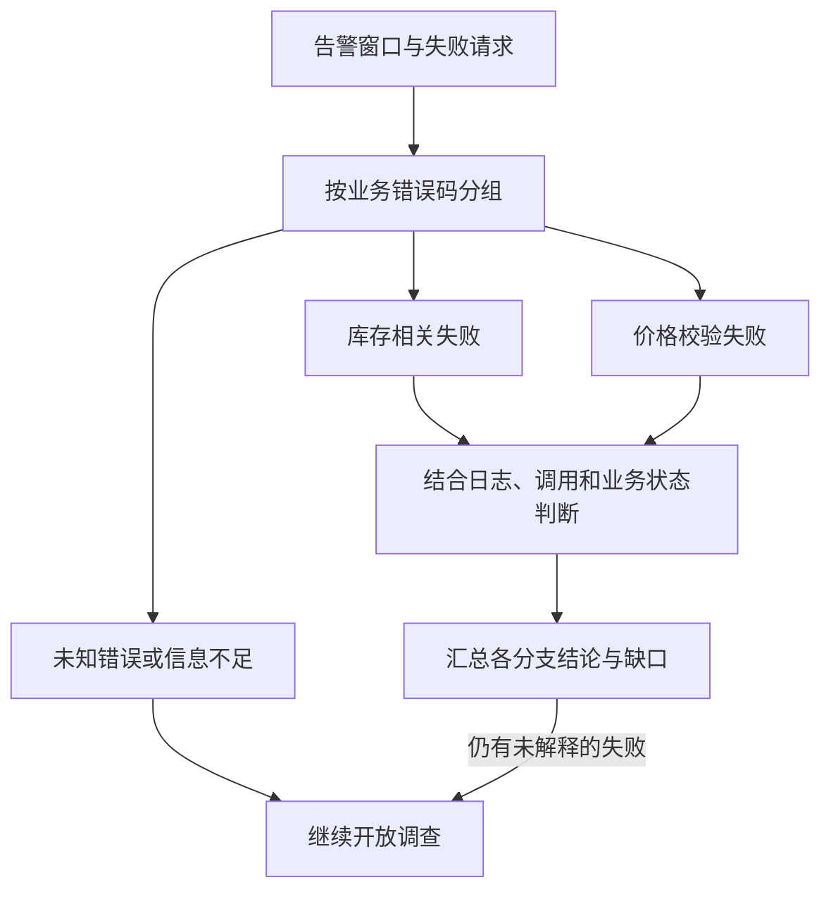

  <a href="/doc/starops/starops.html">STAROps</a> / 告警追因

# 告警 RCA 多分支诊断最佳实践

  分类 · 告警追因

订单创建失败率升高，值班工程师首先要弄清楚的是哪些请求没有成功。库存不足、价格校验失败、下游超时，都可能计入同一个失败率指标。找到一条报错链路，通常还不足以解释整条告警：修好了库存相关的问题，也可能仍有一批订单卡在价格校验。

团队处理过这些告警以后，往往已经积累了一些很具体的经验。某个错误码要先看商品状态，另一个要比较请求快照与生效规则；有的业务拒绝一直存在，需要看本次是否明显增多。这些知识散在 Runbook、代码说明和排查记录里，新接手的人要花时间找，数字员工也需要知道它们。

STAROps 可以把团队的业务诊断经验作为 Skill 使用，从本次失败请求出发，分别调查涉及的分支，再汇总哪些失败已经得到解释。**多分支诊断的价值，是把同一条告警里的不同问题查清楚，让后续处理不遗漏。** 分支是否需要展开、什么时候可以结束，都取决于本次证据。

> 对话回放：[按既定流程诊断](/playground/alert-rca-flow-skill-replay.html) ｜ [开放调查](/playground/alert-rca-flow-investigation-replay.html)

## 先把失败率拆成可调查的问题

先确认告警对应哪个接口、发生在哪个时间窗口，再查看这一窗口里的请求数、失败数和错误分布。对订单创建来说，这一步决定后续该把精力放在哪里。库存不足可能平时就存在；若本次失败率上升主要来自新增的价格错误，调查应能识别这部分变化，同时保留其他失败的情况。

错误码不一定已经出现在告警事件里。数字员工可以从相关应用日志或 Trace 属性中继续提取，结合请求标识区分不同错误。统计时尤其要注意，一个失败请求可能在订单入口、下游服务和数据库调用处留下多个 Span。**Span 数与失败请求数不是同一个统计口径。** 先按请求或 Trace 去重，再看每类错误；如果只有采样 Trace，就用它确认错误形态，不把样本占比当作全部订单的失败占比。

下面用三个教学错误码说明怎样划分调查方向。实际使用时，要换成团队自己的错误码、业务含义和数据入口。

| 错误码 | 需要进一步区分的问题 | 有助于判断的证据 |
| --- | --- | --- |
| `INV_LOCK_FAIL` | 库存锁定失败是否来自商品未登记、版本冲突或其他拒绝条件 | 库存服务调用、错误日志、商品记录和当时的库存状态 |
| `SKU_STOCK_NOT_ENOUGH` | 是真实库存不足，还是库存数据或预占状态异常 | 请求数量、可用与预占库存、相关业务操作记录 |
| `PROMO_PRICE_MISMATCH` | 请求中的价格快照为何与校验规则不一致 | 请求快照版本、规则版本、适用渠道和规则生效时间 |

同属库存的前两个错误可以先进入同一分支，但后续判断仍要分开。商品不存在与库存更新时发生版本冲突，可能返回同一个锁定失败错误码，需要继续看具体拒绝原因。若一看到名称里有锁就去查数据库锁等待，很容易沿着错误方向查下去。

把这些含义提前写清楚，数字员工就能少猜一次。对团队来说，这也是整理 Runbook 的一个实际收益：原本默认所有人都知道的业务约定，变成了可以查阅、核对和更新的说明。

## 把 Runbook 写成分支，而不是写死答案

一条有用的 Runbook 分支，应当能帮助接手的人继续判断。例如，进入库存分支后，先确认失败请求涉及哪个商品、请求数量是多少、返回了哪种拒绝；有了这些信息，再核对库存记录与当时状态。若状态和请求对不上，就继续查看变更或并发更新的证据，而不应在分支开头就把结论写成库存并发冲突。

优惠价格分支也类似。已知价格快照不匹配，就比较请求携带的版本与当时适用的规则，进一步确认是否涉及特定渠道、商品或生效时间。查到近期规则变更，可以作为线索继续核对，但仅有时间接近，还不能认定就是这次变更引起的。

这两组取证彼此没有先后依赖，数字员工可以分别开展；同一分支内部则按发现推进。先找到异常商品，再查询对应库存，往往比把所有商品和数据库状态都查一遍更有针对性。通用的指标检索、日志和调用链分析继续使用数字员工已有能力，Skill 重点保存团队特有的语义与判断依据。

分支返回后，还要回到最初的告警。每个结论解释了哪些失败，是否遗漏了未知错误，是否有同一项变更影响了几个分支，都需要放在一起看。比如两个分支都提到配置版本变化，汇总时可以继续核对它们是否来自同一次发布；如果仅仅发生在同一时间，就先分别保留判断。

**一个分支查完，不代表整条告警已经解释完整。** 反过来，也不需要为了完成流程，强行把所有可能的原因都查一遍。已经排除的方向可以说明依据；没有对应错误的分支可以不展开，把精力留给仍未解释的失败。

## 在数字员工中复用团队经验

配置时，可以把各类告警都适用的要求放进默认规则，例如先确认告警主体与时间窗口、报告保留未解释的失败、结论带上对应依据。订单错误码和业务 Runbook 则放进订单诊断 Skill。以后调整价格校验逻辑时，更新这一份业务说明即可，不必把所有告警的规则一起修改。配置入口见[配置默认规则](https://help.aliyun.com/zh/starops/user-guide/configure-default-rules)和[技能管理](https://help.aliyun.com/zh/starops/user-guide/skills-management)。

整理 Skill 时，最好选一条团队处理过、记录相对完整的告警。把当时用过的查询入口、错误含义和判定条件写进去，再检查数字员工能否在当前权限下取到这些数据。旧 Runbook 里一句查看库存状态，对熟悉业务的人也许足够；对数字员工，还需要说明是哪类记录、通过什么已接入的数据源查看，以及关注哪些字段。

**文中的错误码、分支和提问用于教学，不能直接作为生产诊断 Skill 使用。** 落地前需要核对业务语义、日志字段、Trace 采样、服务依赖、版本差异和访问权限，并用团队的历史告警检查分支是否会漏查或误判。尤其要注意，业务版本变化后，同一个错误码的含义也可能变化。

配置好之后，可以从一条历史告警开始提问：

> 看一下这次订单创建失败率告警，按我们的订单诊断 Skill 分析。哪些失败已经有证据解释，哪些还需要继续查？

阅读结果时，除了看最后的根因，还要看它是否找对了时间窗口、是否覆盖了主要错误类型、业务知识是否真的用于判断。重复验证时选用可比的输入和窗口，才有条件讨论覆盖是否改善、耗时是否变化。增加了分支，可能意味着本轮查得更全面，也可能只是多做了查询，不能单靠流程形式评价效果。

## 从一次订单测试看分支的作用

原实践使用一个订单测试应用验证诊断过程。请求经过订单服务，再调用库存或优惠服务；库存校验可能遇到商品未登记、库存不足或更新时版本冲突，优惠服务则检查价格快照版本。这些请求确实经过服务调用与数据库查询，但属于**专门构建的测试场景**，不是真实客户事故。

这次调查从订单失败告警开始。告警上下文没有直接给出业务错误码，数字员工继续查看失败 Trace，发现库存相关错误和价格快照不匹配都出现在订单失败请求中，于是分别调查这两组问题。回放中，库存与优惠两个分支分别取证，随后将结果汇总到订单告警中。

库存分支中，调用链把失败带到了库存校验环节：订单入口返回 HTTP 422，下游库存调用却可以返回 HTTP 200，业务拒绝记录在调用的错误属性里。看到这一点，再单独统计下游 HTTP 5xx，就解释不了订单为什么失败。数字员工需要继续读取业务错误，区分库存不足和锁定失败。

测试代码还给出一个值得注意的细节：商品未登记和更新时版本冲突都可能返回 `INV_LOCK_FAIL`。因此，即使 Trace 已经带着这个错误码，仍然需要失败时的商品记录或应用日志来确认具体原因。原回答曾把它直接归为并发冲突，这一步超出了当时证据能够支持的范围。

优惠分支也出现了类似的技术成功与业务失败：优惠服务调用返回 HTTP 200，业务属性提示价格快照不匹配。这个发现足以把下一步调查落到请求快照与规则版本，但当时没有取到足够的快照明细和应用日志，无法确认差异来自哪次规则发布，也不能给出经过验证的恢复办法。

把两条分支放回订单告警，值班人员得到的就不再是笼统的订单失败。一部分请求需要核对库存状态，另一部分需要核对价格规则；数据库调用成功也不意味着业务校验已经通过。下面按可确认的范围整理了结果，表中是对历史材料的复核，**并非完整原始回答**：

| 分支 | 已有依据 | 下一步 |
| --- | --- | --- |
| 库存 | 失败 Trace 指向库存校验，能区分锁定失败与库存不足 | 核对失败请求的库存版本、数量及当时状态 |
| 优惠价格 | 失败 Trace 带有价格快照不匹配错误 | 补充请求快照与生效规则，确认差异来源 |
| 整体 | 两类失败都需要解释 | 按同一窗口复查失败分布，确认没有遗漏其他主要错误 |

团队可以据此把问题交给对应业务环节继续处理，也可以在原会话里补充数据，让数字员工接着查。后续确认了新原因，再把它补进 Runbook，并保留当时能够区分不同原因的证据。这样积累下来的 Skill，才能帮助下一位值班人员和下一次调查，而不是反复给出同一个听起来合理的答案。

## 相关入口

- [返回 STAROps 最佳实践首页](/starops/starops.html)
- [打开 STAROps Playground](/playground/staropsdemo.html)
- [进入 STAROps 控制台](https://starops.console.aliyun.com)

