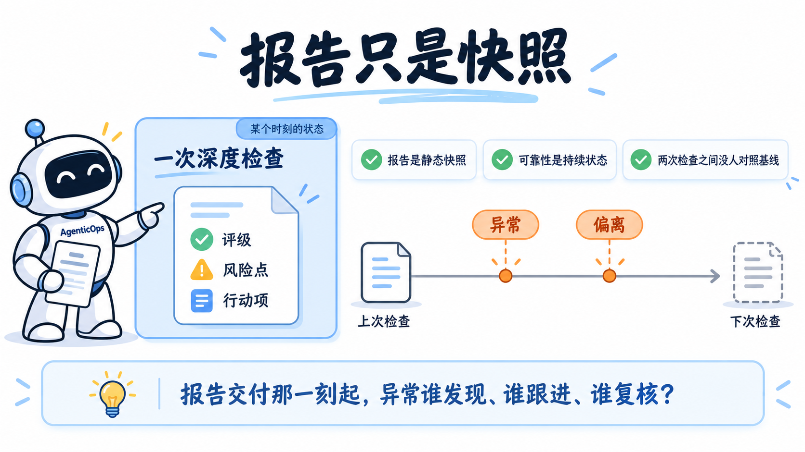
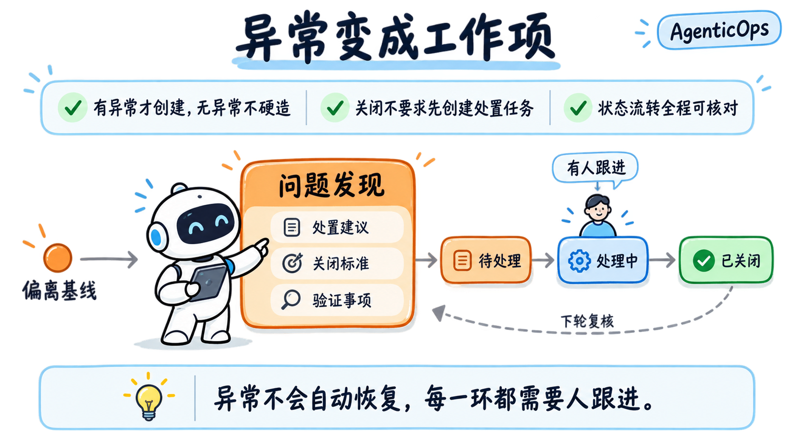
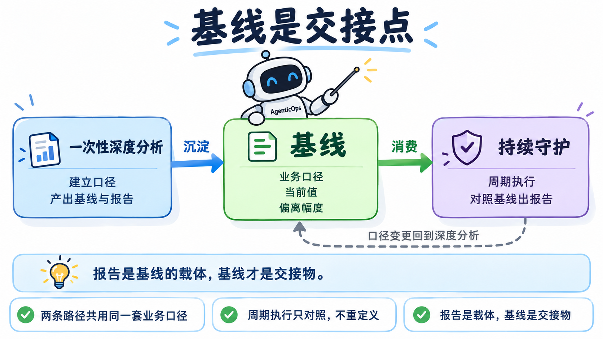
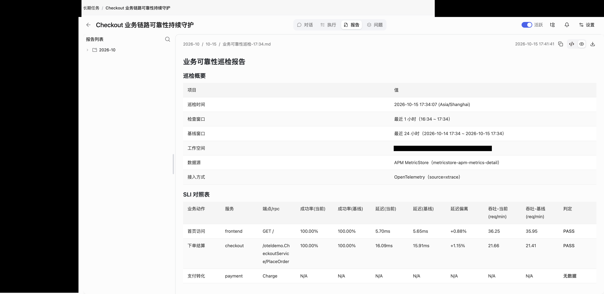
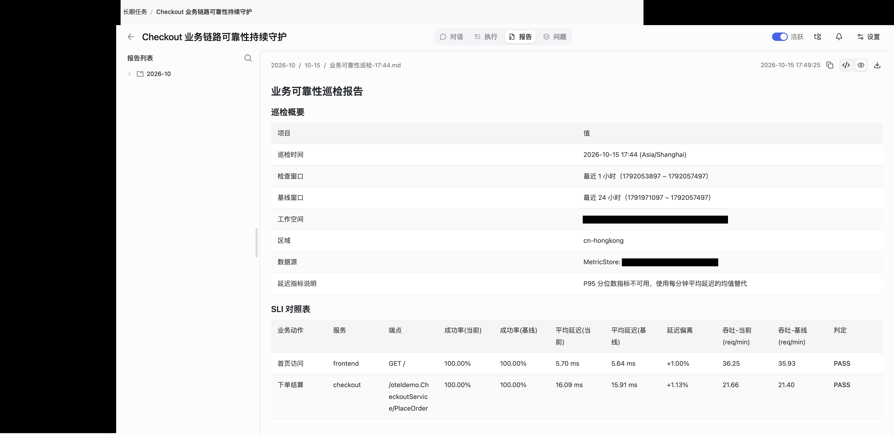
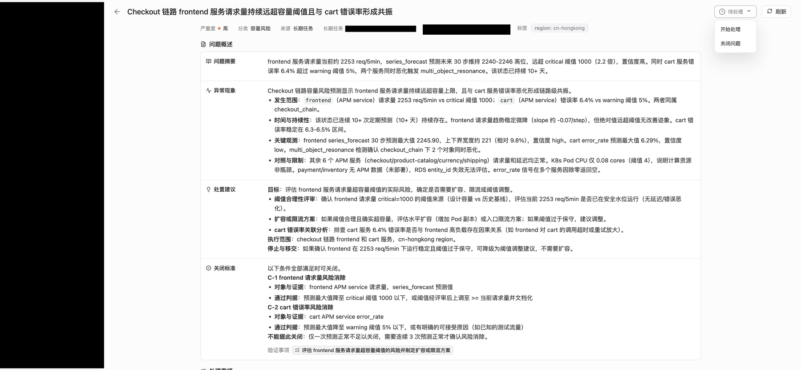
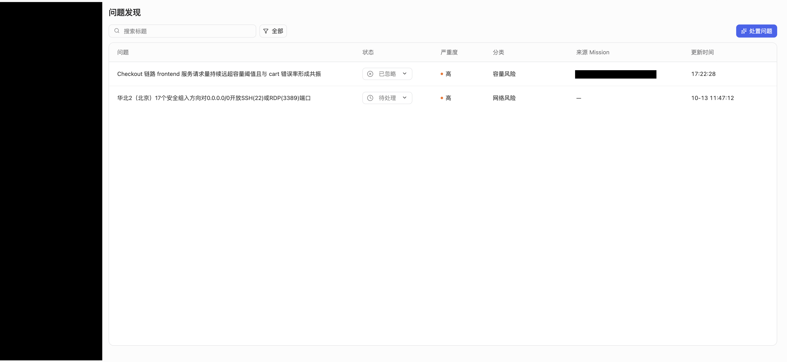

<div class="sls-starops-article-crumb">
  <a href="/doc/starops/starops.html">STAROps</a> <span class="sep">/</span> <span>主动巡检</span>
</div>

# 从一次深度评估到持续守住业务基线

<div class="sls-starops-article-meta">
  <span>分类 · 主动巡检</span>
</div>

周一的运维例会上，负责交易平台的团队又被问到同一个问题：下单链路扛不扛得住？

手边现成的东西有两样。一样是监控面板，应用全绿；一样是不久前做过的一次深度评估报告，评级、风险点、行动项都在里面。但这个问题答不踏实。应用全绿只说明服务都在运行，回答不了下单可不可靠：用户下不了单的时候，每个应用的错误率可能都在阈值以内。报告也只是做完那个时刻的快照，从那天到现在的每一天，偏离了谁发现、谁跟进、跟完谁复核，报告里没有答案。

异常不挑检查日。两次检查之间，下单成功率可以每天滑一点：每一刻都够不上告警阈值，每一刻也都在偏离。另一个极端是把可靠性全押在告警上，等它响，用户已经碰到了问题。主动评估和被动告警之间，缺的是一条持续对照的值班线。

::: details 报告只是快照：一次深度检查的产出是某个时刻的状态，两次检查之间异常无人对照

:::

本文介绍 STAROps 的业务可靠性守护做法：**用一次性深度分析建立业务口径与基线，用长期任务按周期对照守住基线，用问题发现把偏离变成有人跟进的工作项。** 两条路径共用同一套业务口径，交接点是基线。报告是基线的载体，不是终点。一个运维电商应用的团队就是用这套做法把下单链路守起来的，完整过程在典型场景一节。

## STAROps 的做法

### 守护对象是业务口径

客户最终要守住的是订单、支付、登录、核心 API 这类业务能力。业务能力太抽象，落不了地；应用指标太技术，代表不了业务。中间的落地口径是业务动作和业务 SLI：下单、支付、登录、首页访问，每个动作对应入口接口上的成功率、延迟、吞吐。缺了这层口径，深度分析会退化成应用指标拼表，持续守护也没有对照物。

建立口径按三步走：找到最外层入口，网关、BFF、前端服务或核心 API；在入口或关键服务接口上定义业务动作；为每个业务动作建立 SLI，成功率、延迟、吞吐、转化率或链路成功率，并给出 SLO 与评估周期。

以一个电商应用为例：

| 业务动作 | 推荐业务口径 | 说明 |
| --- | --- | --- |
| 首页访问 | `frontend GET /` 成功率、延迟、吞吐 | 用户进入站点的第一跳体验 |
| 下单结算 | `checkout.PlaceOrder` 成功率、延迟、吞吐 | 订单主路径是否可靠 |
| 支付转化 | `payment.Charge` 成功率、延迟、调用成功率 | 支付动作是否完成 |
| 端到端下单 | 从入口到支付的链路成功率 | 聚合或衍生 SLO，用于整体观感，不替代接口级口径 |

动手之前，先确认这些入口接口的访问日志完整可查：每个请求一条记录，带状态与耗时字段，字段已开启索引统计，SLI 才有全量数据可算。常见的缺口是个别服务没有上报访问日志，这时把该业务动作标成数据缺口，并在报告里注明口径，不拿应用层指标凑数。

**数据关联上有一个刻意的分工。** 业务动作锚定到已有的入口接口和服务实体上，不新建一类业务指标对象；上下游依赖关系直接读取调用链语义化后的拓扑，不重新建模；业务 SLI 的当前值与基线由访问日志全量聚合计算，不取调用链的采样数据；APM 已覆盖的应用与实例指标作为解释证据直接取用，不重复采集；告警与变更事件是解释业务偏离的证据层，没接入时在报告里写成缺口，不写成无异常。

先看取值这一侧的现实约束。调用链数据有采样，样本只是全量请求的一部分，拿采样数据算出的成功率与延迟分布会随采样策略波动；基线本身不准，逐轮对照就失去意义。入口接口的访问日志是全量记录，每个请求一条，状态与耗时字段都在；日志服务 SLS 的 SQL 分析提供 count、count_if、avg、approx_percentile 等聚合算子，按接口和时间窗口聚合，就能算出吞吐、成功率、延迟分布的当前值与基线（算子口径见 [《聚合函数》](https://help.aliyun.com/zh/sls/aggregate-function) 与 [《估算函数》](https://help.aliyun.com/zh/sls/approximate-functions)）。另一个取舍是同一份事实只留一份：访问日志留在 SLS，应用与实例指标留在 APM，需要时实时查询聚合，不复制、不另建业务指标对象；两边各自更新，口径必然漂移，对照时说不清以哪边为准。模型里只存长期稳定的关系，即哪个业务动作落在哪个入口接口上。取不到的数据宁可写成缺口，也不拿近似值凑出一张完整的表。

### 现在可靠吗：一次性深度分析建立基线

需要成体系评估的时刻一直存在：业务高峰前、发布后、故障后。在会话里让数字员工做一次深度分析，它按五个阶段组织跨层证据：

| 阶段 | 回答的问题 | 关键产出 |
| --- | --- | --- |
| 1 业务指标基线 | 业务 SLI 当前值相对基线偏离多少 | 业务指标基线表：当前值、基线值、偏离幅度、样本完整性 |
| 2 应用指标关联 | 哪些应用异常可能影响业务 | 应用异常到业务影响的因果链 |
| 3 依赖拓扑分析 | 瓶颈或故障点在哪段依赖上 | 依赖拓扑与异常依赖标注 |
| 4 告警事件聚合 | 这段时间有没有已知问题 | 告警与变更事件时间线，含覆盖缺口说明 |
| 5 综合可靠性报告 | 整体是否可靠、下一步做什么 | 按业务能力组织的综合报告 |

五个阶段在同一会话内串行执行，因为后一阶段要引用前一阶段的口径与证据。跨会话执行会丢失累积上下文，综合阶段容易产出各阶段互不引用的报告。

综合报告给出整体评级、各业务动作的 SLI 与 SLO 状态、风险点、影响面、支撑证据与反证、数据缺口、行动项和下一周期复核项。**关键在于交付的不只是结论**：报告里沉淀下来的业务口径和基线，会被持续守护接着消费。

深度分析按业务口径组织证据，回答的是现在可不可靠、偏离在哪里。偏离要进一步定位到原因时，由 STAROps 内置的深度问题调查（InvestigationAgent）承接：它从告警或指定对象出发，沿调用与依赖关系动态取证，给出根因结论、故障传播路径、关键证据与处置建议。调查分快速与深度两种：快速调查在几轮迭代内收敛，深度调查围绕假设逐步扩大取证范围。告警触发时调查可以自动启动，会话里也可以就某个具体偏离直接发起。评估按口径对照，负责发现偏离；调查由事件驱动，负责追到根因。两者共用同一套实体关系与指标数据。

### 谁在持续对照：长期任务守住基线

长期任务是数字员工按周期自动执行的任务。把服务范围、业务目标、基线和评估周期写进任务目标，守护就进入周期节奏：任务按周期产出结构化报告并归档，报告沿用同一套口径，读得出本轮与基线的对照。

设计上有两条约定。周期执行不重新定义口径，只对照基线；要改口径，回到深度分析里改，改完更新任务目标。这个分工保证轮次之间可比：每轮看的东西一致，偏离才有意义。数值基线按滚动 24 小时窗口逐轮计算，不依赖上一轮报告；跨轮次连续的是问题与缺口：报告里标记为持续观察的条目会标注首次发现于哪一轮，一个缺口存在了多久，一眼可见。

### 偏离了谁跟进：问题发现

偏离基线的异常形成一条问题发现：问题概述、处置建议、关闭标准、验证事项和处理事项，状态从待处理到处理中再到已关闭。列表里有一列来源：由长期任务产生的问题发现，来源指向创建它的任务；会话里产生的，来源为空。

::: details 异常变成工作项：偏离基线形成问题发现，状态从待处理、处理中走到已关闭

:::

问题发现是条件出口：有异常才创建。创建之前还有一道把关：异常先形成候选，与历史问题发现做相似度去重，再经语义复核确认值得跟进，通过后才正式创建。开关启用、周期执行正常、但本轮数据无异常时，运行计划里会出现提交问题发现的阶段，却不会创建问题发现。阶段出现和产物创建是两件事。这样设计是不让工作项淹没在噪音里：每天产出一条一切正常的问题发现，三周之后就没有人再看了。

让数字员工产出问题发现，有三个前置条件，会话和长期任务同样适用：

1. 任务目标或会话指令里显式写问题发现指令。可复制的文案：

   ::: details 查看可复制的文案

   ```
   发现的风险归纳为问题发现（Finding），使用 Findings SubAgent 创建，并以服务端的 Findings 为准。
   ```

   :::

2. 数字员工的运行时角色含问题发现写权限。
3. 数字员工的「开启问题发现」开关已启用。开关路径：数字员工 设置 → 通用设置 → 基本信息 → 开启问题发现；必须点该页面的确定按钮才持久化，只拨动开关不保存。

关闭在详情页直接完成：从状态菜单选择关闭，选关闭类型（已解决、失败、误报、已忽略、已取消）并填写原因即可，活动流记录状态流转，列表对已关闭项显示所选的关闭类型。关闭不要求先创建处置任务，也不占用长期任务配额。异常不会自动恢复，每一环都需要人跟进才能走完。

### 两条路径怎么接起来

业务高峰前检查、发布后复核、故障后复盘，走一次性深度分析；日常值守、基线偏离跟踪、异常跟进，走持续守护。两种触发方式共用同一条闭环，交接点是基线。

::: details 基线是交接点：一次性深度分析沉淀业务口径与基线，持续守护的周期执行消费它

:::

### 权限与边界

权限分两条独立的轨道，排障时先定位是哪一轨的问题：

- 使用权限轨：谁能创建和管理数字员工、会话、长期任务与报告。走持续守护路径需要长期任务操作权限。
- 员工运行时轨：数字员工的运行时角色决定它能读到哪些数据、能写哪些对象。走持续守护路径需要目标数据源的运行时访问权限，产出问题发现还需要问题发现写权限。

**控制台能看见数据，不等于员工能读到；员工能读到，不等于人能在控制台核对结果。**

边界上，两条路径全程只读，不发起生产变更，所有行动项都是建议或复核任务。长期任务的账号配额属于运营管理，腾退或提额按运营流程处理；单次执行有积分成本，随任务复杂度变化。

## 典型场景：把下单链路守起来

回到开头的问题。一个运维电商应用的团队用 STAROps 守护下单链路，数字员工「交易守护」已接入应用的指标、调用链、告警和变更数据。完整过程分五步。

### 定下业务口径

团队按三步走，把守护对象定成三个业务动作，逐个落到入口接口的 SLI 和 SLO 上，每小时评估一轮：

| 业务动作 | SLI | SLO |
| --- | --- | --- |
| 首页访问 | `frontend GET /` 成功率、延迟、吞吐 | 成功率不低于 99%，延迟偏离不超过 20% |
| 下单结算 | `checkout.PlaceOrder` 成功率、延迟、吞吐 | 成功率不低于 99%，延迟偏离不超过 20% |
| 支付转化 | `payment.Charge` 成功率、延迟、吞吐 | 成功率不低于 99%，延迟偏离不超过 20% |

让「交易守护」逐个接口核对数据能否稳定取到时发现，分位数延迟指标不可用，团队接受用平均延迟替代，并在口径表里注明。这一步的产出远不止一份文档：三个业务动作各自有了接口级 SLI、SLO 和评估周期，后面两条路径都要用这套口径。

### 发起一次性深度分析

团队在会话里向「交易守护」提出：

> 对首页访问、下单结算、支付转化做一次可靠性评估。给出每个业务动作的 SLI 当前值与基线、偏离幅度、风险点和行动项，按业务能力出一份综合报告。

「交易守护」在同一个会话里按五个阶段串行取证，每个阶段的产出：

- 业务指标基线：下单链路吞吐对比基线抬升 98.5%，偏离幅度显式标注；成功率较基线高 0.70 个百分点；延迟持平。P99 延迟数据不可用，报告改用 P95 加最大值，并注明口径。
- 应用指标关联：下单服务两个实例的负载不均度 33.6%；流量对比基线接近翻倍，但没有扩容，余量持续减少。依据：应用实例的指标记录。
- 依赖拓扑分析：shipping 与 currency 的延迟显著偏离基线，cart 有偶发异常，flagd 存在异常；瓶颈定位在 shipping 的 GetQuote。依据：依赖拓扑与接口延迟记录。
- 告警事件聚合：跨 5 个数据源聚合成时间线；拓扑里两个异常依赖没有触发任何告警，覆盖缺口写进报告；期间没有基础设施变更，排除变更引入。
- 综合报告：按业务能力组织，给出整体评级、5 项 SLO 达标 2 项、5 个风险点分级和 10 项行动建议。

团队得到的除了结论，还有沉淀下来的口径与基线：三个业务动作、各自的 SLI 与 SLO、当前基线值都在报告里，可以直接交给持续守护消费。

### 把口径和基线固化成长期任务

团队创建长期任务，每小时执行一轮，任务目标写进口径、基线和问题发现指令：

> 每轮评估首页访问、下单结算、支付转化三个业务动作：按滚动 24 小时窗口计算基线，对照 SLO 评估偏离，产出结构化报告。发现的风险归纳为问题发现（Finding），使用 Findings SubAgent 创建，并以服务端的 Findings 为准。

创建前确认了三件事：问题发现指令写进了任务目标；运行时角色含问题发现写权限；问题发现开关已开启并保存。

守护跑起来后，第一轮报告的结果是：基线窗口为滚动 24 小时；首页访问与下单结算全部 SLO 达标；支付服务无数据，报告如实标注为数据缺口；本轮没有 SLO 违反项，没有创建问题发现。这正是设计想要的：没有异常就不制造工作项，值班的人只需要看报告里与基线的对照。

::: details run1 结构化报告：滚动 24 小时基线窗口下首页访问与下单结算均达标，支付转化标注为无数据，本轮未创建问题发现

:::

### 认领并跟进一处持续缺口

真正需要人跟进的偏离，以一种不戏剧化的方式出现了。下一轮报告里，支付服务无数据没有消失，而是变成一条持续观察项：状态持续，首次发现于上一轮的 17:34。缺口从哪一轮开始、存在了多久，报告里一眼可见。依据：前后两轮报告的对照记录。

值班工程师认领后跟进确认：这属于数据源缺口，支付服务没有向任务使用的数据源上报数据，口径里的支付转化一项实际没有取到数。补齐数据上报的动作在数字员工的只读边界之外，由人完成；在那之前，报告里的持续观察项继续逐轮跟踪。

::: details run2 报告：同一任务的下一轮（17:44，晚于 run1 十三分钟），巡检概要沿用滚动 24 小时基线窗口

:::

### 复核后关闭

问题发现列表里还有一条待处理项，来自团队另一条容量巡检任务，来源列指向创建它的任务。值班工程师复核后决定关闭：在详情页的状态菜单选择关闭问题，关闭类型选已忽略，填上原因：演示环境容量阈值偏保守，风险已知并接受。确定之后，活动流记录下从待处理到已关闭的流转，列表里这条的状态列显示已忽略。依据：该问题发现的活动流。整个过程没有创建处置任务，也没有占用长期任务配额。

::: details 问题发现详情页的状态菜单：待处理 / 开始处理 / 关闭问题

:::

::: details 关闭后列表状态列显示「已忽略」徽标

:::

到这里，例会上那个问题有了新的答法：不再凭面板绿不绿和一份旧报告，而是同一套口径下每一轮的对照结果，加上每一条异常从发现到关闭的记录。

## 总结

回到开头的问题：报告交付之后，异常谁来跟。答案是把一次检查的终点往后挪一步：一次性深度分析建立口径与基线，长期任务按周期对照基线，问题发现把偏离变成有人跟进的工作项，关闭状态回流到下一轮复核。报告还在，只是它沉淀的口径与基线会被每一轮周期执行接着用。

这套做法有没有在自己的环境里成立，可以看三件事：偏离从发生到有人认领隔了多久；问题发现关闭之后有没有复发，复发时能不能看出它第一次出现在哪一轮；团队讨论可靠性时，说的是业务动作的成功率，还是应用面板的绿与不绿。

同一套口径还能用到更多时刻：发布后复核和故障后复盘走一次性深度分析，和基线对照出结论；深度分析发现明显故障时，把证据交给深度问题调查接着定位；新业务上线，先从一次性深度分析开始，把口径立起来再谈守护。

## 相关入口

- [返回 STAROps 最佳实践首页](/starops/starops.html)
- [打开 STAROps Playground](/playground/staropsdemo.html)
- [进入 STAROps 控制台](https://starops.console.aliyun.com)

<style>
.sls-starops-article .vp-doc details {
  margin: 12px 0;
}

.sls-starops-article .vp-doc details > summary {
  font-size: 14px;
  line-height: 1.6;
}

.sls-starops-article .vp-doc details img {
  display: block;
  width: 100%;
  max-width: 640px;
  aspect-ratio: 16 / 9;
  object-fit: contain;
  margin: 10px auto 2px;
  background: #f7f9fc;
  border: 1px solid var(--sls-starops-border, #e6ebf3);
  border-radius: 10px;
  box-shadow: none;
}

.sls-starops-article .vp-doc p {
  line-height: 1.85;
  margin: 14px 0;
}

.sls-starops-article .vp-doc h2 {
  margin-top: 36px;
}
</style>
