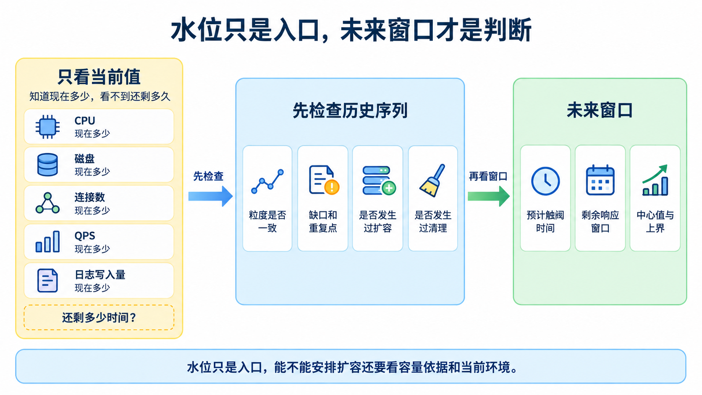
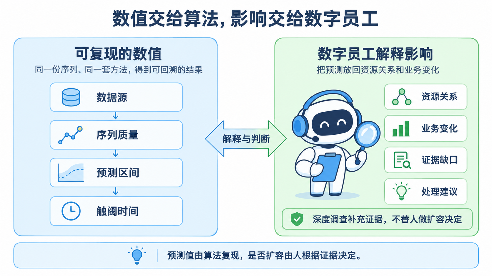
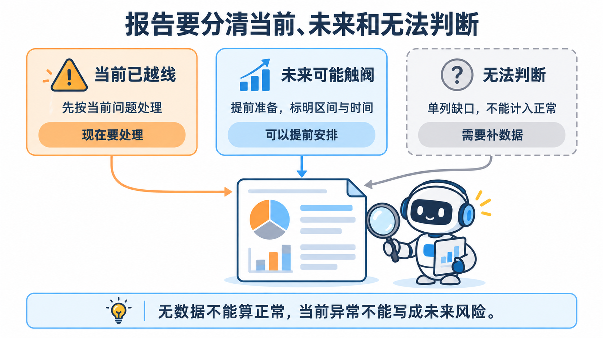
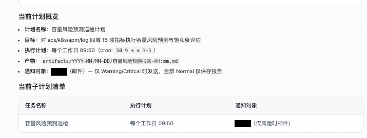
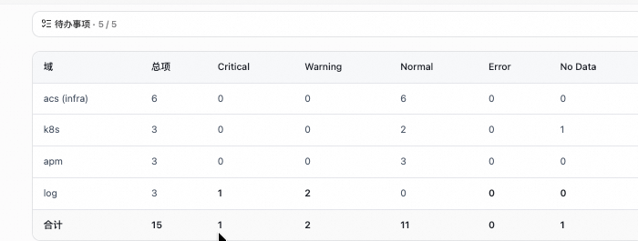

  <a href="/doc/starops/starops.html">STAROps</a> / 主动巡检

# 自定义容量风险巡检设计最佳实践

  分类 · 主动巡检

数据库磁盘还没有到告警线，扩容却可能已经该提上日程了。采购、评估和变更都需要时间，等到空间紧张再着手处理，选择就会少很多。日常巡检如果能把最近的增长放到未来一段时间里看，团队就有机会提前安排，而不必等一条水位告警来催。**容量风险预测的价值不只在给出一个未来数字，而在于帮助团队安排扩容：哪些资源值得提前准备，时间有多紧，依据是否可靠。**

这篇实践讲的是容量风险预测。巡检只是周期执行的载体，报告要回答的是未来窗口；它不替代当前的告警和巡检，巡检回答现在有没有问题，容量预测回答还剩多少时间。把两件事混在一起，报告容易给出一个看似精确、却无法用于安排的数字。

在 STAROps 中，可以把确认过的指标和计算方法整理成 Skill，交给长期任务持续执行，再由数字员工结合资源关系和业务变化解释结果。**预测帮助人提前做准备，能否据此安排扩容，还要看容量依据和当前环境。** 遇到证据不足、关系缺失或多信号冲突时，可以在同一会话中继续深度调查。下面从一组数据库磁盘开始，说明怎样把数据、预测和后续判断接起来。

## 从一个有明确容量上限的对象开始

第一次配置容量巡检，可以先选一组需要提前扩容的数据库磁盘。磁盘有明确的总容量，也容易说明剩余空间意味着什么：如果写入保持近期的增长，预警线可能在什么时间到达，团队有没有足够时间处理。把这一项做清楚，再增加其他对象，报告也更容易被实际使用。

准备配置时，先和维护这些实例的人确认两件事：目前按什么标准决定扩容，完成一次处理通常需要预留多长时间。已有的容量规划或值班规则可以直接作为起点。预测窗口应服务于这个安排；如果团队需要提前两天评估，只看未来一小时就帮不上忙，预测得过远又可能带来更大的不确定性。

下面是一份**教学用配置**，展示应向数字员工提供哪些信息。具体窗口与阈值要按数据质量和团队扩容流程调整。

| 配置项 | 示例内容 | 为什么需要 |
| --- | --- | --- |
| 对象 | 订单业务使用的 RDS MySQL 实例 | 固定检查范围，避免每轮遗漏或扩大 |
| 指标 | 已用空间与总容量，统一成字节 | 区分数据增长和容量调整造成的使用率变化 |
| 历史窗口 | 最近 14 天，按 15 分钟整理 | 观察增长与周期，同时检查是否发生过扩容或清理 |
| 预测窗口 | 未来 48 小时 | 为评估和变更预留时间 |
| 阈值 | 团队确认的预警线与容量红线 | 明确何时需要处理以及阈值由谁维护 |
| 输出 | 当前水位、预测区间、预计触阈时间、数据缺口 | 支持安排处理顺序和人工复核 |

这份配置可以随 Skill 保存，作为每轮执行的约定。数字员工仍然可以帮助发现数据源和整理查询，但最终采用哪些指标、阈值从哪里来，需要能够解释清楚。日后报告与实际情况不一致，团队才能判断该调整取数、预测方法，还是容量标准。

换成请求量、日志写入量或队列积压，就要重新考虑容量的含义。**QPS 升高不能单独证明容量不足。** 若请求量增长而延迟和错误率仍然稳定，可能只是业务更繁忙；要判断系统是否接近承载上限，还需要压测、配额或容量评估提供依据。把一个方便填写的整数当作阈值，程序虽然也能报出风险，值班人员却无法据此决定是否扩容。

## 先检查序列，再计算未来窗口

预测开始前，先把实际要用的历史数据拿出来看一遍。时间粒度是否一致，缺点和重复点有多少，单位有没有变化，这些都会影响后续计算。数据库刚从小规格切到大规格时，使用率可能突然下降；这时要连同总容量一起看，才能区分数据真的减少了，还是分母变大了。

清理和批处理也会留下明显的曲线变化。每天定时回收的数据，与一直保留的数据，对剩余空间的影响不同。团队已经知道的业务安排，可以作为解释预测的背景；尚未发生的活动则应明确写成假设，不能让算法仅凭过去的平稳走势就替未来做保证。

STAROps 的数字员工可以帮助查询可用指标、整理历史序列，再按已选方法计算。SLS 提供 `series_describe` 分析序列特征，`series_forecast` 返回预测序列及上下界；调用时需要按当前接口准备序列并处理错误返回，参数与限制见[SLS SPL 函数](https://help.aliyun.com/zh/sls/metric-spl-function)。选择方法时，还应确认它适用的数据条件，而不是只看查询能不能返回一个数值。

触阈时间的含义也要说清楚。按预测中心值首次越线的时间安排工作，与按预测上界首次越线的时间提前准备，保守程度不同。报告可以同时展示，但应说明各自依据。对于使用率或错误率这类有范围的指标，出现超出合理范围的预测时，要回看序列和模型，不宜继续把它计算成一个精确的耗尽时刻。

遇到数据不足或计算失败，报告仍可以保留已经取得的当前水位，并列出缺少什么。**无法预测的对象不能被计入正常。** 对值班人员而言，某个重要数据库没能完成检查，本身就值得跟进；如果被一张全绿的汇总表掩盖，下次巡检可能仍然查不到它。

## 让预测结果对应到业务影响

磁盘预测接近预警线以后，数字员工还要说明这台数据库被哪些应用使用。如果已经在数据建模中建立应用与数据库的关系，数字员工可以沿关系找到访问它的应用，再结合写入任务、日志保留或数据生命周期继续判断。没有完整关系时，就先列出已确认的资源和证据，避免仅凭名称相似把业务关联上去。

一次数据探索就是从应用链路继续找到数据库依赖：先识别应用访问的数据库对象，再通过已有映射找到对应的 RDS 实例。这样，应用侧的请求变化与数据库侧的容量读数才有机会放在一起讨论。关系提供了调查范围，至于这次增长是否由该应用造成，仍然需要同一时段的写入或空间变化来支持。

如果应用请求量、数据库写入量和磁盘使用量一起增长，可以先将它们作为一组相关线索，检查是否经过同一条业务链路，以及变化先后是否吻合。报告保留各项原始读数，读者才能知道判断建立在哪些观测上。同一地域里的两条曲线一起上升，还不足以把它们合成同一个容量问题。

证据不足、关系缺失或多信号冲突时，可以在同一会话中继续深度调查，不必让每次判断都走完同一串查询。深度调查补充的是证据和关系，最终是否安排扩容，仍由报告里的容量依据和人的判断决定。

最终交给维护人员的结果，应当能支持下一步安排。数据与容量依据都充分的，可以列出需要提前评估的实例、预计触阈时间和关联业务；已经越线的，先按当前问题处理；缺少容量依据的，则说明需要补压测结果或配额信息。负责人已知时可以一起给出，尚未接入时不要凭应用名称猜一个处理人。

## 用一份真实报告走完判断

7 月的一轮测试覆盖了 10 个对象、27 个信号，报告列出 3 项 Critical、1 项 Warning、22 项 Normal 和 1 项 Error。拿到这样的结果，第一步是展开具体项目，看看这些等级由什么得出，再决定哪些值得通知或继续调查。

其中一项应用请求量的当前值约为 2265，预测最大值约为 2256，配置阈值为 1000，程序因此给出了高风险结果。这行数据很适合用来检查规则：**当前值已经高于阈值，预测并没有显示它还会明显增长。** 如果想据此安排扩容，必须先知道请求量按什么窗口聚合，以及 1000 是否代表经过确认的处理能力。

这里的问题不能靠换一种报告措辞解决。若 1000 只是测试时填写的阈值，就应先补容量依据；如果它确实是一条有效红线，则应把结果描述为当前已越线，而不是未来将要触顶。两种情况对应不同的后续动作，数字员工的解释需要把这个区别说给读报告的人。

同一份记录里，部分错误率预测出现了较大的外推变化，还有一项错误率查询返回空结果。错误率变化需要同时查看错误请求数、总请求数和历史分布，确认是否受低流量、稀疏错误或数据缺口影响。空结果则要留下来检查数据源，不能顺手归为正常。完成这些复核后，才知道哪些预测值得进入日常报告，哪些还需要调整。

这也是第一次试运行的意义：除了确认脚本能执行，更要确认报告是否能帮助团队做决定。把缺少依据的阈值补齐，将当前异常与未来风险分开展示，保留无法判断的对象，报告才能逐渐变得可用。每次都产出很多红色条目，却无法解释为什么需要处理，很难让值班人员长期信任它。

仓库保留了 capacity-risk-prediction 示例 Skill，可用于阅读配置、预测结果和报告的组织方式。**它是测试示例，不能直接用于生产环境。** 使用前需要核对指标与单位、产品及数据库版本、部署形态、采集粒度、算法接口、阈值来源和权限。示例还保留了旧接口和降级逻辑，部分无数据路径可能被归为正常，不同数据源也未统一采用同一种预测方法，使用前需要逐项适配。

## 确认单次结果后，再持续运行

将适配后的 Skill 添加到自定义数字员工，先对选定对象运行一次。对照原始序列，看当前水位、预测窗口和触阈判断是否一致，也检查没有取得数据的对象是否仍然出现在报告中。添加方式见[技能管理](https://help.aliyun.com/zh/starops/user-guide/skills-management)。

早期版本的记录展示了从数据探索、Skill 构建到长期任务配置的过程。它采用 15 项检查，与前述 7 月测试的 27 个信号属于不同配置。复用时可以参考它怎样从一次运行走到长期任务，具体算法和检查范围则按当前环境重新确认。

单次结果能够用于判断后，再[创建长期任务](https://help.aliyun.com/zh/starops/user-guide/creating-and-planning-long-term-mission)，例如：

> 每个工作日检查订单数据库未来两天的磁盘容量风险，使用团队确认过的配置和容量预测 Skill。列出需要提前处理的实例、预计触阈时间和依据；数据不足的实例单独列出。将需要处理的风险通知值班人员。

通知内容应让收件人知道为什么现在需要关注，而不只是收到一个风险等级。已有水位、预计越线时间、关联业务和报告入口，能帮助他安排评估；反复出现的数据缺口，则需要交给相应的数据维护人处理。

持续运行后，把预测与后来实际发生的变化放在一起看。是否经常提前过多，是否漏掉快速增长，某项误报是否总出现在数据清理之后，这些都能用于调整配置。数据库扩容或业务活动改变了原来的条件，也应更新规则。容量巡检最终要融入团队的日常安排：提前发现需要准备的工作，处理之后有数据复核，而不是每天多读一份预测报表。

## 总结

容量风险预测要走完这条判断链：当前水位只是入口，先检查历史序列能不能预测，再看未来窗口的触阈时间和区间，然后把结果放回业务影响，最后分清当前已越线、未来可能触阈和无法判断三类结果。固定的计算口径交给 Skill，数据的解释和业务关联交给数字员工，周期执行交给长期任务，证据不足时再交给深度调查。

这套做法也有边界。预测不是承诺，阈值要有容量依据，缺数据要单列，相关不等于因果；示例 Skill 需要按实际指标、版本、采集粒度和权限适配。团队仍要维护历史窗口、预测窗口、阈值和规则，数据库扩容或业务活动变化后重新核对。

下一次看到一张水位报告，可以先问三个问题：还剩多少时间，依据是什么，影响谁。容量工作从这里开始，而不是等告警响起才临时安排。

## 参考

- [SLS 时序数据查询和分析语法](https://help.aliyun.com/zh/sls/time-metric-data-query-and-analysis-syntax)
- [SLS SPL 函数](https://help.aliyun.com/zh/sls/metric-spl-function)

## 相关入口

- [返回 STAROps 最佳实践首页](/starops/starops.html)
- [打开 STAROps Playground](/playground/staropsdemo.html)
- [进入 STAROps 控制台](https://starops.console.aliyun.com)

