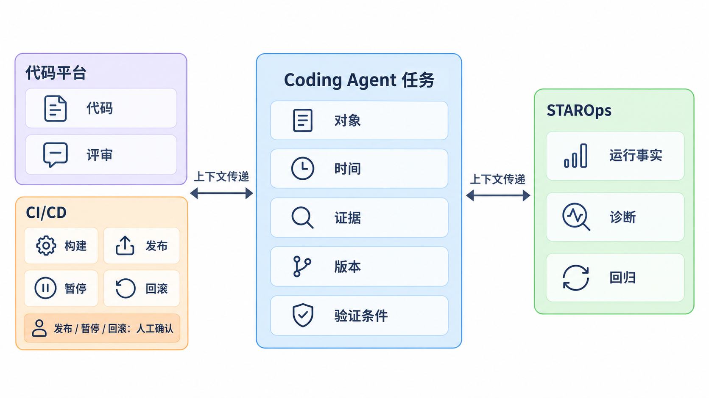
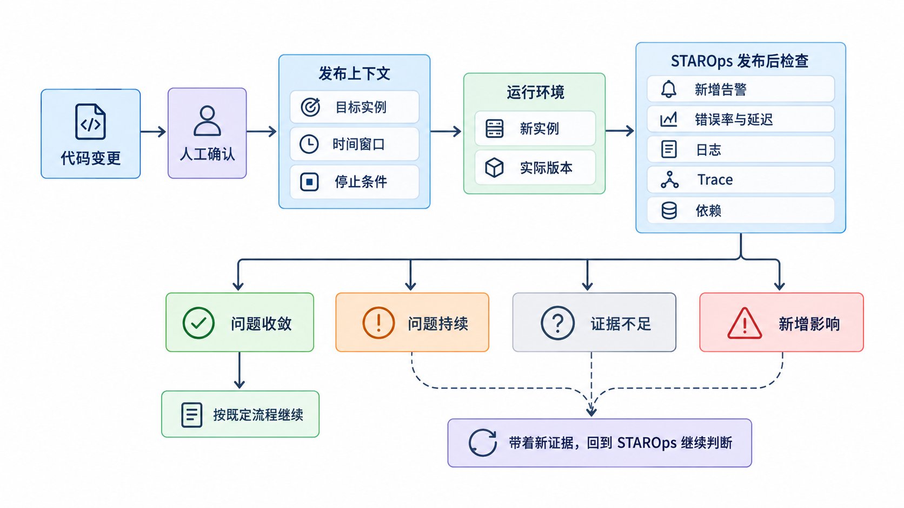
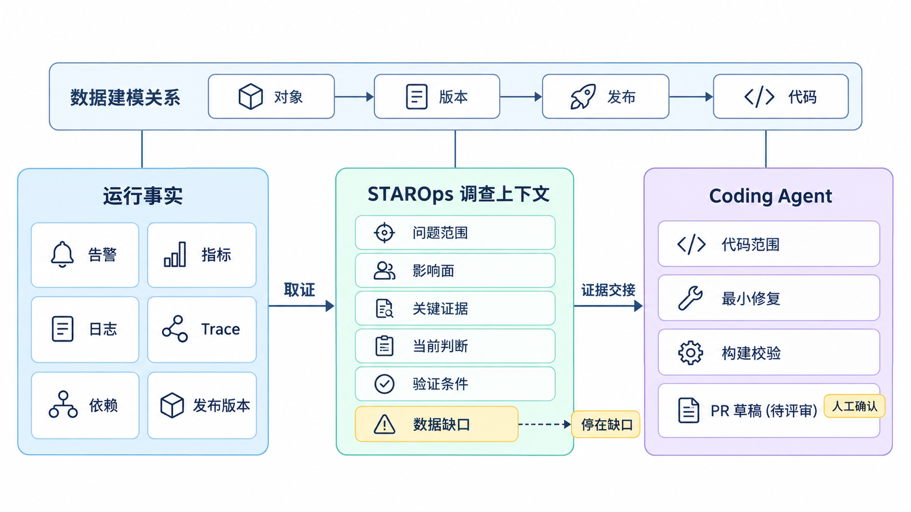
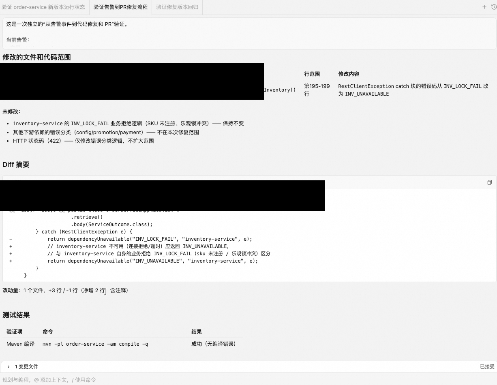
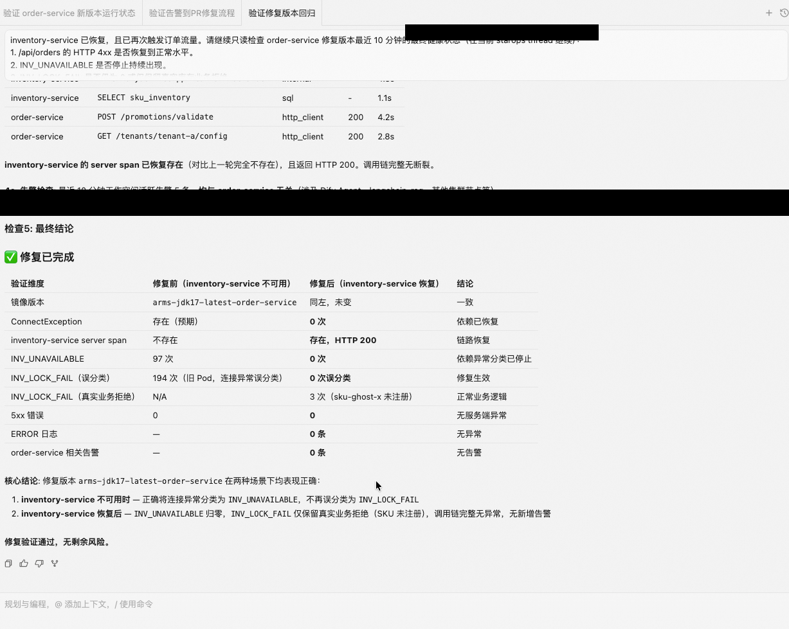

  <a href="/doc/starops/starops.html">STAROps</a> / 协作闭环

# 一个 Agent 入口完成 DevOps 闭环

  分类 · 协作闭环

一次发布完成以后，版本是否真的收敛，要到运行数据里看；一次告警出现以后，问题是否真的解决，又要回到代码和下一轮发布。**把发布检查、告警诊断、代码修复和运行回归留在同一个 Coding Agent 任务里，一条 DevOps 任务才不必反复搬上下文。**

平台切换本身只占几秒钟，恢复上下文才耗精力。一次完整交接至少要讲清五件事：处理哪个对象、问题发生在什么时间、证据支持什么判断、修改对应哪个版本、发布后按什么条件验证。这些信息通常散在聊天记录、诊断报告、代码提交和发布单里；任务暂停一段时间，开发者和 Agent 都得先把它们重新拼起来。

这里说的闭环是两条已经验证的路径：发布后的运行检查，以及从告警到诊断、最小修复、PR 草稿和两阶段回归。它不是 CI/CD 自动发布、自动创建 PR 或完整灰度验证；代码提交、PR、发布、暂停和回滚仍由原系统按权限和人工确认执行。

## 每换一次平台，就要重新讲一遍问题

很多 DevOps 问题，每一步都有现成工具。代码在仓库里改，版本在 CI/CD 里发，指标在监控平台看，日志和 Trace 又在另一个页面查。麻烦出在这些动作分散在不同平台，而不是某个工具不好用。

日志里查到证据后，要把运行对象、异常时间和判断结论交给代码侧；代码改完，还要把版本、环境和回归条件交给发布与运维。任务暂停一段时间，开发者和 Agent 都得先把这些背景重新拼起来，才能继续往下做。平台切换本身只占几秒钟，恢复上下文才耗精力；同一个问题被拆得越碎，遗漏版本、证据和验证条件的概率就越高。

统一入口要做的，是让这五件事留在同一个任务里。Coding Agent 保存代码、版本、发布和运行上下文；STAROps 查询应用、实例、依赖、告警、日志、指标和 Trace，说明影响面、证据、判断和待确认事项；[Skill](https://help.aliyun.com/zh/starops/user-guide/skills-management) 把用户意图送到对应系统，再把结果带回当前任务；代码平台与 CI/CD 继续按原有权限完成提交、评审、发布、暂停、回滚和审计。

这不是把所有权限交给 Agent。开发者仍然确认目标、风险和结果，提交、PR、发布、暂停和回滚仍按各系统的权限与审批执行。Agent 少做的是复制、对照和重新说明，不是替人做决定。

## 运行事实要能落到代码和版本上

一句根因结论很难直接拿来改代码。Coding Agent 还需要知道受影响的服务和接口、异常时间、相关指标、日志和 Trace、当前运行版本、证据缺口，以及修复后要观察什么。

STAROps 通过 [UModel](https://help.aliyun.com/zh/starops/product-overview/core-concept) 描述应用、资源、拓扑、制品、发布和代码对象之间的关系，并按对象、时间和关系查询运行数据。关系缺失时，明确缺口，不根据名称相似推断代码范围；关系清楚以后，运行事实才能落到具体版本和代码范围。否则 Agent 只能停在模糊的相关性上，无法形成可评审的修复。

这一步成立的前提是：运行数据已经接入，发布版本、目标实例和发布时间可以确认，代码仓库、分支、commit、制品、发布与服务之间的映射可以确认，Coding Agent 能加载 STAROps Skill 并访问目标仓库。缺少其中一项，任务就停在对应的缺口，不继续生成具体修复。

## 版本发完，先看运行结果

发布完成不代表运行结果已经收敛。新版本进入目标环境后，开发者在 Coding Agent 里保留目标环境、实例、发布时间、观察时间和停止继续发布的条件，再把这些信息交给 STAROps。

### 发布后检查怎么做

STAROps 重点检查新实例：有没有新增告警，错误率和延迟是否偏离基线，日志里有没有启动或连接异常，Trace 是否出现新的失败分支，实例实际运行的是哪个版本。结果回到当前任务后，开发者可以继续追问具体实例和证据。

历史测试中，错误版本部署到目标环境后，依赖服务被缩容到零副本。[Qoder](https://help.aliyun.com/zh/starops/qoder-desktop-integration) 在独立的发布后检查任务中调用 STAROps，确认目标服务请求在观察窗口内全部失败、依赖实例为零，并建议停止继续发布。

运行正常，就按既定流程继续，并在下一观察窗口重复检查。出现异常时，先不要扩大范围：

| 观察结果 | 下一步 |
| --- | --- |
| 异常集中在新版本或新实例 | 保持当前范围，人工确认后暂停、回滚或进入代码修复。 |
| 异常与依赖或环境相关 | 保留运行证据，先恢复依赖或环境，再重新检查。 |
| 证据不足 | 补充时间范围、版本映射、依赖数据或扩大调查，不推进生产动作。 |

发布成功只表示版本已进入目标环境；是否收敛仍由 STAROps 依据运行数据确认。

## 告警来了，直接回到代码

告警负责发现异常，STAROps 负责判断异常的性质和影响。以 HTTP 4xx 告警为例，告警只说明接口出现异常请求，不直接说明业务错误分类是否正确。STAROps 查询日志和 Trace，区分真实业务拒绝与下游依赖不可用，并检查依赖服务端 Span 是否存在。

### 从告警到 PR 草稿怎么做

历史测试中，目标接口在告警窗口内出现 61 次请求，全部返回 HTTP 422；STAROps 发现调用下游依赖时出现 ConnectException 和连接拒绝，依赖服务端 Span 不存在，而调用方仍把绝大多数失败归为业务拒绝。问题因此落在错误分类，而不是下游返回了真实业务拒绝。

有了数据建模关系，Coding Agent 可以把运行对象对应到发布版本、制品、commit 和代码仓库，读取相关代码，只修改被当前证据支持的处理分支，并执行本地构建或测试。历史测试中，Qoder 定位到调用下游服务的异常处理分支，只调整依赖不可用时的错误分类，保留真实业务拒绝的原有分类；随后完成 Maven 编译校验，生成包含诊断证据、修改原因、测试结果和回归条件的 PR 草稿。

关系缺失或证据不足时，Coding Agent 停在缺口；STAROps 可以继续深度调查补证，修复范围仍无法确定时，不生成具体代码修改。

代码提交、PR 创建、合并和发布仍由人工按代码平台与 CI/CD 的流程执行；当前验证不包含 Coding Agent 自动创建或提交 PR。

## 修复发布后，原来的问题还要再查一次

修复版部署后，STAROps 使用原始问题条件重新观察。修复前后使用同一组对象、时间窗口和验证条件，才能判断问题是收敛、持续、证据不足，还是出现了新增影响。

### 两阶段回归怎么做

历史测试把回归分成两个条件：

| 回归条件 | 观察结果 | 结论 |
| --- | --- | --- |
| 依赖仍不可用 | 连接拒绝仍然存在，依赖服务端 Span 仍缺失；新实例不再出现原业务拒绝分类，而是返回依赖不可用分类。 | 修复改变了错误分类，没有掩盖真实依赖故障。 |
| 依赖恢复 | 连接拒绝消失，依赖服务端 Span 恢复，未出现新的告警、错误 Trace 或错误日志；少量业务拒绝能追溯到真实业务原因。 | 原始分类问题已收敛，真实业务拒绝仍被保留。 |

最终观察窗口没有单独保留成功下单的 HTTP 200 样本，因此这里证明的是错误分类修复和依赖恢复后的运行状态，不是完整业务成功路径。当前修复版使用可变镜像标签部署，尚未留存从具体提交到镜像摘要再到 Pod 镜像的不可变映射链。

## 任务接得上，靠的是上下文而不是自动化

一个案例从发布开始，一个案例从告警开始。它们在正常使用时不是两套流程：发布后发现问题，可以转入代码修复；告警后的修复发布后，又可以回到同一组运行条件继续检查。对象、时间、证据、版本和验证条件在同一个任务里传递，Coding Agent 不必重新问一遍，STAROps 也不必重新查一遍。

历史验证把发布检查、告警诊断和修复回归分别保存在三个独立任务里，是为了避免一次实验污染另一次；这不代表日常使用也必须拆成三个任务。真正要保留的是上下文，不是任务数量。

底层平台仍然各司其职，权限也仍由各系统管理。诊断、代码修改、发布和受控运维动作继续使用各自的权限与审批规则；Skill 负责传递请求和结果，Agent 负责根据当前任务决定下一步。其他 Coding Agent、自动 PR、CI/CD 灰度分批和不可变镜像映射仍需单独验证。

## 总结

把发布版本、目标实例、运行事实、诊断证据、代码修改和回归条件留在同一个 Coding Agent 任务里，发布后检查能发现新版本的运行异常，告警路径能把运行事实落到具体代码分支，两阶段回归能区分错误分类修复和依赖故障被掩盖。

代码提交、PR、发布、暂停和回滚仍在原系统，一条 Qoder + STAROps 的实际处理人工维持了上下文的连续，但没有代表和说明 Coding Agent 和生产动作都已经闭环。

下一次发布或告警出现时，可以先问：版本、实例、运行证据、代码范围和回归条件，是不是还在同一个任务里。只要这些信息不需要重新搬运，这条闭环就成立了一半；剩下的动作，仍按各系统的权限和流程完成。

## 相关入口

- [返回 STAROps 最佳实践首页](/starops/starops.html)
- [打开 STAROps Playground](/playground/staropsdemo.html)
- [进入 STAROps 控制台](https://starops.console.aliyun.com)

