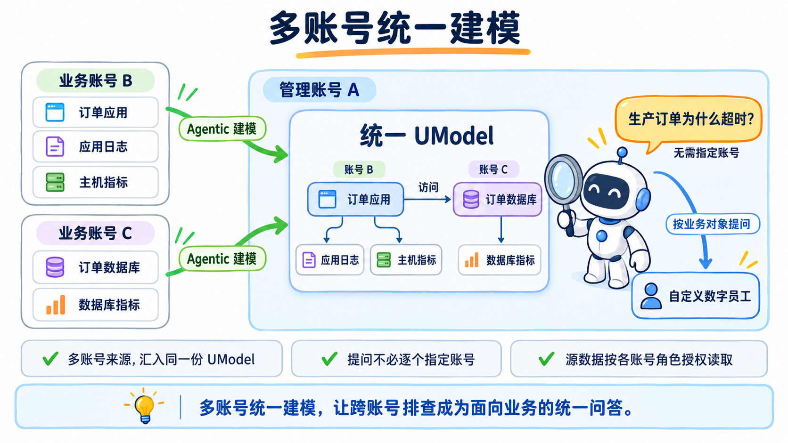
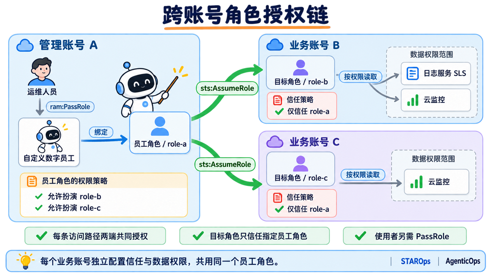
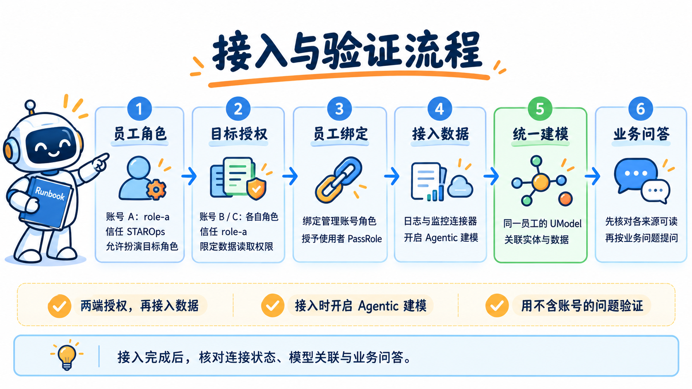
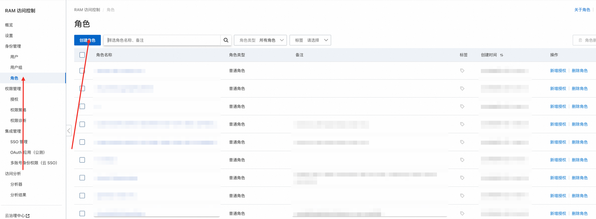
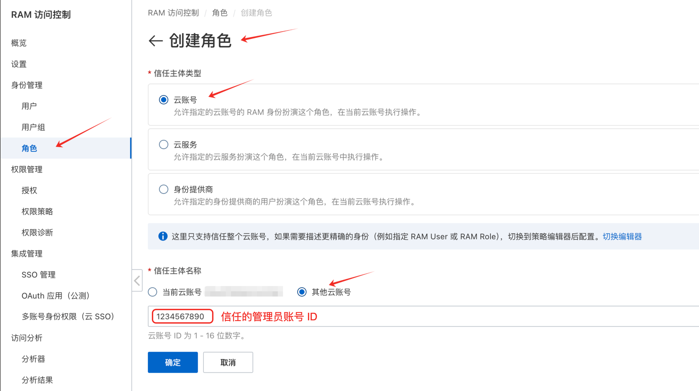
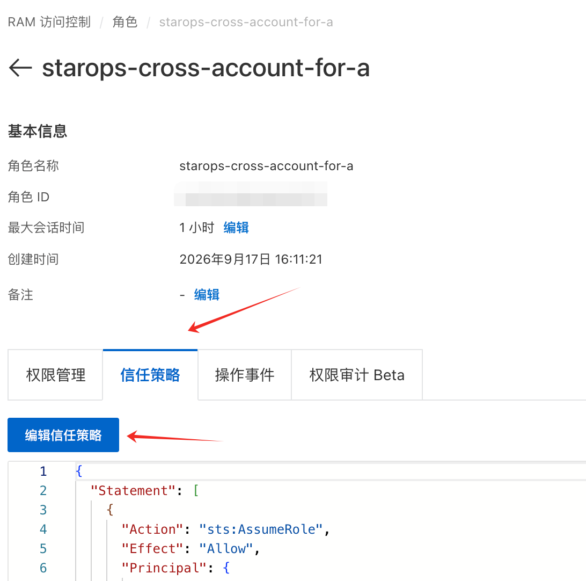
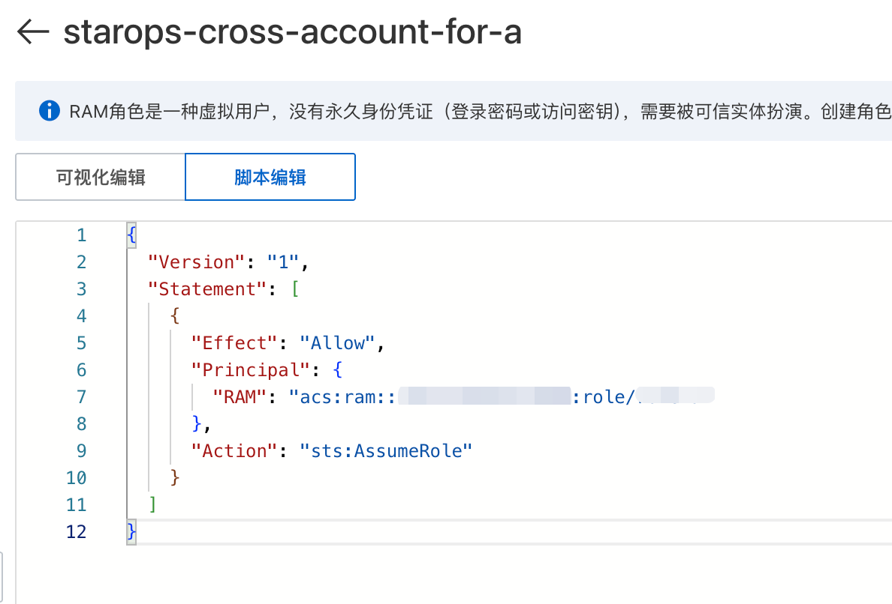
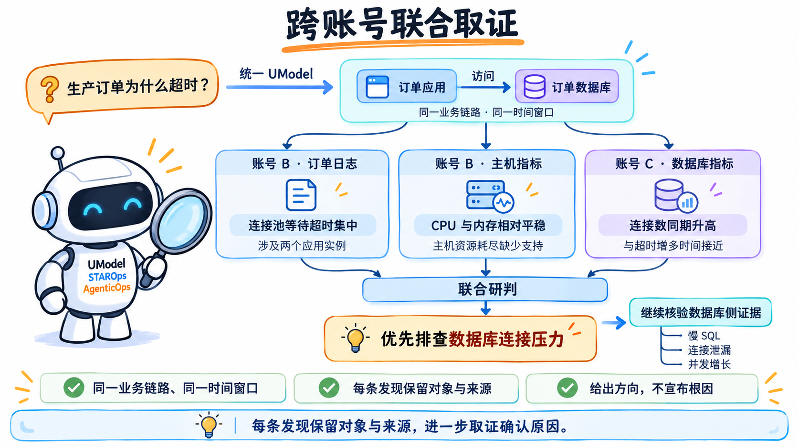
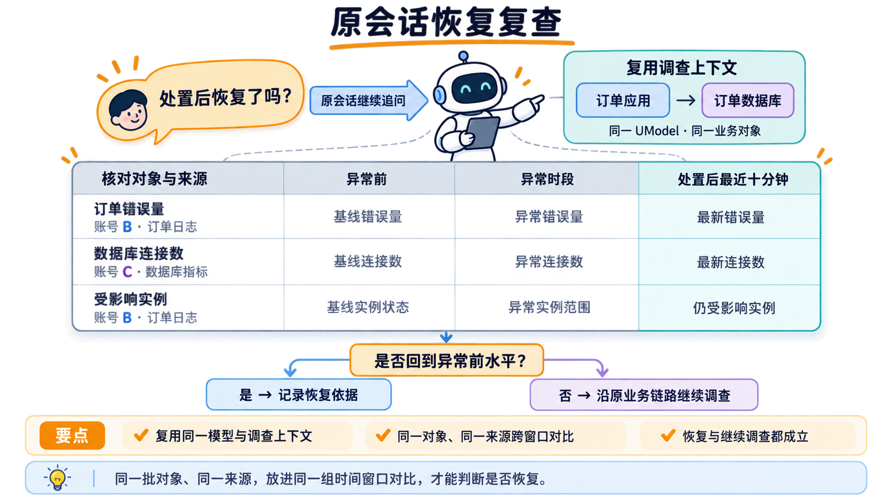

<div class="sls-starops-article-crumb">
  <a href="/doc/starops/starops.html">STAROps</a> <span class="sep">/</span> <span>协作闭环</span>
</div>

# 跨账号统一建模与问题排查

<div class="sls-starops-article-meta">
  <span>分类 · 协作闭环</span>
</div>

生产订单服务开始大量超时。值班工程师应急的第一步往往是登录多个账号，应用日志和主机指标在交易账号，数据库指标又在另一个账号。过去，这意味着切换账号、找到对应的 Project 和工作空间，再把不同页面上的线索整理到一起。业务账号越多，这些准备工作越容易打断调查。

有了 STAROps 的数字员工，可以实现日志查询、指标分析和关联取证。这些能力的实现，除了打通访问权限，还需要把不同账号中的应用、数据库、日志和指标组织成统一的业务上下文，让数字员工知道一个业务问题涉及哪些对象、应该到哪里取证。同时多个账号的凭证信息，需要对数字员工黑盒，不能暴露给大模型。

STAROps 通过连接器和独立授权的集成方式，敏感凭证不进入沙箱和数字员工上下文，基于跨账号 RAM 角色接入多个业务账号，再通过 **Agentic 自动建模**将这些来源的实体、关系和数据组织到同一个 **UModel** 中。建模完成后，工程师可以直接围绕业务问题提问，无需在每个问题中指定账号、Project 或工作空间；数字员工沿统一模型定位对象，通过相应连接器访问源数据。**多账号统一建模，让跨账号排查成为面向业务的统一问答。** 本文以生产订单服务超时为例，介绍从授权、接入、建模到调查与恢复复查的完整做法。

::: details 多账号统一建模：多账号数据自动建模到统一 UModel，并按业务问题联合排查

:::

## 为什么跨账号排障需要统一访问与建模

企业用多个云账号隔离业务线和生产环境，运维团队又需要集中处理告警。账号隔离保留了资源的归属边界，也让一次调查所需的数据分散在不同的访问身份后面。

把这件事交给 Agent，需要把访问方式提前配置好。只在提问中写生产账号的名称，无法赋予数字员工对应的访问权限；运维人员自己能打开业务账号的日志，也不能说明自定义数字员工能读取同一份数据。

**跨账号调查应同时确定运行身份和数据范围。** 管理账号负责组织数字员工及其使用入口，业务账号通过目标角色决定开放哪些资源、允许哪些操作。数字员工沿这条已授权的访问路径取证，工程师可以围绕业务问题连续追问。

授权以后，还需要解决不同来源的对象对应问题。订单应用在一个账号、它访问的数据库在另一个账号时，按账号分别查数据仍然需要人来拼接证据。**统一建模把应用与依赖关系连起来，使一次业务调查可以自然跨越账号边界。** 工程师只需描述业务对象、环境和异常现象，数字员工通过模型找到相关来源。

数字员工的职责也应与访问范围一致。负责交易生产环境的员工，只接入履行这项职责需要的数据；测试环境、其他业务线由各自的员工承接。这样，团队可以分别管理谁能使用员工，以及员工能访问什么。对话中的范围说明帮助聚焦调查，实际访问边界由角色权限和连接器配置落实。

## STAROps 的做法

### 用角色扮演连接两个账号

**自定义数字员工使用绑定的 RAM 角色运行。** 跨账号访问时，员工使用管理账号 A 中的员工角色 `role-a`，分别扮演业务账号 B 中的目标角色 `role-b`、业务账号 C 中的目标角色 `role-c`。角色扮演是 RAM 提供的临时访问机制，数字员工由此获得各目标角色允许的数据访问能力。

::: details 跨账号角色授权链：管理账号 A 的员工角色分别访问业务账号 B 和 C，各账号独立授权

:::

每条访问路径都由两端共同授权。以 A 访问 B 为例：`role-a` 需要允许扮演指定的 `role-b`；`role-b` 的信任策略需要允许 `role-a` 扮演，并通过权限策略授予所需的数据读取能力。C 中的 `role-c` 按相同方式独立配置信任与数据权限。**目标角色的信任主体应收敛到具体员工角色。** 角色信任关系决定谁能使用它，数据权限决定使用它以后能做什么。

接入多个业务账号时，按相同方式分别配置各账号的目标角色，再由各连接器使用对应角色。它们可以归属同一名数字员工，共同服务于这名员工的业务职责。

使用者权限单独配置。运维人员需要相应的 STAROps 使用权限，以及将 `role-a` 传递给 STAROps 的 `ram:PassRole` 权限。`PassRole` 控制谁能使用这份运行身份，业务账号的数据读取权限仍由 `role-b` 承载。权限模型及策略模板见[《权限配置》](https://help.aliyun.com/zh/starops/user-guide/permission-configuration/)，两端角色的配置见[《STAROps 跨账号访问权限实践》](https://help.aliyun.com/zh/starops/use-cases/practice-of-starops-cross-account-access-permission)。

### 按数据类型接入连接器

角色解决访问身份，连接器把这个身份与实际的数据入口配置在一起。STAROps 的日志服务、云监控和阿里云资源连接器都支持跨账号角色，但它们承担的任务不同。

| 调查需要 | 选择的连接器 | 连接目标 |
|---|---|---|
| 查询错误日志、分析日志分布 | 日志服务 SLS | 业务账号指定地域的 Project |
| 查看指标、链路和已有实体 | 云监控 2.0 | 业务账号指定地域的工作空间 |
| 补充查询云资源当前状态 | 阿里云资源 | 目标角色有权限访问的云产品资源 |

日志和监控调查优先接入前两类。阿里云资源连接器用于查询或管理云资源，**不会导入原始观测数据**。因此，接入一个云资源连接器，不能代替日志 Project 和监控工作空间的接入。

每个连接器使用一套访问身份，创建时应核对目标账号、地域及数据源。配置方法见[《接入日志服务 SLS》](https://help.aliyun.com/zh/starops/user-guide/connect-to-log-service-sls-of-starops)、[《接入云监控 2.0》](https://help.aliyun.com/zh/starops/user-guide/connect-to-log-service-sls)和[《接入阿里云资源》](https://help.aliyun.com/zh/starops/user-guide/access-alibaba-cloud-resources)。

### 将多账号数据自动建模到同一个 UModel

在同一数字员工下接入多个业务账号，并为相关连接器开启 **Agentic 建模**后，STAROps 会按各连接器的访问身份和范围探索数据，分析日志结构、工作空间中的实体及不同来源之间的关系，将结果保存到当前数字员工的统一模型中。

这个 **UModel** 同时组织业务对象、对象之间的关系和可访问的数据。账号 B 中的订单应用、应用日志与主机指标，以及账号 C 中的订单数据库和数据库指标，可以围绕订单业务建立关联。数字员工从订单应用出发，就能沿应用访问数据库的关系继续调查，并找到两端对应的日志和指标。具体配置见[《通过连接器自动建模》](https://help.aliyun.com/zh/starops/user-guide/automatic-modeling-via-connectors)。

建模时会保留来源账号、地域、资源标识和数据源信息，依据实例标识、访问目标等信息识别对象与关系。**模型统一组织业务上下文，源数据访问继续使用各账号授权的角色。** 后续新增业务账号时，其数据可以继续建模并关联到当前数字员工已有的模型中，形成可复用的多账号调查上下文。

### 基于统一模型开展无账号问答

**无账号问答，是指按业务对象提问，无需在每次问题里指定数据所属账号。** 例如，工程师直接问生产订单为什么超时，数字员工就可以从统一模型找到订单应用、它访问的数据库，以及这些对象所在账号的日志和监控数据。

Project、工作空间、地域和角色在接入及建模阶段配置好，运行时由模型与连接器共同确定取数路径。工程师可以把注意力放在错误原因、影响范围和恢复情况上；调查结果仍能对应到具体对象及其数据来源，便于继续追问和核验。

## 典型场景：从管理账号调查生产订单超时

某零售企业在管理账号 A 使用 STAROps，生产订单应用位于业务账号 B，订单数据库由业务账号 C 管理。交易运维团队希望由一名数字员工完成这条业务链路的调查。以下名称与读数用于说明这一场景。

| 对象 | 示例配置 |
|---|---|
| 管理账号 A | 创建自定义数字员工，名称为交易生产运维 |
| 业务账号 B | 存放生产订单应用、应用主机及其日志和监控 |
| 业务账号 C | 存放订单数据库及其监控 |
| 目标地域 | 华北 2（北京） |
| 日志来源 | B 中的 Project `retail-prod-logs`，订单日志库 `order-app` |
| 应用监控来源 | B 中的云监控工作空间 `retail-prod`，已有订单应用、ECS 的指标和实体关系 |
| 数据库监控来源 | C 中的云监控工作空间 `trade-db-prod`，已有订单数据库的实体和指标 |

订单日志中保留应用名、实例标识和数据库目标信息，能够对应到应用主机和实际访问的订单数据库。STAROps 通过自动建模把这三个来源放进同一份业务上下文，让应用侧与数据库侧的证据可以一起用于调查。

### 准备账号与资源信息

操作前，在 A 中开通 STAROps 并准备一个用于数字员工的工作空间；在 B、C 中确认相应的日志或云监控数据已经存在且有数据。各账号分别由具备 RAM 管理权限的人员完成角色配置。下面先配置 A 到 B 的访问，再以同样方式接入 C。

下面的策略使用占位符表示账号，复制时替换为实际值。**账号 ID 使用主账号 ID，不能填写 RAM 用户 ID。**

| 变量或对象 | 本例取值 | 用途 |
|---|---|---|
| `{uid-a}` | 管理账号 A 的主账号 ID | 员工角色和 PassRole 的账号段 |
| `{uid-b}` | 业务账号 B 的主账号 ID | 目标角色的账号段 |
| `{uid-c}` | 业务账号 C 的主账号 ID | 数据库监控目标角色的账号段 |
| 员工角色 `role-a` | `starops-trade-operator` | 绑定到管理账号中的数字员工 |
| 目标角色 `role-b` | `starops-trade-prod-reader` | 在 B 中承载数据读取权限 |
| C 中的目标角色 `role-c` | `starops-trade-db-reader` | 在 C 中承载数据库监控读取权限 |
| 员工角色 ARN | `acs:ram::{uid-a}:role/starops-trade-operator` | 数字员工绑定值、目标角色信任主体 |
| 目标角色 ARN | `acs:ram::{uid-b}:role/starops-trade-prod-reader` | 连接器的跨账号 Role ARN |
| C 的目标角色 ARN | `acs:ram::{uid-c}:role/starops-trade-db-reader` | 数据库监控连接器的跨账号 Role ARN |

整个接入过程如下。准备各账号的身份与授权后，将数据连接到同一名员工，开启自动建模，再通过不指定账号的业务问题验证统一访问能力。

::: details 接入与验证流程：从角色授权、连接器接入到统一建模与业务问答的接入流程

:::

### 在管理账号准备员工角色

如果已有正常工作的自定义数字员工，可以直接复用它绑定的自定义角色，将下文的 `starops-trade-operator` 替换为实际角色名。首次创建时按以下步骤操作。

1. 使用 A 的 RAM 管理员登录 [RAM 控制台](https://ram.console.aliyun.com/)，进入 **身份管理 > 角色 > 创建角色**。
2. 信任主体类型选择 **云服务**，通过 **切换编辑器** 配置以下信任策略，允许 STAROps 相关服务扮演这个角色。
3. 输入角色名称 `starops-trade-operator`，完成创建。
4. 打开角色详情，复制 **ARN**，后续绑定员工和配置目标角色信任时使用。

::: details 查看员工角色的信任策略

```json
{
  "Version": "1",
  "Statement": [
    {
      "Effect": "Allow",
      "Principal": {
        "Service": [
          "operation-platform.aliyuncs.com",
          "cloudmonitor.aliyuncs.com"
        ]
      },
      "Action": "sts:AssumeRole"
    }
  ]
}
```

:::

为员工角色配置在 A 中使用工作空间和模型所需的读取权限，模板见[《数字员工权限配置》](https://help.aliyun.com/zh/starops/user-guide/digital-employee-permission-configuration)。B、C 的源数据读取权限分别配置在各自的目标角色上。

### 在业务账号创建目标角色

以下截图展示 RAM 中的操作位置。填写时使用前文准备的实际账号 ID 和角色名称。

1. 切换到 B 的 RAM 管理员身份，进入 **身份管理 > 角色 > 创建角色**。

::: details 在 RAM 角色列表中创建角色

:::

2. 信任主体类型选择 **云账号**，选择 **其他云账号**，输入 `{uid-a}`。

::: details 选择云账号及其他云账号作为信任主体

:::

3. 输入角色名称 `starops-trade-prod-reader`，完成创建。
4. 打开角色的 **信任策略**，编辑为下面的内容并保存。将 `{uid-a}` 替换为 A 的主账号 ID；如果复用了已有员工角色，同时替换角色名。

::: details 在角色详情中打开并编辑信任策略

:::

::: details 查看目标角色的信任策略

```json
{
  "Version": "1",
  "Statement": [
    {
      "Effect": "Allow",
      "Principal": {
        "RAM": "acs:ram::{uid-a}:role/starops-trade-operator"
      },
      "Action": "sts:AssumeRole"
    }
  ]
}
```

:::

::: details 在信任策略中指定管理账号的员工角色 ARN

:::

5. 在该角色的 **权限管理** 中单击 **新增授权**，为本次调查选择数据读取策略。B 为独立的交易生产账号、允许员工读取该账号相关观测数据时，可以选择下表中的系统策略。

| 数据类型 | 系统策略 | 权限内容 |
|---|---|---|
| 日志服务 | `AliyunLogReadOnlyAccess` | 日志服务读取与查询，见[策略说明](https://help.aliyun.com/zh/ram/developer-reference/aliyunlogreadonlyaccess) |
| 云监控 | `AliyunCloudMonitorReadOnlyAccess` | 云监控及关联观测数据读取，见[策略说明](https://help.aliyun.com/zh/ram/developer-reference/aliyuncloudmonitorreadonlyaccess) |

**这两条系统策略的授权范围超过单个 Project 或工作空间。** 如果 B 中还包含其他业务数据，应选择组织已有的、限定目标数据范围的自定义读取策略。连接器的目标选择用于确定查询入口，不会缩小 RAM 策略本身的授权范围。自定义授权按目标产品支持的资源粒度配置，方法见[《管理 RAM 角色的权限》](https://help.aliyun.com/zh/ram/user-guide/grant-permissions-to-a-ram-role)。

6. 确认授权主体是 B 中的 `starops-trade-prod-reader`，完成授权，并从角色详情复制它的 **ARN**。后续连接器填写这份目标角色 ARN。

### 授权员工扮演目标角色

目标角色的信任策略准备好后，回到 A，允许员工角色使用这条访问路径。

1. 在 A 的 RAM 控制台进入 **权限管理 > 权限策略 > 创建权限策略**，使用 JSON 编辑器填写下列策略。将 `{uid-b}` 替换为 B 的主账号 ID。
2. 策略名称填写 `starops-assume-trade-prod-reader`，保存。
3. 进入 **身份管理 > 角色**，打开 `starops-trade-operator`，单击 **新增授权**，选择刚创建的自定义策略。
4. 确认策略已出现在员工角色的权限列表中。

::: details 查看 AssumeRole 策略

```json
{
  "Version": "1",
  "Statement": [
    {
      "Effect": "Allow",
      "Action": "sts:AssumeRole",
      "Resource": "acs:ram::{uid-b}:role/starops-trade-prod-reader"
    }
  ]
}
```

:::

**这条策略附加给 A 的员工角色；B 的信任策略写入 A 的员工角色 ARN。** 两端分别完成配置后，员工才能扮演指定的目标角色。

### 创建数字员工并授予使用权限

1. 在 A 中，为配置人员授予创建和管理自定义数字员工的 STAROps 操作权限；为日常运维人员授予使用员工和会话的权限。可分别采用[《数字员工权限配置》](https://help.aliyun.com/zh/starops/user-guide/digital-employee-permission-configuration)中的 **创建和管理自定义数字员工**、**仅对话权限**模板，并按职责收敛。
2. 在 A 的 RAM 控制台创建下列自定义策略 `starops-pass-trade-operator`，替换 `{uid-a}`，将其授权给需要配置或使用这个员工的 RAM 用户或用户组。如果已有权限模板包含 PassRole，直接把相应 Resource 改为这份员工角色 ARN。

::: details 查看 PassRole 策略

```json
{
  "Version": "1",
  "Statement": [
    {
      "Effect": "Allow",
      "Action": "ram:PassRole",
      "Resource": "acs:ram::{uid-a}:role/starops-trade-operator",
      "Condition": {
        "StringEquals": {
          "acs:Service": [
            "operation-platform.aliyuncs.com",
            "cloudmonitor.aliyuncs.com"
          ]
        }
      }
    }
  ]
}
```

:::

3. 登录 [STAROps 控制台](https://starops.console.aliyun.com/)，进入 **数字员工 > 创建数字员工**，填写以下信息，其余必填项按页面完成。

| 配置项 | 本例填写 |
|---|---|
| ID | `trade-prod-ops` |
| 显示名称 | 交易生产运维 |
| 选择地域 | 华北 2（北京），作为员工的数据存放地域 |
| RAM 角色类型 | **自定义角色** |
| RAM 角色 ARN | `acs:ram::{uid-a}:role/starops-trade-operator`，替换为实际 ARN |
| 描述信息 | 负责生产订单应用及其数据库的跨账号调查与恢复复查 |

4. 单击 **确定**。已有员工可进入 **设置 > 通用配置**，核对其绑定的 RAM 角色，具体见[《查看与编辑数字员工》](https://help.aliyun.com/zh/starops/user-guide/managing-the-digital-workforce)。

**员工绑定 A 中的角色，各业务账号连接器使用本账号的目标角色。** 使用者的 PassRole 指向 A 中的员工角色。

### 接入业务账号的日志与监控

1. 打开交易生产运维，进入 **设置 > 连接器 > 可观测**，单击 **添加可观测**，选择 **日志服务**，再单击 **下一步**。
2. 按下表的日志列填写连接器 ID、名称和角色。**阿里云角色**选择 **跨账号角色**，粘贴 B 中目标角色的实际 ARN。
3. 单击 **检查权限**。通过后，在 **连接目标** 选择 **华北 2（北京）**，再选择 `retail-prod-logs`。
4. 在建模选项中开启 **Agentic 建模**，让 STAROps 分析日志结构、组织数据语义并关联业务对象。自动建模会发起会话，按实际用量计费。
5. 进入 **检查并添加**，核对角色、地域、Project 和建模选项，单击 **保存**。
6. 返回 **可观测**，再次单击 **添加可观测**，选择 **云监控 2.0**。按下表监控列配置，检查权限后选择北京的 `retail-prod` 工作空间，同样开启 **Agentic 建模**，再检查并保存。

| 配置项 | 日志连接 | 监控连接 |
|---|---|---|
| 类型 | 日志服务 | 云监控 2.0 |
| 连接器 ID | `trade-prod-sls` | `trade-prod-cms` |
| 名称 | 交易生产日志 | 交易生产监控 |
| 阿里云角色 | **跨账号角色** | **跨账号角色** |
| Role ARN | `acs:ram::{uid-b}:role/starops-trade-prod-reader` | 同左，使用 B 中相同目标角色 |
| 地域 | 华北 2（北京） | 华北 2（北京） |
| 连接目标 | Project `retail-prod-logs` | 工作空间 `retail-prod` |
| Agentic 建模 | 开启 | 开启 |

**目标角色、地域和数据源要一起核对。** 这两类连接器的角色、地域及连接目标在创建后不能修改，需要更换时删除后重建。保存连接器后，还需要查看自动建模任务及其生成的模型。

### 接入数据库所在账号

接入 C 时沿用前面的授权方式，将数据连接继续添加到交易生产运维这名员工下。

1. 在 C 中创建角色 `starops-trade-db-reader`，信任主体同样是 A 的员工角色 `acs:ram::{uid-a}:role/starops-trade-operator`，并为它授予订单数据库监控的读取权限。策略选择可参考前文云监控读取策略，按 C 中需要开放的数据范围授权。
2. 回到 A，为 `starops-trade-operator` 增加扮演 C 中目标角色的权限。可以将前面 AssumeRole 策略的 Resource 改为下面的数组，同时保留 B、C 两个目标；也可以单独附加一条仅允许扮演 C 目标角色的策略。

::: details 查看跨账号 AssumeRole 策略

```json
{
  "Version": "1",
  "Statement": [
    {
      "Effect": "Allow",
      "Action": "sts:AssumeRole",
      "Resource": [
        "acs:ram::{uid-b}:role/starops-trade-prod-reader",
        "acs:ram::{uid-c}:role/starops-trade-db-reader"
      ]
    }
  ]
}
```

:::

3. 在该员工的 **设置 > 连接器 > 可观测** 中添加云监控 2.0 连接，填写以下信息，检查权限后保存。

| 配置项 | 数据库监控连接 |
|---|---|
| 连接器 ID | `trade-db-cms` |
| 名称 | 订单数据库监控 |
| 阿里云角色 | **跨账号角色** |
| Role ARN | `acs:ram::{uid-c}:role/starops-trade-db-reader` |
| 地域 | 华北 2（北京） |
| 连接目标 | 工作空间 `trade-db-prod` |
| Agentic 建模 | 开启 |

### 自动建模并确认多账号关联

三个连接器都归属同一名数字员工，建模结果会进入这名员工的统一 UModel。

1. 打开员工的 **数据建模 > 建模任务**，查看三个连接器发起的任务；也可以在连接器详情中单击 **打开建模会话**。
2. 等待任务完成，查看模型应用和关联结果。STAROps 会探索 B 中的应用、日志和主机指标，探索 C 中的数据库实体与指标，再根据日志中的访问目标、实例标识等信息建立跨来源关联。
3. 在生成的模型中查看订单应用、应用实例、订单数据库及其关联数据。本例应能从 `order-service` 关联到 B 中的应用日志和主机指标，并沿访问关系找到 C 中的订单数据库及其指标。
4. 如需继续补充业务对应关系，可以在建模会话中描述业务语义，例如：

> order-service 是生产订单应用，它访问的订单数据库在数据库监控连接中。请结合已有模型和日志中的访问目标，补充这条业务链路的实体与数据关联。

**接入时明确来源，建模后按业务使用。** 账号、地域和数据源归属保留在模型中，数字员工据此确定取数路径；后续提问无需重复列出这些配置。

### 在会话中验证跨账号连接

先在 **可观测** 列表确认三个连接器状态为 **成功**，打开详情核对所属账号、Role ARN、地域和连接目标。然后回到该员工的会话页，先按接入来源确认数据可读：

> 帮我检查交易生产日志、交易生产监控和订单数据库监控这三个连接，确认能读取订单日志、应用主机指标和订单数据库指标，并列出对应业务对象。

结果中应能对应到 B 中的订单日志、应用及主机，以及 C 中的订单数据库，并取得相应数据。统一模型应用完成后，再用一个不包含账号、Project 或工作空间的问题验证无账号问答：

> 看一下生产 order-service 最近十五分钟的错误量、应用主机 CPU 和它访问的订单数据库连接数。

STAROps 应通过模型找到订单应用和关联数据库，分别访问 B、C 的连接器，并在结果中说明证据对应的对象与来源。至此，源数据访问和多账号统一问答都已覆盖。

**查询返回空数据和身份访问失败需要分别处理。** 空数据先核对时间窗口、业务是否有流量和采集是否正常；角色扮演或鉴权失败则打开连接器详情，沿以下路径定位。

| 检查结果 | 应检查的位置 |
|---|---|
| Role ARN 无效 | 从对应业务账号的角色详情复制目标 ARN，确认账号段和角色名 |
| 员工自身身份不可用 | A 中员工角色是否存在、是否信任 STAROps，使用者是否具备对应 PassRole |
| 无法扮演目标角色 | A 的员工角色是否有相应目标角色的 AssumeRole 权限，该业务账号的目标角色是否信任员工角色 |
| 目标 Project 或工作空间不可读 | 数据源是否属于对应业务账号的所选地域，该账号的目标角色是否具备读取权限 |

权限检查、建模关联和业务查询都通过后，就可以直接围绕订单问题开展跨账号调查。

### 围绕订单超时发起调查

下午两点二十，订单创建错误率升高。值班工程师在管理账号 A 打开交易生产运维的会话，直接描述问题：

> 生产 order-service 从今天 14:20 开始超时增多。帮我分析最近半小时的主要错误、受影响实例和相关资源异常，给出证据及下一步建议。

这次提问没有指定账号或数据源。STAROps 从统一 UModel 找到生产订单应用及其日志，从错误类型、发生时间和实例分布确定调查对象，再沿实体关系找到应用主机和订单数据库。应用日志与主机指标通过 B 的连接器读取，数据库指标通过 C 的连接器读取，最后放在同一业务上下文中分析。

::: details 跨账号联合取证：将账号 B 的订单日志和主机指标与账号 C 的数据库指标联合研判，形成有依据的排查方向

:::

这一场景下的结果可以组织为：

| 调查发现 | 证据示例 | 来源 | 对判断的影响 |
|---|---|---|---|
| 错误集中在获取数据库连接超时 | 14:20 后，连接池等待超时占订单错误的 84%，涉及两个应用实例 | B 的订单日志 | 优先调查订单服务与数据库之间的连接压力 |
| 应用主机未同步出现明显负载升高 | 同期两个实例的 CPU 使用率在 30%～45%，内存使用率平稳 | B 的应用主机指标 | 主机资源耗尽的解释缺少支持 |
| 订单数据库连接数在相近时间升高 | 连接数由约 480 升至约 940，与应用超时增加的时间接近 | C 的数据库指标 | 数据库连接压力是优先排查方向 |

数字员工通过统一模型把两个业务账号的日志与指标对应到同一条业务链路和同一时间窗口，给出有证据支撑的排查方向。连接数升高与超时同时出现，还需要数据库侧证据才能进一步区分慢 SQL、连接泄漏或并发增长等原因。工程师据此安排下一步调查，无需逐个账号寻找数据和整理上下文。

### 在原会话中核对恢复情况

数据库负责人完成处置后，值班工程师继续追问：

> 再看最近十分钟的订单错误和数据库连接数，与异常时段对比，确认是否回到异常前水平。

STAROps 复用统一模型中的订单应用、数据库和会话中的调查上下文，分别读取 B 的订单日志和 C 的数据库指标，比较错误量、连接数和受影响实例的变化。**无账号问答贯穿调查与复查：工程师持续追问业务状态，数字员工负责找到各账号中的相应证据。**

::: details 原会话恢复复查：在原会话中对比异常前、异常时段和处置后的订单错误、数据库连接数与受影响实例，判断是否恢复

:::

## 总结

**跨账号接入解决数据可访问，统一建模让多账号数据能够围绕业务一起使用。** STAROps 通过角色扮演和连接器读取各账号数据，通过 Agentic 自动建模形成统一 UModel，再由数字员工按模型开展问答、取证、分析和恢复复查。工程师直接描述业务问题，无需在每次提问中指定账号与数据源。

这套做法也适用于其他业务账号的巡检和报告。扩展时按职责增加目标角色及连接器，将新增来源自动建模并关联到同一员工的业务上下文中。产品建议单个数字员工配置的跨账号连接器不超过 10 个；账号和职责持续增加时，宜按业务线或环境组织数字员工，使统一模型与员工职责相匹配。

## 相关入口

- [返回 STAROps 最佳实践首页](/starops/starops.html)
- [打开 STAROps Playground](/playground/staropsdemo.html)
- [进入 STAROps 控制台](https://starops.console.aliyun.com)

<style>
.sls-starops-article .vp-doc details {
  margin: 12px 0;
}

.sls-starops-article .vp-doc details > summary {
  font-size: 14px;
  line-height: 1.6;
}

.sls-starops-article .vp-doc details img {
  display: block;
  width: 100%;
  max-width: 640px;
  aspect-ratio: 16 / 9;
  object-fit: contain;
  margin: 10px auto 2px;
  background: #f7f9fc;
  border: 1px solid var(--sls-starops-border, #e6ebf3);
  border-radius: 10px;
  box-shadow: none;
}

.sls-starops-article .vp-doc p {
  line-height: 1.85;
  margin: 14px 0;
}

.sls-starops-article .vp-doc h2 {
  margin-top: 36px;
}
</style>
