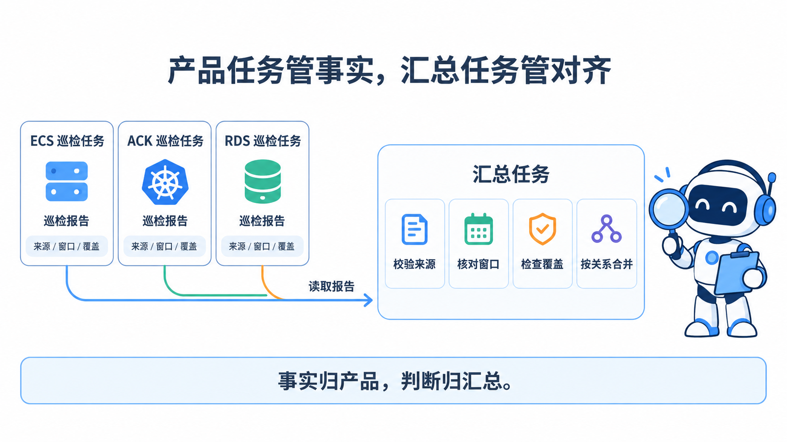
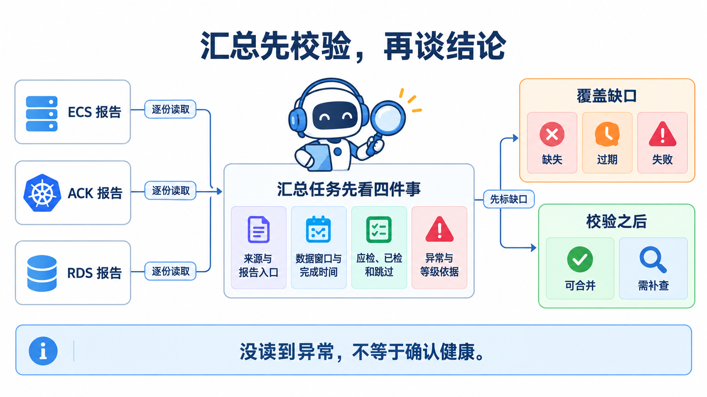
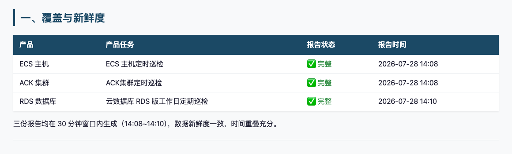
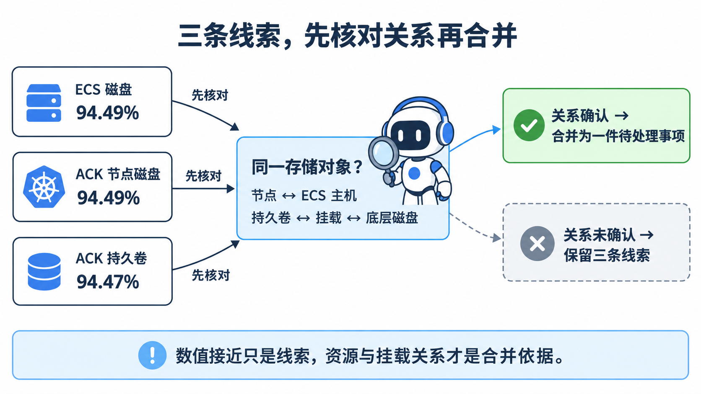
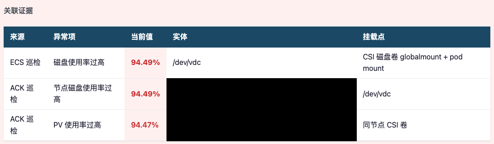

  <a href="/doc/starops/starops.html">STAROps</a> / 主动巡检

# 多云产品融合巡检最佳实践

  分类 · 主动巡检

ECS、ACK 和 RDS 都已经有了自己的巡检任务，值班人员每天还是要分别打开几份报告。主机报告说磁盘快满了，集群报告又列出节点和持久卷告警；它们可能是三个问题，也可能是同一块盘在不同层面的表现。数据库报告一切正常，也未必说明相关业务没有风险。

产品检查越完善，汇总这些信息的工作就越值得认真对待。读报告的人既需要看见异常，也需要知道本轮究竟检查了多少范围、哪些结果还没有出来。若只把几份摘要拼在一起，同一个问题可能被重复安排处理，某个缺失的检查却容易被忽略。

**让值班人员拿到一份能继续处理的报告，是融合巡检的目标。** 这篇实践讲的是同一云账号下多产品巡检结果的汇总：产品任务各自生产事实，汇总任务负责校验来源、时间窗口和覆盖，再按资源关系合并异常；它不是把几份摘要拼在一起，也不是跨云厂商统一接入。

在 STAROps 中，可以增加一个汇总长期任务，继续使用各产品原有的巡检结果，由数字员工核对来源和时间，再依据资源关系整理异常。遇到多产品结果冲突或证据不足时，可以在同一会话中继续深度调查。下面用 ECS、ACK、RDS 的历史测试，说明怎样组织产品任务与汇总任务，以及如何读懂合并后的结果。

## 保留产品检查，把汇总需要的信息交接清楚

每个产品都有自己的检查方法。ECS 关心主机指标和系统日志，ACK 会检查节点、工作负载与存储，RDS 也有对应的指标或事件规则。已有巡检可以继续运行，汇总任务负责理解这些结果之间的关系；因此，首先要把每份报告来自哪里、检查了什么交代清楚。

这份交接不一定要先设计一套复杂格式。如果已有 Markdown 报告能够稳定给出资源、时间和检查明细，就可以先复用。产品较多、需要程序校验时，再约定结构化结果文件。关键在于，数字员工读到一条异常以后，能够找到原始报告，也能判断它是否属于本轮应检查的范围。

| 信息 | 在汇总时的用途 |
| --- | --- |
| 来源任务与报告入口 | 找到原始结果，避免读错任务 |
| 数据窗口和完成时间 | 区分当前结果与历史结果 |
| 应检、已检和跳过范围 | 判断覆盖是否完整 |
| 异常资源、读数和等级依据 | 比较多个报告里的异常 |
| 查询或关系依据 | 核对是否涉及同一个资源或业务 |

历史测试中，三个产品任务的报告命名并不一致：有的采用英文文件名，有的使用中文巡检报告加生成时间。汇总任务通过明确的来源清单读取三份结果，继续提取其中的检查信息。只靠文件名中是否带有巡检来猜，容易漏读或把其他任务的结果纳入；明确来源以后，命名差异就不必成为汇总的障碍。

报告里的检查范围也不能省略。RDS 的一份事件巡检报告，与同时查询 CPU、连接数、慢 SQL 的报告，覆盖内容不同。两者即使都写正常，也不能在汇总时被当作同一种健康结论。

## 先确定本轮哪些结果可用

汇总任务运行时，先逐份确认产品结果的来源、完成状态和数据窗口。报告刚生成，不一定意味着里面的数据足够新；最近一份报告，也可能已经是上一轮的结果。对于没有按时完成的产品任务，保留缺失说明，同时汇总已经取得的内容，读者才知道哪些结论可以使用。

历史配置把三个产品任务安排在工作日 06:00，汇总安排在 06:30，给报告生成留出间隔。那轮测试实际在下午执行：ECS 和 ACK 的报告生成于 14:08，RDS 为 14:10，汇总报告为 14:56。汇总时据此确认读取的是哪几份结果，并继续核对各报告的数据窗口。**错峰执行方便安排，每轮是否齐备仍要检查。**

有了报告，还要继续读它的覆盖明细。该轮 ECS 完成了 18 项指标检查，但由于系统日志未接入，没有完成 OOM 日志检测。ACK 环境没有 GPU，对应检查属于不适用。两种情况都没有异常记录，含义却不同：前者需要补数据，后者可以在本环境中明确排除。

RDS 报告涉及 32 个实例，在所查询的规则事件窗口内没有发现异常。汇总时保留这一范围，读者就能理解结果；若直接改成所有数据库健康，就把没有检查的部分也包含进去了。把这些信息放在报告前面，值班人员不用读完所有明细，便知道今天哪些范围已经检查、哪些还需要补齐。

## 同一资源上的异常怎样合并

这轮历史报告里有一组磁盘异常。ECS 给出的使用率是 94.49%，ACK 节点磁盘也是 94.49%，持久卷则为 94.47%。原汇总报告根据产品报告中的节点、设备和挂载信息，将它们组织成了一组容量风险。下面泛化了资源名称，只保留理解判断所需的读数。

| 来源 | 报告中的发现 | 汇总时需要核对的关联 |
| --- | --- | --- |
| ECS | 数据盘使用率 94.49% | 主机、设备与挂载位置 |
| ACK 节点 | 节点磁盘使用率 94.49% | 节点与 ECS 主机的对应关系 |
| ACK 存储 | 持久卷使用率 94.47% | 卷、挂载位置与底层磁盘的对应关系 |

这组结果把不同观察位置连接起来。主机侧看到了高水位，节点和卷侧也有对应表现，维护人员就应该优先核对它们是否落在同一存储对象上。如果映射能够确认，可以围绕这个对象统一安排容量检查，同时保留各来源的读数与报告入口。

**数值接近只能提示可能相关，资源与挂载关系才是合并依据。** 核对时，先确认 ACK 节点对应哪台 ECS，再确认卷挂载到哪个设备或文件系统。仅找到候选关系时，可以在报告中把几项放在一起提示，待映射确认后再合并处理。这样既保留了线索，也不会过早把独立问题算成一个。

历史汇总复用了产品报告中已有的映射描述。要在其他环境中采用同样做法，需要检查自己的资源标识是否能够对应；不同部署形态下，节点、云盘和持久卷的关系未必相同。已有关系可以通过数据建模（UModel）或相关产品信息补查，报告里也应留下核对依据。

合并之后，磁盘为什么增长仍然是一个待查的问题。高水位本身不能证明是日志堆积，也不能直接决定清理哪类文件。维护人员可以沿这组关联继续查看空间构成、增长记录和使用它的工作负载，再决定扩容或清理方式。融合巡检在这里先解决的是处理对象重复的问题，为后续调查提供共同起点。

同一轮报告还列出了容器内存偏高、频繁重启和工作负载不可用。这些异常没有足够证据与该磁盘问题关联，仍然需要分别保留。等级也要看具体规则：不同产品都使用 P1、P2，并不意味着紧急程度完全相同。汇总可以采用团队统一的排序，但应保留原等级及调整依据，让读者知道为什么某个问题被排在前面。

## 在 STAROps 中建立汇总任务

先选定需要汇总的几个产品任务，确认数字员工能够读取它们的结果。报告位置和访问权限要在实际环境中核对。第一次可以各取一份报告，请数字员工列出来源、数据窗口、检查范围和未完成项；这一步做对了，后面的关联分析才有可靠的输入。

接下来[创建长期任务](https://help.aliyun.com/zh/starops/user-guide/creating-and-planning-long-term-mission)，说明汇总目标。例如：

> 每个工作日汇总指定的 ECS、ACK 和 RDS 巡检任务结果。先列出本轮覆盖情况，再整理需要处理的异常；只有资源关系能核对的异常才合并。缺失或过期的报告单独说明，每项保留原始报告入口。需要处理的问题统一通知值班人员。

检查任务规划时，核对来源清单、执行时间和通知对象，然后执行一次。报告中的每一组异常，应能回到对应产品的原始结果。对已经合并的项目，还要看读者能否理解为什么合并，以及后续应该查哪一个对象；只有汇总标题，缺少这些依据，仍然需要人工重新拼接信息。

历史测试保留了 ECS、ACK、RDS 三个产品任务和一次汇总过程的记录，以及 Markdown、HTML 两种格式的汇总报告。当时产品任务没有单独配置邮件通知，汇总任务发送了统一报告。这个安排适合减少重复通知；如果团队还需要保留某类紧急告警的直接通知，则要明确与汇总通知的分工，避免值班人员误以为收到了新的问题。

**这套配置与历史报告用于说明方法，不能作为已经适配好的生产方案直接照搬。** 将流程用于自己的环境，或进一步整理成 Skill 时，需要核对产品与数据库版本、部署形态、检查范围、报告格式、实体映射、等级规则和访问权限。历史测试能读取指定任务的产物，不代表所有环境都具有相同的读取条件。

## 下一轮怎样判断问题是否还在

汇总报告持续运行后，维护人员还会关心昨天处理的问题是否已经消失。可以用资源标识和风险类型对应前后两轮结果，分别展示新增、持续和已确认恢复的问题；发生过资源替换或映射变化时，也要保留说明，避免只靠名称匹配。

恢复判断需要本轮的有效检查。磁盘清理以后，ECS 与 ACK 对应的观测都重新取得，并且水位回落，才有依据更新状态。若其中一份报告没有生成，或者原检查被跳过，先记为尚未复核。这样，下一个接班的人就能区分问题已经处理，和今天暂时没有看见它。

几个产品给出冲突结果时，也可以从汇总继续深度调查。先核对它们是否看同一对象、同一时段，再查看采集或资源变化。报告逐轮积累下来，团队看到的应是一份可以接着工作的记录：哪些事项新出现，哪些仍待处理，哪些已有恢复依据，以及哪些检查需要先补上。

这套复查方法还需要在下一轮真实报告上验证。历史测试只覆盖了一轮汇总，恢复识别、资源替换后的对应关系和多产品冲突处理，都还没有完整跑过第二轮。

## 总结

融合巡检的分工可以分成两层：**产品任务负责生产事实，汇总任务负责对齐和判断。** 汇总先校验来源、完成时间、数据窗口和覆盖，再按资源与挂载关系合并异常；关系确认不了的，保留为线索，不提前算成一个问题。缺失、过期和无法判断的结果要单独留下，不能因为汇总表没有红色就当作正常。

汇总任务不替代产品检查，也不承诺把所有产品统一成一套接口。它做的是在当前报告格式和权限条件下，把值班人员原本要手工做的来源核对、覆盖检查和重复归并接过来。汇总任务还没有可直接照搬的生产 Skill；跨云厂商、固定 P0 和原报告的因果链也不在本篇结论范围内。

下一轮上班时，值班人员打开一份报告，能看见哪些事项新出现、哪些仍待处理、哪些已有恢复依据、哪些检查还要先补。这就是汇总报告应该交付的东西。

## 相关入口

- [返回 STAROps 最佳实践首页](/starops/starops.html)
- [打开 STAROps Playground](/playground/staropsdemo.html)
- [进入 STAROps 控制台](https://starops.console.aliyun.com)

