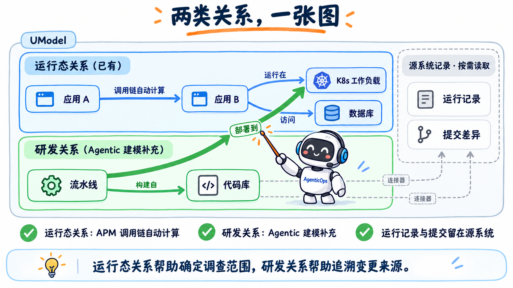
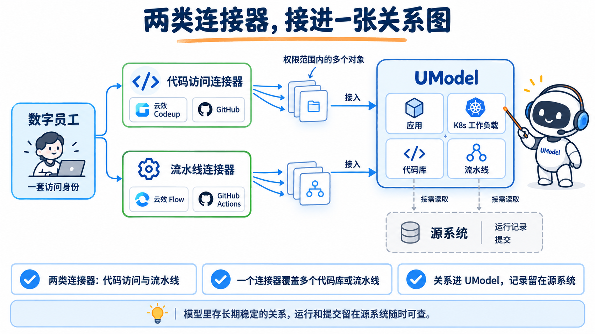
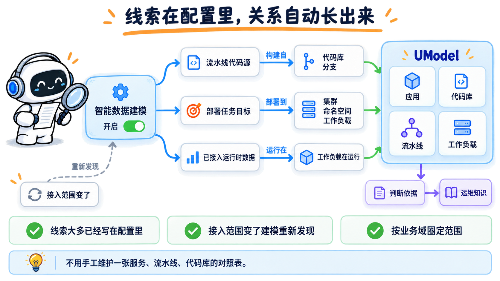
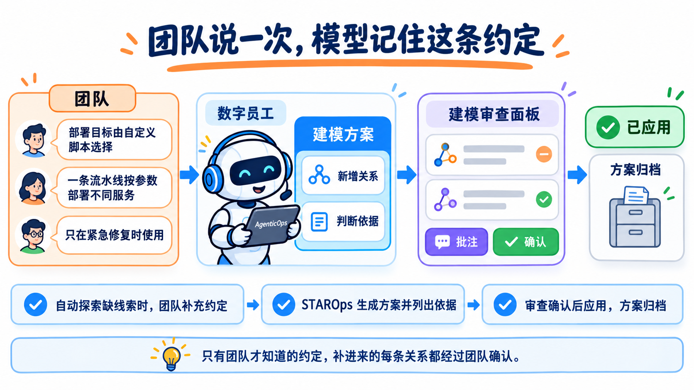
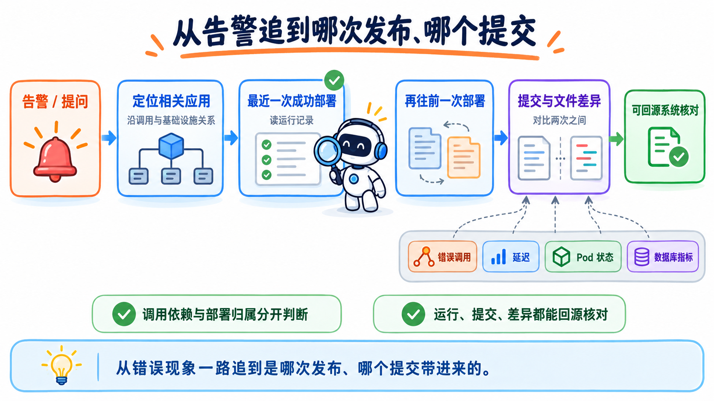
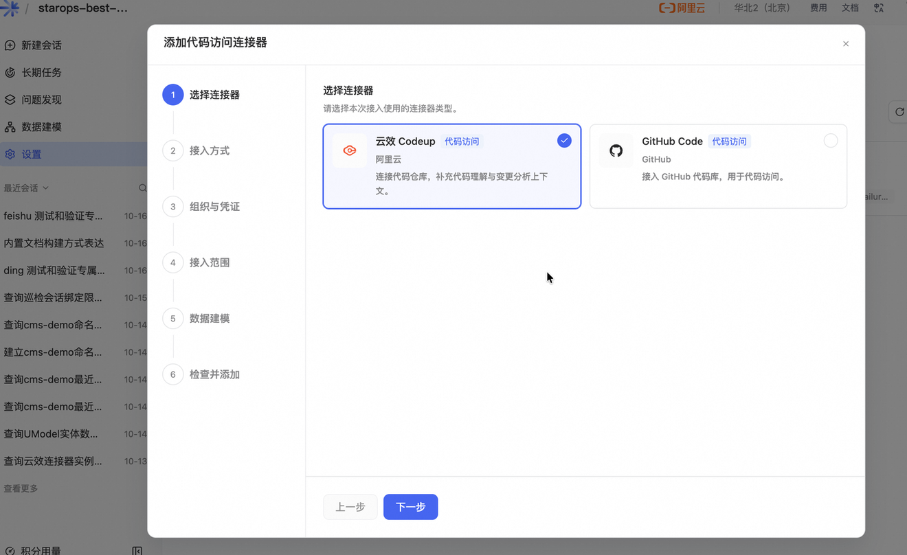
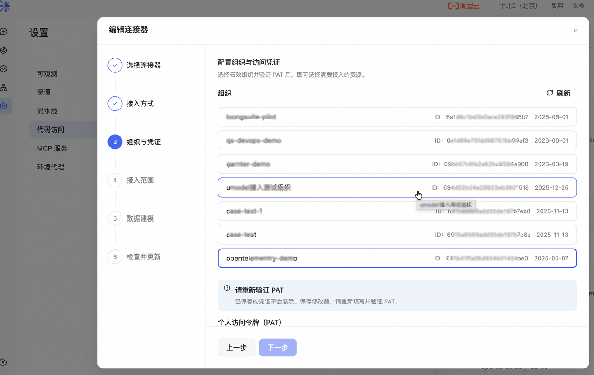
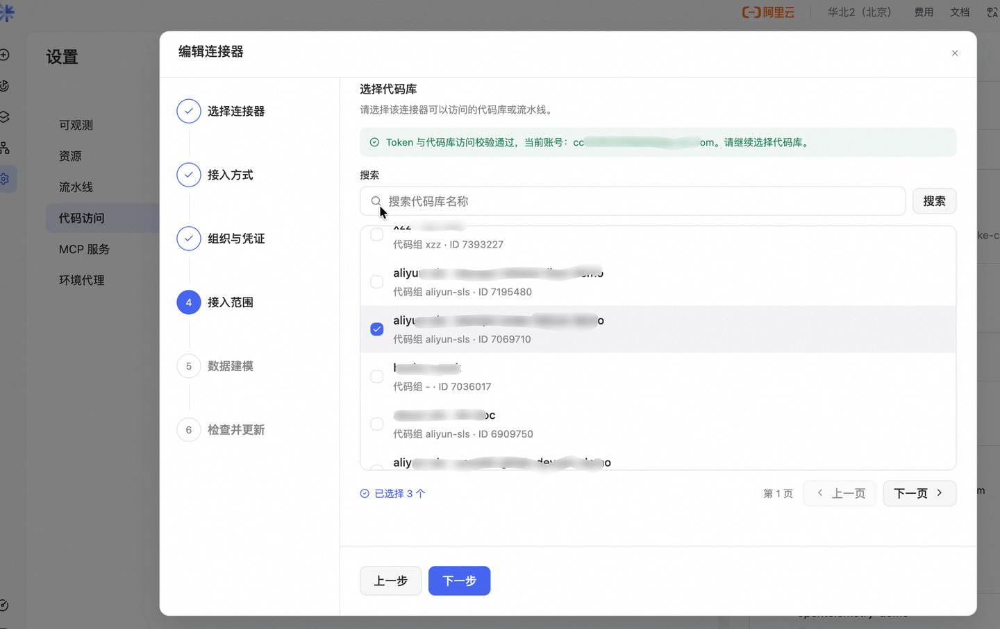
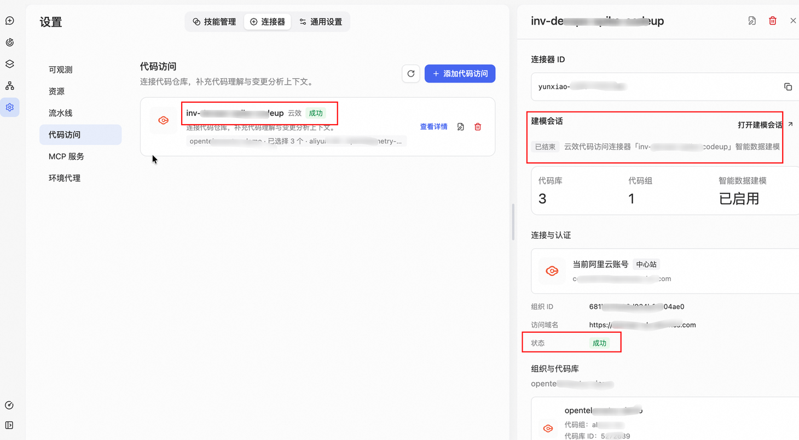

  <a href="/doc/starops/starops.html">STAROps</a> / 协作闭环

# 从运行异常追到代码变更

  分类 · 协作闭环

下午两点二十，核心错误率告警响了。下单请求经过订单、优惠券、库存等多个微服务，告警调查把失败落到 order-service 调用 inventory-service 读超时。这几个服务由不同代码库和流水线独立发布，当天也都有变更。值班工程师接下来要回答的问题是：哪一个服务的哪次发布，引起了这次下单失败？

APM 调用链已经能说明请求经过哪些应用、时间花在哪一跳，结合 K8s 和数据库数据，还能查看应用对应的工作负载与依赖的基础设施。接下来却要离开监控：去流水线平台找这些服务各由哪些流水线发布，确认哪次运行真正部署到了生产；再拿对应的提交去代码平台，和上一次部署比一比。拿不准的时候，还得在群里问今天谁发过哪个服务。监控、流水线、代码库各有各的答案，费时间的是把它们对上。

本文介绍在 STAROps 里怎样把这件事交给数字员工：**在已有运行态关系上，通过 Agentic 建模补上代码库、流水线和应用的关系。** 数字员工从调用链定位到的异常服务和依赖出发，沿着关系追到各自的部署和提交，再把变更与运行证据对照起来。

## 为什么要把代码和流水线连进来

AgenticOps 让 Agent 承担取证和推理，人负责判断和决策。Agent 能追多远，取决于它手里的数据有没有连起来。

变更是线上故障最常见的诱因之一。告警调查能把问题定位到服务、工作负载或接口，可是哪次变更引起的，答案不在指标和日志里，而在流水线的运行记录和代码库的提交里。

把这一步交给 Agent，最直接的办法是给它流水线和代码平台的接口，让它每次自己去查。运行和提交都查得到，查不到的是它们和运行时对象的对应关系：order-service 这个工作负载由哪几条流水线部署，每条流水线构建的是哪个代码库。没有这层关系，Agent 只能按名字相似、时间相近去猜，而这两种猜法在生产环境里都很容易出错：

- **名字对不上。** 流水线、代码库、工作负载由不同的人在不同时候命名，名字未必一致。一条流水线部署好几个服务，一个服务既有正式发布流水线、又有紧急修复流水线，也很常见。
- **离告警最近的变更，不一定是这个服务的部署。** 同一个命名空间里，别的服务十几分钟前刚发布，时间上离告警更近，看起来更可疑。
- **最近一次运行，不一定是一次部署。** 失败的运行没有把代码部署上去。拿最近两次运行做对比，累计改动会漏掉那次失败运行带进来的提交，而问题可能恰好出在那里。

每次都猜一遍，答案就可能每次不同，也说不清它是怎么得出来的。

更好的做法，是把这层对应关系变成数据：代码库、流水线和应用、K8s 工作负载放进同一个实体关系模型，哪条流水线部署哪个工作负载、构建自哪个代码库，作为关系存下来。Agent 从调用链上的相关应用找到各自的流水线，从运行记录找到实际部署和对应提交，再比较两次部署之间的改动。**运行态关系帮助确定调查范围，研发关系帮助追溯变更来源。** 关系建好后，告警调查和日常追问可以持续复用。

## STAROps 的做法

STAROps 用 UModel 承载这些实体和关系。**应用之间的调用关系由 APM 根据调用链自动计算**；结合调用链中的数据库访问、应用实例信息和 K8s 资源数据，还能关联应用运行在哪些工作负载上、访问哪些数据库等基础设施。数字员工沿着这些已有关系，查看相关应用及基础设施的日志、指标和调用链。

**本篇新增的是通过 Agentic 建模建立代码库、流水线与应用的关系。** 接入研发系统后，STAROps 探索流水线代码源、部署配置和运行时对象，把构建、部署关系补进同一个 UModel。这样，从应用调用和基础设施排查得到的线索，就能继续追到发布和代码。下面四项能力配合完成这件事。

这两类关系共同组成数字员工手里的实体关系图：运行态关系来自 APM 调用链与基础设施数据，研发关系由 Agentic 建模补充；运行记录与提交差异留在源系统，数字员工按需通过连接器读取。

::: details 两类关系，一张图：运行态关系由 APM 调用链自动计算并关联基础设施，研发关系由 Agentic 建模补充

:::

### 内置连接器接入代码库和流水线

STAROps 提供两类内置连接器：代码访问连接器接入云效 Codeup 和 GitHub 代码库，流水线连接器接入云效 Flow 和 GitHub Actions。**一个连接器可以接入其权限范围内的多个代码库或多条流水线。** 接入时按业务域选择范围，把相关微服务的代码库、正式发布和紧急修复流水线一起纳入。连接器归属于一个数字员工，用一套访问身份读取数据，只能看到这套身份有权限的范围。配置步骤见帮助文档：[《接入云效 Codeup》](https://help.aliyun.com/zh/starops/user-guide/connect-to-apsara-devops-codeup)、[《接入云效 Flow》](https://help.aliyun.com/zh/starops/user-guide/connect-to-apsara-devops-flow)、[《接入 GitHub 代码库》](https://help.aliyun.com/zh/starops/user-guide/connect-to-a-github-code-repository)、[《接入 GitHub Actions》](https://help.aliyun.com/zh/starops/user-guide/connect-to-github-actions)。

接入后，范围内的代码库和流水线成为 UModel 里的实体，和这个数字员工已经接入的应用、K8s 工作负载放在一起。每一次运行、每一个提交仍然留在云效或 GitHub 里，数字员工需要时通过连接器去读。

这样分工是有意的。运行和提交每天都在增加，源系统里的记录才是准的。以云效 Flow 为例，流水线在触发的那一刻就把源分支的最新提交写进运行记录，这次运行部署的是哪个提交，由源系统直接给出，不需要推断。模型里存的是长期稳定的关系：哪条流水线部署哪个工作负载，构建自哪个代码库。

::: details 两类连接器把代码库和流水线接进同一个 UModel

:::

> 此外，其他类型的连接器，也可以通过环境代理或者 MCP 的方式接入，例如自建的 Gitlab、Jenkins、ArgoCD 等。

### 智能数据建模自动发现关系

接入代码库和流水线时打开智能数据建模。连接器创建或接入范围变化时，STAROps 会启动建模：探索接进来的数据，找出代码库、流水线和应用、工作负载之间的关系，补进 UModel，并把判断依据沉淀为运维知识。

这些关系的线索大多已经写在配置里。流水线的代码源说明它构建哪个代码库、哪个分支；部署任务的目标说明它更新哪个集群、哪个命名空间下的哪个工作负载；已经接入的运行时数据则说明这个工作负载确实在运行。团队不用手工维护一张服务、流水线、代码库的对照表。接入范围变了，建模会跟着重新发现。

建议按业务域圈定接入范围，把一条业务链路涉及的多个应用、它们的代码库和部署流水线一起接进来。关系两端都在范围里，才能把调用链上的相关应用继续追到各自的发布和代码。

::: details 三条配置线索被翻译成构建自、部署到、运行在关系并补进 UModel

:::

### 对话式建模补上团队才知道的关系

有些关系需要结合团队约定才能确认：部署目标由自定义脚本动态选择，一条流水线按参数部署不同的服务，或者某条流水线只在紧急修复时才使用。自动探索缺少足够线索时，可以由团队补充这些约定。

这时用对话式建模，在会话里直接把这条关系告诉数字员工。STAROps 据此生成建模方案，列出要新增的关系和依据；在建模审查面板里查看、批注方案，确认后应用，方案随即归档。这样补进来的每一条关系，都经过团队确认。

这类只有团队才知道的约定，正是团队该交给 STAROps 的知识；怎么取数、怎么比对，由 STAROps 自己完成。

::: details 团队在会话里说出约定，数字员工生成建模方案，审查确认后应用并归档

:::

### 数字员工沿关系追到部署和提交

关系就位之后，告警调查和日常提问都会用上它。数字员工先沿应用调用和基础设施关系确定相关对象，再找到这些应用各自的部署流水线；通过流水线连接器读取运行记录，找出最近一次成功部署到目标工作负载的运行和对应提交；再往前找到上一次部署，通过代码访问连接器对比两次部署之间的提交和文件差异，最后把这些改动与错误调用、延迟、Pod 状态和数据库指标对照起来。

**调用依赖和部署归属分别判断。** 下游应用的发布可能影响上游请求，需要纳入调查；同一命名空间里其他服务的发布，则要结合调用和基础设施证据判断相关性。每次部署归属于哪个应用、包含哪些提交，以部署目标和运行记录为准。数字员工据此比较相关服务的变更，答案中的运行、提交和差异都能回到源系统核对。

::: details 数字员工从告警沿关系追到最近一次部署、上一次部署，并对比两次之间的提交与文件差异

:::

## 典型场景：电商微服务发布后下单失败

下面以一个简单的电商场景为例。交易系统包含四个独立发布的应用，都运行在 ACK 集群 `ack-prod-hz` 的 `shop` 命名空间，各自对应一个同名 Deployment：

| 应用 | 在业务中的职责 | 云效 Codeup 代码库 | 云效 Flow 流水线 |
| --- | --- | --- | --- |
| `order-service` | 接收下单请求，调用优惠券和库存服务，写入订单数据库 | `shop/order-service` | `order-service-deploy-prod`、`order-service-hotfix` |
| `inventory-service` | 锁定库存，访问库存数据库和 Redis | `shop/inventory-service` | `inventory-service-deploy-prod` |
| `promotion-service` | 校验优惠券、计算优惠价格，访问营销数据库 | `shop/promotion-service` | `promotion-service-deploy-prod` |
| `order-worker` | 消费订单事件，异步更新订单数据库中的订单状态 | `shop/order-worker` | `order-worker-deploy-prod` |

四条正式发布流水线在各自代码库合并到 `main` 分支后构建并部署；`order-service-hotfix` 在紧急修复时手动运行，部署步骤是仓库里的 `deploy/hotfix.sh`。

团队的数字员工「订单值班」已经接入云监控2.0，包括 ARMS、ACK、RDS MySQL 和 Redis 的可观测数据。云监控2.0 支持自动计算 UModel 拓扑：
1. UModel 根据 ARMS 真实调用链自动计算出 `order-service` 对 `inventory-service`、`promotion-service` 的调用关系
2. 结合运行时数据，UModel 里也能查到各应用对应的 K8s 工作负载及数据库、Redis 依赖。例如，`order-service` 和 `order-worker` 都访问订单数据库，`inventory-service` 则访问库存数据库和 Redis。

> 调查下单失败时，这些关系已经可以用来追查慢调用、异常 Pod 和数据库状态。

接下来要补上的是这四个应用分别来自哪个代码库、由哪些流水线部署。

### 接入代码库和流水线

团队给「订单值班」添加两个连接器：**一个代码访问连接器接入上述四个 Codeup 代码库，一个流水线连接器接入上述五条 Flow 流水线**。两条连接器的创建路径相同，以代码访问连接器为例：

1. **打开入口。** 在「订单值班」的 设置 > 连接器 > 代码访问 页面，点击 添加代码访问，选择 云效 Codeup。

::: details 选择连接器类型：云效 Codeup

:::

2. **填写身份与授权。** 填连接器 ID（创建后不可修改）和名称，选择云效中心站和团队所在的云效组织，填入该组织下具备代码库只读权限的个人访问令牌（PAT），点击 校验代码库权限。校验通过后页面会显示当前账号，进入下一步。令牌保存后不会回显，再次校验时需要重新填写。

::: details 填写组织与访问凭证并校验 PAT

:::

3. **选择接入范围。** 在接入范围中勾选上述四个代码库，可按名称搜索。数据建模保持基础建模开启，并打开智能数据建模，让 STAROps 在接入后探索代码库与已有应用、工作负载的关系。

::: details 勾选接入的代码库与数据建模开关

:::

4. **核对并完成。** 在 检查并添加 页核对连接器 ID、组织、已选代码库数量和建模配置，点击 完成。

流水线连接器同样走一遍：设置 > 连接器 > 流水线，选择 云效 Flow，接入范围勾选五条流水线。研发系统在 GitHub 时路径相同，类型改选 GitHub Code 和 GitHub Actions，授权同样使用 PAT。

怎么算接上了：回到 代码访问 和 流水线 列表，两个连接器的类型、状态为 成功，已选代码库和流水线数量与创建时一致。至此四个代码库和五条流水线进入 UModel，STAROps 随后自动启动 Agentic 建模，探索它们与已有应用、工作负载的关系。

::: details 代码访问连接器状态为成功、代码库数量为 3

:::

### 查看自动发现的关系

建模完成后，在会话里问一句：

> 下单链路上的应用分别对应哪些代码库和发布流水线？订单异步处理服务也一起列出来。

数字员工按 UModel 里的关系列出四条正式发布流水线：它们分别构建自表中四个代码库的 `main` 分支，部署到 `ack-prod-hz` 集群 `shop` 命名空间下的四个同名工作负载，并由这些工作负载关联到对应应用。`order-service-hotfix` 的代码源也是 `shop/order-service`，但部署目标尚未识别。

### 用对话式建模补上紧急修复流水线

order-service 的开发负责人在会话里补充：

> order-service-hotfix 也会部署 ack-prod-hz 集群 shop 命名空间的 order-service，部署目标写在仓库的 deploy/hotfix.sh 里。把这条关系建上。

STAROps 生成建模方案：新增流水线 `order-service-hotfix` 部署到工作负载 order-service 的关系，依据是这段说明和脚本路径。负责人在建模审查面板里加了一条批注「只用于生产环境紧急修复」，确认并应用，方案归档。

从这时起，「订单值班」的所有会话和告警调查都知道 order-service 有两条部署流水线。

### 告警之后追问部署和提交

10 月 12 日 14:20，`order-service` 创建订单接口的错误率升到 6.3%，告警触发。这一天，库存服务、订单服务、订单异步处理和优惠券服务都完成过发布。

值班工程师让「订单值班」调查告警。数字员工先沿已有的运行态关系取证：失败集中在 `POST /api/orders` 对 `inventory-service` 的调用，客户端读超时集中在 800 毫秒附近；`promotion-service` 调用正常。相关 Deployment 副本就绪，没有重启或资源饱和；订单与库存数据库的慢查询、连接数、锁等待，以及库存 Redis 的延迟均未见对应异常。`order-worker` 虽然与订单服务共享订单数据库，但当前没有发现数据库争用的证据。

`inventory-service` 服务端没有出现对应的错误增长，但 14:00 下单高峰后 P99 延迟升到 1.1 秒，相关慢请求的服务端耗时集中在 800～1200 毫秒。订单调用方报错、库存服务端仍在处理的现象，需要继续与调用方超时配置对照。零星错误从 13:40 前后开始出现，高峰到来后超过告警阈值。

值班工程师在同一个会话里追问：

> 下单链路上这些服务今天都发过版，哪次变更最可能与这次失败有关？把相关服务的部署时间和代码改动与调用链证据对照，列出流水线、运行、提交和依据。

数字员工从运行态关系中的应用出发，沿 Agentic 建模补上的关系找到各自的代码库和流水线，读取运行记录并比较前后两次部署的代码，先给出相关发布的对照：

| 应用 | 当天最近一次成功部署 | 与异常的对照 |
| --- | --- | --- |
| `inventory-service` | `inventory-service-deploy-prod` #84，12:10 | 改动库存盘点任务；下单峰值前调用延迟稳定，当前慢请求未经过改动分支 |
| `order-service` | `order-service-deploy-prod` #128，13:40 | 包含库存调用超时配置变更，与首批超时出现时间吻合 |
| `order-worker` | `order-worker-deploy-prod` #62，14:05 | 改动订单归档批次；首批超时早于此次发布，共享数据库也未见争用信号 |
| `promotion-service` | `promotion-service-deploy-prod` #91，14:10 | 改动优惠券展示文案；错误调用链中优惠券校验成功 |

每一行都附对应流水线运行记录和代码对比的依据。随后，数字员工展开订单服务的变更：

> **最近一次部署**：流水线 `order-service-deploy-prod` 的运行 #128，10 月 12 日 13:38 由代码合并触发，13:40 部署成功，目标是 ack-prod-hz 集群 shop 命名空间的 order-service，对应提交 `3f9c2e1a`。依据：运行 #128 的运行记录。
>
> **上一次部署**：同一条流水线的运行 #126，10 月 10 日 16:05 部署成功，对应提交 `b71d04e9`。两者之间的运行 #127（10 月 12 日 11:15，提交 `9d41a7c3`）在构建阶段失败，没有执行部署。`order-service-hotfix` 最近一次运行在 9 月 28 日。依据：两条流水线的运行记录。
>
> **两次部署之间的变更**：2 个提交，3 个文件。依据：`shop/order-service` 中 `b71d04e9` 到 `3f9c2e1a` 的对比。
>
> - `9d41a7c3` 调整库存服务调用超时：`application-prod.yaml` 中 `inventory.read-timeout` 从 3000 毫秒改为 800 毫秒。
> - `3f9c2e1a` 下单时合并优惠券校验与价格计算：改动 `OrderPriceService.java`、`CouponClient.java`，不涉及库存调用。
>
> **与告警的关系**：客户端读超时集中在 800 毫秒附近，与 `9d41a7c3` 设置的新超时一致。相关库存请求的服务端耗时为 800～1200 毫秒，超过新阈值，仍低于原来的 3000 毫秒。错误开始于 #128 部署之后，优惠券调用与相关基础设施也没有出现相应异常。综合这些证据，**`9d41a7c3` 的超时配置变更是当前最可能的原因**。
>
> **建议**：按发布流程将 `inventory.read-timeout` 恢复为 3000 毫秒，或评估回滚到 #126 的版本。变更后对照相近负载，检查订单接口错误率、库存调用超时和服务端延迟，复核判断。

### 从多次发布中缩小范围

上面的过程属于 **AI 辅助排查**：值班工程师在会话里提出问题、追问可疑变更，数字员工负责取证、比较和分析，把运行态证据和研发变更接在一起：

- **调查覆盖了调用链上的多个服务。** 库存服务虽然有延迟增长，优惠券服务虽然刚发布，都要结合各自的代码改动和错误调用链判断。APM 给出依赖范围，Agentic 建模让每个应用都能追到自己的研发记录。
- **更近的发布有证据可比较。** 优惠券和异步处理服务的发布都比订单服务更接近告警时间。调用链、首批错误时间和共享数据库状态，帮助降低这两次发布的嫌疑。
- **上一次部署取对了。** #127 构建失败，没有部署上去，它带的 `9d41a7c3` 是跟着 #128 一起上线的。如果拿 #128 和 #127 比，只能看到优惠券那个提交，偏偏漏掉超时配置这一行。
- **流水线查全了。** 紧急修复流水线是用对话式建模补上的。假如它当天下午也运行过，最近一次部署就该是它。有了这条关系，数字员工会把它查进来，再给出结论。

答案把最可能的原因落到了一个具体配置项上，也给出了修复和复核方向。改回超时还是回滚，由团队按自己的发布流程决定和执行；执行后再用相近负载下的运行证据确认效果。

### 从告警自动追到代码变更

**STAROps 内置的深度问题调查（InvestigationAgent） 可以直接从告警出发，沿着同一组关系追踪到流水线和代码变更。** 告警触发自动深度排查后，InvestigationAgent 根据告警关联的应用和异常时间，沿 APM 调用关系、K8s 和数据库依赖收集运行证据；发现变更线索后，再沿 Agentic 建模建立的关系找到相关代码库和发布流水线，读取实际部署记录，比较前后两次部署的提交与文件差异。

在这个例子里，自动调查可以从订单错误率告警一路追到库存调用的 800 毫秒超时，再找到 `order-service-deploy-prod` 的运行 #128，识别随这次部署上线的 `9d41a7c3` 超时配置改动。同时，它会结合库存、优惠券和订单异步处理应用的发布与运行证据，判断其他变更的相关性。值班工程师收到的调查结果就能包含异常表现、相关部署、可疑提交、判断依据和处理建议。

这就是 **从 AI 辅助排查进一步走向自动定位**：前面的会话由人提出问题、推动下一轮调查；自动深度排查由 InvestigationAgent 从告警启动，自己推进取证和变更追溯，在调查结果里给出定位判断。两种方式复用同一份实体关系和源系统记录，值班工程师也可以在自动调查结果上继续追问。修复或回滚仍由团队按发布流程决定和执行，执行后复核效果。

### 之后的使用

关系建好后，日常对话和自动深度排查都能持续复用。下一次订单或库存服务告警触发自动深度排查时，InvestigationAgent 可以直接把相关应用的部署与代码变更纳入调查；值班工程师也可以随时在会话里追问。团队新增服务时，在已有连接器里扩展代码库和流水线的接入范围，智能数据建模会再发现一轮；部署脚本和团队约定变化时，更新对应关系。

## 总结

回到开头的问题：哪一个服务的哪次发布，引起了下单失败？微服务各自发布，异常可能出现在调用方、下游服务或共享基础设施。**APM 调用链与基础设施关系帮助定位异常环节，代码库、流水线与应用的关系帮助解释这个环节发生过什么变更。** 两部分连起来，才能比较多次发布，并把判断落到具体提交。

STAROps 在已有运行态关系上，通过内置连接器批量接入相关代码库和流水线，**由 Agentic 建模补上研发系统与应用之间的关系**，再用对话式建模补充团队约定。数字员工在告警调查和追问时沿着关系取证，把各服务的运行异常、部署记录和代码差异放到一起比较，每个变更事实都能回到源系统核对。

同一组关系支撑两种排查方式：**AI 辅助排查由值班工程师在会话中追问，自动深度排查由 InvestigationAgent 从告警直接推进到变更定位。** 团队把代码、流水线和应用的关系建好，自动调查就能把研发变更与运行态证据一起纳入分析。

这套做法有没有起作用，可以看三件事：告警之后，多久能确认是不是某次发布引起的；追问得到的运行和提交，与流水线记录是否一致；值班时还需不需要到群里问今天谁发过。

同一组关系还能用在更多地方。发布前，可以问这次变更会影响哪些服务；发布后，可以让数字员工检查相关服务的错误率和延迟；定位到提交之后，可以接着找到提交人和服务负责人。研发系统不在内置连接器范围内时，比如自研的 CI，可以通过 MCP 把它的查询能力接给数字员工，需要长期复用的关系再用 UModel 建模沉淀下来。

## 相关入口

- [返回 STAROps 最佳实践首页](/starops/starops.html)
- [打开 STAROps Playground](/playground/staropsdemo.html)
- [进入 STAROps 控制台](https://starops.console.aliyun.com)

