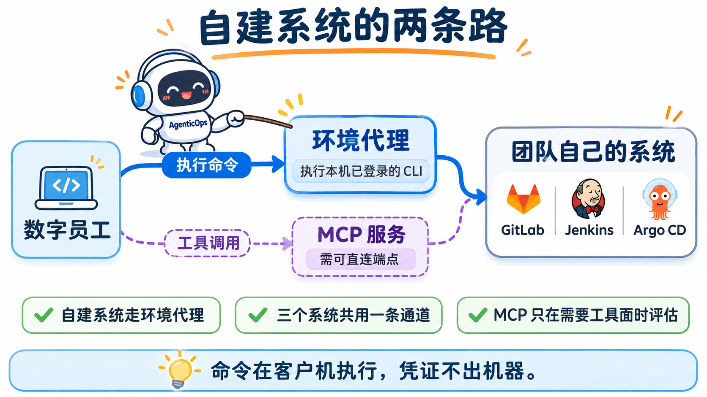
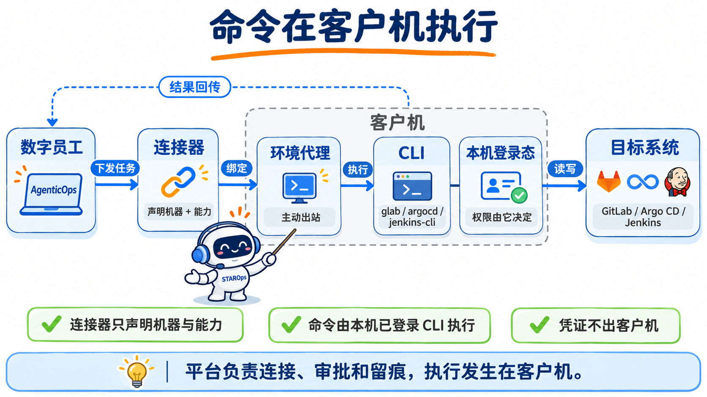
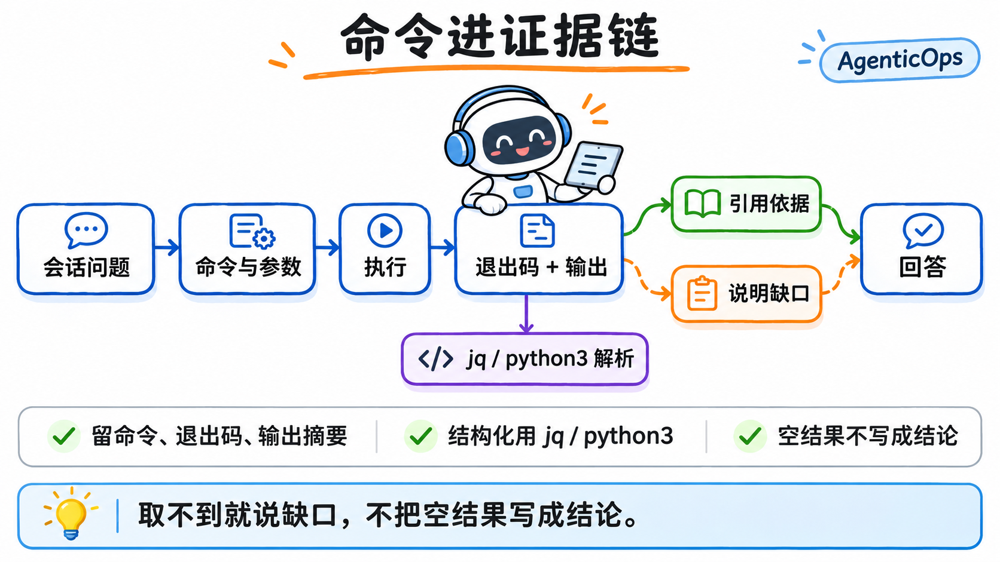
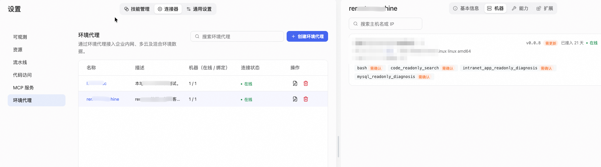
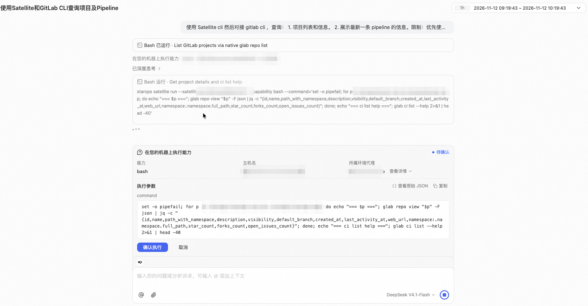
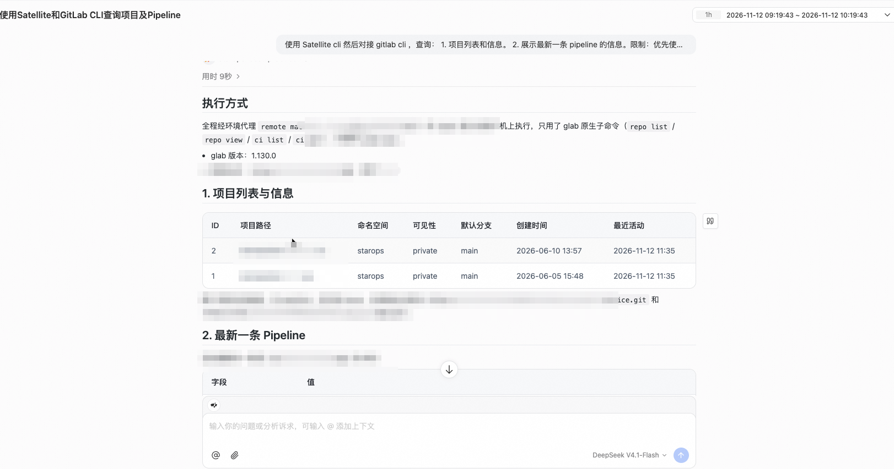
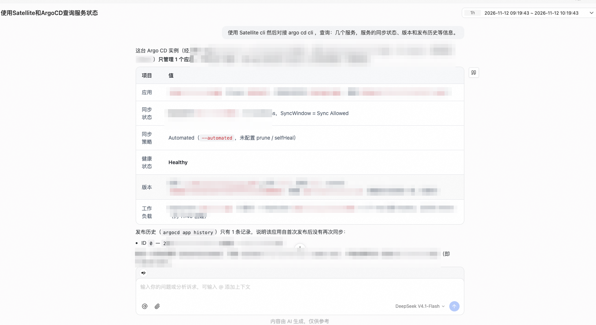
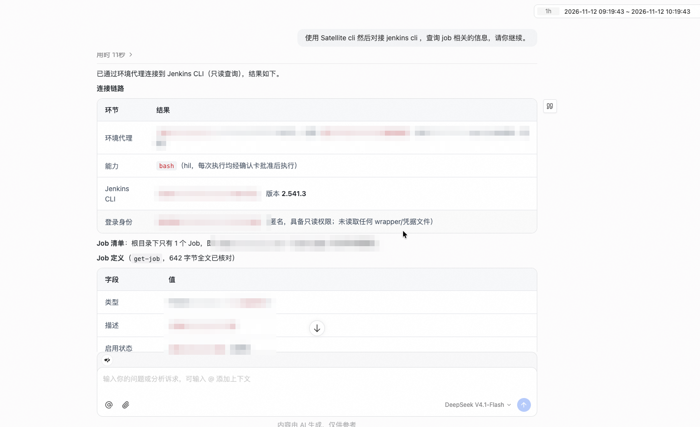
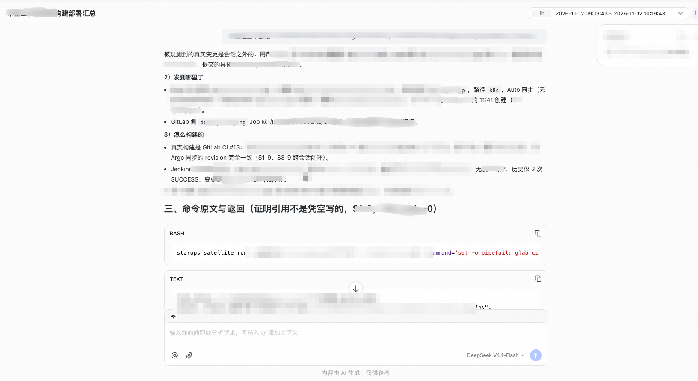

<div class="sls-starops-article-crumb">
  <a href="/doc/starops/starops.html">STAROps</a> <span class="sep">/</span> <span>经验固化</span>
</div>

# 把自建 DevOps 系统接进 STAROps：环境代理与官方 CLI

<div class="sls-starops-article-meta">
  <span>分类 · 经验固化</span>
</div>

值班工程师的日常问题分两类。一类在监控里：服务的错误率、延迟、日志。另一类在监控外：这个服务最近谁改过代码，答案在团队自建的 GitLab 里；负载高了能不能先扩两个副本顶住，动作发生在 K8s 集群里。

以前回答第二类问题，要切到别的系统：打开 GitLab 查提交，登录集群控制台改副本数，查完再切回来，把几个窗口里的线索拼在一起。STAROps 用指标、日志、APM、Trace 和 UModel 组织运行时证据，第一类问题数字员工直接能答；第二类的答案长在客户自己的系统里，产品内置不到。

环境代理改变了这条边界。**在能访问这些系统的机器上安装环境代理，数字员工就能执行这台机器上已经登录的官方 CLI，把监控外的答案带进同一个会话**：查 GitLab 的提交和流水线、看 Argo CD 的同步状态、读 Jenkins 的 Job 定义，用的都是各系统自己的命令行工具。本文以自建 GitLab、Jenkins、Argo CD 为例，讲清这条路径怎么接、每一步能确认什么、取不到什么。平台侧提供连接、审批和留痕，命令本身由客户机上已经登录的 CLI 执行；三个系统共用同一条通道，差别只在各自 CLI 能查什么。

接入前先对一下路径，不是所有需求都走同一条链：

| 要用的能力 | 走哪条路 |
|---|---|
| 云监控 2.0、日志服务 SLS、云效 Codeup、云效 Flow、GitHub Code、GitHub Actions 等平台已覆盖的数据 | 系统连接，直接添加 |
| 云资源现状查询与变更 | 云资源操作：数字员工通过托管的 aliyun CLI 按所选角色授权范围执行 |
| 只能从企业内网、多云等客户现场取的事实 | 客户环境执行：环境代理主动出站建连，每个代理绑定一台机器，可用范围以[《环境代理》](https://help.aliyun.com/zh/starops/user-guide/environmental-agent)为准 |
| 团队自己的系统：自建代码平台、K8s 操作面、CMDB、工单、内部发布平台 | 环境代理：执行系统自己的 CLI；需要工具级治理时再评估 MCP 服务 |

前三条配置即可用，本文展开第四条。



## STAROps 的做法

这条路径接入后，STAROps 做三件事。



**连接器只声明机器与能力。** 连接器是外部系统进入数字员工的唯一入口，一个接入对象对应一台能访问目标系统的机器和一组可执行能力，归属于一个数字员工。这类接入不需要在控制台填写端点、登录凭证或访问密钥：它绑定机器，声明能力（例如 bash），取数时使用这台机器上 CLI 已经登录的身份。凭证不进入 STAROps，也不进入会话。连接检查确认机器在线、能力可用，不确认 CLI 是否安装、是否登录；连接状态正常，不等于查询一定能成功。

**每条命令人工确认。** 执行前弹出确认卡片，列明能力、主机和本次参数，人确认后才执行；确认请求有有效期，超时未确认就不会执行。查询和变更走同一道闸门，区别只在人看到的参数。

**命令与输出进证据链。** 每次执行留下命令、退出码和输出摘要，回答引用这些结果并说明依据。需要结构化字段时，用机器上的 jq 或 python3 解析输出；命令超时、退出码非零或返回为空时，明确说明缺口，不把空结果写成结论。



这条路径不替代监控主链，指标、日志、Trace 该走系统连接的还走系统连接；取数质量由 CLI 版本、登录态和网络决定；命令最终能不能执行，由本机登录态和外部系统权限决定。

## 接入前的四个边界

**权限跟着本机登录态走。** 连接器不托管凭证，数字员工用的是机器上 CLI 已经登录的身份，可见范围由这个身份在目标系统里的权限决定：它可能是只读身份，也可能是管理员。接入前先确认三件事：CLI 登录的是谁、这个身份有哪些权限、是否只开放查询。平台只保证执行链路和命令级审批，本地凭据是否可读、能读到什么，由执行身份和客户机权限决定。



**人工确认是唯一闸门。** 这条路径不经过全局执行策略，每次命令都由确认卡片拦截。需要更细的审批时，把审批放进外部系统的工单，或在机器上限制 CLI 能执行的范围。审批落在命令一级：人看到的是本次要执行的命令和参数。



**责任分四方，各管一段。** 接入前把这张表和外部系统的负责人对齐：

| 方 | 负责什么 |
|---|---|
| STAROps | 理解意图、组织命令、解析输出、生成结论与建议 |
| 环境代理 | 出站连接、执行已声明能力、回传结果 |
| CLI 与外部系统 | 登录态、身份权限、真实数据、系统侧审计 |
| 人与审批系统 | 每次命令确认、高风险变更授权、回滚决策 |

**排障按层查。** 先看命令有没有执行（确认卡片是否出现、是否超时），再看退出码（CLI 或网络），再看返回（身份权限或查询范围），最后看控制台（连接器与机器绑定）。

## 典型场景：三个自建系统接进「运维值班」

团队的环境：GitLab、Jenkins、Argo CD 都跑在一台能访问的机器上，三个 CLI 已经在这台机器上登录。数字员工「运维值班」绑定这台机器后，值班工程师在同一个会话里问三类问题：这次改动是谁提的、这个应用同步到哪了、构建它的 Job 是怎么定义的。

### 先查代码：这次改动是谁提的

工程师先问 GitLab。数字员工执行：

::: details 查看 GitLab 项目与流水线命令

```text
glab auth status
glab api "projects?per_page=5&simple=true"
glab api "projects/<id>/repository/commits?per_page=3"
glab api "projects/<id>/pipelines?per_page=5"
```

:::

**确认什么**：本机 glab 登录的是哪个 GitLab、有哪些项目、最近提交和流水线是什么。

**取到什么**：项目 id、路径、默认分支、最近活动；提交的 sha 与说明；流水线的 id、sha、ref、status、created_at。

**取不到什么**：没有登录态或网络不通时取不到；身份权限不足时只返回可见范围；CLI 不会替人判断变更与故障之间的因果。



### 再看发布：这个应用同步到哪了

接着问 Argo CD。数字员工执行：

::: details 查看 Argo CD 应用状态命令

```text
argocd app list -o name
argocd app get <应用名>
argocd app history <应用名>
argocd app diff <应用名>
```

:::

**确认什么**：有哪些应用、同步状态、revision、健康状态、发布历史、期望态与实际态的差异。

**取到什么**：Application 层面的数据，包括 source、destination、syncPolicy、sync.status、health、history。

**取不到什么**：Pod 级运行态。集群 API 不可达时，kubectl 只会超时返回；这时能确认的是“取不到”，不是工作负载异常或正常。



### 最后看构建：Job 是怎么定义的

最后问 Jenkins。数字员工执行：

::: details 查看 Jenkins Job 命令

```text
jenkins-cli who-am-i
jenkins-cli list-jobs
jenkins-cli get-job <Job 名>
```

:::

**确认什么**：当前身份、有哪些 Job、Job 定义是什么。

**取到什么**：当前身份可见的 Job 清单与 Job 的 XML 定义。

**取不到什么**：未授权的写操作、未开放的构建日志；身份可见范围决定结果。



三类数据放在一起，能回答“谁改的、发到哪、怎么构建的”，但每一步都要说明来源和缺口。CLI 返回的是控制面状态，不等于业务健康；Pod 级、业务指标和日志仍要回到监控与日志连接器。



### 接不通先查哪里

接入和调用不顺时，先看现象落在哪一行：

| 现象 | 先查哪里 |
|---|---|
| 确认卡片没有出现 | 连接器是否绑定机器；能力是否声明为执行前确认 |
| 确认后命令没有执行 | 确认请求是否已超时 |
| 命令退出码非零 | 本机 CLI 是否登录；网络是否可达目标系统 |
| 命令成功但返回为空 | 该 CLI 身份在目标系统里的可见范围 |
| 控制台看不到连接器或机器 | 连接器归属与机器绑定状态 |
| 返回字段与预期不一致 | CLI 与服务端版本 |
| 连接状态正常但查询失败 | CLI 是否安装、是否登录、版本是否支持该子命令 |

## 总结

监控之外的答案要进到数字员工的会话里，做法是让环境代理在能访问系统的机器上执行官方 CLI：连接器只声明机器与能力，每条命令人工确认，输出进证据链。GitLab、Jenkins、Argo CD 各有一套 CLI，能取到的是控制面数据；取不到的要说明缺口，不把空结果写成结论。

这套做法要长期可用，取决于四件事：CLI 登录的是谁、网络通不通、确认有没有人做、版本与字段对不对得上。需要工具级治理或统一工具面时，再评估 MCP 服务：它要求可直连的服务端点，或在客户侧另部署一套服务，自建内网系统通常不具备前者。

## 相关入口

- [返回 STAROps 最佳实践首页](/starops/starops.html)
- [打开 STAROps Playground](/playground/staropsdemo.html)
- [进入 STAROps 控制台](https://starops.console.aliyun.com)

<style>
.sls-starops-article .vp-doc details {
  margin: 12px 0;
}

.sls-starops-article .vp-doc details > summary {
  font-size: 14px;
  line-height: 1.6;
}

.sls-starops-article .vp-doc img {
  display: block;
  width: 100%;
  max-width: 640px;
  aspect-ratio: 16 / 9;
  object-fit: contain;
  margin: 10px auto 2px;
  background: #f7f9fc;
  border: 1px solid var(--sls-starops-border, #e6ebf3);
  border-radius: 10px;
  box-shadow: none;
}

.sls-starops-article .vp-doc p {
  line-height: 1.85;
  margin: 14px 0;
}

.sls-starops-article .vp-doc h2 {
  margin-top: 36px;
}
</style>

