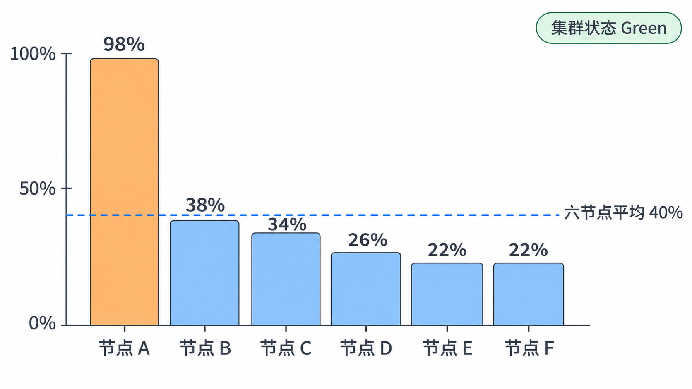
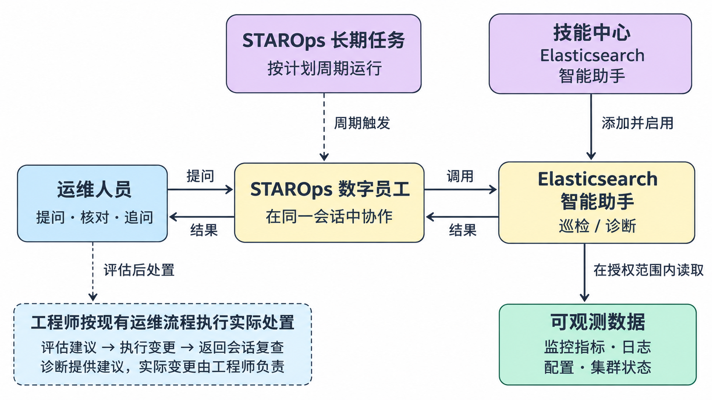
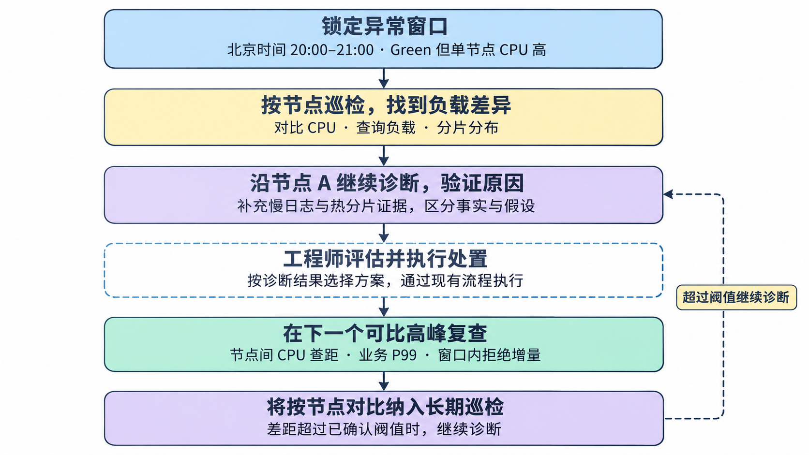

  <a href="/doc/starops/starops.html">STAROps</a> / 主动巡检

# 集群状态健康不等于业务健康：用 STAROps 完成 ES 节点级巡检与异常追因

  分类 · 主动巡检

某电商平台的商品搜索服务使用一台 6 个数据节点的 Elasticsearch 实例。周五北京时间 20:00 起，业务陆续反馈搜索变慢，搜索接口 P99 从平时约 200 ms 升到 2 s 以上，部分请求超时。值班工程师打开控制台：集群状态健康，没有未分配分片，集群平均 CPU 约 40%，乍看不像资源已经吃紧。

按节点展开后，问题才显露出来：节点 A 从 20:05 起 CPU 持续高于 95%，其余 5 个节点在 20%～40%。线程池里能看到 search 累计拒绝上万次，却不知道今晚新增了多少；等抓取热线程时，峰值已经回落，堆栈也没能解释刚才为什么慢。

业务还在等恢复进展。工程师要判断，压力是请求量增加、查询变重，还是分片或访问热度集中在节点 A；还要查清这个节点承载了哪些分片、慢查询落在哪里。**这些问题，得把同一时段的证据放在一起看。** 集群状态健康只说明主分片和副本分片都已分配，不能据此判断查询性能正常；集群平均值也会把单节点的高负载摊薄。

说明：本例根据多类值班问题组合编写，业务背景、数值、节点代号、对话及报告均为示例，不代表真实客户或真实执行记录。

同一时刻的示例快照：节点 A 已接近满载，六节点平均仍只有 40%；集群状态健康只说明分片已经分配。

## 先让数字员工用上 Elasticsearch 智能助手

STAROps 技能中心的「官网推荐」已经列出 **Elasticsearch 智能助手**。它通过托管服务提供实例健康巡检、故障诊断与根因定位、实例和节点及索引信息查询、网络配置查看与知识问答，只执行只读查询和诊断，不创建、删除、重启或变配实例。

能不能在某个数字员工的会话里直接用，取决于这个环境有没有发布并启用这项技能。先进入员工的**设置 → 技能管理 → 已安装**，确认列表里有这项技能；如果看不到，说明这个环境还没挂载它，需要按该环境的技能发布方式启用，或联系平台处理。技能中心能看到它，不等于每个地域、每个员工都已经可用。

首次使用还要确认两类权限：

- ES 侧需要 `elasticsearch:InvokeEsAgent` 权限，并完成一次 RAM 服务关联角色授权。
- 数字员工使用的 RAM Role 要能调用该接口，并能读取待排查的实例。

授权完成后进入会话，先拿一台熟悉的实例跑一次只读巡检，确认调用正常。技能配置见[技能中心](https://help.aliyun.com/zh/starops/user-guide/skill-center)，助手开通见[Elasticsearch 智能助手](https://help.aliyun.com/zh/es/user-guide/es-smart-ops-agent)，权限要求见[STAROps 权限配置](https://help.aliyun.com/zh/starops/user-guide/permission-configuration/)。

数字员工通过 Elasticsearch 智能助手读取可观测数据；助手提供巡检、诊断和建议，实际变更由工程师执行。

## 先巡检这一小时，把平均值展开到每个节点

工程师把实例、地域和异常时段一起交给数字员工。这次已经知道问题出在晚高峰，就直接指定 20:00—21:00；如果等事后再问「最近一小时」，故障时段已经过去了。

> 使用 Elasticsearch 智能助手检查杭州地域 `cn-hangzhou` 的实例 `es-cn-xxxx`，时间为故障当天北京时间 20:00—21:00。商品搜索变慢，集群状态健康，但节点 A 的 CPU 很高。请先做一轮巡检，重点按节点对比 CPU、查询负载和分片分布；只读查询，不要执行任何变更。如果某项数据取不到，请说明取不到以及原因。

实际使用时，将 `es-cn-xxxx` 和节点 A 替换为真实标识，并填写故障的具体日期。业务接口 P99 的变化也一并提供，方便与集群侧数据对照。

这一轮可能拿到各节点 CPU、集群查询 QPS 和分片分布，也可能拿不到异常时段的慢日志或线程池窗口增量。记录时分成三类：已取得、业务侧补充、尚未取得，免得把「暂时没有」写成「没有问题」：

| 类别 | 记录内容示例 |
|---|---|
| 已取得 | 20:00—21:00 各节点 CPU 时序、集群查询 QPS，以及本轮查询到的索引与分片分布。节点 A 从 20:05 起持续高于 95%。 |
| 业务侧补充 | 搜索接口 P99 从约 200 ms 升至 2 s 以上，部分请求超时。 |
| 尚未取得 | 异常时段慢日志、线程池拒绝数的时序增量；现有累计拒绝数不能直接说明今晚新增了多少。 |

这张表只说明怎么记录，助手不会固定按这个格式输出。不同环境、不同问法，结果的组织方式也会不同。提问前还要确认两件事：慢日志需要已经开启并覆盖该时段，否则助手也取不到；线程池的 `rejected` 是累计计数器，要看今晚新增多少，需要在窗口前后采样，或由监控侧提供窗口增量。

工程师现在可以给业务一个更具体的进展：「已确认压力集中在节点 A，正在查它承载的查询和分片。」调查不再被集群状态和平均值挡住，接下来缺什么数据，也有了明确的补查方向。

## 围绕节点 A 追问，把几条线索接起来

下一步还在原会话里做。工程师要知道节点 A 为什么比别的节点忙，这种差异和搜索变慢有没有关系：

> 继续诊断节点 A 在 20:00—21:00 的高 CPU。只读查询，不要执行任何变更。请判断更接近哪种情况：请求总量增加、查询变重，还是分片或访问热度集中在节点 A；把支持判断的证据和仍缺的数据分开列出。

这个示例里，集群查询 QPS 和前一周同一时段差不多。可以说请求总量没有明显上涨，但还不能停在这里：同样的 QPS，更重的聚合或更大的扫描范围，也会占用更多 CPU；总量不变，压力也可能只落在某一个节点上。

诊断结果可以按三层整理，方便接手的人知道已经走到了哪一步：

> **已确认：**20:05 起，只有节点 A 的 CPU 持续高于 95%，其余节点为 20%～40%。集群查询 QPS 与前一周同时段相近，暂未发现请求量整体明显上涨。
>
> **待核对：**商品搜索索引的分片布局或数据访问热度可能让查询压力集中在节点 A；也需要核对是否有更多重查询。当前信息还不足以确定根因。
>
> **需补充：**异常时段的慢日志与节点、分片对应关系，以及线程池拒绝数的时序增量。

这三层也只是整理方式，助手不会固定按这个结构回答。工程师可以照着这三层补查日志，或在原会话继续追问慢日志和分片的对应关系，再把慢查询对应的索引、分片、节点放到同一时间线上。异常期间如果发生过分片迁移，还要核对当时的位置。这样才能判断节点 A 是承载了更多分片，还是分片数量看着均衡、实际访问热度却明显不同。

先前那份峰值回落后的热线程快照，只能说明采集那一刻的状态。它没有热点，不能抹掉 20:05 之后发生过的高 CPU；要解释这次故障，还是得回到那一小时的数据。慢日志能看出分片执行情况，业务接口 P99 则对应用户实际感受到的延迟。

## 按证据选择处置，再等一个可比的晚高峰

节点 A 的问题收窄以后，工程师再决定怎么处置。如果确认查询压力和分片布局或热数据集中有关，就结合分片大小、主副本数量、路由和实际负载，重新评估分片规划。调整分布后如果还是只有节点 A 偏高，就继续查这个节点。对于已经停止写入的索引，如果进一步确认段数量等因素影响了搜索效率，可以在评估资源余量后，放到低峰做段合并。

变更做完，可能已经过了晚高峰。就算眼前的 CPU 和 P99 都降了，也要先记下做了哪些调整、确认服务可用。等到下一个工作日 20:00—21:00 的高峰过去，再回原会话复查：

> 我已完成本次评估后的处置。请复查同一实例今天北京时间 20:00—21:00 的运行情况，并与故障当天同一时段比较。只读查询，不要执行任何变更。重点看节点间 CPU 差距、查询负载，以及新观察窗口内的拒绝数增量。我会补充业务监控中的接口 P99，请一起判断是否恢复。

下一个工作日只是提供了一个观察窗口，比较前还要核对 QPS、查询类型和活动强度。如果周五有促销、工作日负载明显更轻，就继续等负载相近的高峰，或者在可控环境中验证。线程池要看新窗口里拒绝数是否还在增长，历史累计值不用归零。

复查时，工程师同时看三件事：节点 A 是否仍明显高于其他节点、业务 P99 是否恢复、请求超时是否还在发生。只有这些变化和可比的业务负载对得上，才有依据告诉业务「这次调整起作用了」，剩下的问题交给下一班继续观察。

先固定异常窗口，再按节点比较；处置后回到可比高峰复查，把节点差距纳入长期巡检。

## 把按节点比较纳入长期巡检

这次排查说明，只看集群状态健康和集群平均 CPU，容易漏掉单节点压力。如果当前环境支持在长期任务里用这个技能，团队可以把按节点比较写进 STAROps 长期任务，由配好技能的数字员工持续检查：

> 每天北京时间 21:10，使用 Elasticsearch 智能助手巡检这台商品搜索实例，检查当天 20:00—21:00 的运行情况。只读查询，不要执行任何变更。按节点对比 CPU 和查询负载；节点间差距超过团队确认的阈值并持续达到约定时长时，继续诊断相关索引和分片。异常和检查失败都通过已配置的渠道通知值班人员。

创建时，要写清实例、地域、时区、差距怎么比较、阈值、持续时间和通知对象，并核对生成的计划。例如，CPU 差距按百分点算还是按比例算，先由团队定。第一轮跑完，值班同学看一次报告，确认能读到各节点差异，也确认通知能收到。如果环境还不支持这个组合，就先把上面的检查项留作人工巡检清单，别假设长期任务已经能自动完成。

下次平均值看着正常、节点 A 又升高时，接手的人可以从这轮检查继续查，不用重新拼那晚的现场。

## 其他异常先看什么

除了单节点 CPU 高，巡检还可能碰到其他问题。发现异常后，可以按下面的方向继续追问，不用一次把表里的问题问完：

| 巡检发现 | 接着核对什么 | 要回答的问题 |
|---|---|---|
| Yellow / Red、分片未分配 | 分配解释、节点可用性、分配约束与磁盘条件 | 哪些分片受影响，具体是什么阻止了分配 |
| 磁盘水位高、索引只读 | 节点磁盘、索引限制、分片分布与近期增长 | 空间由什么占用，是否仍在增长 |
| JVM / GC、内存压力 | 同一时段的堆内存、GC、查询或写入负载 | 资源压力是否与业务失败同时发生，集中在哪里 |

继续追问时，带上具体实例、节点和时间段，别只问一句有没有异常。能查到哪些数据，取决于实例有没有开启相应的日志和监控，以及数字员工被授权的范围。没有取到的项目要逐项写明，不能写成暂未发现异常。

看到节点 A 的 98%，还不算查完。接下来要把节点差异、查询变化、分片位置和业务 P99 对上同一小时；处置后也等到负载可比的高峰，才判断调整是否有效。下次看到集群状态健康、平均值也正常，先展开到节点，再决定要不要继续查。

## 总结

集群状态健康只说明分片已经分配，平均值也会把单节点的压力摊薄。先把异常时段固定下来，再按节点展开，把那一小时的 CPU、查询负载、分片位置、慢日志和业务 P99 放在一起看，节点 A 的 98% 才不会被看漏。

要在自己的环境里复用，先确认技能已经挂载、服务已经开通，权限也够用。提问时写清实例、地域、时段和只读要求，记录时把已取得、业务补充和尚未取得分开，缺什么就写什么。处置后别急着下结论，等到负载可比的高峰再复查；峰值回落后的快照不能证明已经恢复，长期巡检也按节点比较来做。

## 相关入口

- [返回 STAROps 最佳实践首页](/starops/starops.html)
- [打开 STAROps Playground](/playground/staropsdemo.html)
- [进入 STAROps 控制台](https://starops.console.aliyun.com)

