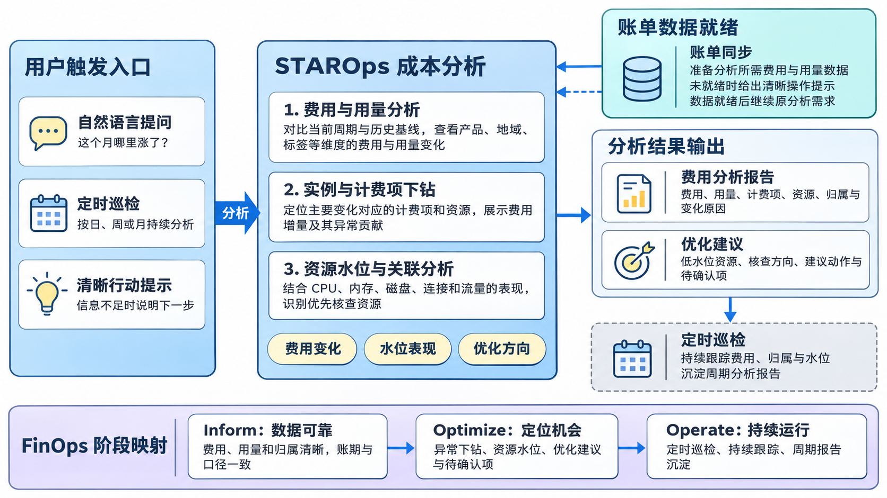
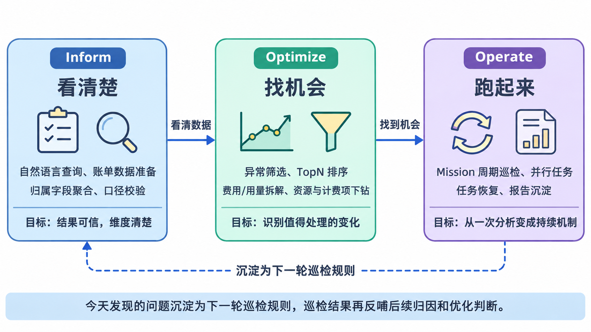
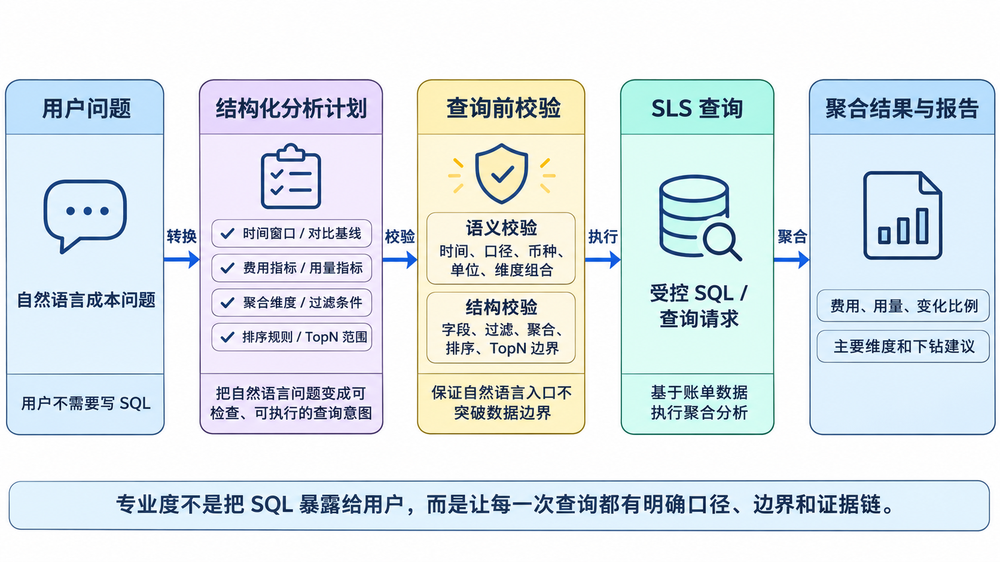
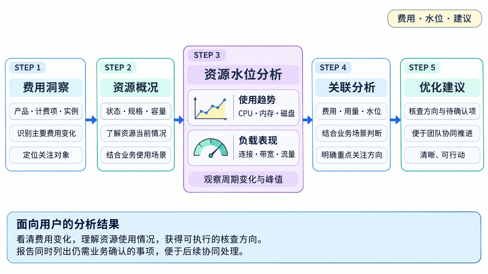
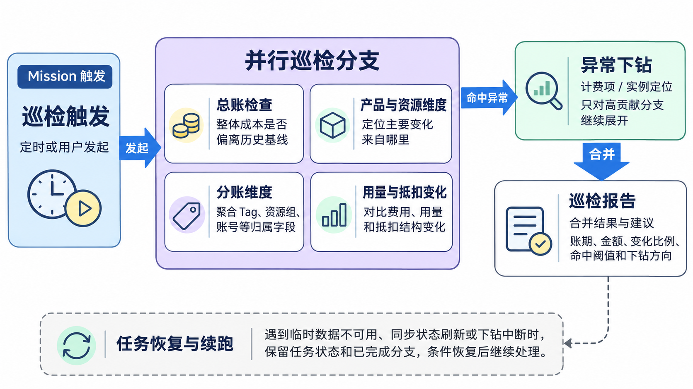

  <a href="/doc/starops/starops.html">STAROps</a> / 主动巡检

# STAROps 助力云成本治理落地

  分类 · 主动巡检

企业上云之后，账单通常不是看不到，而是看不明白、追不下去、处理不及时。

很多团队都会遇到类似的问题：

- 财务月末才发现费用上涨，平台和业务团队再回头查原因；
- 账单字段复杂，时间窗口、费用口径、用量单位很容易对不齐；
- 成本只能看到产品总额，难以继续下钻到计费项、资源和用量变化；
- 费用较高或上涨并不等于资源浪费，仅靠账单难以判断资源配置与实际负载是否匹配；
- 巡检依赖人工触发，异常发现、原因定位和后续跟进缺少连续机制。

FinOps 关注的不是把账单做得更漂亮，而是让成本变化能被及时看见、解释清楚，并回到对应团队处理。

这也意味着，成本治理不能止步于账单分析。即使已经定位到费用上涨的产品、计费项和资源，也不代表已经找到优化机会。企业还需要结合 CPU、内存、磁盘、连接、带宽和流量等资源水位，判断资源配置与实际负载是否匹配，并在业务用途、容量要求和 SLA 等约束下形成可执行的优化建议。

STAROps 则把这个过程变得更容易发起和持续：用户直接提问，系统完成数据检查、口径校验、受控查询、费用下钻、资源水位分析和优化建议；数据还没准备好时，也能引导先完成账单同步，再继续分析。

## 从“查账单”到“运营云成本”

把这些问题放到日常工作里，场景其实很熟悉：

月末导出账单，财务发现费用上涨，平台团队帮忙拆明细，工程团队再确认是不是业务变化。中间要反复对齐时间口径、产品口径、标签口径、资源归属和费用口径。

STAROps 补上的，是“看到数字”之后的完整链路：先统一费用和用量口径，识别异常变化，再下钻到具体计费项和资源；结合资源水位判断配置与负载是否匹配，最终给出优先核查对象、优化方向和待确认事项。分析结果还可以进入周期巡检，持续跟踪费用、用量、水位和优化进展。在 STAROps 里，一次成本分析更接近这样：

从费用变化到资源水位与优化建议，STAROps 将一次分析延伸为可持续跟踪的成本治理行动。

用户仍然可以用自然语言提问，比如：

- “这个月哪个业务线的云成本上涨最明显？”
- “最近 7 天 SLS 成本上涨，是用量问题还是计费项结构变化？”
- “哪些资源没有分账标签，会影响成本归因？”
- “哪些计费项的用量变化带来了费用上涨？”
- “哪些高费用资源长期处于低水位，应该优先评估什么优化动作？”
- “每天帮我巡检成本异常、分账维度和用量变化。”

系统真正要回答的，也不只是“多少钱”。更重要的是：谁在用这些资源，成本为什么变了，资源配置与实际负载是否匹配，哪些对象值得优先核查，以及下一步可以采取什么优化方向。

这条链路贯穿了从费用可见到持续治理的完整过程，也对应着 FinOps 的三个核心阶段。

## 对齐 FinOps 的三个阶段：Inform、Optimize、Operate

如果用 FinOps Foundation 的 Inform、Optimize、Operate 来看，STAROps 覆盖的是一条从“看清楚”到“找机会”再到“跑起来”的闭环。

| FinOps 阶段 | 企业要解决的问题 | STAROps 成本治理能力 |
|---|---|---|
| Inform：看清楚 | 成本、用量、归属和账期口径是否及时准确 | 数据接入检查、自然语言查询、费用归因、分账巡检、多维报告 |
| Optimize：找机会 | 哪些成本异常、浪费、结构变化值得处理 | 异常筛选、TopN 排序、用量/费用拆解、资源下钻、优化建议 |
| Operate：跑起来 | 如何把成本治理变成持续机制 | 定时巡检、并行任务、账单数据准备、任务恢复、报告沉淀 |

这三个阶段不是做完一次就结束。今天定位出的费用上涨原因，明天可以变成巡检重点；这次发现的分账口径问题，也会成为后续治理的依据。

## Inform：让成本数据可靠、归属清晰

### 数据可靠和口径可信

FinOps 的第一步是成本可见性。但“可见”不是只看一张总账表。真正有用的是：这张表覆盖了哪些数据、按什么口径算、能不能按业务维度继续拆。

对企业来说，更关键的是这些问题能不能被验证：

- 成本能否按产品、项目、部门、账号、地域、标签归因；
- 用量和费用是否能对应到具体资源和计费项；
- 趋势、异常和归属是否能在同一套口径下对比；
- 业务团队能否看懂自己负责的成本，而不需要理解复杂账单字段。

在 STAROps 的成本分析链路里，自然语言问题不会直接变成一条随意执行的 SQL。系统会先生成结构化分析计划，明确时间窗口、对比基线、指标口径、聚合维度、过滤条件、排序规则和 TopN 范围，再生成受控 SQL 或查询请求。

为了保证结果可靠，系统会在执行前做两类校验：

| 校验类型 | 作用 |
|---|---|
| 语义校验 | 检查时间窗口、费用口径、用量单位、币种、维度组合是否符合成本分析语义 |
| 结构校验 | 检查查询字段、过滤条件、聚合方式、排序和 TopN 是否落在受控范围内 |

这样做的好处是，用户不用理解底层账单字段，也不用自己写 SQL；同时，系统仍然会守住查询字段、聚合方式和费用口径的边界。

### 成本归因

用户问题：按业务项目分析本月云成本，比较各项目的费用分布和变化。

Agent 回答（示例数据）：电商平台本月费用 ¥100,000，占 50%，较上月增加 ¥20,000，增量主要来自 ECS 和 RDS；数据平台费用 ¥60,000，占 30%，较上月基本持平；内部研发费用 ¥40,000，占 20%，较上月减少 ¥10,000。建议优先由电商平台团队核查新增计算和数据库资源。

FinOps 很强调“谁使用，谁负责”。但这句话要落地，前提是成本能先归到正确的维度上。

在成本归因场景中，STAROps 主要基于账单里已有的 Tag、ResourceGroup、CostUnit、OwnerID 等字段做聚合和过滤，先把费用分布摊开给用户看：

- Tag 分账：按账单中的 Tag 字段聚合，查看 TopN Tag、异常上涨 Tag，以及 `(无 tag)` 或 无 这类标签取值的费用占比；
- 资源组分账：按 ResourceGroup 聚合，查看费用主要落在哪些资源组，以及默认资源组相关费用占比；
- 财务单元：底层支持按 CostUnit 查询和聚合，可用于查看财务单元分布或未分配费用；
- 多账号归属：按 OwnerID 拆分主账号或财务子账号费用，用于多账号成本归属。

需要说明的是，系统不会在没有企业标签规范或映射表的情况下，直接断言“成本中心归属错误”。更准确地说，STAROps 会先把账单里已有的归属字段聚合出来，让用户看到 Tag、资源组、财务单元和账号维度的费用分布；至于是否属于分账缺口、命名不一致或组织映射问题，需要再结合企业自己的规则确认。

这些信息如果只在月末才看，处理起来就会很被动。放到定时巡检里，财务团队可以少一些月末反复确认，工程团队也能更早看到资源创建和架构调整带来的成本影响。

## Optimize：识别值得处理的优化机会

### 异常识别与多维下钻

用户问题：最近 7 天 ECS 哪些费用上涨最值得关注？请下钻到具体实例和计费项。

Agent 回答（示例数据）：ECS 较前 7 天增加 ¥10,000（+10%）。实例 i-example03 的“系统盘”计费项从 ¥1,000 增至 ¥5,000，增加 ¥4,000，占 ECS 异常增量的 40%；实例 i-example04 的“云服务器配置”计费项增加 ¥3,000，占异常增量的 30%。建议优先核查这两个实例对应计费项的资源变化。

成本上涨不一定意味着浪费。业务活动、流量增长和架构迁移都可能带来合理增长。FinOps 真正需要关注的，是缺少解释、跟进和责任人的异常变化。

STAROps 通过对比当前周期与基线周期的费用和用量，综合分析变化金额、变化比例、用量趋势、抵扣与折扣、资源集中度以及标签、地域、产品和计费项结构，识别值得关注的异常。同时结合基线金额过滤“小金额、大比例”的噪声：例如，某资源从 1 元涨到 10 元，涨幅虽高，但通常不如核心产品线从 100,000 元涨到 120,000 元更值得关注。

识别异常后，系统会按金额和贡献度筛选重点对象，并沿以下层级逐步下钻：

| 下钻层级 | 要回答的问题 |
|---|---|
| 总账层 | 整体成本是否偏离历史基线 |
| 产品层 | 哪些云产品贡献了主要变化 |
| 计费项层 | 变化来自存储、流量、请求、计算、加工，还是抵扣 |
| 资源层 | 哪些资源或实例贡献了主要增量 |
| 原因层 | 原因是用量增长、单价变化、抵扣减少，还是资源新增 |

STAROps 会保留各层级的费用变化、异常贡献金额和相对占比，最终将几十页明细收敛为少数可行动的核查对象。例如，当 SLS 成本上涨时，分析会继续拆分存储、索引流量、读写流量和数据加工等计费项，并结合具体项目、日志库、资源和标签，判断主要驱动因素是用量增长还是费用结构变化。只有定位到具体计费项、资源和原因，成本数据才能真正从“看得见”变成“能处理”。

### 资源水位分析与优化建议

用户问题：分析最近 7 天 ECS 费用，并找出值得优先核查的低水位实例。

Agent 回答（示例数据）：实例 i-example01 的 7 天费用为 ¥1,000，CPU 平均 10%、峰值 20%，内存平均 10%、峰值 20%，属于优先核查的低水位实例；i-example02 的 CPU 平均 40%、峰值 80%，内存平均 60%，当前不作为低水位候选。优化建议：先确认 i-example01 的业务用途、峰值周期、SLA 和容量要求；如果确认长期低负载，可评估降低实例配置；如果属于非持续运行的测试或预发环境，可进一步评估定时启停。实施前需确认数据保护、依赖关系和变更窗口。

STAROps 将费用变化、资源使用水位和业务约束放在一起分析，帮助用户从“发现费用异常”进一步走到“明确核查与优化方向”。

分析内容包括：

- 费用洞察：定位主要费用变化及其对应的产品、计费项和资源。
- 水位分析：查看 CPU、内存、磁盘、连接、带宽和流量等资源使用趋势。

用户可以从以下几个方面查看分析结果：

1. 识别主要费用变化和需要关注的资源。
2. 查看资源使用趋势和负载表现。
3. 结合业务场景，获得可执行的核查与优化方向。
4. 了解仍需业务确认的事项，便于后续协同推进。

分析结果会说明费用变化、资源使用情况、建议关注的对象以及仍需业务确认的事项。

如果当前没有可用的智能水位分析结果，报告会明确提示信息缺口，并说明如何开启智能水位分析。

如需补充必要授权，报告会给出清晰的操作提示，帮助用户继续完成分析。

## Operate：让 FinOps 变成持续运行的机制

### 周期巡检和 Mission 长期任务

用户问题：每天上午 9 点检查前一天的费用异常、分账风险和用量变化，并生成报告。

Agent 回答（示例数据）：今日巡检已完成：昨日总费用 ¥30,000，较前一日 +10%；发现 2 个重点事项——系统盘费用 +20%，无环境标签费用 +10%。报告已列出主要贡献资源和待确认负责人，下一次巡检将在明日上午 9 点执行。

FinOps 不能只靠月末复盘，真正有效的成本治理需要在日常持续运行。

在周期性成本巡检中，STAROps 可以通过长期任务能力 Mission 承载持续运行的巡检，把多个方向并行跑起来：

| 巡检方向 | 发现什么 |
|---|---|
| 成本异常 | 总成本、产品成本、资源成本是否异常波动 |
| 分账风险 | 标签、项目、部门、账号归属是否缺失或异常 |
| 抵扣变化 | 对比资源包抵扣用量、计费用量和总用量变化 |
| 结构变化 | 识别新增/消失产品，以及地域、资源组等维度的费用分布变化 |

这些任务可以并行执行，最后汇总成一份巡检报告。报告里会保留分析账期、基线账期、当前金额、基线金额、变化比例、命中阈值、主要维度和建议下钻方向。

Mission 适合这类长期、分阶段、可恢复的任务：先做总账检查，再并行展开产品、资源、分账、用量等分支；发现重点后，还可以继续下钻。

如果巡检过程中遇到临时数据不可用、成本管家同步状态刷新或下钻任务中断，STAROps 会记录任务状态和已经完成的分支，条件恢复后继续处理。对生产环境来说，这比“失败后人工重跑”更接近一个真正能长期运行的系统。

### 账单数据准备

成本分析要跑起来，第一步是账单数据进入可查询状态。

当用户发起成本分析或巡检时，STAROps 会先确认成本管家是否已经完成账单同步。成本管家会把云账单同步到 SLS，后续自然语言查询、结构化 SQL 查询和周期巡检，都基于这份账单数据执行。

如果账单数据还没准备好，系统会在 STAROps 问答中提示用户完成成本管家开通、同步账单数据或更新必要字段。数据就绪后，原来的分析可以继续执行，周期巡检也可以重新触发。用户得到的不是一句“现在不可用”，而是一条能继续往前走的路径。

## STAROps 帮用户解决什么

STAROps 不只是另一张账单报表。它更像一个可以追问、可以下钻、也可以持续巡检的成本分析入口。

| 用户常遇到的问题 | STAROps 带来的变化 |
|---|---|
| 不知道费用为什么上涨 | 从总账下钻到产品、计费项、资源和用量变化 |
| 不想手写 SQL 或理解复杂账单字段 | 用自然语言发起分析，系统生成受控查询 |
| 担心分析口径不一致 | 校验时间窗口、指标口径、维度和 SQL 结构 |
| 明细太多，重点被淹没 | 通过阈值、TopN 和下钻结果保留关键项 |
| 成本治理依赖人工想起来查 | 通过 Mission 承载周期巡检和任务恢复 |
| 账单数据还没准备好 | 在 STAROps 问答中引导完成成本管家开通和账单同步，再回到分析 |

最后，用户感受到的变化很直接：成本问题不用等到月底才翻账单，平时就可以随时问、自动查、持续巡检。费用上涨能更早被发现，原因能更快解释清楚，后续治理动作也能沉淀下来。

随着企业云上架构日趋复杂，成本治理将从“事后分析”走向“实时感知”。STAROps 正在构建的，正是这样一条从数据可见、异常可解释到治理可持续的完整路径。

## 相关入口

- [返回 STAROps 最佳实践首页](/starops/starops.html)
- [打开 STAROps Playground](/playground/staropsdemo.html)
- [进入 STAROps 控制台](https://starops.console.aliyun.com)

