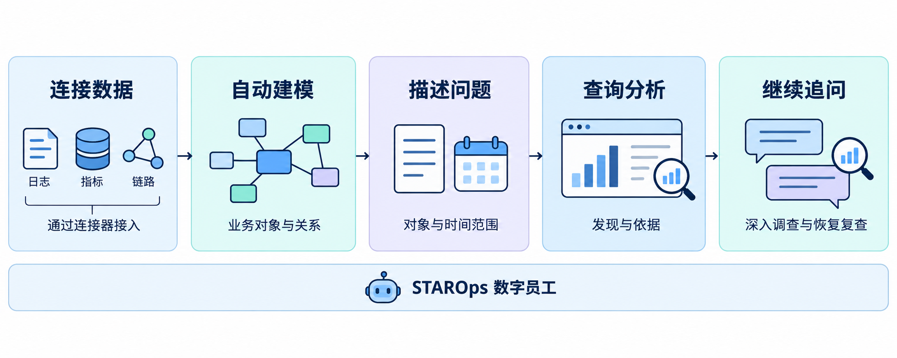
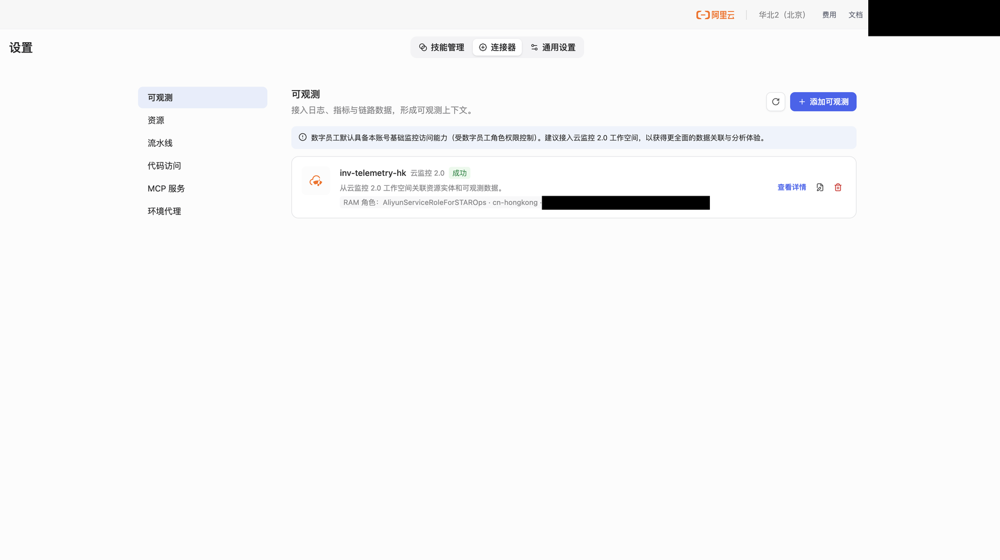
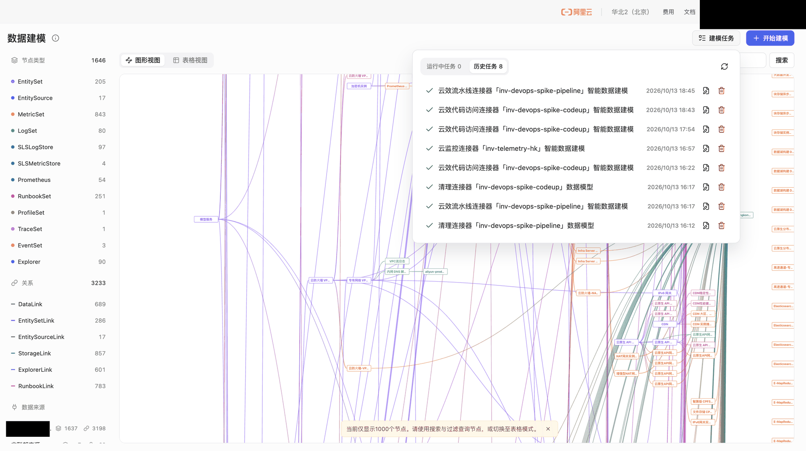

  <a href="/doc/starops/starops.html">STAROps</a> / 语义上手

# 从连接数据到完成一次诊断

  分类 · 语义上手

第一次使用 STAROps，可以从一份已有的监控数据开始：把数据连接给数字员工，选一个集群或服务，问问它最近的运行情况。发现异常后，再接着问原因。

这篇文章以云监控 2.0 为例，走一遍**连接数据、自动建模、发起诊断和继续追问**的标准流程。

## 先把数据连接给数字员工

数字员工需要先能访问你的系统，才能回答系统里的问题。**连接器就是用来做数据连接的。** 添加连接器时，选好数据来源和访问身份，这名员工后续就可以使用这些数据。

STAROps 支持多种连接器，已有的监控、日志、代码和运维系统都可以按需接入：

| 要连接什么 | 可以使用的连接器 |
| --- | --- |
| 指标、日志和调用链 | 云监控 2.0、日志服务 SLS |
| 代码库和发布流水线 | 云效 Codeup、云效 Flow、GitHub 代码库、GitHub Actions |
| 云资源和自建系统 | 阿里云资源、MCP 服务、环境代理 |

监控告诉数字员工哪里出现了异常，日志帮助它看清错误，代码和流水线则可以继续回答异常前改过什么。**同一业务接入的数据越多、越完整，诊断时能用上的信息就越充分，效果也会更好。** 连接器的完整介绍见[《连接器》](https://help.aliyun.com/zh/starops/user-guide/connector-of-starops/)。

第一次接入不必一次配齐。先选一个确定有数据的云监控 2.0 工作空间，完成下面这条流程即可。

## 添加云监控 2.0 连接器

打开目标自定义数字员工的**设置 > 连接器 > 可观测**，单击**添加可观测**，选择**云监控 2.0**。

填写连接器 ID 和名称，访问角色选择**员工角色**，再选择数据所在的地域和工作空间。员工角色由 STAROps 自动创建和维护，首次接入可以直接使用。打开 **Agentic 建模**后保存。

列表中连接状态显示**成功**，说明这个数据入口已经连通。角色、地域和工作空间在创建后不能修改，保存前核对清楚。各配置项的说明见[《从连接数据到完成一次诊断》](https://help.aliyun.com/zh/starops/getting-started/from-data-connection-to-fault-diagnosis)。

## 等待建模，找到要分析的对象

数据连通以后，STAROps 还要知道这些数据描述了什么：有哪些服务、实例和集群，它们之间是什么关系，各自有哪些日志和指标。刚才打开的 **Agentic 建模**会自动完成这项工作，后续数字员工就能按业务对象查找数据。

进入**数据建模 > 建模任务**，可以看到该连接器发起的任务。任务完成后，查看模型中的对象和关系。

回到数字员工，新建会话。在页面顶部选一个有数据的时间范围，然后输入 `@`，就可以选择已建模的 Service、Pod、集群等实体。

## 选一个对象，开始诊断

以检查集群为例，选中目标集群后提问：

> 看一下这个集群最近一小时的运行情况，有没有需要关注的问题？

数字员工会查询相关数据，分析服务或实例的运行情况，并在会话中返回发现和依据。阅读回答时，可以从具体对象继续看它对应的指标、日志或事件；有完整报告入口时，也可以打开详细分析。

如果已经知道异常现象，就直接说出来。例如选中一个未就绪的 Pod 后问：

> 这个 Pod 为什么一直没有就绪？帮我看看相关事件和日志。

**不需要先替数字员工安排排查步骤。** 选好对象，说清现象和时间，它会根据接入的数据开展查询和分析。

没有查到数据时，先核对会话时间范围和连接器选择的工作空间，确认这个时段确实有采集数据；遇到权限提示，再检查数字员工的运行角色。你能在控制台看到数据，还需要让员工使用的身份也能读取它。

## 顺着发现继续问

一次诊断不必把所有问题都放进第一句话。比如回答中发现一个服务延迟升高，可以直接接着问：

> 慢在哪一段？是这个服务处理变慢，还是在等下游？

前面的对象、时间和查询结果都留在会话里，追问可以沿着它们继续。如果已经接入代码和流水线，还可以问：

> 异常开始前，这几个服务有没有发布或配置变更？哪些和当前问题有关？

完成处置后，回到原会话复查：

> 处理完了，再看最近十分钟的错误率和延迟，和刚才的异常时段比一下。

到这里，就完成了从连接数据到诊断、追问和复查的使用过程。接下来，把同一业务的其他日志、监控、代码和流水线继续连进来，数字员工就能从发现异常，进一步查到相关依赖和变更。

## 相关入口

- [返回 STAROps 最佳实践首页](/starops/starops.html)
- [打开 STAROps Playground](/playground/staropsdemo.html)
- [进入 STAROps 控制台](https://starops.console.aliyun.com)

