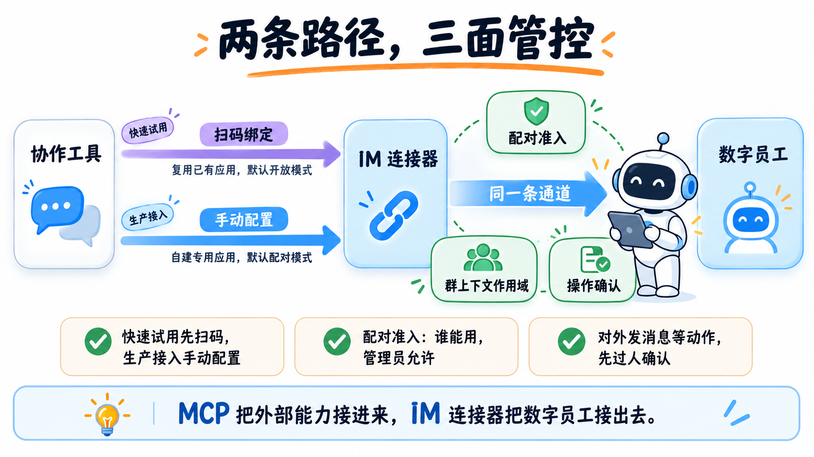
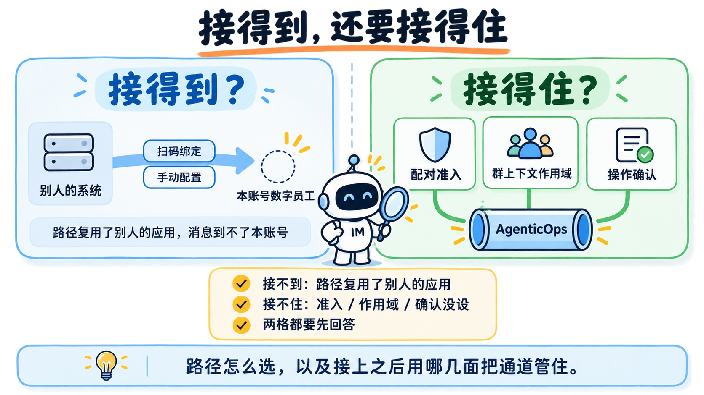
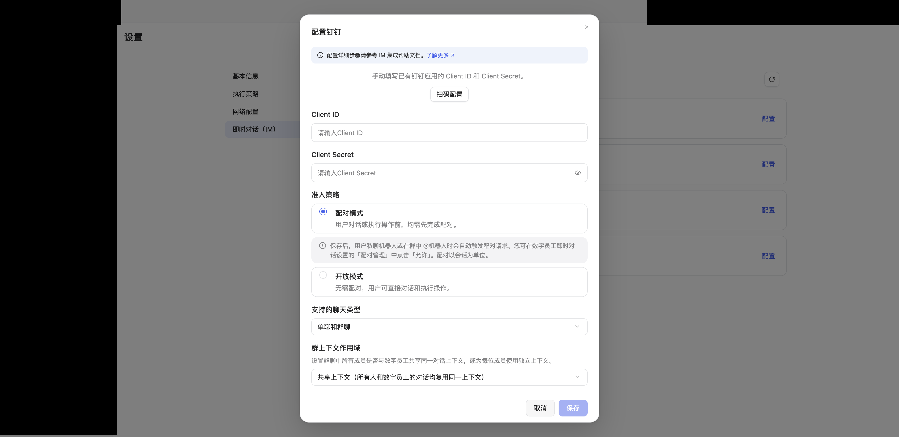
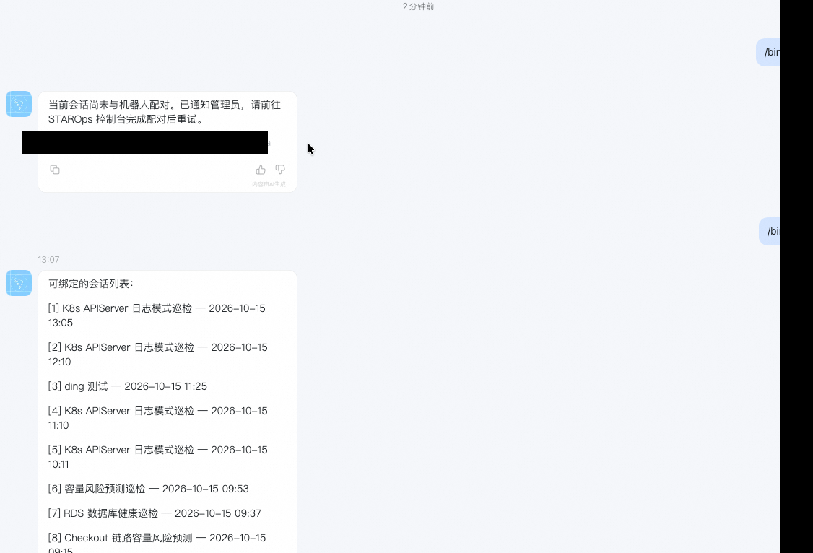
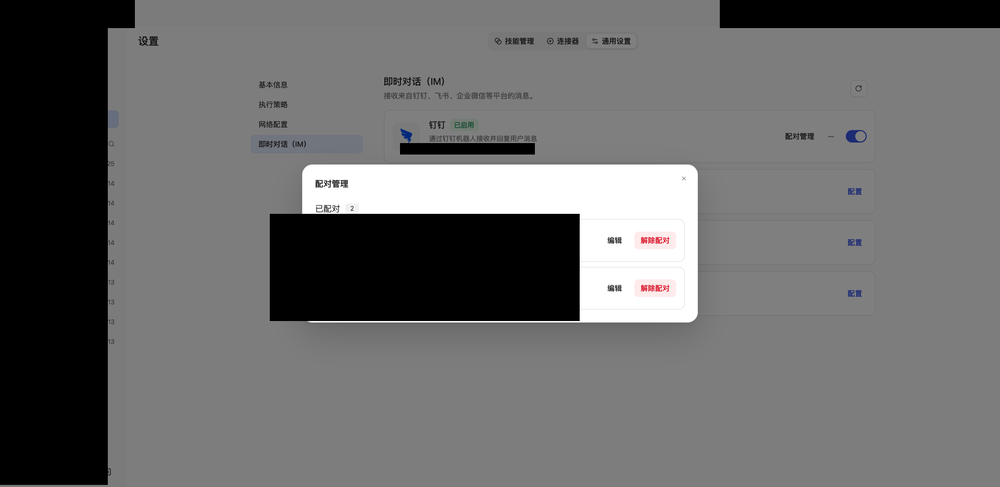
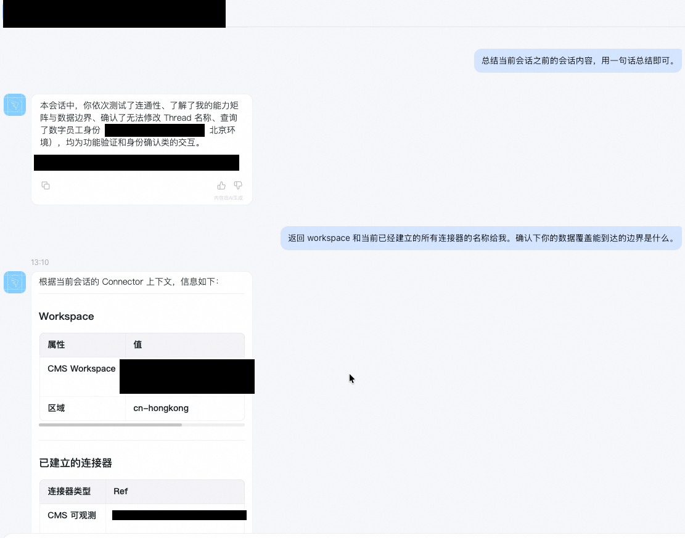
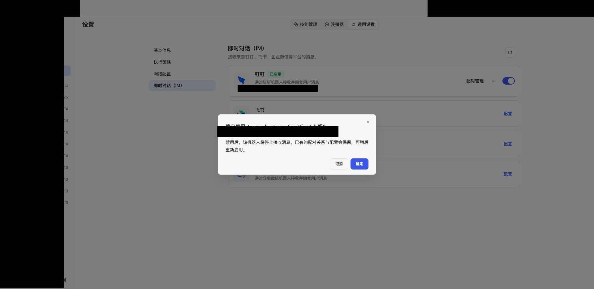
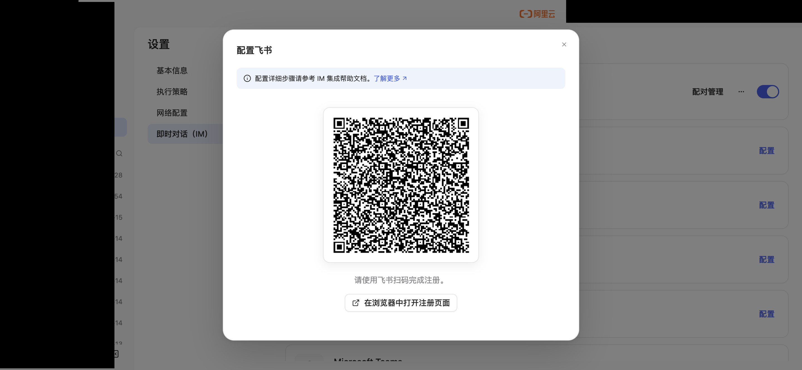

  <a href="/doc/starops/starops.html">STAROps</a> / 协作闭环

# 把数字员工接进协作工具：接入路径与通道管控

  分类 · 协作闭环

值班的多数时刻发生在协作工具里。告警在群里冒出来，交接在单聊里完成，想知道某条链路最近谁改过，也习惯直接在群里问一句。数字员工能查指标、读日志、追变更；可这些能力每次都要切回控制台才能用，就卡在触达这一步。

即时对话（IM）连接器把触达面搬进协作工具：单聊里直接问，群聊里 @ 机器人发起对话。

方向值得先说清：MCP 把外部系统能力接进数字员工，IM 连接器把数字员工接出去。接出这一步看起来最轻——控制台里点一张平台卡片、填几个字段就能建连接器；可正因为轻，接错路径、接完不管的代价，要过一段时间才显现。

## 为什么不能接上就算

把这件事拆成两格：机器人**接得到**吗（消息能不能到本账号的数字员工），接上之后**接得住**吗（谁能用、上下文怎么算、动作谁批准）。两格都会出问题。

接不到，来自接入路径。同一个平台不止一种接法：一种是把组织里已经存在的机器人应用直接绑过来（扫码绑定），一种是从零创建一个只服务这个数字员工的应用（手动配置）。前者快，但它接的是别人的应用——应用后端指向谁、开了哪些权限、对谁可见，全都继承过来。如果那个应用的后端指向的是另一个系统，消息会走到那条链路去，本账号这一侧从头到尾收不到会话。通道接上了，它不是你的通道。

接不住，来自接入之后的管控。机器人进了群之后：不设准入，任何能搜到机器人的成员都能直接对话；不设群上下文作用域，同一个群里多个人的对话互相可见；不设操作确认，代表数字员工对外发消息这一类动作会直接执行。

两格合起来，才是接入要回答的问题：路径怎么选，以及接上之后用哪几面把通道管住。

## STAROps 的做法

数字员工的诊断、巡检和长期任务能力在产品里已经具备；即时对话（IM）连接器不新增这些能力，只决定它们能不能在协作工具里被触达和使用。它和 MCP 方向相反：MCP 把外部能力接进来，IM 连接器把员工接出去，让能力发生在团队每天待着的地方。下面四件事按「现实约束 → 设计选择 → 能力变化」展开，每件后面各跟一条边界。

### 两条接入路径

- **现实约束。** 组织里往往已经存在机器人应用（别的团队、别的系统建的），平台也允许扫码复用；而复用会把后端指向、权限面和可见范围一并继承，接入方不能只挑其中一部分。
- **设计选择。** 产品在钉钉卡上给出两条路径——扫码绑定（复用已有应用）和手动配置（自建应用，填 Client ID 和 Client Secret 接入）；两条路径的默认准入策略不同，扫码默认开放模式，手动配置默认配对模式。
- **能力变化。** 要真正服务指定的数字员工，用手动配置：应用、权限、可见范围、版本都在接入方手里；只是快速试用，可以先扫码。

| 维度 | 扫码绑定 | 手动配置 |
|---|---|---|
| 平台侧是否新建应用 | 不新建，复用已有应用 | 新建专用应用 |
| 应用归属 | 继承被复用应用的后端与说明 | 应用、权限、可见范围、版本自控 |
| 权限面 | 取决于被复用应用的历史授权 | 按最小集自行开通 |
| 可见范围 | 继承被复用应用的设定 | 新建后自行限定 |
| 默认准入策略 | 开放模式 | 配对模式 |
| 适用场景 | 快速试用；组织已有可复用的机器人应用 | 生产接入；要求归属与权限自己掌握 |

平台侧每一步——建企业内部应用、加机器人能力并把消息接收模式设为 Stream 模式、开通三项权限、取 Client ID 与 Client Secret、调整可用范围——见帮助文档[《接入钉钉》](https://help.aliyun.com/zh/starops/user-guide/connect-to-dingtalk)。

**边界。** 手动配置不替你决定平台侧开哪几项权限、给谁可见；它把控制权交回接入方，具体怎么收窄仍要在平台侧自己定。

### 配对准入

- **现实约束。** 机器人一旦可被搜索到，默认就对能搜到它的成员开放；而同一个平台里，试用和生产对「谁能用」的诉求不同。
- **设计选择。** 准入策略两档。配对模式下，用户单聊机器人、群内 @ 机器人、单击需确认的操作卡片时，系统自动发起配对请求，管理员在配对管理里允许；配对以会话为单位。开放模式下无需配对。
- **能力变化。** 默认配对，等于把「谁能用这条通道」交回管理员；要放开再显式切到开放，切换时管理员能看清影响。

**边界。** 这里的准入是 STAROps 数字员工侧的管控。机器人在组织里的可见范围与权限，仍要回对应软件的管理后台调整，两边不能互相替代。

### 聊天类型与群上下文作用域

- **现实约束。** 同一个群里，多个成员的提问要不要互相看见，取决于这个群的协作方式，不能替所有群定死一个答案。
- **设计选择。** 支持的聊天类型分单聊、群聊、单聊和群聊三档；群上下文作用域分共享上下文（群内成员复用同一个会话、延续该群此前的对话）和独立上下文（每位成员各自独立会话，互不影响）。
- **能力变化。** 用共享还是独立，成了接入时必须想一次的问题；它直接决定群里的对话边界。

**边界。** 作用域只作用于群内成员的会话隔离，不改变机器人能收到的消息范围——机器人只接收直接发给它的消息，即单聊消息和群内 @ 机器人的消息，不读取群内其他聊天记录。

### 操作确认

- **现实约束。** 收发消息是低风险，代表数字员工对外发消息这一类动作不是；动作执行完再补救，代价高。
- **设计选择。** 发消息类的动作在控制台侧标记为需要确认、读会话为继承。数字员工要执行这类动作时，IM 侧以批准菜单承载人工确认。
- **能力变化。** 危险动作从通道里隔离出来：动作发起 → 用户在批准菜单上同意或拒绝 → 同意则执行、拒绝则取消，对话继续。这条动作闭环留在用户手上，不落给 Agent 自己。

**边界。** 操作确认约束的是通道里的动作，不是数字员工的一切能力；控制台内直接执行的动作不受它管理。

### 平台间机制分档

不同平台的接入机制不同，动手前要按平台分档：

| 平台 | 接入方式 | 机制要点 |
|---|---|---|
| 钉钉 | 扫码绑定已有应用，或手动配置自建应用 | 同一平台两条路径，默认准入策略不同 |
| 飞书 / Lark | 扫码自动创建应用 | 扫码在平台侧新建应用，不是复用已有应用 |
| 企业微信 | 扫码自动创建智能机器人 | 扫码自动创建机器人 |

即时对话（IM）覆盖六个平台：钉钉、飞书、Lark、企业微信、Slack 和 Microsoft Teams。平台的接入方式、页面入口与配置项说明见帮助文档[《即时对话（IM）外部集成》](https://help.aliyun.com/zh/starops/user-guide/instant-messaging-im-external-integration/)。

**边界。** 机制分档说明的是接入方式，不代表配置项逐一相同；以各平台卡片当时的字段为准。

## 典型场景：把值班助手接进钉钉

团队的值班协作发生在钉钉里。数字员工「值班助手」已经接入云监控和日志服务，能查指标、读日志、追变更。团队要做的第一步不是把钉钉接完美，而是先把通道接上跑起来，再按反馈校准。

### 第一步：先按最省事的方式接上

团队先按默认路径扫码，想把机器人尽快接进组织。扫码很快，但反馈不对：机器人在群里 @ 之后没有响应，本账号这一侧的会话列表始终是空的。回到控制台看，连接器没有任何会话绑定。

判断不需要猜：扫码路径绑定的是组织里一个早已存在的机器人应用，它的后端指向另一个系统，消息走到那条链路去了。**接到的那条通道，后端不是值班助手。**

### 第二步：换成手动配置，自建一个专用应用

团队改用手动配置，在钉钉开发者平台自建一个专用企业内部应用。每一步都可以照着做，也可以对着帮助文档[《接入钉钉》](https://help.aliyun.com/zh/starops/user-guide/connect-to-dingtalk)逐条核对：

1. **建应用。** 登录钉钉开发者平台，创建企业内部应用，配置应用名称和描述，进入详情页。
2. **加机器人能力。** 在详情页添加机器人能力，把消息接收模式设为 **Stream 模式**（不需要公网回调地址）。
3. **开权限。** 在 开发配置 → 权限管理 开通三项：`Card.Streaming.Write`、`Card.Instance.Write`、`qyapi_robot_sendmsg`。对照组织里那个旧应用开了大量与机器人无关的个人数据权限，这里不照抄。
4. **取凭据。** 在 凭证与基础信息 复制 Client ID 和 Client Secret。
5. **定可见范围。** 新应用默认只有创建人可见；进入 应用发布 → 版本管理与发布，创建新版本，把可用范围调到值班组。看不见机器人的成员搜不到、也发不起单聊。
6. **发布。** 提交发布，应用由「开发中」变为「已上线」。

### 第三步：在控制台做手动配置

回到控制台，进入 数字员工 → 设置 → 通用设置 → 即时对话（IM），在钉钉卡上选 手动配置，填入上一步的 Client ID 和 Client Secret，再设定准入策略、支持的聊天类型、群上下文作用域和模型。

配置项的含义和取值见帮助文档[《管理 IM 连接器》](https://help.aliyun.com/zh/starops/user-guide/manage-im-connector)。团队先用默认值：准入策略配对模式、聊天类型单聊和群聊、群上下文作用域共享上下文、模型 Auto——先用默认跑通，再按需要收紧。四项配置的完整参考留给帮助文档。

保存后连接器建立。控制台的展示名按「员工名 + 平台」自动生成，不等于平台侧的应用名；要确认绑定的是不是预期的应用，对号要到平台开发者平台的应用列表里核对。

### 第四步：群里 @ 一次，先让群会话建立起来

把机器人拉进值班群，@ 它提一个问题。群内被 @ 会建立（或复用）该群的会话，并把这个群绑定到连接器。可绑定的会话，从自己这一侧也能看到：在机器人单聊里发 `/bind`，它会返回可绑定的会话列表（按最近活跃时间倒序，最多十条）[《通过 IM 连接器和数字员工对话》](https://help.aliyun.com/zh/starops/user-guide/dialogue-with-digital-workers-via-im-connector)。

**怎么看这两条回执：** 第一条「当前会话尚未与机器人配对」说明准入生效了，通道没有对你敞开；第二条会话列表说明绑定对象是可选的，不是唯一一条群会话。看到列表，就可以按编号或会话 ID 绑到目标会话。

### 第五步：把配对请求处置到底

配对不是「发一条请求」就结束。团队把配对当一条走完的链路看待：

- **产生。** 用户单聊机器人、或在群里 @ 机器人时，系统自动发起配对请求。
- **触达。** 管理员的配对管理里出现待处理项。
- **处置。** 管理员在待处理列表里点允许（或忽略）。
- **关闭。** 允许后进入已配对列表，会话可以直接对话。

**怎么看这张列表：** 已配对里群聊和私聊各算一条，说明配对是按会话生效的——同一个人在不同会话里是两条记录。要让某个会话失效，处理的是这条记录，不是这个人。若机器人动作走到操作确认，用户点「同意」或「拒绝」后对话继续，这条动作也当场关闭。

### 第六步：会话里问一句，把产物拿回来

工程师在单聊里让值班助手做一次会话总结。数字员工返回一段会话总结，并附一张按工作空间归类的连接器边界表，逐条列出该工作空间下已接入的连接器与绑定状态。

**怎么看这张表：** 它回答的是「这条通道背后有哪些连接器、各自绑到哪」，不是业务结论。渠道只负责把消息送到数字员工，口径仍由员工的连接器和模型数据给出——**通道是壳，智能在后端复用**。

### 第七步：通道的启停

关闭卡片上的启停开关会弹二次确认，原文是：

> 禁用后……已有的配对关系与配置会保留，可稍后重新启用。

确认后卡片变为已禁用，开关关闭，配对管理入口仍在；重新打开即恢复。**怎么看这件事：** 禁用只停消息投递，不清配对关系和配置——临时下线不会再走一遍配对。要彻底移除才用删除，删除后配置清空且不可恢复，需要重新配置才能再用。

### 换一个平台，接入方式就不一样

值班助手也接进了飞书。飞书卡只有扫码一种方式，扫完在飞书侧自动创建了一个新应用，不需要填 Client ID 和 Secret，也没有手动配置入口——和钉钉「扫码绑定已有应用」不是一回事。

**怎么看这一步：** 同一个动作（扫码），在钉钉是「复用已有应用」，在飞书是「自动创建应用」，含义相反。飞书默认准入策略同样是配对模式，而默认群上下文作用域是独立上下文——**接入方式分档要在动手前确认，不能把一个平台的路径经验直接搬到另一个平台。**

## 总结

回到开头的问题：怎样让数字员工的能力，在协作工具里被安全地用起来。分两格回答。**接得到**——扫码绑定复用组织里已有的应用，会把它的后端指向、权限面和可见范围一并继承，可控的是手动配置：自建一个只服务这个数字员工的应用，权限与可见范围自己定。**接得住**——配对准入决定谁能用，群上下文作用域决定上下文怎么算，操作确认决定需要落地的动作怎么批准。

同一个员工的同一平台只有一个连接器槽位，换路径先删旧再建新；连接器可随时禁用和重新启用，禁用期间配对关系与配置保留。

**怎么知道这套做法有效**，看三件事，都能自己核对：

1. 机器人接上后，单聊发一句能收到回复，说明消息到了本账号的数字员工，路径判断没有走偏。
2. 用不在可见范围内的账号搜索机器人，搜不到；用可见范围内的账号搜到并发起对话，配对管理里出现对应的待处理项——准入的两端都在生效。
3. 让数字员工发起一次需要确认的动作，IM 侧出现批准菜单，同意后动作执行、拒绝后不执行——动作闭环没有被绕过。

这套做法还能往下扩。同一个数字员工可以按平台分档接入更多协作工具，钉钉、飞书、Lark、企业微信、Slack 和 Microsoft Teams 都已支持，各平台具体接法见[《接入钉钉》](https://help.aliyun.com/zh/starops/user-guide/connect-to-dingtalk)与[《接入飞书/Lark》](https://help.aliyun.com/zh/starops/user-guide/connect-to-feishu-lark)；需要周期性执行的检查，把会话里的问法沉淀成长期任务；长期任务等场景的单向推送走通知管理里的 IM 机器人通知渠道，与这里的交互式对话相互独立。选路在前，管控在后，通道才谈得上进生产。

## 相关入口

- [返回 STAROps 最佳实践首页](/starops/starops.html)
- [打开 STAROps Playground](/playground/staropsdemo.html)
- [进入 STAROps 控制台](https://starops.console.aliyun.com)

