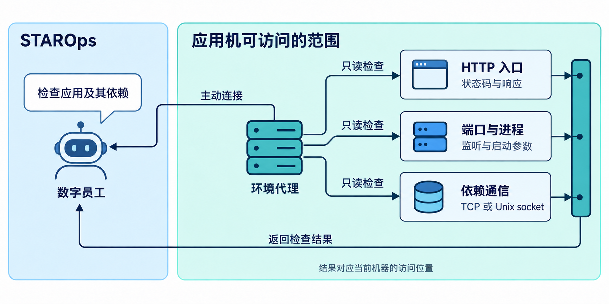
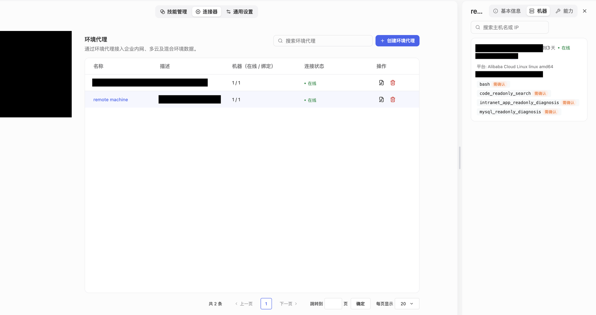
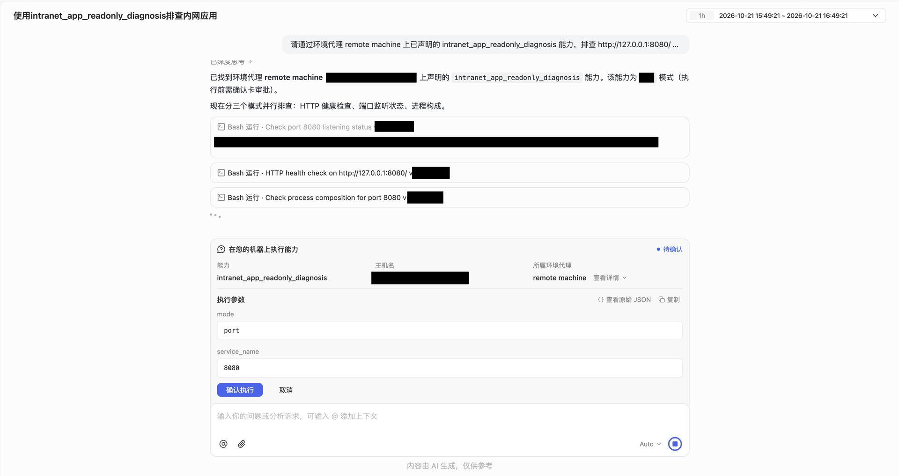

<div class="sls-starops-article-crumb">
  <a href="/doc/starops/starops.html">STAROps</a> <span class="sep">/</span> <span>告警追因</span>
</div>

# 使用环境代理排查内网应用及其依赖

<div class="sls-starops-article-meta">
  <span>分类 · 告警追因</span>
</div>

自建 GitLab 或内部管理应用需要检查时，运维人员往往要先登录一台能访问它的机器：请求一下入口，看看端口和进程，再查数据库、缓存。命令各有输出，遇到不符合预期的结果，还要继续找启动参数和连接配置。

例如，数据库默认端口没有监听，是否就表示数据库停了？同一台机器上有几个容器都提到了 8080，哪一个才是正在检查的入口？这些问题不能靠一条命令回答，要把前后的结果放在一起看。

**STAROps 环境代理让数字员工从这台机器上开展检查，并沿着返回结果继续查。** 工程师说明应用和访问地址，数字员工调用机器上的检查能力，查看 HTTP 响应、端口、进程和依赖。下面以一次 GitLab 检查为例，看看调查怎样往下走。



## 选一台能访问应用的机器

环境代理可以安装在应用机上，也可以安装在能够访问目标应用的运维机器上，再绑定到数字员工。它主动向 STAROps 建立出站连接，机器不需要为它开放入站端口。创建、安装和绑定方式见[《环境代理》](https://help.aliyun.com/zh/starops/user-guide/environmental-agent)。

机器接入后，数字员工可以使用已声明的 shell 能力，也可以调用团队已有的 HTTP、端口和进程检查脚本。将这些能力设置为执行前需人工确认，就能在调用时先核对机器和参数。



**选哪台机器，决定了从哪里看这个应用。** 在应用机本地请求入口，检查的是本地访问；要回答用户为什么打不开，还需要沿用户经过的域名、入口代理和网络继续查。两种检查可以相互补充，结论要对应各自的访问位置。

## 先看 GitLab 入口能否响应

这次从应用机本地检查一个 GitLab 实例，入口是 `http://127.0.0.1:8080`。同一台机器还运行着其他容器服务。

在会话中选择这台机器对应的环境代理，发起检查：

> 看一下这台机器上的 `http://127.0.0.1:8080`，检查 HTTP 响应、8080 端口监听和相关应用进程。

数字员工调用检查能力，工程师核对确认卡片上的目标和参数后执行。



HTTP 请求返回 **302**，这次请求的总耗时为 **33.1 毫秒**；宿主机的 `0.0.0.0:8080` 处于 `LISTEN` 状态。从应用机本地已经能连接入口，并收到重定向响应。若要继续检查页面访问，就需要读取 `Location`，跟进跳转目标；登录和业务操作还要分别确认。

## 从进程结果中分清两个 8080

进程检索找到了 GitLab 的 `puma` 和 `gitlab-workhorse`，也找到了另一条带有 8080 的容器启动命令：

::: details 查看 Jenkins 的端口映射命令

```text
-p 8081:8080
```

:::

这条命令属于 Jenkins。完整参数说明它把容器内的 8080 映射到了宿主机 8081，与这次访问的宿主机 8080 是两个入口。**关键词命中相同端口号，还要看端口出现在哪一侧。**

GitLab 的 puma 进程参数中也有 `127.0.0.1:8080`。它与宿主机监听是否对应，仍要结合容器映射和网络命名空间确认。这一步先找到了相关进程，也分清了 Jenkins 的端口映射，后面查看启动配置就有了明确对象。

## 默认端口没有监听，再看依赖怎样连接

入口有了响应，接着检查 GitLab 的 PostgreSQL 和 Redis：

> 再看看 PostgreSQL 和 Redis。5432、6379 有没有监听？如果没找到，继续看相关进程和实际连接方式。

宿主机没有查到这两个默认 TCP 端口的监听记录。但进程查询里，PostgreSQL 的主进程和后台进程都在，还能看到 `[local] idle` 会话；Redis 的启动参数则写着：

::: details 查看 Redis 的启动参数

```text
unixsocket:/var/opt/gitlab/redis/redis.socket
```

:::

这就解释了为什么只查默认端口还不够。PostgreSQL 已有本地 socket 会话，接下来要看 GitLab 配置的连接目标；Redis 也配置了 Unix socket 路径，可以继续检查这个 socket 是否监听、权限是否允许访问，以及 GitLab 是否使用了该路径。

**没有默认 TCP 端口的监听记录，不能直接判断依赖已经停止。** 反过来，进程存在也还不能说明应用能够访问它。查到实际连接方式以后，才知道该在哪里检查连接。

## 从已经查清的位置继续

这轮检查得到的结果很具体：本机入口返回了 302，GitLab 相关进程存在，Jenkins 使用另一个宿主机端口，依赖检查则需要继续看本地 socket。工程师可以接着问：

> 按刚才找到的连接方式，继续检查 GitLab 的数据库和 Redis 配置，看应用能否访问这两个依赖。

如果要确认用户侧访问，再补充实际域名和访问位置，继续检查跳转、入口代理、TLS 或访问控制。从应用机收到一次响应，到确认用户可以登录使用，中间还有哪些环节，就逐段查清。

这次检查中，入口的响应、进程参数和依赖连接方式是一项项查出来的。环境代理提供机器上的工具和访问条件，数字员工根据返回结果补查，工程师就可以从本地入口一直问到具体依赖。

## 相关入口

- [返回 STAROps 最佳实践首页](/starops/starops.html)
- [打开 STAROps Playground](/playground/staropsdemo.html)
- [进入 STAROps 控制台](https://starops.console.aliyun.com)

<style>
.sls-starops-article .vp-doc details {
  margin: 12px 0;
}

.sls-starops-article .vp-doc details > summary {
  font-size: 14px;
  line-height: 1.6;
}

.sls-starops-article .vp-doc img {
  display: block;
  width: 100%;
  max-width: 640px;
  aspect-ratio: 16 / 9;
  object-fit: contain;
  margin: 10px auto 2px;
  background: #f7f9fc;
  border: 1px solid var(--sls-starops-border, #e6ebf3);
  border-radius: 10px;
  box-shadow: none;
}

.sls-starops-article .vp-doc p {
  line-height: 1.85;
  margin: 14px 0;
}

.sls-starops-article .vp-doc h2 {
  margin-top: 36px;
}
</style>
