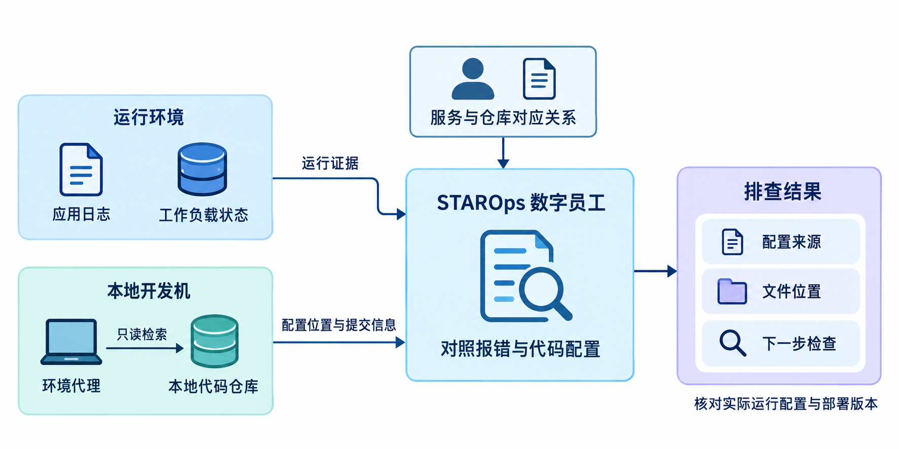
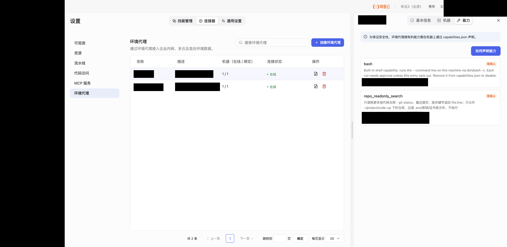
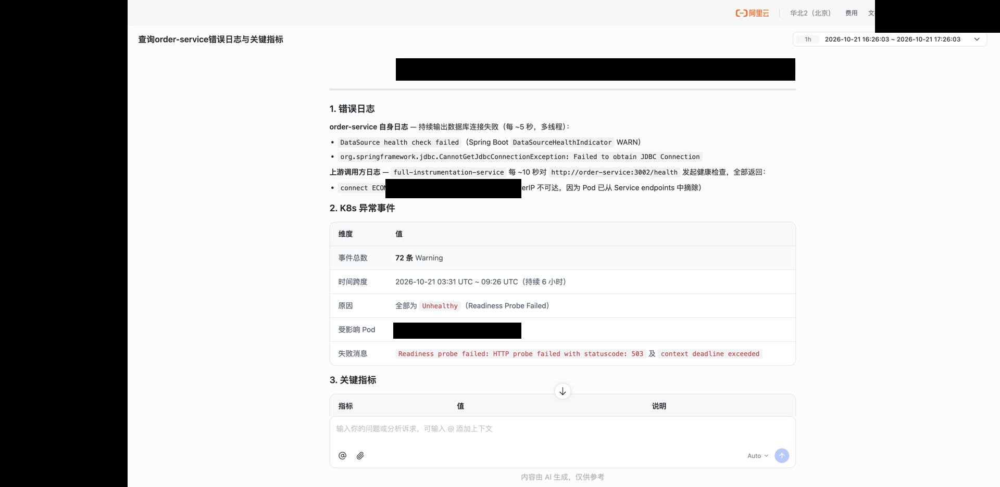
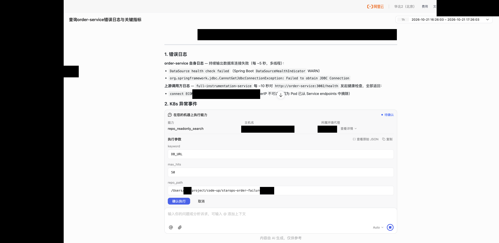

  <a href="/doc/starops/starops.html">STAROps</a> / 告警追因

# 把应用异常追到本地代码与配置

  分类 · 告警追因

`order-service` 的日志里持续出现 `Failed to obtain JDBC Connection`，就绪检查也返回了 503。监控已经找到了出错的服务，接下来要查的是：它到底在连接哪台数据库，连接地址从哪里来？

答案要回到代码和部署配置里找。应用配置可能写了默认值，部署时又通过环境变量覆盖；本地工作副本里看到的内容，也未必就是当前运行的版本。只拿着一句 JDBC 报错搜索源码，很容易找到几个相关文件，却还不知道应该检查哪一项。

**STAROps 可以在同一次调查里，结合运行日志查询本地代码。** 监控和日志通过连接器接入，代码工作副本通过环境代理读取。工程师告诉数字员工服务对应哪个仓库，它就可以带着前面的报错继续找配置、看文件和提交，不必来回复制日志与源码。

## 让数字员工读到服务的本地代码

代码可能保存在工程师本机，也可能在内网开发机上。选择存放工作副本的机器，安装环境代理并绑定到数字员工，就可以使用它已声明的 shell 能力或只读检索脚本。查询在这台机器上执行，仓库不需要整体上传。安装绑定方式见[《环境代理》](https://help.aliyun.com/zh/starops/user-guide/environmental-agent)。

下面使用已有的只读检索能力，返回当前分支、提交信息，以及带文件名和行号的匹配内容。将执行方式设为人工确认，查询范围限定到目标仓库，并在输出前处理源码、配置中的敏感信息。

运行数据也要接入同一名数字员工。监控和日志提供出错的应用、时间及具体异常，环境代理负责读取这台机器上的文件。数据接入方式见[《连接器》](https://help.aliyun.com/zh/starops/user-guide/connector-of-starops/)。

**服务与本地目录的对应关系，由工程师提供。** 一台机器上可能有多个仓库，同一个仓库也可能包含多个服务；说明目录和服务名，数字员工才能从正确的位置查起。

## 先看数据库连接错误，再查配置

这次调查从 `order-service` 的运行情况开始。在会话中提问：

> 看一下 order-service 的数据库连接错误，以及同一时段的就绪检查情况。

返回信息里，应用出现 `CannotGetJdbcConnectionException: Failed to obtain JDBC Connection`，DataSource 健康检查失败，就绪检查返回 503。

获取数据库连接失败已经影响到应用就绪，但这条异常本身还分不出是连接超时、认证失败，还是连接池在等待。先找到连接配置，才能知道后面该向哪个数据库、哪条网络路径继续查。

工程师在会话中选择保存代码的环境代理，补充仓库位置。以下目录为示例：

> order-service 的代码在这台机器的 `/srv/repos/trade-services`。查一下它的数据库地址从哪里读取，部署时有没有覆盖。把相关文件和行号给我，也看一下当前分支和提交。只读查询，连接值做脱敏。

数字员工发起检索，工程师核对卡片上的机器、路径和参数后确认执行。

## 沿着 DB_URL 找到连接地址的来源

检索找到了两处直接相关的配置：

| 文件位置 | 内容 |
| --- | --- |
| `k8s/20-apps.yaml:8` | 为应用注入环境变量 `DB_URL` |
| `order-service` 的 `application.yml:8` | 数据源地址通过 `${DB_URL:...}` 读取 |

这两处配置说明，应用会从 `DB_URL` 读取数据库地址，仓库里的部署清单为它提供这个值。**要查这次连接失败，应该继续看运行实例实际得到的 `DB_URL`。** 只看 `application.yml` 中的默认地址，可能会查错目标。

文件名和行号让这一步可以直接核对：从应用配置看到读取方式，再回到部署清单看变量如何注入。调查不再停在搜索 JDBC 关键词，也不必把仓库里所有涉及数据库的文件逐个翻一遍。

## 回到运行实例核对

找到配置来源，还需要确认它与正在运行的实例一致。本地工作副本可能有未提交或未推送的改动，部署时也可能使用了另一份配置。**本地文件能解释地址怎样传入应用，实际连接目标要以运行环境生效的配置为准。**

工程师可以接着问：

> 找到 DB_URL 的来源了。再看运行实例里实际生效的配置，以及完整的连接错误。这个本地提交和部署版本也核对一下。

接下来的判断就有了具体对象。如果完整错误是连接超时，就从应用所在网络检查这个目标；如果是认证失败，就核对应用实际使用的认证配置；如果在等待连接池，则继续看连接使用情况。相关配置近期有过修改时，再查对应提交是否已经部署。

从一句 JDBC 报错，到找到 `DB_URL` 的读取和注入位置，再回到实例核对生效值，代码查询就有了明确的用途。工程师给出仓库位置，数字员工沿着运行中的问题读本地文件，后面的调查也有了具体的配置项可查。

## 相关入口

- [返回 STAROps 最佳实践首页](/starops/starops.html)
- [打开 STAROps Playground](/playground/staropsdemo.html)
- [进入 STAROps 控制台](https://starops.console.aliyun.com)

