<div class="sls-starops-article-crumb">
  <a href="/doc/starops/starops.html">STAROps</a> <span class="sep">/</span> <span>主动巡检</span>
</div>

# 从被动查询到主动发现：STAROps 日志智能巡检实践

<div class="sls-starops-article-meta">
  <span>分类 · 主动巡检</span>
</div>

很多人查日志，都是从一条告警开始的。接口报错了，先搜 Request ID；Pod 重启了，去找退出前的异常堆栈；用户反馈支付失败，再拿着账号和订单号回查调用过程。此时问题已经发生，日志帮助我们还原现场。

但日志里留下的东西远不止故障现场。应用日志记录业务执行过程，访问日志反映流量和服务质量，审计日志记录谁在什么时间做了什么操作，Kubernetes Event 记录资源状态变化。研发用它排障，安全团队用它审计，运营团队也可以从中发现支付、库存、设备或用户行为的异常。

真正容易被忽略的，是那些还没有触发告警、也没有人主动搜索的变化：一个新版本开始零星出现从未见过的异常堆栈；整体错误率看起来正常，某个 Region 却在持续恶化；一类高风险操作第一次出现在非授权时间。

单独看，这些信号可能并不起眼。继续发展下去，它们也可能成为下一次大面积故障的起点。

日志智能巡检要做的，是在没人提问的时候主动看一遍，并告诉我们：这里出现了一个过去没有的变化，值得现在就查。

## 规则能看到已知问题，巡检要寻找未知变化

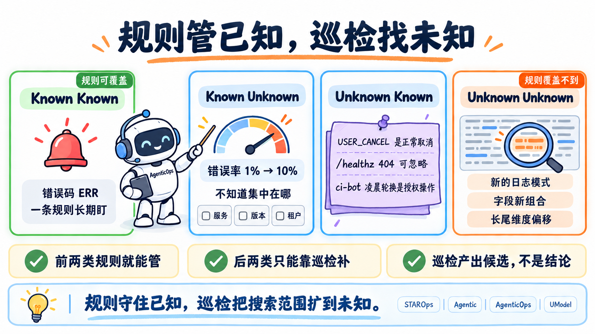

规则和告警很有用，我们知道某个错误码代表失败，也知道什么阈值需要处理，写一条 SQL 或告警规则就能长期监控。这类问题属于 Known Known：知道问题，也知道怎么找到它。

生产环境中的问题并不都这么清楚。

有时我们知道发生了异常，却不知道问题集中在哪里。比如错误率从 1% 上升到 10%，但暂时还不知道是哪个服务、接口、版本或租户引起的。这是 Known Unknown。

还有一些经验只存在于工程师脑中，BizException(code=USER_CANCEL) 属于正常业务取消，/healthz 的 404 可以忽略，ci-bot 在凌晨执行密钥轮换属于授权操作。系统不知道这些背景时，就会把它们当成问题反复报告。这类情况可以理解为 Unknown Known：团队已经知道，系统还不知道。

最难的是 Unknown Unknown：事前没有人定义过问题，也没人知道应该搜索什么。它可能是一种新的日志模式，可能是几个字段从未出现过的组合，也可能是某个长尾维度刚刚偏离正常状态。

日志智能巡检无法承诺发现所有未知问题。它能做的是扩大搜索范围：除了执行已有检查，还持续查看新增模式、分布变化、数值尾部和互相矛盾的信号，把值得调查的候选尽早找出来。

## STAROps 日志智能巡检

让 Agent 做日志巡检，真正困难的是如何从海量数据中稳定地找出异常，同时保留足够的证据供人复核。逐条阅读不可行，抽取少量样本也不可靠：低频异常容易漏掉，几个表达强烈的样例又可能把判断带偏。

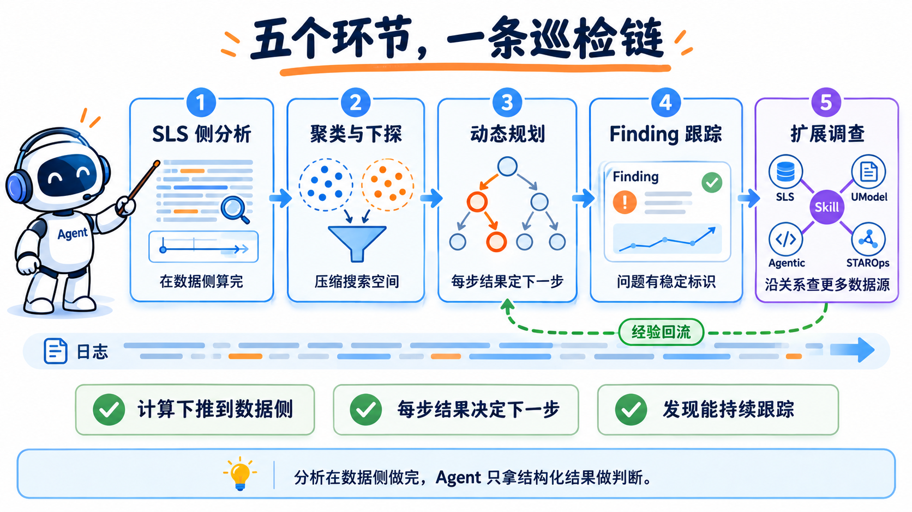

STAROps 把这项工作分成了几个彼此衔接的环节：

- SLS 先在数据侧完成大范围分析
- 日志聚类和维度下探 AI 算子负责压缩搜索空间
- Agent 根据每一步结果动态规划调查路径
- 确认后的问题进入关注列表持续跟踪
- 关联代码、指标、Trace、领域 Skill 和 UModel，继续跨实体、跨数据源调查

### SLS 日志分析 AI 算子

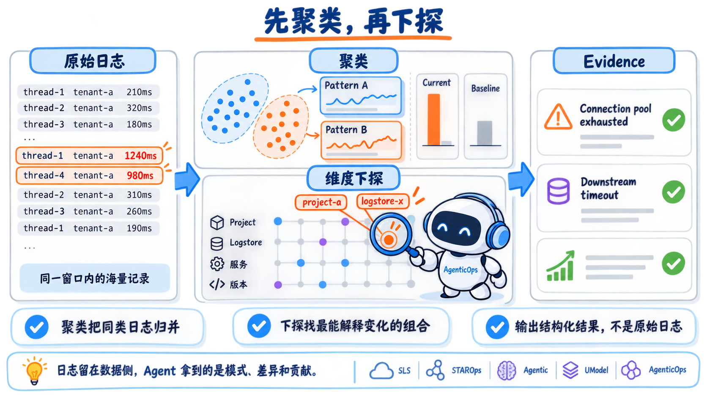

真实生产场景，有一个物理限制绕不开：模型上下文是有限的，无法把一个巡检窗口内的海量日志全装进去。而简单抽样同样有问题，低频异常可能没有被抽中，少数特殊样本也可能让 Agent 对整体情况产生误判。依赖关键词和固定 SQL 先过滤，又只能覆盖事先已经知道的错误。

SLS 这两类日志分析 AI 算子的共同优势，是把计算直接下推到数据侧。日志留在 SLS 中，算子在指定时间窗口内直接完成实时聚类、基线比较和维度下探，再把 Pattern、变化幅度、异常维度及其贡献等结构化结果交给 Agent。一次分析能够覆盖的日志范围不再受模型上下文长度限制，Agent 也不需要依靠几条样本猜测全局。

日志聚类处理的是大量非结构化日志。它会把时间、线程、租户、接口、耗时等动态内容抽取为变量，将表达同一类事件的日志归入同一个 Pattern。聚类还可以按服务、模块等字段分组，并把当前窗口与昨日同期、上周同期或发布前窗口直接比较，从大量文本中找出新增、消失和数量突变的模式。

例如，一组混合日志中同时出现了连接池耗尽和下游调用超时：

::: details 查看日志样例与聚类结果

```text
WARN  [worker-17] Connection pool exhausted, tenant=shop-102, wait=812ms
ERROR [gateway] Downstream timeout, provider=bank-a, api=/pay/confirm, elapsed=3201ms
WARN  [worker-08] Connection pool exhausted, tenant=shop-518, wait=943ms
```

```text
Pattern A: <*> WARN [<*>] Connection pool exhausted, tenant=<*>, wait=<*>ms
Pattern B: <*> ERROR [gateway] Downstream timeout, provider=<*>, api=<*>, elapsed=<*>ms
```

:::

真实巡检中，Agent 看到的是指定分析窗口内的整体 Pattern 分布：每类 Pattern 当前和历史出现了多少次、哪些属于新增或突增，以及变量值如何分布。即使没有人提前定义 Connection pool exhausted 这个关键词，只要它形成了新的日志模式，依然有机会被巡检发现。

维度下探解决的是另一类问题：异常已经出现，但还不知道集中在哪里。算子会同时比较当前值和历史基线，在 service、region、version、operation 等多个候选维度及其组合中搜索，找出最能解释变化的范围，并给出实际值、基线值、差异和贡献。

这比依次对每个字段执行 group by 更有效。流量最大的维度未必是导致异常的维度，单个字段也可能看不出问题；真正的异常可能只出现在 project-a + logstore-x 这样的组合中。维度下探能够直接从大量结构化日志中找到这些差异模式，再将调查范围继续收窄。

### 动态规划与精准下探

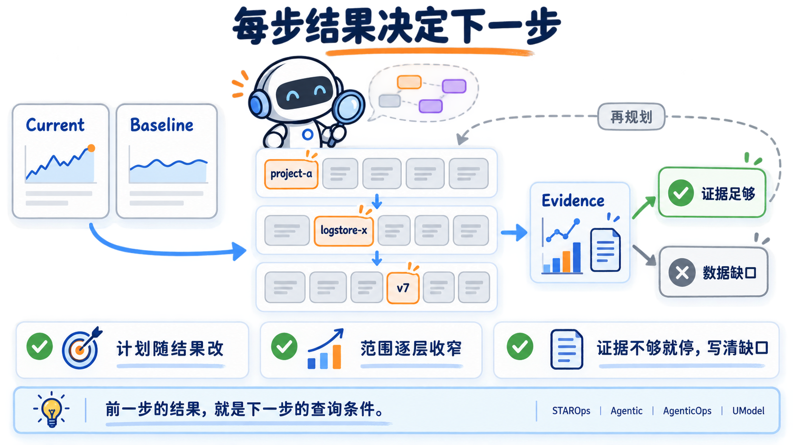

日志巡检不会为所有系统预先写死同一条调查流程。任务第一次运行时，STAROps 会根据日志结构、可用历史和巡检目标生成一份初始计划；稳定检查按计划重复执行，现场调查则由 Agent 根据本轮证据决定。

一次调查可能先发现失败比例上升，确认分母和历史基线后，再调用维度下探 AI 算子寻找贡献最大的范围；也可能先发现一个新 Pattern，随后检查它是否集中在某个版本、Region 或上游依赖。字段解释不了变化时，Agent 会转向正文聚类；怀疑发布影响时，会检查版本和变更；需要判断用户影响时，再去找 Request、Trace 或业务实体。

算子返回的第一层候选只是调查入口。Agent 会复核当前窗口和历史基线是否可比，重新查询主要候选的实际差异，再把高贡献范围作为下一轮查询条件。例如先锁定 project-a，再只在该 Project 内比较 Logstore 和版本。前一步的结果决定下一步查什么，范围逐层缩小，查询链路也会保留在 Finding 中。

每轮巡检还会保留一次有边界的自主探索。即使已有检查没有报错，Agent 也会从未被解释的日志、新增字段、模式变化、数值尾部和相互矛盾的信号中选择一个方向继续查看。证据已经能够解释问题、继续查询没有明显收益，或者数据确实不足时，调查就会停止，并把结论或数据缺口写清楚。

### Finding 持续运维与持续优化

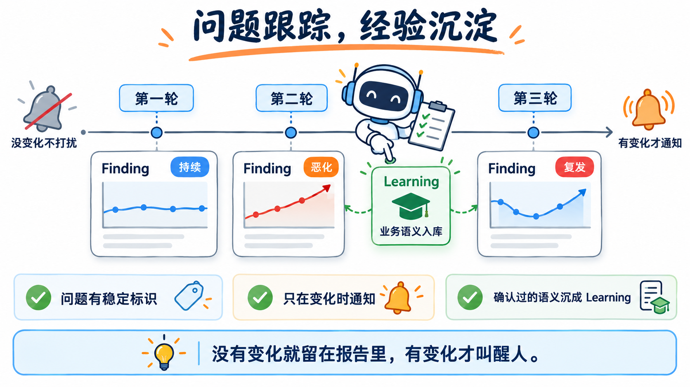

一次巡检发现的问题，不应该变成一条孤立的通知。STAROps 会为问题生成可持续跟踪的 Finding，保留稳定标识、当前证据、影响范围和状态变化。同类问题再次出现时，系统会关联已有 Finding，区分它是持续存在、正在恶化、已经复发，还是影响正在减小。

通知策略也以 Finding 的变化为依据。新增异常、问题恶化、问题复发或影响范围明显扩大时，可以发送钉钉或飞书；没有变化的问题继续留在报告中，不必每个周期重复打扰值班人员。

一项巡检任务刚开始运行时，只需要明确业务范围、执行周期、重点关注项和通知方式。后续优化来自每一次真实反馈。BizException(code=USER_CANCEL) 如果是正常业务取消，可以告诉 Agent；健康检查、压测流量或授权操作不需要关注，也可以补充适用范围。STAROps 会把确认后的业务语义和判断依据沉淀为 Learning，用于调整后续巡检。

未知问题被人工确认后，也会成为可复用的经验。某种异常堆栈如果已经确认与连接池配置有关，后续巡检可以复用上次的下探路径和复核方法，先判断是不是同一个问题，再检查它是否恶化。日志字段、业务范围或关注目标发生变化时，巡检计划也会重新评估；只有经过验证的调整才会进入稳定检查。

### 自定义探查与扩展能力

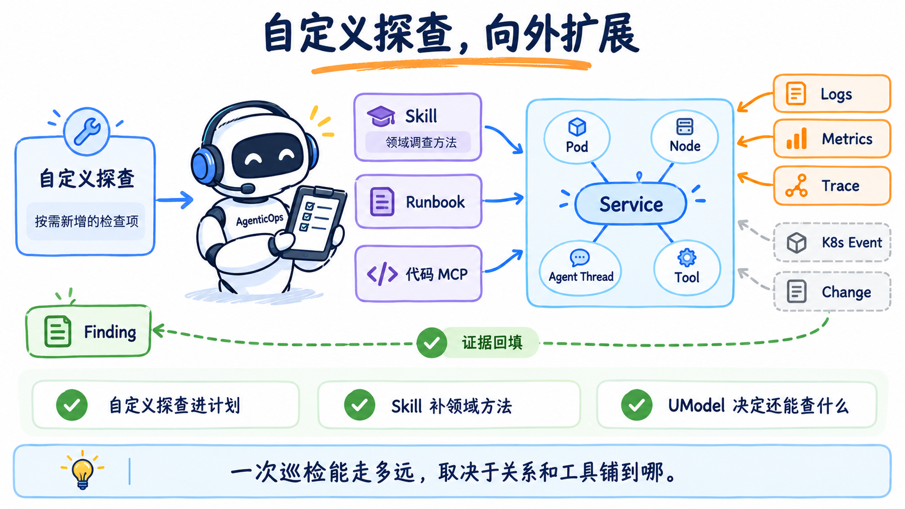

除了系统生成的通用检查，用户还可以增加自己的探查要求，例如只关注结算窗口内的资金差异、检查非授权时段的高风险操作，或者针对某类业务错误码补充专门的判断逻辑。自定义探查会进入巡检计划，和日志聚类、维度下探及 Agent 自主探索配合执行。

Skill 和 Runbook 用来补充领域知识与调查方法。发现新的 Java 异常堆栈后，可以通过代码 MCP 查询对应文件、提交记录和发布版本；发现数据库连接超时后，可以调用专项排障 Skill，继续检查连接池、慢 SQL 和数据库指标。企业也可以把业务错误码、授权窗口、处置规范和系统知识写进自己的 Skill。

UModel（UnifiedModel） 解决的是当前日志还能和哪些数据关联。它把服务、Pod、节点、Agent Thread、Skill 等实体，与对应的 LogSet、MetricSet、TraceSet 及其实际存储组织在一张关系图中。某个 Logstore 发现异常后，Agent 可以沿 UModel 找到关联实体，再去查询它们的日志、指标、Trace、Kubernetes Event 和变更记录。原始数据不需要搬到同一个存储中，UModel 会提供对象关系、数据位置和字段语义。

这让一次日志巡检不必停在单个 Logstore。通用巡检先找出变化，UModel 决定可以沿哪些实体和数据继续调查，领域 Skill 决定每类对象应该怎么查，代码 MCP 和其他工具负责取得证据。最终形成的是一条跨实体、跨数据源的调查路径。

## STAROps 如何利用日志智能巡检提升业务可靠性

对 STAROps 来说，服务指标正常运行并不等于业务可靠。一次任务要经过入口网关、鉴权、AgentRuntime、Sandbox、工具服务等多个组件，任何一个环节出现问题，都可能让任务失败、响应变慢，或者得到不完整的结果。我们还需要持续关注任务是否完成、性能是否发生变化、错误集中在哪些 Agent、用户和依赖链路。

因此，我们把 STAROps 自身的 Agent Thread 日志纳入日常智能巡检。巡检按小时运行，持续分析请求量、完成状态、延迟、Agent 分布和用户分布；发现新的错误模式或关键指标恶化后，再沿 Agent 和 UModel 关联 LLM、Tool、Gateway 等数据，确认问题影响了什么、发生在哪个环节。

### 从关键业务日志开始巡检

在 SLS 控制台打开目标 Logstore，进入“智能巡检”页面，就可以创建一项巡检任务。巡检要求可以先保持泛化，让 Agent 根据日志特征建立初始计划；如果已经有明确的业务关注点，也可以在创建时直接补充。

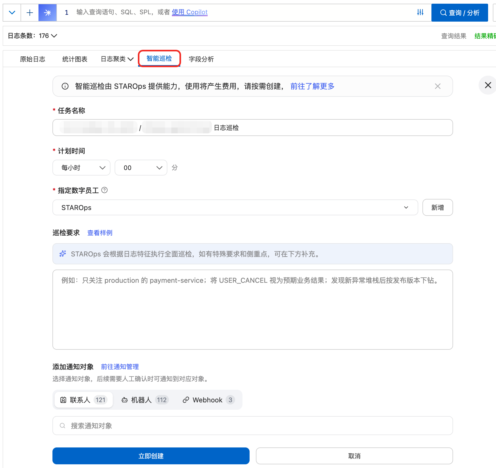

第一次运行后，巡检发现日志记录量比前一个窗口增长了 147%，增量集中在一段批量任务执行时间内。报告同时给出了当前窗口、对照窗口、实际查询和不确定性说明。根据已有证据，这次增长更像系统调度行为变化，没有直接影响服务健康。

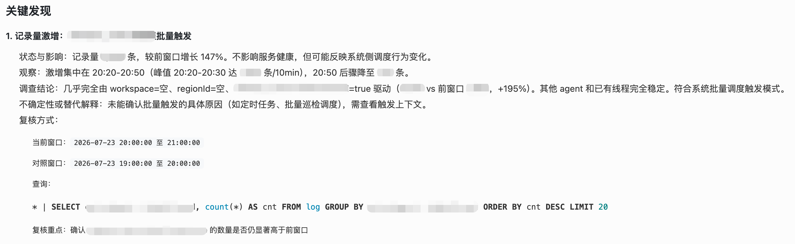

这个结果有依据，但还不够贴近 STAROps 的业务。单看记录量和通用字段，很难判断变化究竟来自哪个入口、哪些用户，以及是否影响了真实任务。

### 把业务语义补进巡检计划


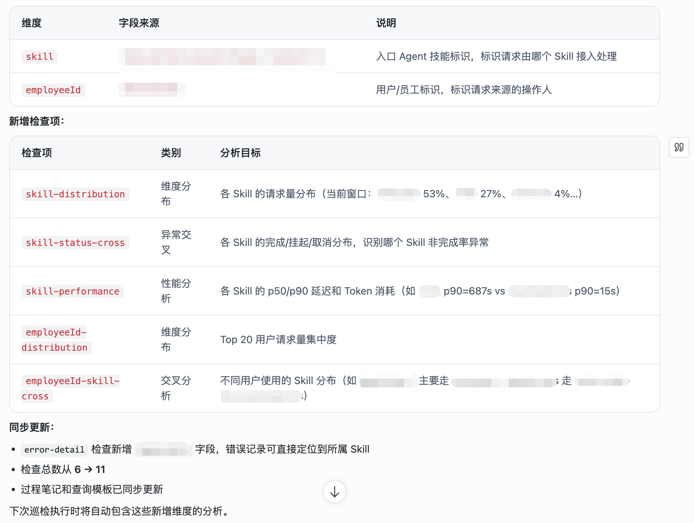

我们直接告诉 STAROps：skill 表示请求由哪个入口 Skill 接入处理，employeeId 表示请求来自哪位用户，这两个字段需要重点关注。Agent 随即更新巡检计划，增加了 Skill 请求分布、Skill 完成状态、Skill 性能、用户请求分布以及用户与 Skill 的交叉分析，检查项从 6 项增加到 11 项。下一轮巡检会自动执行这些新增检查。

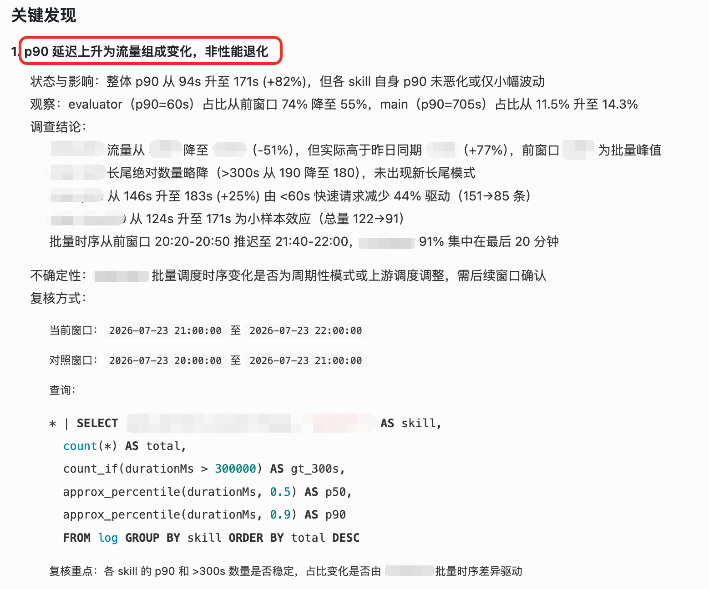

更新后的巡检很快体现出差异。某个窗口的整体 p90 延迟从 94 秒升到 171 秒，看起来像一次明显的性能退化；继续按 Skill 拆分后，各 Skill 自身的 p90 并没有同步恶化，真正变化的是流量构成：慢请求占比较高的 Skill 在当前窗口占比上升。最终报告把它判断为流量组成变化，而不是服务性能退化。

可以看到，用户反馈改变了 Agent 对日志的理解，也改变了后续检查和下探方式。经过确认的业务语义会进入后续巡检计划，不需要每一轮重新解释。

### 持续运行，按问题触发通知

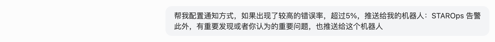

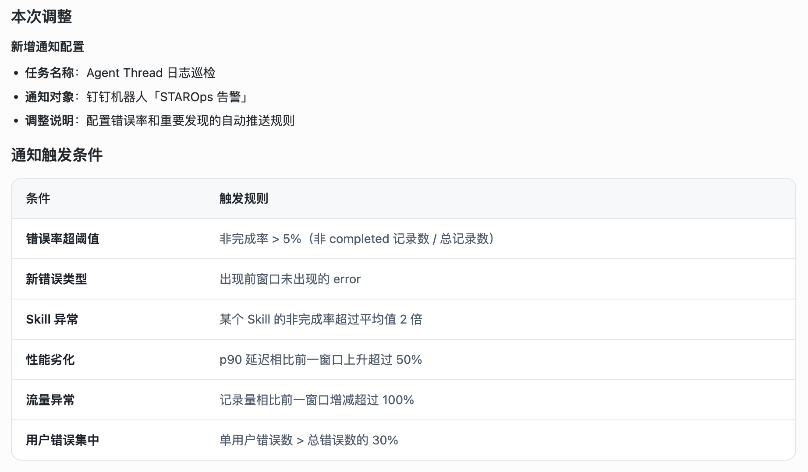

巡检任务需要按小时运行，通知却没有必要每小时发送。我们给任务增加了问题触发条件：错误率超过 5%、或者出现新的重要发现。而后 STAROps 自己拆解出：出现新的错误类型、某个 Skill 的非完成率显著偏高、p90 明显恶化，或者错误集中在少数用户时，才推送到“STAROps 告警”钉钉机器人。

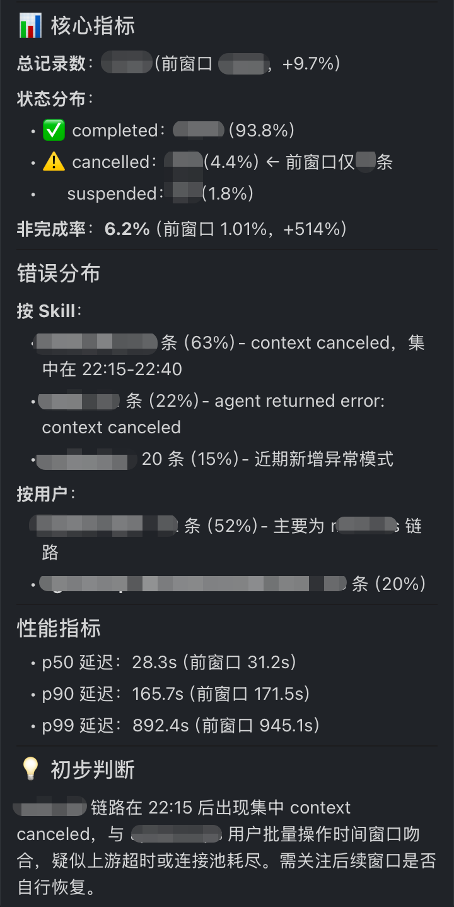

后续一次巡检中，非完成率从前一个窗口的 1.01% 升至 6.2%，超过了通知阈值。机器人收到的通知同时带上了按 Skill、按用户的错误分布、性能指标和初步判断，问题已经收敛到某条 Skill 链路在特定时间段内集中的 context canceled。没有触发条件的正常巡检仍然保留报告，但不会反复打扰人。

### 通过 Skill 和 UModel 扩大调查范围

单个 Logstore 能告诉我们 Agent Thread 发生了什么，却不一定能解释为什么。我们进一步把这项巡检与 STAROps 自己的 Skill 和 UModel 关联起来：Agent Thread 可以关联到入口 Skill、用户、LLM 调用、Tool 和 Gateway，每类实体又有自己的 LogSet、MetricSet 或其他数据源。

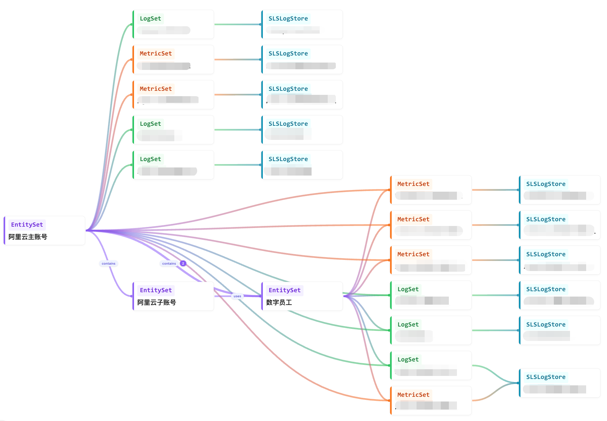

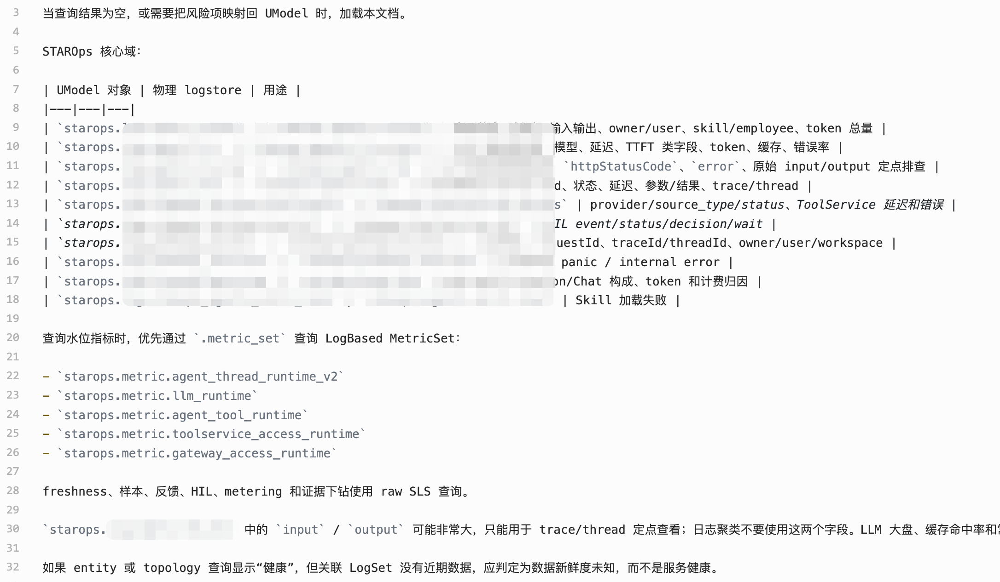

当 Thread 日志出现非完成率异常时，Agent 可以沿 UModel 继续检查关联实体。在一次跨源巡检中，Thread 的 failed 比例仍为 0%，关联的 LLM 调用数据却出现了集中的 429 限流；部分 Gateway SSE 统计和 /metrics 请求则已经被识别为已知噪音。最终报告把证据分成 P1 正常、P2 异常和 P3 已知噪音，没有把所有红色指标混在一起。

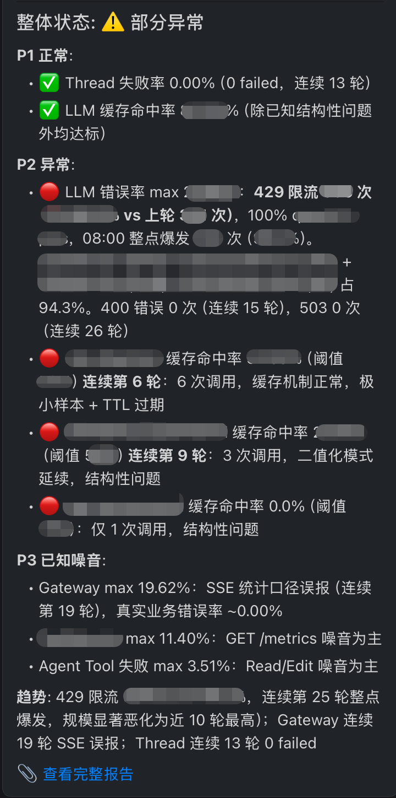

STAROps 的可靠性巡检从一个 Logstore 起步。第一轮结果不够贴近业务，我们补充业务语义；检查计划随之更新，通知策略也从“每轮发送”变成“问题触发”；再通过 Skill 和 UModel，把调查范围扩展到更多实体和数据源。随着系统和业务继续变化，这项巡检也会不断校准，成为一套持续运行的可靠性保障机制。

## 怎么判断这套巡检是否奏效

日志巡检不像发布上线，没有一次性的验收动作。判断它有没有用，看的是连续的运行结果。

第一，看它是否比告警更早发现问题。统计候选 Findings 里有多少在人工告警之前出现，比看它一共报了多少条更有意义。数量多说明搜索范围打开了，但只有提前量才是价值。

第二，看通知是否越来越值得看。巡检上线初期，通知里难免混着已知噪音；如果几轮之后，业务取消、健康检查 404、凌晨密钥轮换这类情况仍然反复出现，说明业务语义还没有补进计划。非完成率升到 6.2% 这样的信号之所以值得追，不是数字本身，而是每条通知背后都能拿出可复核的证据。

第三，看定位是否在收敛。同一类问题从发现到确认原因，需要的追问轮次和人工翻查的日志量是否下降。调查路径被记录下来以后，第二次遇到相似模式不必从头再来。

第四，看经验是否真的留了下来。每轮确认过的判断依据，下一轮是否直接生效：同类候选不再重复上报，已知噪音自动归入报告而不打扰人。经验留在会话里，下一次还得重讲，就不算沉淀。

第五，看扩展成本。新增一个数据源或一类实体时，是补一条关系和几个检查项，还是要把整套流程重做一遍。前者说明模型和工具是通用的，后者说明这套做法还绑在具体场景上。

这些判据都不是一次性的。系统在变，日志在变，阈值和语义也会过期。连续几轮候选都需要人工从头复核，或者通知里大部分仍是已知噪音，就是计划该重新校准的信号——回到业务语义和判断依据，把这一轮的经验补进去。

## 结语

过去，我们通常在问题发生后才打开日志。日志智能巡检把这件事提前了一步：Agent 持续观察日志中的模式和分布变化，在没人提问、没有现成规则的时候，主动寻找值得调查的信号。

一项有用的巡检任务不需要在第一天就写完所有规则。它可以从一个 Logstore 和一份泛化计划开始，通过运行结果逐步补充业务语义、调整检查计划和通知策略，再借助 Skill 与 UModel 关联更多实体和数据源。

随着一次次巡检和反馈，未知问题会变成可以复用的经验，已知噪音会逐渐退出通知，真正发生变化的问题则会被继续追踪。问题发现得更早，调查范围收敛得更快，发出的每一条通知也更值得被认真看一眼。

## 相关入口

- [返回 STAROps 最佳实践首页](/starops/starops.html)
- [打开 STAROps Playground](/playground/staropsdemo.html)
- [进入 STAROps 控制台](https://starops.console.aliyun.com)

<style>
.sls-starops-article .vp-doc details {
  margin: 12px 0;
}

.sls-starops-article .vp-doc details > summary {
  font-size: 14px;
  line-height: 1.6;
}

.sls-starops-article .vp-doc img {
  display: block;
  width: 100%;
  max-width: 640px;
  aspect-ratio: 16 / 9;
  object-fit: contain;
  margin: 10px auto 2px;
  background: #f7f9fc;
  border: 1px solid var(--sls-starops-border, #e6ebf3);
  border-radius: 10px;
  box-shadow: none;
}

.sls-starops-article .vp-doc p {
  line-height: 1.85;
  margin: 14px 0;
}

.sls-starops-article .vp-doc h2 {
  margin-top: 36px;
}
</style>
