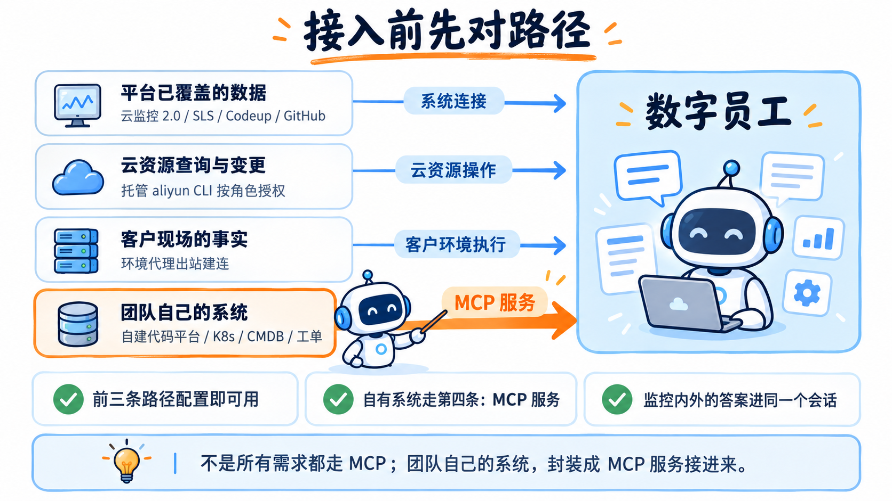
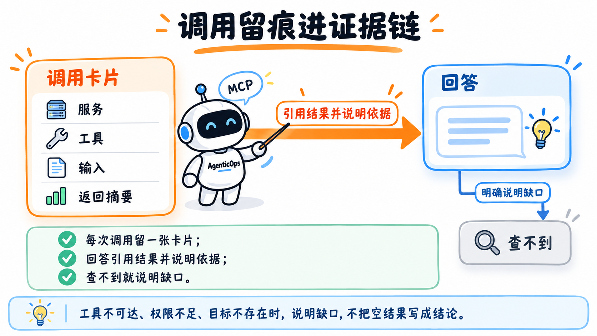
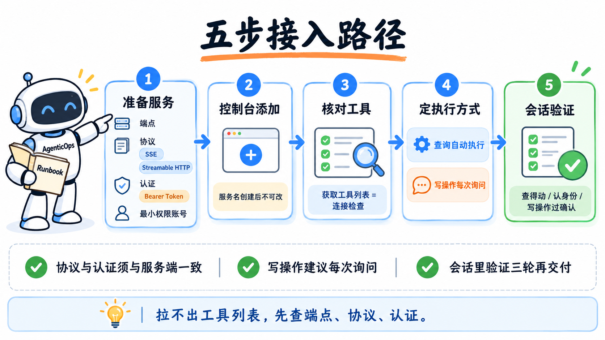
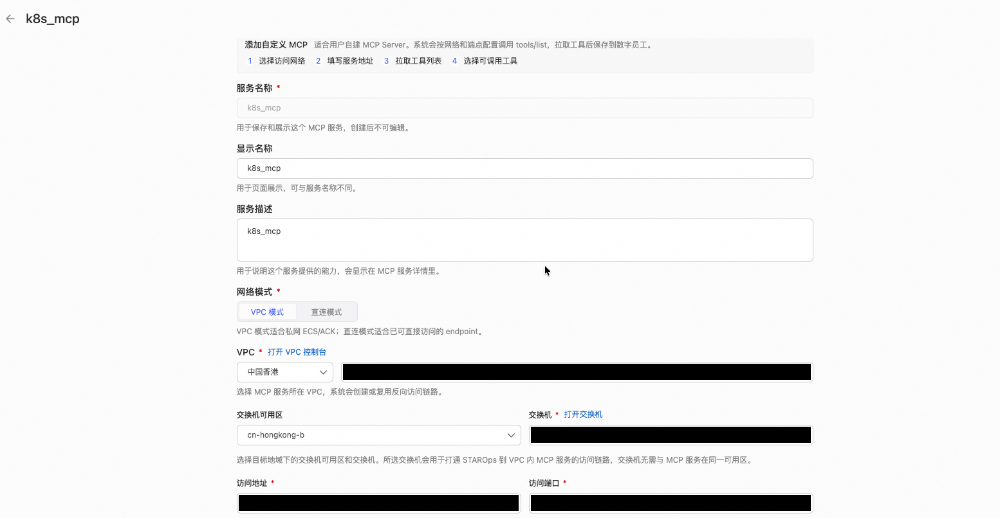
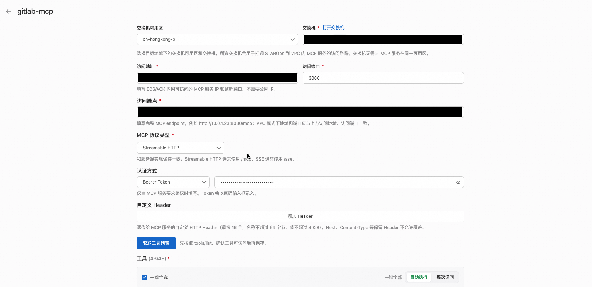
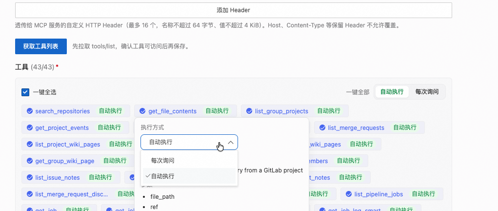
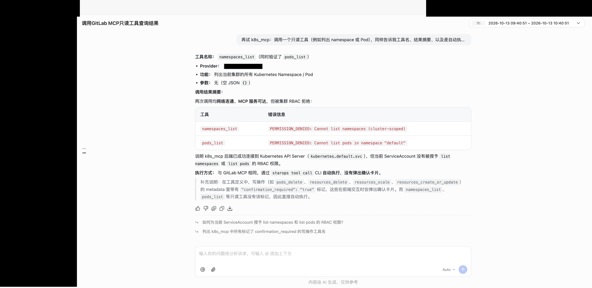
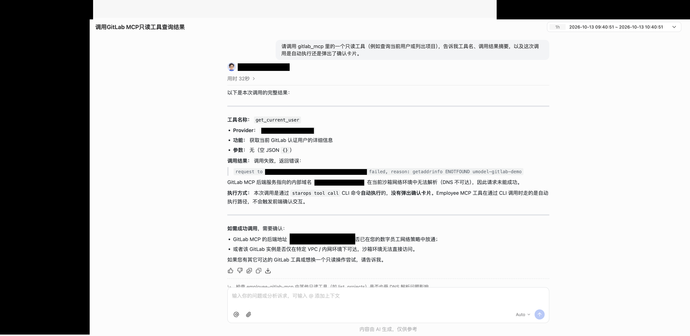

  <a href="/doc/starops/starops.html">STAROps</a> / 经验固化

# 把团队自己的系统接进 STAROps：MCP 接入与调通

  分类 · 经验固化

值班工程师的日常问题分两类。一类在监控里：服务的错误率、延迟、日志。另一类在监控外：这个服务最近谁改过代码，答案在团队自建的 GitLab 里；负载高了能不能先扩两个副本顶住，动作发生在 K8s 集群里。

以前回答第二类问题，要切到别的系统：打开 GitLab 查提交，登录集群控制台改副本数，查完再切回来，把几个窗口里的线索拼在一起。STAROps 用指标、日志、APM、Trace 和 UModel 组织运行时证据，第一类问题数字员工直接能答；第二类的答案长在客户自己的系统里，产品内置不到。

MCP 改变了这条边界。**团队把自己的系统封装成 MCP 服务接进 STAROps，监控外的答案就能和监控里的证据出现在同一个会话里**：数字员工查到错误率升高，顺着就能查到昨晚那次提交的合并请求，也能在确认之后直接把副本数扩上去。本文用一个真实接入过程讲清这件事怎么做：把自建 GitLab 和 K8s 操作面接进数字员工「运维值班」，从准备服务到会话里调通，每一步在哪个界面操作、填什么、得到什么。

不是所有需求都要走 MCP，接入前先对一下路径：

| 要用的能力 | 走哪条路 |
|---|---|
| 云监控 2.0、日志服务 SLS、云效 Codeup、云效 Flow、GitHub Code、GitHub Actions 等平台已覆盖的数据 | 系统连接，直接添加 |
| 云资源现状查询与变更 | 云资源操作：数字员工通过托管的 aliyun CLI 按所选角色授权范围执行 |
| 只能从企业内网、多云等客户现场取的事实 | 客户环境执行：环境代理主动出站建连，需申请开通，每个数字员工最多 20 个，每个代理绑定一台机器 |
| 团队自己的系统：自建代码平台、K8s 操作面、CMDB、工单、内部发布平台 | 自定义工具接入：把系统能力封装成 MCP 服务 |

前三条配置即可用，本文展开第四条。

## STAROps 的做法

MCP 服务接入后，STAROps 做三件事。

**服务注册与工具发现。** 连接器是外部系统进入数字员工的唯一入口，一个接入对象对应一个外部系统实例和一套访问身份，归属于一个数字员工。在控制台添加 MCP 服务、填入端点与认证信息后，工具列表直接从服务端拉取，每个工具的用途、输入、输出在控制台可见，用不着的工具可以不开启。

**工具级执行方式。** 每个工具独立配置执行方式，只有两档：自动执行，数字员工调用时不打断对话；每次询问，调用前弹出确认卡片，列明动作与目标，人确认后才执行。同一个服务里查询类工具放自动执行，写类工具放每次询问，风险分层落在工具面上。产品建议所有写操作都配每次询问。

**调用留痕进证据链。** 每次工具调用留下一张调用卡片：用了哪个服务哪个工具、输入是什么、返回摘要是什么。回答引用工具结果并说明依据，不把原始返回直接堆出来。工具不可达、权限不足、目标不存在时，数字员工明确说明缺口，不把空结果写成结论。

边界也在这里说清：MCP 不替代监控主链，指标、日志、Trace 该走系统连接的还走系统连接；工具面的质量由服务方负责，描述不清的工具数字员工就用不好；写操作最终能不能执行，由外部系统侧的账号权限决定。

## 接入前要知道的四个边界

**权限分两条轨。** 谁能创建和管理 MCP 服务，是控制台使用权限；数字员工调用工具时用什么身份访问外部系统，是连接器上配置的那套访问身份。两条轨互不相通：控制台里能看见数据，不等于数字员工能读到。访问凭证由平台托管，只用于建连，不进入会话，保存后控制台不回显。

**全局执行策略管不到 MCP 工具。** 数字员工的执行策略管的是阿里云 OpenAPI 调用，分拒绝、自动放行、人工确认、RAM 角色权限兜底四层，对 MCP 工具不生效。MCP 工具的风险控制就两个抓手：接入时裁剪工具面，不开不需要的工具；逐工具配置执行方式两档。需要更多审批层级的动作，进外部系统自己的工单与审批流程。

**责任分四方，各管一段。** 接入前把这张表和外部系统的负责人对齐：

| 方 | 负责什么 |
|---|---|
| STAROps | 理解意图、选择工具、组织证据、生成结论与建议 |
| MCP 服务 | 工具封装：输入输出定义、权限声明、风险标注、审计字段 |
| 外部系统 | 真实资源状态、账号权限、系统侧审计 |
| 人与审批系统 | 高风险动作确认、生产变更授权、回滚决策 |

**排障先认名字。** 控制台里配置的服务名，和运行时会话里显示的提供方标识可能不一致，对照配置排障时以控制台服务名为准。

## 典型场景：自建 GitLab 与 K8s 操作面接进「运维值班」

团队的环境：一个跑在自建 K8s 集群里的电商应用，代码托管在团队自建的 GitLab 实例。数字员工「运维值班」已经通过系统连接接入云监控与日志服务。这次要把两件长在平台外的能力接进来：K8s 集群的受控操作，以及自建 GitLab 的研发上下文。

### 第一步：准备 MCP 服务

两台 MCP 服务分别部署在能访问 K8s 集群和 GitLab 实例的位置。部署侧确认三件事：服务端点、协议类型、认证方式。协议有 SSE 和 Streamable HTTP 两种，稍后填进控制台的必须与服务端实际一致。认证用 Bearer Token 的，Token 只填进控制台，不写进文档和群聊。服务访问外部系统用的账号按最小权限准备：GitLab 侧用只读服务账号；K8s 侧把扩缩容子资源单独授权，不授删除。

### 第二步：在控制台添加服务

打开「运维值班」的 **设置 > 连接器 > MCP 服务**，单击 **添加**，按表单填写：服务名称、显示名称、网络模式、访问端点、协议类型、认证方式。服务名称创建后不可修改，起一个能表达系统归属的名字；其余字段保存后仍可修改。服务在 VPC 私网就选 VPC 模式，该能力需先申请开通；公网可达选直连模式。字段级细节见帮助文档[《MCP 服务配置》](https://help.aliyun.com/zh/starops/user-guide/mcp-service-configuration)。

### 第三步：核对工具列表

保存前先点 **获取工具列表**，这一步同时就是连接检查：端点、协议、认证有任何一处不对，列表拉不出来。拉取成功后逐个看工具描述，用途、输入、输出符合预期再勾选开启，不需要的工具不开。GitLab 服务发现 43 个工具，覆盖当前用户、仓库、合并请求、流水线、提交与任务日志查询；K8s 服务的工具覆盖命名空间与 Pod 查询、日志读取、扩缩容、资源删除等动作。

### 第四步：定执行方式

工具区支持一键全部设为自动执行或每次询问，再逐工具微调。团队的配法：查询类全部自动执行，查命名空间、查 Pod、读日志、查当前用户、查合并请求，诊断时不打断对话节奏；写类逐个改回每次询问，扩缩容、删除资源每次执行前都要人确认。

### 第五步：会话里验证三轮

**第一轮，查得动、查得准。** 值班工程师让数字员工查看目标命名空间的部署状态。只读工具自动执行，返回该命名空间 90 个部署，其中 89 个副本数符合期望，唯一例外是 checkoutservice，期望 2 个副本只有 1 个可用。90 个里揪出 1 个，人工逐个点开看得花十几分钟，这一问几秒钟就定位了排查对象。

接着让数字员工取 checkout 服务一个 Pod 的最近 50 行日志：47 秒的窗口里 3 笔订单完整走完下单、支付、发货链路，各步骤耗时正常，另有 2 笔空购物车访问被跳过。日志条数本身说明不了什么，能说明问题的是链路完整性：3 笔全链路走通，checkout 服务本身健康，副本不足的影响还没有传导到下单链路。

**第二轮，认得清自己、接得住边界。** 工程师问数字员工它用的是什么身份，数字员工调用 GitLab 服务的当前用户查询工具，返回的正是接入时配置的那个服务账号。这一问确认的是权限归属：之后每一次 GitLab 调用，走的都是这套身份，不是工程师个人的账号。

再试边界：让数字员工查一个实例上不存在的项目。它没有编造结果，而是列出实例上实际存在的项目，请工程师确认名称。查不到时如实说明，比编一个像样的答案重要得多，这是工具结果进证据链的底线。

**第三轮，写类动作过确认、外部权限说了算。** 工程师让数字员工把 ad 服务从 3 副本扩到 4 副本。写类工具触发确认卡片，列明动作与目标，确认后执行。执行完数字员工主动复核：4 个 Pod 全部就绪，新增的那个几秒前刚创建。随后缩回 3 副本，同样先确认再执行，复核确认副本数恢复、扩容新增的 Pod 已终止。

接着工程师故意越界：让数字员工删除一个 Pod。确认之后，动作被集群侧拒绝，当前连接使用的账号对该命名空间的 Pod 没有删除权限。数字员工如实转述，并解释了权限结构：扩缩容能成功，是因为权限单独授给了扩缩容子资源，删除 Pod 是另一条权限路径，要执行需要集群管理员另行授权。确认卡片拦的是误操作，集群权限拦的是越权，两道各管各的。

### 接不通先查哪里

接入和调用不顺时，先看现象落在哪一行：

| 现象 | 先查哪里 |
|---|---|
| 获取工具列表失败 | 网络路径与访问端点；协议类型是否与服务端一致；认证方式与凭证 |
| 工具调用认证失败 | 服务认证方式是否变更；凭证不回显，直接重新填写 |
| 调用成功但没有数据 | 查询范围与时间窗；外部系统里目标是否真实存在 |
| 动作被外部系统拒绝 | 连接器那套访问身份在外部系统侧的权限，与控制台配置无关 |
| 控制台配置与运行时显示对不上 | 以控制台服务名为准，运行时的提供方标识可能不一致 |

## 总结

回到开场的问题：监控之外的答案，怎样进到数字员工的会话里。做法是把团队自己的系统封装成 MCP 服务接进来，五步走完：准备服务、控制台添加、核对工具、定执行方式、会话验证。接进来之后，代码上下文、受控操作和监控证据出现在同一个会话里，一次排障不用再切系统。

这套做法能不能用久，看接入时有没有守住四个边界：权限两条轨分开管，一套服务一套访问身份；执行策略管不到 MCP 工具，风险分层靠工具面裁剪加两档执行方式；责任四方各管一段，写操作最终由外部系统权限说了算；排障认准控制台服务名。

接好的能力还能继续长。需要周期性执行的检查，把会话里的问法沉淀成长期任务；结论要触达人，接 IM 通道，钉钉、飞书、Lark、企业微信、Slack、Microsoft Teams 都已支持；需要长期复用、跨场景追因的实体关系，评估沉淀到 UModel 建模，不必每次用工具重新取。

## 相关入口

- [返回 STAROps 最佳实践首页](/starops/starops.html)
- [打开 STAROps Playground](/playground/staropsdemo.html)
- [进入 STAROps 控制台](https://starops.console.aliyun.com)

