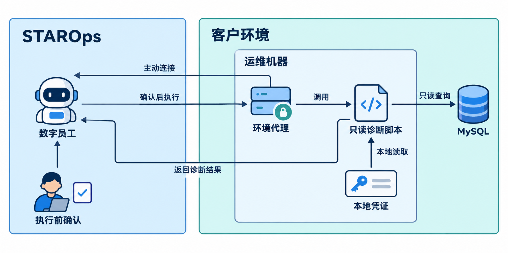
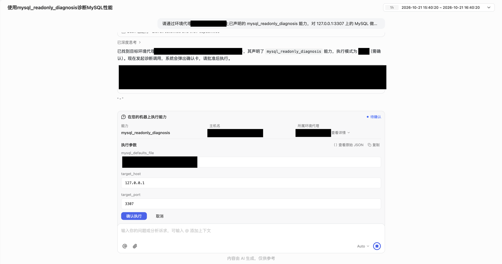

<div class="sls-starops-article-crumb">
  <a href="/doc/starops/starops.html">STAROps</a> <span class="sep">/</span> <span>主动巡检</span>
</div>

# 使用环境代理完成 MySQL 只读性能诊断

<div class="sls-starops-article-meta">
  <span>分类 · 主动巡检</span>
</div>

检查一台内网 MySQL，数据库管理员通常已经有常用的 SQL 和脚本：看看慢查询、锁等待、连接数，再查一下复制状态。客户端和凭证都在运维机器上，登录后就能执行。

查询跑完，还要逐项看结果。扫描行数很多的 SQL 是否值得优化，一个持续存在的会话是不是卡住了，复制检查没有返回记录又意味着什么，都需要结合具体语句和实例用途判断。把几段输出复制给数字员工，还得补上查的是哪台实例、前面已经查过什么。

**通过 STAROps 环境代理，可以让数字员工直接使用这台机器上已有的诊断工具。** 工程师在会话里发起检查，确认目标后执行；结果返回同一会话，接下来就能围绕其中的 SQL 和会话继续问。数据库仍从原来的运维机器访问，凭证也留在本地。



## 把已有的诊断工具接入数字员工

选择一台能够访问 MySQL 的机器，安装环境代理并绑定到目标数字员工。环境代理主动向 STAROps 建立出站连接，不需要为它开放入站端口。在员工的**设置 > 连接器 > 环境代理**中，可以创建代理并获取绑定命令，具体操作见[《环境代理》](https://help.aliyun.com/zh/starops/user-guide/environmental-agent)。

机器接入后，数字员工可以执行已声明的 shell 命令或运维脚本。如果团队已有只读检查脚本，就把它接入为脚本能力，说明能检查什么、需要哪些参数。脚本继续调用本地 MySQL 客户端，从本地配置文件读取凭证，不必在每次提问中重新粘贴 SQL 或账号密码。

下面使用一台 MySQL 8.0 实例，已有脚本检查慢查询摘要、锁等待、扫描统计、复制状态和活跃会话。数据库账号按这些查询授予读取权限：诊断表需要相应的 `SELECT` 权限，查看其他用户会话需要 `PROCESS`，读取复制状态需要 `REPLICATION CLIENT`。

将这项诊断能力设置为**执行前需人工确认**。数字员工准备调用时，工程师可以先看清机器、实例和参数，再决定执行。数据库权限控制能查什么，执行确认则让这一次检查的目标清楚可见。

## 在会话中检查一台 MySQL

在输入框中输入 `@`，选中这台运维机器对应的环境代理，告诉数字员工要检查的实例。下面的地址和路径为配置示例：

> 帮我检查一下 `127.0.0.1:3307`，用机器上已有的 MySQL 只读诊断脚本，凭证文件在 `/etc/mysql-readonly/client.cnf`。看看有哪些需要关注的问题。

数字员工调用已接入的诊断能力，在会话中展示确认卡片。核对目标机器、实例和凭证文件路径后，确认执行。



脚本在运维机器上查询数据库，结果返回后，由数字员工整理和解释。工程师可以直接接着问某条语句为什么值得关注，不用再把整份输出贴一遍。

## 看结果时，先看它查的是什么

这次返回的扫描统计里，一条查询扫描了 **878 行**，只返回 **1 行**，扫描与返回的比例是 **878:1**。单看比例，容易把它当成低效查询。但找到对应语句以后，含义就清楚了：

::: details 查看扫描统计对应的 SQL

```sql
SELECT COUNT(*) FROM information_schema.tables
```

:::

它统计的是元数据表，聚合结果本来就只有一行。**878:1 描述了这条统计查询的读数，不能据此判断业务表缺少索引。** 真正要分析业务 SQL，还要看查询条件、扫描量、执行次数和耗时，再决定是否查看执行计划。

活跃会话里还有一个持续存在的 `event_scheduler`，状态是 `Waiting on empty queue`。这是 MySQL 的系统线程，正在等待事件队列，不能按持续时长把它归成卡住的业务查询。

复制检查则要看实例本来承担什么角色。这台实例没有配置复制，应记录为**未配置复制**。对于本应承担复制任务的实例，才需要继续检查复制线程和延迟。

这次返回的信息没有指向业务慢 SQL，也还不能得出需要添加索引或终止连接的结论。先分清这些语句和会话在做什么，再决定是否处理，才不会把系统自身的活动当成业务问题。

## 找到具体问题后，再往下查

日常检查先帮助了解实例情况。以后如果检查到了业务 SQL 扫描量偏大，就可以在原会话中继续问：

> 这条 SQL 的扫描量为什么这么大？接下来需要看哪些索引和执行计划信息？

如果发现锁等待，就围绕返回的会话追问：

> 谁在等，谁持有锁，涉及什么对象？把对应会话和语句列出来。

需要补充数据时，数字员工继续调用相应的只读能力。是否终止会话、修改索引或调整参数，由数据库管理员根据业务影响决定；处置后再运行同一检查，比较等待关系、语句耗时和连接状态。

团队原来的 SQL、脚本和凭证管理方式可以继续使用。接入环境代理后，日常检查从会话发起；有了值得关注的语句和会话，就让数字员工带着这次结果接着查。

## 相关入口

- [返回 STAROps 最佳实践首页](/starops/starops.html)
- [打开 STAROps Playground](/playground/staropsdemo.html)
- [进入 STAROps 控制台](https://starops.console.aliyun.com)

<style>
.sls-starops-article .vp-doc details {
  margin: 12px 0;
}

.sls-starops-article .vp-doc details > summary {
  font-size: 14px;
  line-height: 1.6;
}

.sls-starops-article .vp-doc img {
  display: block;
  width: 100%;
  max-width: 640px;
  aspect-ratio: 16 / 9;
  object-fit: contain;
  margin: 10px auto 2px;
  background: #f7f9fc;
  border: 1px solid var(--sls-starops-border, #e6ebf3);
  border-radius: 10px;
  box-shadow: none;
}

.sls-starops-article .vp-doc p {
  line-height: 1.85;
  margin: 14px 0;
}

.sls-starops-article .vp-doc h2 {
  margin-top: 36px;
}
</style>
