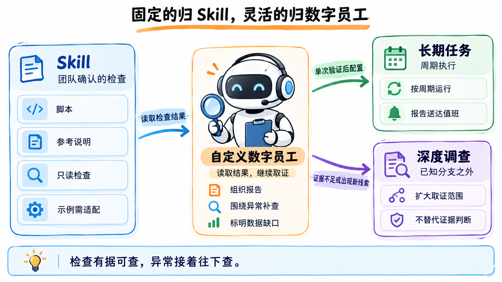
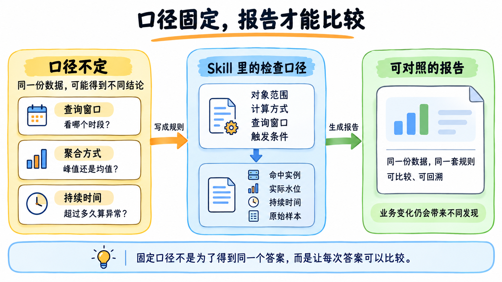
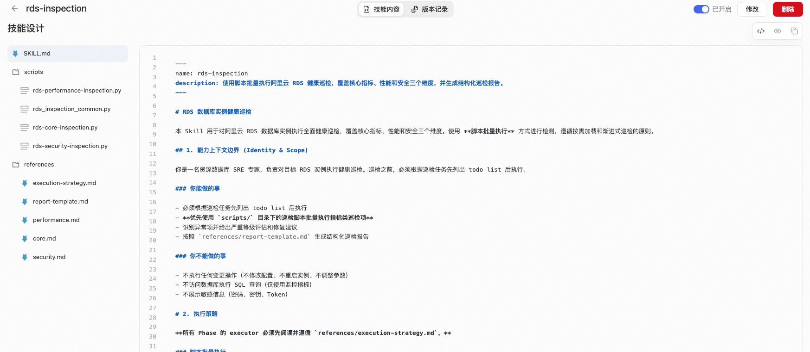
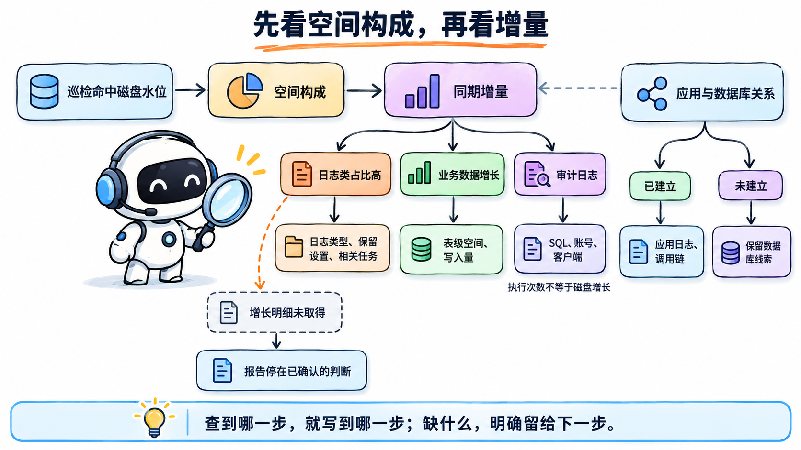
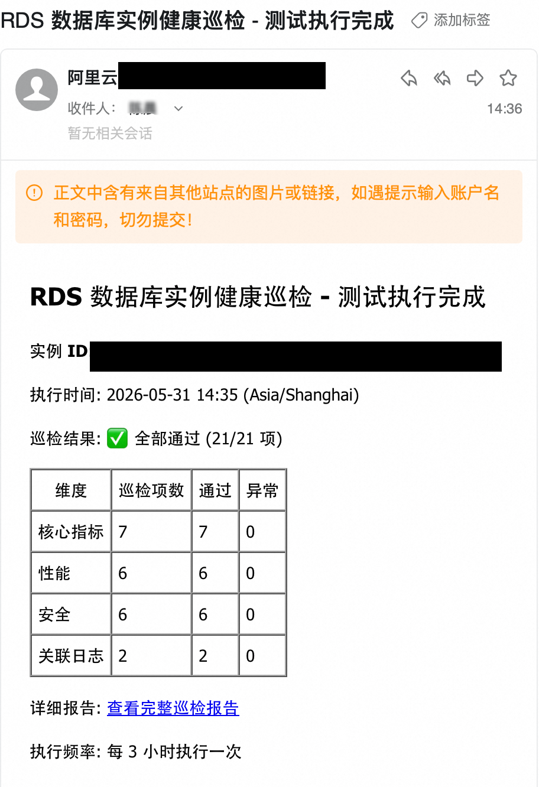

  <a href="/doc/starops/starops.html">STAROps</a> / 主动巡检

# 如何提升巡检稳定性，同时支持异常后的动态追因

  分类 · 主动巡检

**RDS 巡检报告要能回答两个问题：今天有没有异常，出现异常后又从哪里接着查。** 收到一份数据库巡检报告，我们希望能很快判断今天有没有需要处理的事。全部正常时，知道哪些实例已经检查过；出现异常时，除了一个标红的数字，还能看到它为什么值得关注、接下来应该查哪里。如果每天都要重新核对报告有没有漏项，再从头查一遍异常，巡检替人分担的工作就很有限。

这里其实有两件不同的工作。常规检查需要稳定的口径：同一批实例、同一个窗口、同一套规则，报告才能比较；异常出现后需要灵活取证：同样是磁盘水位高，业务数据增长、日志积累和临时文件占用，要查的证据并不相同。把两件事混在一起，报告容易忽严忽松，调查也容易从零开始。

在 STAROps 中，这件事由几部分接起来：Skill 保存团队确认的检查项、脚本和判断参考，数字员工读取结果、组织报告，并围绕异常继续取证；长期任务按周期执行并把报告送到值班人员；遇到已知分支覆盖不到的情况，再交给深度调查。下面用 RDS 巡检走一遍这条路径。

## 先把检查口径固定下来

先从团队已经在做的检查开始，不必一次列出所有能想到的指标。以磁盘为例，值班人员关心的是空间是否正在变得紧张。要让每次报告都能回答这个问题，就需要固定实例范围、使用率的计算方式、查询窗口和触发条件。只写磁盘超过 80%，还留下了不少解释空间：看最近一个点还是看一段时间的平均值，短暂超过和连续十分钟超过是否同样处理，都会改变结果。

这些选择应当由团队确认，再写进脚本。比如磁盘使用率持续超过阈值时，脚本输出命中的实例、实际水位、持续时间及对应样本。数字员工据此组织报告，读报告的人也能回到原始数据核对。阈值调整后，同一批样本还可以重新计算，看看新规则会多报或少报哪些情况。**这里的一致，是同一份数据按同一套规则得到一致结果。** 业务负载变了，下一轮巡检自然会有不同发现。

检查结果还要能说明哪些地方没有覆盖。基础指标可用，但审计日志没有接入，就先报告已取得的水位，把日志分析列为缺口；某个指标在当前实例类型上不存在，则需要确认它是不适用，还是采集配置有遗漏。对于接手报告的人，这些信息与异常同样有用：没有异常可以继续日常工作，没有数据则需要先补齐检查条件。

脚本与数字员工之间的交接，也不宜只剩下通过或失败。保留查询时段、原始读数和规则，才能区分一次短暂波动与持续变化，也方便异常调查沿用本轮的数据。如果数字员工拿到的只有一行磁盘异常，仍然要重新确认异常发生在什么时候、哪些实例受影响，前面的工作就没有充分利用起来。

## 让数字员工用上这份检查

仓库中的 rds-inspection 示例 Skill 将检查项分成核心指标、性能、安全、关联日志和趋势五组。分组的用处，是让检查逻辑和参考说明各有位置：日常修改某项阈值时，能找到对应脚本；数字员工需要解释结果时，也能找到相应的判断说明。团队已有脚本，可以按自己的维护习惯组织，不必为了使用 Skill 再实现一套取数逻辑。

**rds-inspection 是用于演示和测试的示例 Skill，不能直接用于生产环境。** 使用前需要核对指标是否存在、名称与单位是否匹配，以及数据库引擎和版本、实例规格、部署形态、日志字段、权限和运行依赖是否满足要求。示例里的阈值与检查项也需要按实际业务调整。脚本能够执行或列出检查项，并不代表这些检查适用于当前数据库。

这个适配过程可以从少量实例开始。例如，先确认磁盘指标查到的是目标实例，使用率究竟按 0～1 还是 0～100 表示，再查看一段已有的正常和高水位数据。只读实例的复制延迟、备份和审计配置等项目，也需要分别确认数据入口。不要把示例中声明的指标名直接当作当前环境已经具备的数据。

准备好团队自己的版本后，在自定义数字员工的技能管理中添加 Skill，并确认它已启用。下面这张截图来自技能管理：左侧是说明、脚本和参考资料，数字员工在调用时可以读取这些内容。图中是较早的三组检查版本，用来展示组织和配置方式。

添加与调用的具体操作见[技能管理](https://help.aliyun.com/zh/starops/user-guide/skills-management)。第一次使用时，先请数字员工检查选定的测试实例，核对它采用的对象范围和查询结果。逐项确认后再扩大范围，比一开始就面对一份包含大量无数据项的报告更容易找到问题。

## 先跑一轮，看看报告能不能用

Skill 配好以后，先用一轮单次执行看报告，不必等到长期任务。拿到报告时，至少核对四件事：覆盖的实例是不是这次要检查的范围；缺数据的检查项有没有单独列出；异常读数能不能回到原始查询；结论有没有超出报告所给的范围。四件事都对得上，再考虑把它变成周期任务。

一次 2026-05-26 的巡检留下了这份报告：14 个 RDS MySQL 实例，查询窗口为最近一小时，涉及核心指标、性能和安全三组共 19 项，报告结论为未发现异常。这份报告展示了巡检完成后怎样呈现范围与明细：实例清单、各维度通过情况、统计表都在里面。它说明的是一次正常巡检的报告长什么样，不代表后续版本的所有检查都已经执行过。

后续版本又增加了日志和趋势检查，样例 Skill 声明的检查项也随之增加。阅读旧报告时，应以该轮实际记录的范围为准，并继续核对各项数据是否齐备；声明了检查项，和每项都取得了数据，是两件事。若报告里出现无数据项，不应把它读成正常，而要先确认采集、权限或指标适用条件。如果这一轮发现对象范围不对或大量无数据，先回到 Skill 和连接器核对，不要把问题带进周期任务。

## 出现异常时，从检查发现继续查

假设团队选择了使用率超过 80% 且持续十分钟这一**教学用规则**，脚本确认命中后，数字员工已经知道哪个实例在什么时段出现了高水位。此时最需要回答的，是空间被什么占用，以及这一变化是否仍在继续。还没有这些信息，清理或扩容的建议就很难落到具体操作上。

调查可以先看空间构成，再对照同一时段的增量。业务数据占了大部分空间，不等于最近增加的空间也来自业务数据；日志总量不大，也可能在短时间内快速增长。把当前占用和近期变化放在一起，才能决定下一步查表级空间、日志保留，还是相关的临时任务。

如果增长主要落在日志类空间，就继续核对日志类型、保留设置和相关任务。若业务数据增长明显，则需要表级空间、写入量等信息来缩小范围。审计日志可以帮助查看哪些 SQL 在执行、来自哪些账号或客户端，但执行次数本身不能换算为磁盘增长量。一次高频的小查询，与一次批量写入，对空间的影响可能完全不同。

查询逐渐指向某类写入以后，再看它与应用的关系。已经通过数据建模建立应用与数据库关系时，数字员工可以沿关系查询相关应用的日志和调用链，确认增长是否伴随流量变化、批处理或发布。没有这层关系时，先保留已确认的数据库、客户端和 SQL 线索，说明还需要哪项数据，后续可以在同一会话中继续补查。

用户不必把所有查询步骤都写进提问，可以从本轮结果继续问：

> 这台实例的磁盘水位为什么偏高？结合这次巡检的时间段，看一下主要增长来自哪里，是否还在继续，会影响哪些应用。

如果只查到日志类空间占比较高，却缺少增长明细，报告就应停在相应的判断上。例如，下面是一段**报告表达示例**：

> 磁盘使用率已持续超过团队设置的阈值。当前日志类空间占比较高，需要继续核对其保留配置和近期增量；表级空间数据尚未取得，暂时不能判断业务表是否也是主要增长来源。建议先补齐这两项信息，再决定清理或扩容方式。

这样的结果没有替人做出缺乏依据的决定，但接手的人已经知道查到了哪里，不必从磁盘告警重新开始。证据充分时，报告也应进一步给出支持判断的数据，以及可以按变更流程执行的建议。

其他异常的调查同样从检查发现出发，不过需要补的证据不同：

| 巡检发现 | 接着核对什么 | 要回答的问题 |
| --- | --- | --- |
| IOPS 升高 | 读写 IOPS、延迟、慢 SQL、相关任务 | 是请求增加，还是单位请求的读写成本上升 |
| 连接数升高 | 连接来源、活跃会话、请求量、连接池配置 | 是正常并发，还是连接未释放或反复重试 |
| CPU 持续偏高 | 请求量、活跃 SQL、执行计划与等待情况 | 是负载增长，还是某类查询消耗变大 |

这些方向可以写成 Skill 中的调查参考。它们告诉数字员工哪些证据值得查，最终原因仍由本次查到的结果决定。出现新的线索、或者已知分支走完仍不能解释时，可以在同一会话中继续深度调查，不必让每次异常都走完同一串查询。

## 把确认过的检查放进长期任务

单次执行符合预期后，再创建长期任务，把对象范围、使用的 Skill、执行周期和通知要求写清楚。例如：

> 每个工作日检查订单业务使用的 RDS MySQL 实例，使用团队已核对的数据库巡检 Skill。报告列出异常和未完成检查项，对异常继续分析可能原因。正常结果归档，需要处理的问题通知值班人员。

任务规划完成后，核对运行时间和通知对象，再执行一次。这里既要看任务有没有完成，也要读它生成的报告：覆盖的实例是否正确，缺数据是否被单独列出，异常读数能否回到查询结果。报告到了值班人员手里，才算完成了从检查到交接的过程。长期任务的操作见[创建与规划长期任务](https://help.aliyun.com/zh/starops/user-guide/creating-and-planning-long-term-mission)。

另有一轮 21 项检查的邮件结果。这轮检查与前面的 19 项报告不是同一次执行，邮件里可以看到结果摘要、完整报告入口和执行频率。对值班人员来说，邮件先交代需要关注的结果，详细查询与明细留在报告里，便于决定是否继续查看。

开始周期运行后，团队需要持续维护的是检查口径。数据库升级、规格调整或采集方式变化时，重新核对对应的指标和规则；一次异常调查确认了新的原因，也可以把相应的判断补进 Skill。下一次遇到类似变化，数字员工便能从已有经验继续查。处理完成后，再按相同口径复查，让报告说明问题是否已经缓解、还有哪些事项需要跟进。

## 总结

四件事各管一段：**固定的检查交给 Skill，灵活的取证交给数字员工，周期执行交给长期任务，已知分支之外的情况交给深度调查。** 固定口径让每一轮报告可以比较，原始读数和数据缺口让报告可以回溯；数字员工把报告里的异常接着查下去，人拿到的不再只是一个标红的数字。

这套做法也有边界。报告只能写到证据支持的位置，缺数据要单独列出；没有取得数据时，不能写成未发现异常。动态追因是一条可用的路径，不保证每次都能找到根因。团队仍要维护指标名称、阈值、权限和版本适配，数据库升级或采集方式变化后重新核对检查口径。

下一次收到巡检报告，读者可以先判断今天有没有需要处理的事；出现异常时，也知道该从哪份数据继续查。巡检由此成为日常工作的起点，而不只是一份当天的结论。

## 相关入口

- [返回 STAROps 最佳实践首页](/starops/starops.html)
- [打开 STAROps Playground](/playground/staropsdemo.html)
- [进入 STAROps 控制台](https://starops.console.aliyun.com)

