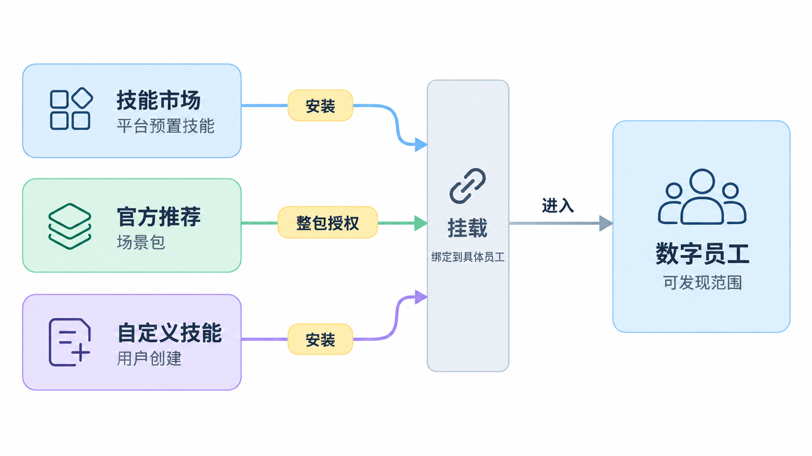
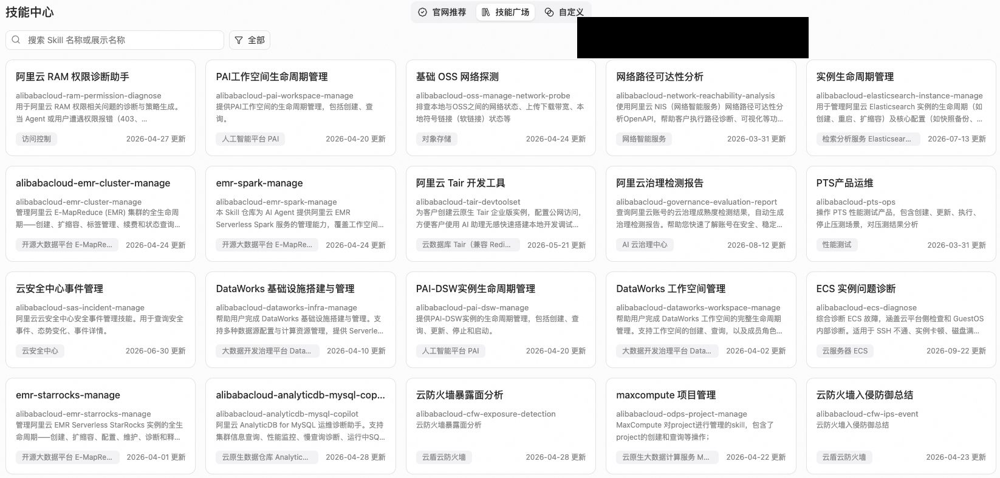
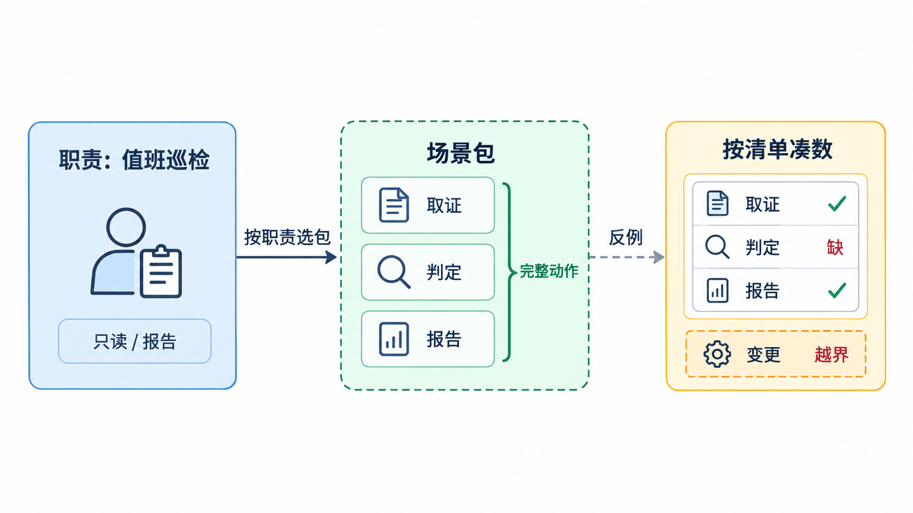
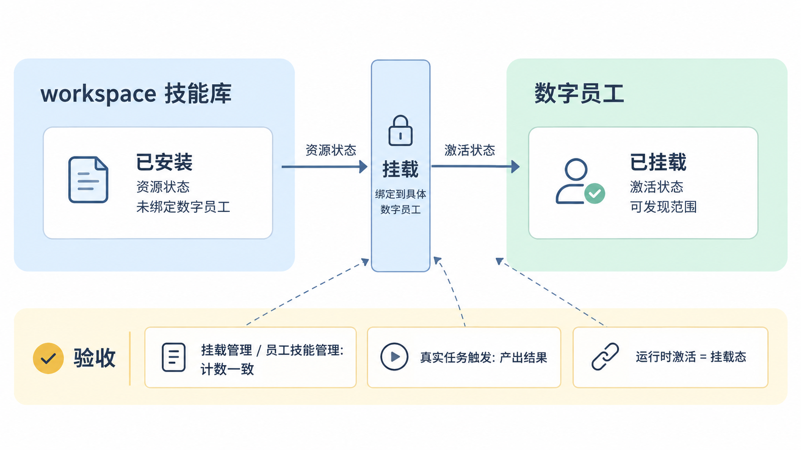
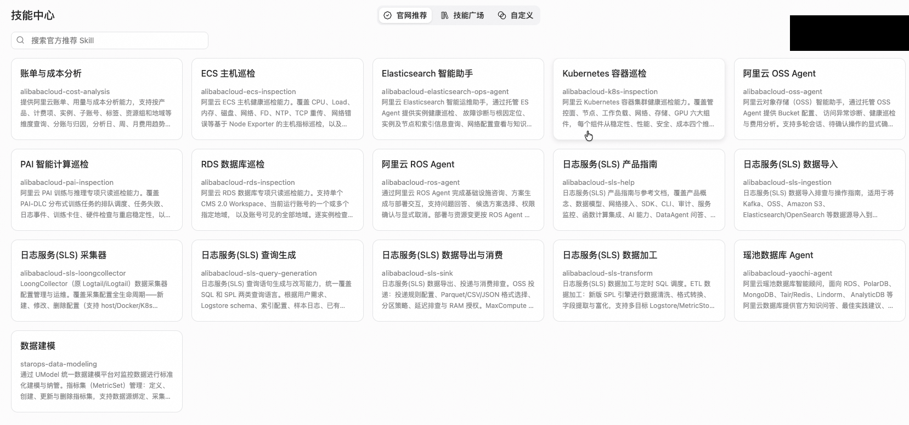

  <a href="/doc/starops/starops.html">STAROps</a> / 经验固化

# 技能中心选型与场景包启用

  分类 · 经验固化

**给数字员工装技能，先定它负责什么，再决定装哪些。** workspace 里的数字员工从一个走向多个以后，能力授权就不再是随手装的事：每个数字员工能调用哪些技能，划定了它的职责边界，也决定每一次任务触发是否在授权范围之内。技能越装越多、职责重叠、授权边界模糊，是数字员工多了以后最常见的问题——同一个场景几个员工都能触发，该有的能力没挂上，不该有的挂上了。

这里讲的是[技能中心](https://help.aliyun.com/zh/starops/user-guide/skill-center)的选型：先定职责边界，再按场景包启用能力，最后验证生效。技能怎么写、脚本怎么算，分别在[编写 STAROps 运维 Skill](/starops/practices/skill-authoring/article.html)和[编写 Skill 确定性脚本](/starops/practices/skill-script-deterministic/article.html)两篇；这里只讲选型。技能数量不是目标，边界清晰才是。

## 技能越多，越先要回答边界问题

能力供给越丰富，选型本身的治理价值越高。技能中心把官方技能、场景包和自定义技能放在同一个入口，装什么、给谁装、装到什么程度，都会影响数字员工下一次能不能在授权范围内完成任务。选型不是把技能装得越多越好；真正的风险是边界不清：同一个场景几个员工都能触发，该有的能力没挂上，不该有的挂上了。

选型围绕一个判断展开：**先选能力边界，再选技能。** 三条约束贯穿全文：场景包是授权边界，不是技能捆绑包；已安装是资源状态，已挂载才是激活状态；选型够用就不写技能。技能清单不是凑数的依据，职责边界才是。

这三条约束就是一套可复用的判断方法：先看这个数字员工负责什么，再看这个场景需要哪些动作，最后看能力是不是真的挂到了这个员工身上。产品只是把这套判断落到技能中心里；换一个 workspace、换一个场景，判断顺序不变。

## 从一个值班数字员工开始

技能中心把三类来源放在同一个入口：**技能市场**是平台预置的技能全集，按产品类目组织；**官方推荐**是围绕巡检、成本分析等场景组织的场景包；**自定义技能**是用户自己创建或上传的能力。市场技能和自定义技能先安装再挂载；场景包按整包授权。

两个状态要分清：已安装是 workspace 技能库里的资源状态；已挂载才绑定到具体数字员工，进入可发现范围。场景包是授权的粒度，整包挂载，不逐个挑选，保证包内技能组合完整。安装与挂载在技能中心完成；员工侧已有技能的查看与管理见[技能管理](https://help.aliyun.com/zh/starops/user-guide/skills-management)。

下面用值班数字员工启用 Kubernetes 容器巡检场景包走一遍。三步走完，再看它实际验证到了什么。

### 第一步：先定职责边界

值班数字员工负责 K8s 集群的日常健康巡检与报告产出，动作限只读取证与报告生成，不含变更。这个边界来自组织分工，不来自技能清单。边界不清就选包，后面每一笔授权都是技术债：同一个场景几个员工都能触发，出了问题不知道找谁。

### 第二步：按场景选包

在官方推荐里选 Kubernetes 容器巡检场景包，核对三件事：

| 核对项 | 内容 |
| --- | --- |
| 动作覆盖 | 包内技能覆盖场景的完整动作：取证、判定、报告。 |
| 模型依赖 | 包依赖的 [UModel](https://help.aliyun.com/zh/starops/product-overview/core-concept) 建模在当前 workspace 已完成。 |
| 权限属性 | 包内技能的只读/变更属性符合岗位权限。 |

缺口在技能市场按产品类目补充。补充的每个技能都要能回答它属于哪个场景边界；回答不了的技能不进授权清单。

### 第三步：启用并验证生效

启用后不看安装态，验证三件事：技能挂载到目标数字员工，挂载管理与员工技能管理两处计数一致；一次真实任务触发所选场景包的技能并产出结果，结果能回答任务提出的问题；运行时激活与挂载态核对一致。

验收时不要只看安装态：在挂载管理与员工技能管理核对挂载计数，再用一次真实任务确认实际触发的是所选场景包。计数和实际触发对不上时，先按缺口记录，补查清楚后再纳入正式授权范围。这类验证目前只覆盖只读巡检；变更类技能的授权、审批和回滚，需要另行核对。

## 选型不是一次性的

选型不是装完就结束。workspace 的能力会变，数字员工的职责会变，场景包也会更新；下一次任务触发前，边界和挂载态都值得再核对一遍。选型优先，编写兜底：场景在官方技能与场景包里都没有对应技能，或官方技能覆盖但口径与实际环境不匹配、且无法通过配置调整，才进入自定义编写。满足判断后，可以按照团队已有的编写规范和确定性纪律去编写所需的 skill，然后上传和挂载在数字员工上进行后续任务的处理。

反向边界同样重要：用自定义技能复刻官方已有能力属于选型失误，维护成本由使用团队承担；把本该挂载官方技能的场景写成自定义技能，会失去官方技能的持续更新。

## 总结

选型是能力治理的先决条件，不靠技能数量的堆积，应当先定义数字员工的职责边界，再按场景包进行整包授权，验收看挂载态和一次真实执行；官方与场景包覆盖不了的场景，才进自定义编写。换一个 workspace、换一个场景，判断顺序不变：边界先于数量，挂载先于安装，真实执行先于报告形式。

## 相关入口

- [返回 STAROps 最佳实践首页](/starops/starops.html)
- [打开 STAROps Playground](/playground/staropsdemo.html)
- [进入 STAROps 控制台](https://starops.console.aliyun.com)

