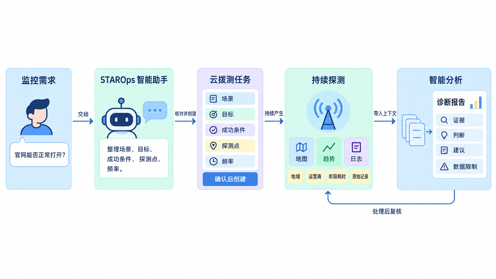
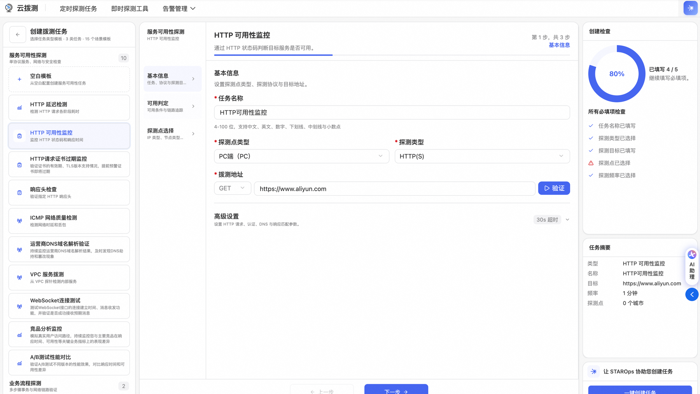
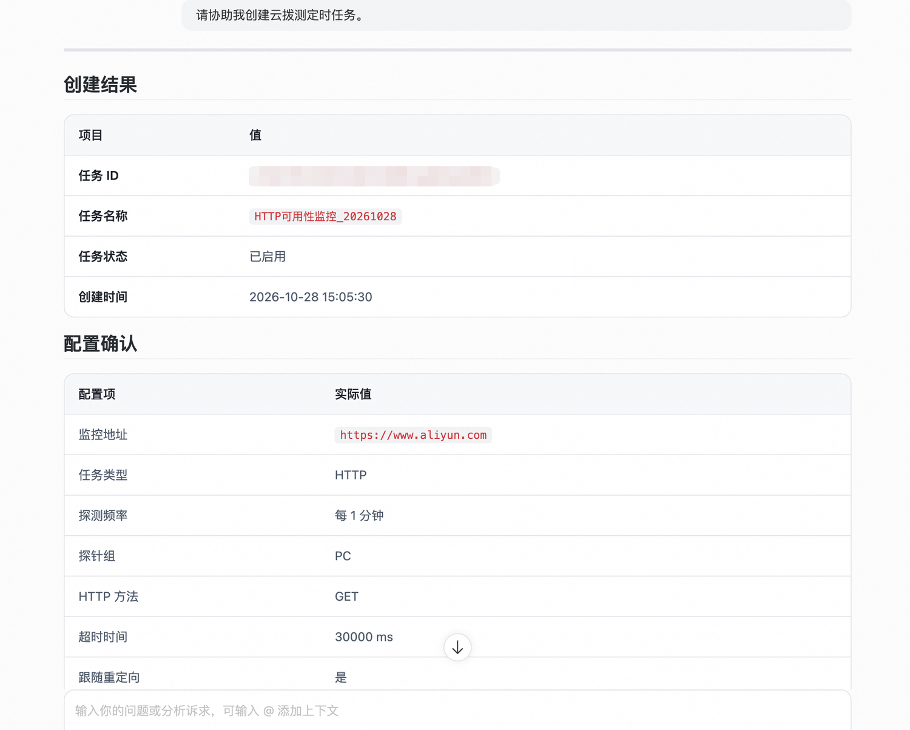
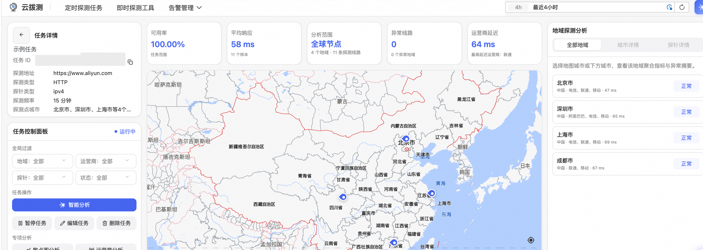
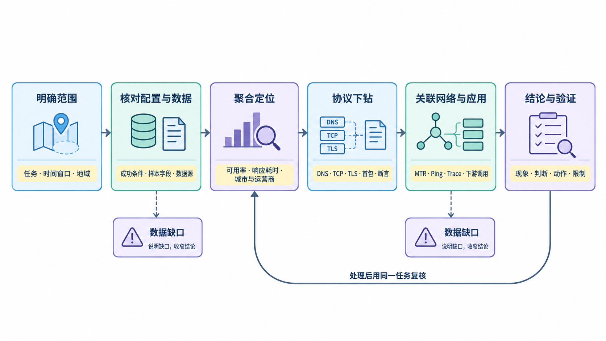
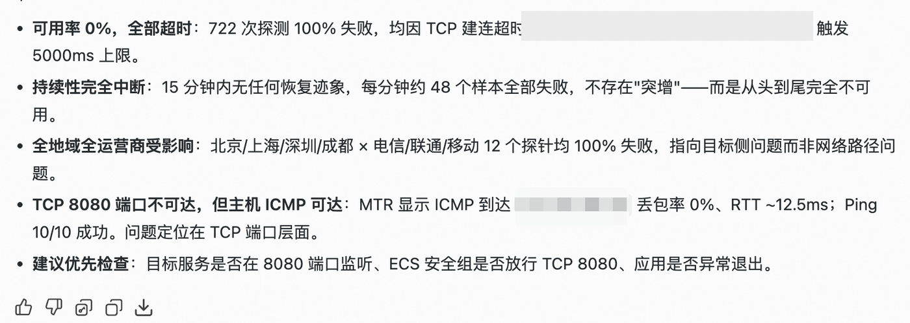

  <a href="/doc/starops/starops.html">STAROps</a> / 主动巡检

# 从一句监控需求到诊断报告：用 STAROps 创建云拨测任务并完成智能分析

  分类 · 主动巡检

服务端的 CPU、内存和应用错误率都正常，用户却反馈部分地区的页面打不开。内部指标能说明服务自己做了什么，却看不到用户所在的网络怎样到达服务。域名解析、运营商出口、TCP 建连、TLS 握手和入口链路，任何一段出问题，用户都会看到失败。

云拨测从分布在不同地域、不同运营商的探测点主动发起访问，按设定频率检查目标，并保留每次访问的结果。**拨测把成功标准固定成可重复的检查，并在异常时留下可追溯的访问证据。**

STAROps 把创建和排查接在同一条流程里：一句监控需求可以由数字员工整理成任务配置，确认后创建；任务运行后，又能从任务详情进入智能分析，沿着样本、协议阶段和网络路径继续查。本文先走一遍从需求到创建的流程，再用一次实际分析报告看智能分析怎样推进。

数字员工负责整理配置、执行创建、读取样本和汇总证据，工程师负责确认业务口径、范围和处置决定。分工清楚，后面的判断才有依据。

## 先选对探测类型

云拨测提供三类探测，它们回答的问题不同。

| 类型 | 回答的问题 | 典型用法 |
|---|---|---|
| 服务可用性探测 | 目标能不能访问，响应有多快，返回内容是否符合预期 | 接口健康检查、首页可用性、TCP 端口、DNS 解析 |
| 业务流程探测 | 一组有先后依赖的业务步骤能不能完整走通 | 登录后查询、下单、支付、库存更新 |
| 页面性能探测 | 真实浏览器打开页面时，加载和交互体验如何 | 首屏时间、资源加载、前端脚本和第三方资源 |

选型时按顺序看三件事：目标在公网还是 VPC 内网，要验证的是可达性、业务完成还是页面体验，需要状态码、业务字段还是浏览器资源作为证据。只确认接口可访问，选服务可用性探测；验证登录之后能不能下单这类多步流程，选业务流程探测；关心首屏、资源加载和真实浏览器行为，选页面性能探测。需要同时看多步业务和页面性能时，拆成两个任务，不要在一个任务里混用口径。

三类探测的能力和配置入口见[站点监控文档](https://help.aliyun.com/zh/cms/cloudmonitor-2-0/site-monitoring/)。

## 把需求说清楚，让数字员工先给出配置方案

开始前，登录 [STAROps 控制台](https://starops.console.aliyun.com/)，选择执行任务的数字员工和目标工作空间。确认数字员工可以使用云拨测分析技能、工作空间已经开通云拨测，身份具备创建任务、读取任务配置和观测数据的权限。人员权限决定能否操作 STAROps 资源，数字员工角色决定运行时能访问哪些数据，两者需要分别配置；具体做法参见[技能管理](https://help.aliyun.com/zh/starops/user-guide/skills-management)和[权限配置](https://help.aliyun.com/zh/starops/user-guide/permission-configuration/)。

在云拨测控制台选择场景模板，或者在 STAROps 会话里直接说明需求。下面是一个自然语言的例子：

> 帮我创建一个云拨测任务，使用 GET 监控 `https://www.aliyun.com`，覆盖北京、上海、深圳的电信、联通、移动网络，每分钟探测一次，HTTP 状态码 200 算成功。先列出配置方案，确认后再创建。

数字员工会把这句话拆成任务类型、目标地址、请求方法、探测点、频率、超时和断言，核对当前可选的探测点，整理出一份配置方案。地域和运营商的组合不一定都有可用节点，缺少的部分需要在方案里说明，不能默认替代。

创建前，让数字员工把方案逐项列出来，由人确认。

| 配置项 | 要确认什么 | 漏掉会怎样 |
|---|---|---|
| 目标与请求 | URL、GET 或 POST、请求头、请求体、认证方式，以及是否跟随重定向 | 探测到错误页面，或登录态、参数失效 |
| 成功条件 | 状态码、响应头、响应体关键字、JSON 字段、响应时间；多步流程还要确认每一步的依赖和失败处理 | HTTP 200 但业务失败被算成功 |
| 探测范围 | 地域、运营商、PC 或移动端，以及公网探测还是 VPC 内网探测 | 看不到目标用户路径，或探针根本到不了私网 |
| 频率与超时 | 业务时效、接口正常耗时、探测成本 | 发现太慢，或正常慢请求被误判为故障 |
| 归属与权限 | 工作空间、数字员工、技能，以及任务配置和观测数据的读取权限 | 任务建在错误范围，或分析时读不到数据 |

**工作空间是任务和数据的归属范围，探测点地域是请求从哪里发出，两者要分开核对。**

目标、成功条件、探测范围或权限缺失时，数字员工应该追问，不能用默认值补齐。**数字员工可以把一句话翻译成配置，不能替业务定义成功。** 示例里的 HTTP 200 只是一个起点。如果接口在 200 响应里返回业务错误，仍然需要增加响应体或 JSON 字段断言；如果响应时间有明确要求，也要把耗时条件写进去。成功条件不清楚，后面的可用率就没有解释力。

频率和探针范围也要一起定：先保证关键路径在主要用户地域有足够样本，再扩展长尾地域；否则样本很多，却看不到关键路径。

确认方案后，可以一键创建任务。创建返回成功，说明任务已经建立；还需要回读任务状态和关键配置，确认地址、方法、频率、探测点、断言和超时与需求一致。

任务创建后，按顺序确认四件事。**配置保存成功和任务真正测起来，是两个不同的完成状态。**

1. **配置回读**：让数字员工回读任务归属、地址、方法、频率、探测点、断言和超时，与方案逐项对照。
2. **新样本**：创建后的查询窗口内确实产生了样本；没有样本时，只说明运行效果待确认，不能当成正常。
3. **断言口径**：规则能正常计算；规则报错和业务条件不满足要分开。
4. **覆盖范围**：选中的地域、运营商都产生了样本；缺少的节点要在结论里说明。

不要因为页面显示任务正在运行，就认为目标可以访问。

## 任务运行后，先回答三个问题

任务运行并产生样本后，先从任务详情页回答三个问题：什么时候失败，从哪里失败，停在哪一步。

- **什么时候失败**：一次尖刺、间歇波动和持续失败，处理方式不同。看时间窗口内的样本分布，不要只看一个平均值。
- **从哪里失败**：按地域、运营商、探测点拆分。个别探针异常，优先检查它们共同的解析、出口或目标节点；多地多运营商同时异常，再把方向收拢到共享的目标侧或入口。
- **停在哪一步**：DNS 解析、TCP 建连、TLS 握手、请求发送、首包等待、响应下载，以及最后的断言，失败停在哪一段，后面的排查方向就不一样。DNS 已经失败时还没有进入应用；TCP 建连超时说明连接没有建立；收到 HTTP 错误响应，则要继续看响应来自哪个组件。

从任务详情的拨测日志里选中一条记录，可以进入单次探测详情。单次探测详情保留目标、探测点、探测时间、解析结果、状态和阶段耗时，也可以继续查看网络路径、原始日志和调用记录。**总览统计说明影响范围，单次样本解释具体路径，两者要一起看。** 一个失败样本能说明这次访问停在哪里，不能单独代表整个窗口的异常规模。

## 智能分析怎样沿着证据推进

从任务详情页点智能分析，当前任务、时间范围和筛选条件会带进分析会话。数字员工读取任务配置和原始拨测记录，先确认这个任务在检查什么，再聚合样本、下钻协议阶段，必要时关联网络路径和应用调用。一个失败数字不足以支撑结论，证据要逐步收窄。

分析过程分为六步。

1. **明确范围**：哪个任务、哪段时间、哪些地域和运营商、是否选中了特定探针或日志。范围不清，后面的统计很容易把不同口径混在一起。
2. **核对配置与数据**：这个任务的地址、频率、超时和成功条件是什么，窗口内有多少样本，字段是否完整。
3. **聚合定位**：看可用率、响应耗时、样本量和失败分布，按城市、运营商、探测点和时间形态缩小范围。先判断是单点、单路径还是大范围持续异常。
4. **协议下钻**：对 HTTP(S) 任务，继续检查 DNS、TCP、TLS、首包、响应下载和断言。失败的阶段决定下一步该查解析、网络、端口、证书、入口还是业务响应。
5. **关联网络与应用**：MTR、Ping 这类网络诊断用来看网络层是否可达，调用链（Trace）和下游调用用来看请求进入应用后的执行。两者回答的不是同一个问题；网络层可达，不代表 TCP 端口开放，也不代表应用处理正常。
6. **结论与验证**：把现象、判断、建议动作和还没确认的限制分开写。报告可以给出优先检查方向，不能把还没有证据支持的猜测写成根因。

**无数据、无权限、查不到 Trace，都不能直接推出服务正常。** 这类结果只说明这条证据缺失，结论应当相应收窄，并说明还需要补什么。

## 把证据组合成下一步动作

六步走完，通常已经拿到样本范围、失败阶段和网络证据。接下来先找对照，再看证据组合，才能判断下一步往哪里查。对照有三个方向：其他地域或运营商是否成功；同一目标的其他协议是否可达；故障前后的窗口是否可比。对照用来排除替代解释，不是用来证明因果。案例里的 12 个探针互为对照，ICMP/Ping 是 TCP 的对照。

| 观察到的证据 | 能支持的判断 | 下一步 | 不能据此认定 |
|---|---|---|---|
| DNS 解析失败，TCP 尚未开始 | 域名、解析服务或探针 DNS 配置 | 对照不同地域的解析结果、权威 DNS 和探针 DNS | 不能认定目标端口或应用故障 |
| 多地多运营商失败，停在 TCP 建连 | 目标端口、链路过滤或服务未监听等目标侧或路径侧方向 | 查目标端监听、安全组/防火墙、进程，以及路径上的 ACL 和中间设备 | 不能认定应用返回了错误，也不能认定是某个探针的问题 |
| 只有少数地域或运营商失败 | 特定路径、探针出口或该地域的解析/网络问题 | 对照该路径的 DNS、出口、节点和目标入口 | 不能认定目标全局故障 |
| TCP 能连上，TLS 握手失败 | 证书、协议版本、SNI 或中间设备 | 查证书有效期、TLS 版本、SNI 和链路 | 不能认定应用业务逻辑错误 |
| 收到 HTTP 响应，但状态码异常 | 请求已经到达某个 HTTP 组件 | 看响应头、响应体、来源组件和入口日志 | 不能认定网络不通 |
| HTTP 200，但业务断言失败 | 业务内容、字段或耗时不符合成功条件 | 查响应体、JSON 字段、业务日志和依赖 | 不能认定服务不可用 |
| 无样本、无权限、查不到 Trace | 证据缺口 | 补数据、权限、追踪接入或查询范围 | 不能认定服务正常 |

**结论要区分事实、判断和假设。** 事实是直接观测到的数字、阶段和范围；判断是由多条事实共同支持的方向，必须带范围；假设是还需要目标端配置或日志验证的可能原因。写结论时按 **范围 → 现象 → 证据 → 判断 → 限制 → 下一步** 组织。只写事实，读者不知道该怎么处理；把假设写成事实，又会把排查带偏。报告里的建议动作属于下一步，不属于事实层。

## 一次 TCP 端口不可达的分析

下面这份报告来自一次实际任务。目标是一个 HTTP 服务，分析窗口为 15 分钟，探测覆盖北京、上海、深圳、成都四个城市，以及电信、联通、移动三家运营商，共 12 个探针。它对应上表中“多地多运营商失败，停在 TCP 建连”那一行；ICMP/Ping 提供了协议层的对照。

报告给出的关键事实是：

| 观察到的事实 | 能推进到的判断 |
|---|---|
| 15 分钟内 722 次探测全部失败，可用率 0% | 不是偶发尖刺，窗口内持续不可用 |
| 北京、上海、深圳、成都 × 电信、联通、移动，12 个探针均失败 | 先排除单个探针、单个运营商出口这类解释 |
| 失败都停在 TCP 建连，接近 5000ms 的超时上限 | 连接没有建立，请求还没有进入 HTTP 阶段 |
| MTR 显示 ICMP 到达目标、丢包率 0%，Ping 10/10 成功，RTT 约 12.5ms | 主机和网络路径在 ICMP 层可达 |
| TCP 8080 端口不可达 | 排查方向收敛到目标侧的 8080 端口 |

这组证据支持的是：失败发生在 TCP 建连阶段，方向在目标侧的 8080 端口；探针侧或某一家运营商的出口可以先排除。报告据此建议优先检查目标服务是否在 8080 端口监听、ECS 安全组是否放行 TCP 8080、应用是否异常退出。

它还不能支持具体原因。**ICMP 可达不能证明 TCP 端口开放。** 安全组可以放行 ICMP 而拒绝 8080，主机防火墙可以丢弃 SYN，服务也可能根本没有监听。要确认到底是哪一种，需要目标端的监听状态、安全组和防火墙规则、进程状态以及应用日志。报告里的优先检查项是下一步动作，不是已经确认的根因；这份材料也没有提供处理后的恢复记录，不能写成已经恢复。

这个案例的排查顺序是：先用多地多运营商的失败范围排除单点因素，再用协议阶段确认请求停在哪里，最后用网络层证据和目标端口证据把方向收拢。每一步只回答一个问题，结论才不会跳得太远。

## 公网探测和内网探测要分开

公网探针从互联网发起访问，VPC 服务拨测从 VPC 内部发起。两者的起点不同，能回答的问题也不同。

| 探测方式 | 请求起点 | 能说明 | 不能说明 |
|---|---|---|---|
| 公网 PC 或移动端探针 | 互联网 | 公网域名、入口和用户实际路径 | VPC 内服务状态 |
| VPC 服务拨测 | VPC 内 | 内网服务和安全组内访问 | 公网用户路径 |

**公网探测失败，不能直接说明 VPC 内的服务故障；VPC 内探测正常，也不能代表公网用户访问正常。** 选择探测类型时，先确认用户从公网还是 VPC 内网发起访问，再决定用公网探针还是 VPC 探针。

## 从一条关键路径开始

拨测任务不需要一开始就铺得很大。先选一条最重要的用户路径，把目标、成功条件、探测地域和频率定清楚，确认任务真的产生了有效样本，再根据业务范围扩展。数字员工可以把自然语言整理成配置，但成功条件、探测范围和频率仍然要由了解业务的人确认。

当异常需要继续进入应用内部，或者需要把一次性检查变成长期巡检时，可以接着看[用 STAROps 串起云拨测闭环](/starops/practices/synthetics-closed-loop/article.html)：那篇会讲怎样用同一次请求的追踪标识关联应用性能监控（APM），以及怎样用长期任务持续分析拨测数据。

一次拨测任务最终要留下可复核的访问证据，处理后还能用同一任务确认恢复。先把这条路径跑通，再考虑覆盖更多场景。

## 相关入口

- [返回 STAROps 最佳实践首页](/starops/starops.html)
- [打开 STAROps Playground](/playground/staropsdemo.html)
- [进入 STAROps 控制台](https://starops.console.aliyun.com)

