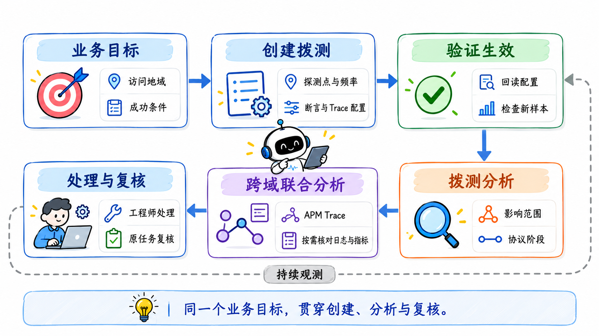
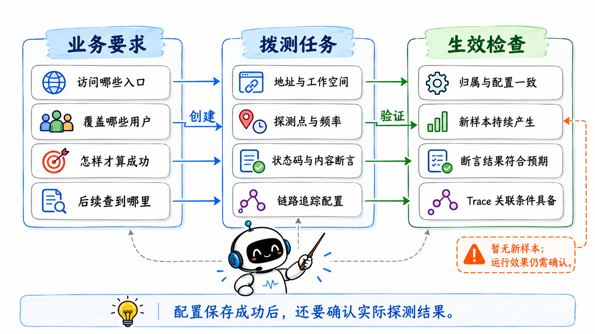
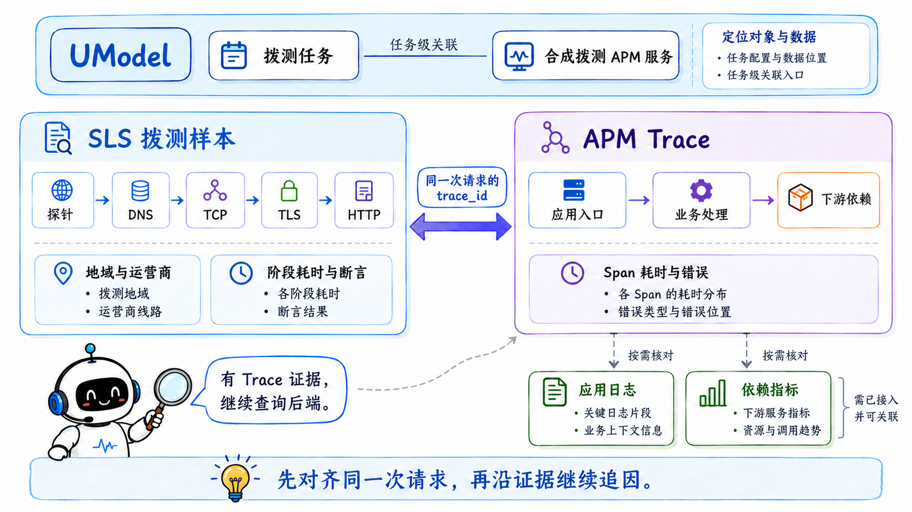
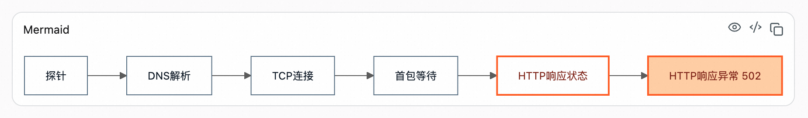
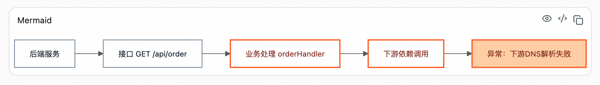
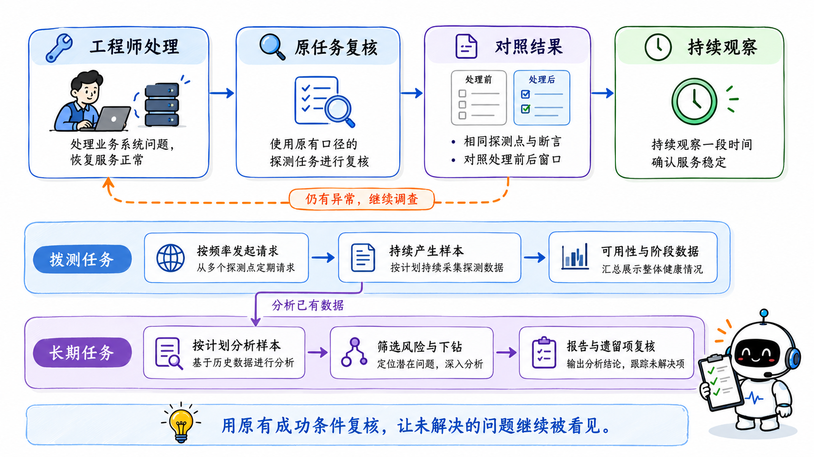
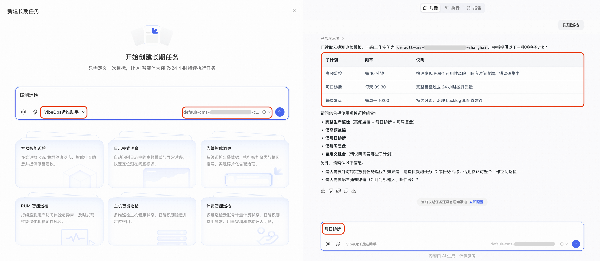
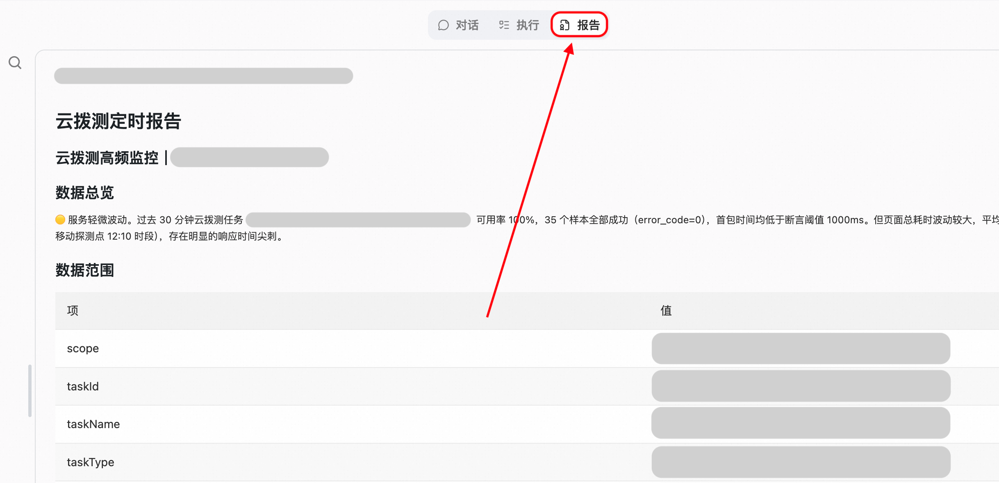

  <a href="/doc/starops/starops.html">STAROps</a> / 主动巡检

# 用 STAROps 串起云拨测闭环：从任务创建到跨域联合分析

  分类 · 主动巡检

一个面向用户的网站或接口上线后，团队需要持续确认：不同地域、不同运营商的用户能否访问，返回的内容是否符合业务预期。应用内部的指标可以帮助判断服务状态，外部访问还会经过域名解析、网络连接和入口链路，需要从用户所在的网络再看一次。

**云拨测**通过分布在不同网络中的探测点，按设定频率主动访问目标，并记录访问结果。借助 STAROps 的**云拨测分析 Skill**，这项工作可以从创建任务开始交给数字员工：把业务要求转成探测配置，确认任务产生了有效样本；发现异常后，再对照协议阶段和应用调用链，判断问题发生在哪一侧。工程师完成处理后，还可以用原任务检查访问是否恢复。

这条流程中，创建与分析有直接联系。探测点决定能观察哪些访问路径，断言定义什么叫成功，链路追踪配置则为后续进入应用内部准备关联条件。**创建时把这些条件安排好，后面的调查才能沿着同一个业务目标继续。**

## 从一个业务接口开始

下面以订单查询接口串起这条流程。创建参数和复核提问是教学示例，域名、任务名及探测参数需要按实际环境填写；跨域分析部分结合一份已有订单接口报告，说明怎样从外部失败继续读到后端异常。

开始前，登录 [STAROps 控制台](https://starops.console.aliyun.com/)，选择执行任务的数字员工和目标工作空间，确认数字员工可使用云拨测分析技能，工作空间已开通云拨测。数字员工还需要具备创建拨测任务、读取任务配置与观测数据的权限；只有查询权限的身份需要补充相应创建权限。配置方式参见[技能管理](https://help.aliyun.com/zh/starops/user-guide/skills-management)和[权限配置](https://help.aliyun.com/zh/starops/user-guide/permission-configuration/)。

在会话中说明希望监测的业务，例如：

> 在当前工作空间创建一个订单查询拨测任务，访问 `https://shop.example.com/api/order`，使用 GET。覆盖北京、上海、广州的电信、联通和移动网络，选择可用的 PC 探测点，每 5 分钟探测一次，超时 5 秒。成功条件是 HTTP 状态码为 200，且响应 JSON 的 `code` 为数字 0。后端已经接入应用链路追踪，请配置匹配的追踪协议，便于异常时继续分析。

数字员工根据这些要求组织任务配置，查询可用探测点，并处理创建所需的信息。地域、运营商组合是否都有可用节点，以实际查询结果为准；缺少的节点需要在方案中说明，再确定替代范围。**工作空间是任务和数据的归属范围，探测点地域是请求从哪里发出，两者需要分别核对。**

这里给出了三个会影响后续分析的选择。

首先，选择探测点要贴近用户分布。同一个接口在上海访问正常，在北京某运营商网络访问失败，这种差异需要相应探测点才能看见。首次配置可以覆盖最重要的用户路径，再根据业务范围扩展；频率和节点数量也要结合发现问题的时效要求与探测成本确定。示例使用的 5 分钟和 5 秒，需要按实际接口特征调整。

其次，**成功条件应当包含业务含义**。订单查询接口可能正常返回 HTTP 200，同时在响应体中给出业务失败状态。增加 JSON 字段断言后，这类结果也能被识别。这里约定 `code` 为数字 0 表示成功，使用其他业务字段时，按接口真实约定配置；需要限制响应时间时，再补充有业务依据的耗时断言。可用条件及支持的配置参见[服务可用性探测指南](https://help.aliyun.com/zh/cms/cloudmonitor-2-0/detection-based-on-pc-over-internet)。

最后，计划做跨域分析时，应在创建阶段准备链路追踪。本文选择支持开启追踪的 HTTP(S) 探测，后端应用也需要接入相应追踪系统，并能够传递、上报请求上下文。**开启追踪是关联的准备条件，实际能否进入后端，还要看样本和 APM（应用性能监控）中是否有对应证据。**

## 创建以后，确认任务真正测起来

任务创建返回成功后，先核对保存的配置，再检查实际探测。数字员工应回读任务详情，确认它属于预期工作空间，地址、方法、频率、探测点和断言与需求一致。任务标识可以用于后续精确分析，也要保留便于团队识别的名称。

接下来，等待与探测频率相适应的时间，检查创建后新产生的记录。对示例接口，需要看到所选探测点确实访问了目标，返回状态与业务字段可以被正确读取，断言能够按设定规则计算。**配置保存成功和运行效果确认，是两个不同的完成状态。**

可以继续在同一会话里提出要求：

> 检查刚创建的订单查询任务是否已经生效，核对保存的配置和新产生的探测结果。说明哪些条件已确认，哪些还需要继续观察。

如果暂时没有新样本，先核对任务是否启用、查询窗口是否覆盖创建后的探测周期，以及数据是否已到达正确的工作空间。此时应说明配置已保存、运行效果仍需确认，并继续观察数据到达情况。重复创建任务会让后面的范围核对更困难。

如果 HTTP 返回 200，而断言执行报错，还要区分规则配置问题和真实业务失败：规则无法计算，需要修正配置；规则正常计算、业务字段不符合成功条件，才是这条业务断言发现了异常。这样，后续分析使用的成功率才有清楚的含义。

## 从异常样本确认请求停在哪里

任务持续运行后，用户可以按名称或任务标识发起分析，也可以让数字员工检查整个工作空间。对示例接口，可以直接问：

> 分析订单查询任务最近 30 分钟的访问情况，重点看失败和慢请求集中在哪里，以及应当继续调查什么。

数字员工先读取任务上下文，确认目标地址、探测点、超时和断言，再定位保存原始拨测记录的 SLS 日志库。这一步影响对异常的解释：同样返回 HTTP 200，检查接口连通性的任务可能判为成功，要求业务字段符合预期的任务却可能判为失败。先读配置，才能知道这个任务在检查什么。

**SLS（日志服务）保存每次探测的执行事实**。总成功率和总耗时提供健康概览，原始样本则保留阶段耗时、解析结果、响应、断言及追踪上下文等继续调查需要的细节。数字员工会把当前问题转成查询，在固定窗口内比较样本数、可用性、延迟分布和错误，再按地域、运营商、探测点、目标 IP 等可用维度缩小范围；需要协议细节时，再读取对应样本。

这些分布会影响下一步调查。只有个别探测点异常，需要优先检查它们共同的解析、出口或目标节点；多个地域同时异常，则应继续关注共享的目标服务和入口。时间上也要分清一次尖刺、间歇波动和持续失败，避免让平均值盖住短时异常。地域集中和时间形态帮助选择调查方向，原因还要结合协议和请求证据确认。

对 HTTP(S) 任务，数字员工继续检查 DNS 解析、TCP 建连、TLS 握手、请求发送、首包等待、响应下载和断言。协议阶段说明请求实际执行到了哪里：DNS 已经失败时，还没有进入应用；已经收到 HTTP 错误响应时，需要核对响应来自哪个组件，以及对应的错误；HTTP 200 但业务断言失败，则要继续核对响应内容与业务处理。

数字员工会选择有代表性的失败或高耗时样本，按实际执行阶段生成拨测访问链路图。**图中只展示有证据的阶段**，请求在解析阶段停止，就不会补画尚未发生的后端执行。代表样本用于解释具体路径，异常规模和影响范围仍以窗口内的整体统计为依据。

接下来需要结合异常形态选择分支。如果主要耗时集中在等待响应，就继续检查应用处理、入口排队和下游调用；如果已经收到 HTTP 502，则要追查这个失败响应由哪里产生。存在追踪证据时，创建阶段准备的关联条件让分析能够继续进入后端。

## 沿同一次请求进入后端

从拨测进入 APM，需要同时解决对象和请求的关联。**UModel 是 STAROps 用来描述可观测对象及其关系的统一模型**，帮助数字员工定位拨测任务、配置和数据位置；开启追踪的任务还可以关联到合成拨测的 APM 服务对象。这个对象提供拨测侧的 APM 关联入口，真实后端应用仍由实际调用链识别。

在具体样本层面，数字员工从拨测记录提取 `trace_id` 等追踪证据，再查询对应的 APM Trace。**任务级关系帮助找到对象，请求级标识帮助对齐同一次执行。** 仅凭接口名称相似或时间相近，还不足以认定两份记录来自同一次访问。

APM 中的一条 Trace 包含多个 **Span**，分别记录应用入口、业务方法、数据库访问或下游调用等执行片段。拨测侧的 client span 记录从发起请求到收到响应的外部视角，后端的 server span 记录请求进入应用后的处理；继续展开业务和下游 Span，才能看清入口响应背后的具体执行。

一份已有的订单接口分析报告展示了这段过程。以下两张是该报告的原始截图，接口路径为 `GET /api/order`，用来说明如何阅读跨域结论。

拨测访问图显示，请求已经完成 DNS 解析、TCP 连接和首包等待，最终收到了 HTTP 502。报告把异常标在 HTTP 响应阶段，保留了前面已完成的阶段。**收到失败响应和一直等不到响应，需要沿不同线索继续调查。**

原报告用同一次请求的追踪标识继续查询后端，得到下面的调用路径。

后端图从订单接口进入 `orderHandler`，再经过下游依赖调用，最终标出**下游 DNS 解析失败**。这份报告据此把问题定界到**后端下游依赖侧**：502 是外部看到的失败表现，继续处理的方向是核对后端所访问的下游目标及其解析链路。

这里有两个位置不同的 DNS 过程。拨测图中的 DNS，是探针解析目标接口地址；后端图中的 DNS，是应用访问下游依赖时的解析。**入口域名可以正常解析，后端调用下游仍可能解析失败。** 把两个位置区分开，才不会在看到 502 后又回头误查探针的入口解析。

这组截图展示到问题定界，未提供下游目标配置、原始 DNS 应答和后续处理记录。因此，可以沿报告指出的下游依赖继续调查，具体是域名配置、解析服务还是其他原因，仍要补充相应证据。其他异常也可以按同样的方法对照两侧观测：

| 对齐后看到的证据 | 可以推进到的判断 |
|---|---|
| 拨测耗时升高，后端入口 Span 也同步变慢 | 继续检查后端业务处理及其子调用 |
| 主要耗时或首个具体错误落在下游依赖 Span | 将问题定界到下游依赖侧，继续核对相关调用 |
| 拨测很慢，后端入口 Span 很短 | 检查入口前链路、代理、排队或其他未观测环节；具体组件仍需证据 |
| 样本有追踪标识，但没有查到完整后端 Span | 说明证据不足，检查接入、采样、上报、查询地域与权限 |

**拨测与后端入口的耗时差，不能直接解释成纯网络耗时。** 两个观测边界之间还可能存在代理、网关、排队或未埋点的处理。需要把阶段数据和实际调用关系一起看，才能进一步定界；没有查到后端 Span，也不能据此认定后端正常。

相关应用日志和依赖指标已经接入、具备关联条件与访问权限时，数字员工还可以继续取证。例如，按实际调用关系定位服务，核对请求窗口内的业务日志，再查看对应依赖的延迟、连接或资源指标。日志中的请求标识能否匹配、指标是否属于相关对象，都要分别确认；日志接入与关联条件可参考[调用链分析](https://help.aliyun.com/zh/cms/cloudmonitor-2-0/trace-analysis)。**跨域联合分析的每次跳转，都应由已有发现推动，并用新证据进一步验证判断。**

这样得到的结论，应当交代受影响的访问路径、异常阶段、具体调用和证据，以及还没有确认的部分。工程师据此决定处理哪个组件、补查哪类数据，或先修正探测配置。调查停在下游调用超时，就按这一范围给出处理方向；只有取得更具体的证据后，才继续归因到某条数据库查询或某项配置。

## 用原任务复核处理效果

工程师完成处理后，回到同一会话，把处理时间和动作交给数字员工：

> 订单查询问题已经处理。以我提供的处理时间为分界，用原来的探测点和成功条件比较处理前后的结果，检查是否还有失败、慢请求或业务断言异常；有对应 Trace 时，一起核对之前的异常环节。

**复核继续使用原任务的地址、探测点和断言。** 前后窗口长度、样本量和业务时段应当可比，并保留地域与运营商维度的结果。总体可用率改善以后，原先受影响的少数探测点仍可能异常；只看平均值，会把这部分未解决问题盖住。

对于前面报告中的下游解析异常，复核也要同时关注两端：外部订单接口是否重新满足成功条件，后端对应的下游调用是否还出现解析错误。如果另有慢调用，也要对照相关阶段的延迟分布。单次成功样本可以证明那次访问成功，是否持续恢复，还需要观察足够的探测周期。

如果发现探测规则本身有误，可以单独修正规则并记录变更。**修改成功条件会改变统计口径**，需要把业务处理带来的改善与规则调整带来的变化分开解释，避免将两段不可比的成功率直接当作恢复效果。

## 让这套流程持续运行

走通单任务的创建和分析之后，可以把重复检查交给 STAROps 长期任务。这里有两个运行节奏：**拨测任务按频率发起请求、产生样本，长期任务按计划分析这些样本、生成报告。** 示例中的订单查询每 5 分钟探测一次，分析计划可以每天运行，也可以根据响应时效要求增加高频检查。

在 STAROps 的**长期任务**中创建任务，选择执行的数字员工和工作空间，说明分析范围、运行频率、报告要求及通知对象，核对生成的计划后执行。通用操作参见[定时任务触发](https://help.aliyun.com/zh/starops/getting-started/timed-task-trigger)。如果只检查这个订单接口，明确指定已有拨测任务；需要工作空间巡检时，再把范围扩大到其中的任务。

例如，可以这样描述每日诊断要求：

> 每天上午 9:30 检查订单查询拨测任务最近 24 小时的情况，与前一天对比。重点检查业务断言失败、持续慢请求和地域差异，发现异常时继续分析协议阶段，并在具备追踪证据时查询 APM。报告保留证据、数据缺口和上次尚未解决的问题，通知对象使用我指定的值班人员。

下面是已有版本的高清操作截图。在对话中说明拨测巡检要求后，数字员工列出高频监控、每日诊断和每周复盘三类计划，可以按需要选择或组合。只检查订单接口时，要在这一阶段明确已有拨测任务；需要工作空间级巡检时，再确认扩大范围。**截图中的任务名称、入口布局和计划时间以当前控制台及实际配置为准。**

核对计划时，同时确认执行时间、分析窗口和通知对象。示例选择每日诊断，对比相邻两个 24 小时窗口；需要更及时发现风险时，可以增加关注最近 30 分钟的高频分析；每周复盘则适合比较前后两周的持续异常、反复波动和遗留问题。图中的创建操作针对分析已有数据的长期任务，前文创建的拨测任务继续按自己的频率产生数据。

长期任务运行后，在任务的**报告**中查看结果。工作空间级巡检会先检查整体情况，再选择低可用率、高延迟、错误集中或持续异常的重点任务下钻；没有样本或数据不完整的对象，需要在报告中明确说明。

上图的另一份巡检报告中，样本均成功，但报告仍提示服务轻微波动，并指出局部探测点存在响应时间尖刺。**可用性达标以后，局部访问体验仍值得继续检查。** 阅读报告时，把成功率、延迟分布和探测点差异放在一起看，才能判断是否还有需要处理的访问路径。

阅读下一期报告时，继续对照上一期的异常对象：它是否还在原来的探测范围内，是否按原有成功条件恢复，是否仍缺少后端或日志证据。这样，团队每次拿到报告都能接着处理尚未完成的工作，新的调查也可以沿着已经建立的拨测任务和请求关联继续展开。

## 相关入口

- [返回 STAROps 最佳实践首页](/starops/starops.html)
- [打开 STAROps Playground](/playground/staropsdemo.html)
- [进入 STAROps 控制台](https://starops.console.aliyun.com)

